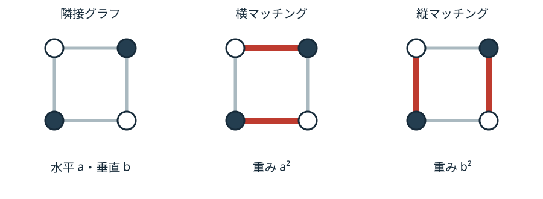
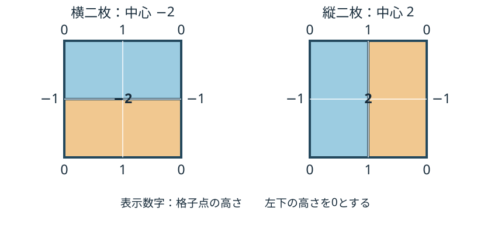

# 発展編　同じドミノを、行列と曲面から見る

北極円へ至る主経路では、北側の境界を粒子列に変えて流れを調べた。ここでは同じドミノ配置を別の二つの目で見る。一つは「接するセルを結ぶ線の選び方」、もう一つは「頂点に付けた高さ」である。前者は配置を**数える**のに、後者は多数の配置が示す**巨視的な形**を理解するのに役立つ。

この発展編の $2\times2$ の計算は自分で完結する。変分原理と行列式の一般定理は、後に述べる原典の結果を使う見通しであり、この小例から一般の場合を証明したものではない。

## ドミノを線で表す

領域の単位正方形を市松模様に黒白に塗り、各セルの中心を頂点とする。辺を共有する二つのセルの中心を線で結ぶと、どの線も黒から白へ向かう。このようなグラフを**二部グラフ**という。ドミノ一枚は隣り合う二セルを覆うから、その間の線一本に対応する。全セルを重複なく覆う配置は、全頂点にちょうど一本ずつ線が接する選び方、すなわち**完全マッチング**と一対一に対応する。

左下と右上を黒、残りを白とする $2\times2$ の正方形では、完成配置は横二枚と縦二枚の二通りだ。黒頂点を左下・右上、白頂点を右下・左上の順に並べ、水平な隣接に重み $a>0$、垂直な隣接に重み $b>0$ を置く。各配置の重みは二枚のドミノの重みの積とすると、全配置の重みの和、**分配関数**は

$$Z=a^2+b^2.$$

ここで普通の隣接行列 $\begin{pmatrix}a&b\\b&a\end{pmatrix}$ の行列式は $a^2-b^2$ であり、二通りが引き算されてしまう。そこで垂直な辺に虚数単位 $i$ を掛けて

$$K=\begin{pmatrix}a&ib\\ib&a\end{pmatrix},\qquad
\det K=a^2-(ib)^2=a^2+b^2=Z.$$

虚数は確率を表すのではない。行列式の置換によるマイナスと、垂直辺二本の $i^2=-1$ が相殺し、実際の配置の正の重みが足し合わされるための帳尻である。例えば $a=2,b=1$ なら $Z=5$、横配置の確率は $4/5$、縦配置は $1/5$ だ。第11章の横ドミノに重み $t$ を付けた例は $a=t,b=1$ に当たる。

この位相の選び方は、正方格子の有限平面グラフに使うカステレイン重みの例である。一般の有限平面二部グラフでも、面ごとに適切な符号・位相を選べば、重み付き完全マッチングの総和を対応する行列式の絶対値で表せる。任意の行列にそのまま成り立つわけではない。グラフの埋め込みと面の条件、平面境界を含む一般論は [Kenyon の講義ノート](https://arxiv.org/abs/0910.3129) §3.3–3.4、定理2を参照する。重みが非負という確率上の条件と、行列に付けた複素位相も区別しよう。

**確かめよう。** 上の行列で $a=3,b=2$ とすると、全重みと縦配置の確率はいくつか。普通の隣接行列の行列式と比べ、なぜ答えが違うか説明せよ。

::: {.callout-note collapse="true"}
## 考え方の例

$Z=3^2+2^2=13$、縦配置は $4/13$。普通の行列式は $9-4=5$ であり、二つのマッチングが符号違いで現れる。カステレイン重みでは垂直辺の位相により $-4$ が $+4$ へ変わる。
:::

## 配置から高さを再構成する

今度はセルではなく、セルの角となる格子点に整数の高さ $H$ を付けよう。基準点 $(0,0)$ の高さを0とする。格子辺に沿って歩くとき、**歩く向きの左に黒セルがある**なら、ドミノを横切らない辺では $+1$、ドミノの内部を横切る辺では $-3$。逆向きに歩けば符号も逆にする。境界上でも領域内の隣接セルの色で同じ向きを定める。図の高さはこの規約で計算した。

なぜ途中経路に依らず高さを決められるのだろう。一つのセルを一周すると、各辺は左にそのセルが来る向きにそろう。四辺のうち、そのセルを相方と結ぶ内部辺はちょうど一本なので、増分の合計は $3\times1-3=0$。白セルを同じ向きで回る場合は全ての符号が逆になるが、和はやはり0である。単連結な領域なら、二つの経路の差はセルの周回に分けられるから、和は同じになる。穴のある領域では穴を一周する周期にも条件が必要で、この説明を無条件に移してはいけない。

例として左下から右へ $(0,0)\to(1,0)$ と歩くと、左側は黒セルで境界辺なので高さは $0+1=1$。続いて上へ $(1,0)\to(1,1)$ と歩くと、左側は同じ黒セルである。縦二枚の配置ではこの辺を横切らないので $H(1,1)=1+1=2$。横二枚ではドミノを横切るため $H(1,1)=1-3=-2$ となる。配置を変えた局所操作は、高さの中央を4だけ変える。

逆に、この規約と高さが分かれば、隣接する頂点の高さの差が $\pm3$ の辺はドミノに横切られた辺だと分かる。したがって許される高さから、どの隣接セル同士が対になるかを復元できる。任意の整数を頂点に並べれば配置になるわけではなく、辺ごとの増分と各セルを一度ずつ覆う条件が必要である。

**確かめよう。** 図の高さを隠して、$H(0,0)=0$ から $(0,1)$、$(1,0)$、$(1,1)$ まで二つの経路で計算し、両経路の答えが一致するか。さらに $H(1,1)=-2$ であれば中央のどの辺がドミノを横切るか。

::: {.callout-note collapse="true"}
## 考え方の例

下辺では $H(1,0)=1$、左辺では $H(0,1)=-1$。横配置では $(1,0)\to(1,1)$ が黒を左にしてドミノを横切るので $-3$、$1-3=-2$。もう一方の経路の $(0,1)\to(1,1)$ は左側に白セルがあり、ドミノを横切らないため増分は $-1$、$-1-1=-2$ である。中央を通る縦の二辺が二枚の横ドミノをそれぞれ横切る。縦配置では中心は2となり、中央を通る水平な二辺が横切られる。
:::

## 一枚の配置から、典型的な曲面へ

一枚の配置の高さを、領域の大きさ $n$ と同じ尺度で位置・高さともに割って眺める。多数の小さな段差は小さく見え、滑らかな曲面に近い高さの候補 $h(x,y)$ を考えられる。高さの傾斜 $(\partial_x h,\partial_y h)$ は、局所的にどの方位のドミノがどれくらい現れるかを制約する。例えば一つの方位しか取れない所では局所的な自由度は小さく、複数方位が入り混じれる所では同じ巨視的傾斜を実現する微視的配置が数多くある。

なぜ数の多い曲面が典型になるのだろう。ある大きな領域を、一辺が全体よりずっと小さいが格子より十分大きい箱に分け、一箱の傾斜がほぼ一定のとき、その箱を埋める配置数が概ね $\exp\{\text{面積}\times s(p,q)\}$ と増えると考える。$s(p,q)$ は傾斜 $(p,q)$ の**エントロピー密度**で、傾斜ごとの局所自由度を対数にした量だ。箱が完全に独立なら全体の配置数は積、その対数は和となり、極限で

$$\log N[h]\approx n^2\int_D s(\partial_xh,\partial_yh)\,dx\,dy.$$

二つの候補曲面の積分値が $S_1>S_2$ なら、状態数の比は大きな $n$ で概ね $\exp\{n^2(S_1-S_2)\}$。一様に配置を選ぶと、積分値の高い曲面の近傍に圧倒的に多くの配置が集まる、と考えられる。隣り合う箱には境界の整合条件があるので、この積の議論は発見のための近似であって定理の証明ではない。

表面張力を $\sigma=-s$ と呼ぶ符号規約なら、典型曲面は

$$\int_D\sigma(\nabla h)\,dx\,dy$$

を、与えられた境界高さと許容傾斜のもとで最小にする。滑らかな内部解について、境界で消える小さな変形 $h+\varepsilon\varphi$ を代入して一階を0とし、部分積分すれば

$$\partial_x\bigl(\sigma_p(\nabla h)\bigr)+\partial_y\bigl(\sigma_q(\nabla h)\bigr)=0$$

を得る。これは内部の停留条件であり、それだけで解の存在・一意性や凍結境界の形を保証しない。傾斜が許容範囲の端に達する場所や非滑らかな境界をどう扱うかも必要だ。領域と境界高さの極限などの仮定の下でエントロピー汎関数による変分原理を定式化・証明したのが [Cohn–Kenyon–Propp](https://arxiv.org/abs/math/0008220) の定理1.1・1.3である。原典の概略的な定理1.1は、区分的に滑らかな単純閉曲線で囲まれた領域、許容される Lipschitz 境界高さ、および領域と正規化境界高さがそれぞれ近似する格子領域列を用いる。定量的な形は同論文の定理1.3・4.3を参照する。ここではこの節の高さの符号・規格化と原典の規約を照合しておらず、定理を本書の境界に適用済みとは主張しない。

## 一次元の流れと二次元の面

第8〜10章の $\rho(x,t)$ は、一列の粒子の局所密度を時間とともに追う量であり、形式的な保存則は $\partial_t\rho+\partial_xj(\rho)=0$ だった。一方、今の $h(x,y)$ は一つの**二次元配置**に付けた空間的な高さだ。前者の時間 $t$ を後者の座標 $y$ と単に同一視することはできない。粒子密度と一次元高さの微分を結べば保存則は一次元の Hamilton–Jacobi 形式にも書けるが、二次元ドミノ高さをシャッフルで時間発展させた極限では、別の二次元勾配と時間を持つ方程式が現れる。[Zhang](https://arxiv.org/abs/1808.07409) は特定のシャッフル高さ過程とその適切な極限で、粘性解としての Hamilton–Jacobi 方程式を示している。過程・初期条件・スケーリングを照合せず、二つを同じ定理とはしない。

| 方法 | 得意な問い | この本での役割と限界 |
|---|---|---|
| シャッフル・粒子 | 一様生成、境界の成長と巨視的形 | 主経路。一般次数や極限の各接続に条件が要る |
| 高さ・変分 | 傾斜ごとの状態数と典型的な大域形 | 本節は原理と有限例。円の直接導出は行っていない |
| 行列式・逆行列 | 有限の配置数、適切な条件下での局所統計 | $2\times2$ の計数を直接確認。揺らぎの一般定理ではない |

円への近さは、次数で割った大きな尺度での結論だ。局所相関や境界の細かな揺らぎの尺度は別の問いであり、円が現れることだけから決まらない。行列式・変分・粒子という三つの見方は、答える問いを分担しつつ、同じランダムな配置を異なる角度から照らしている。
