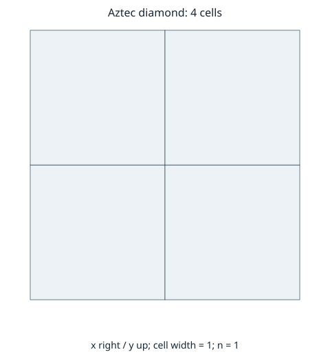
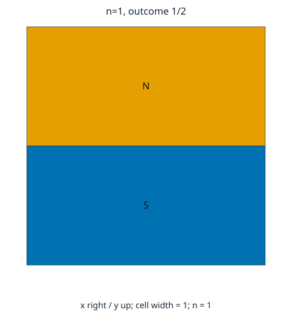
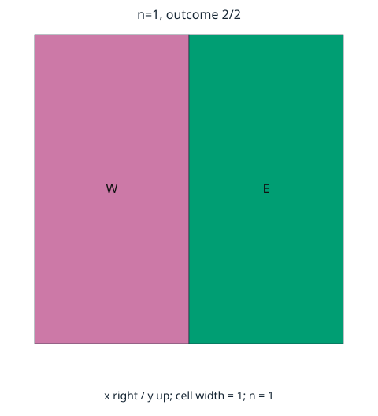
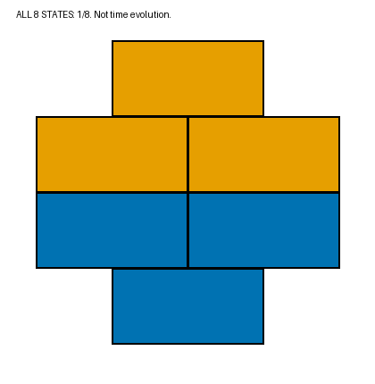
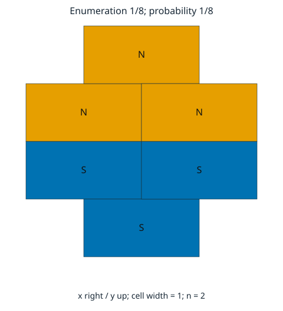

<!-- contract: authoring/contracts/00-production-fixture.json -->
<!-- synthetic-fixture: true -->

これは数式・図・アニメーション・相互参照・日本語・PDF出力を試す検証章です。本書の導入本文ではありません。北極円定理の証明をこの短い章に圧縮するものでもありません。

## 一つの配置を選ぶとは {#sec-choice}

ランダムに長方形を置くと言われたとき、どこを選ぶのでしょうか。置く順序でしょうか、それとも完成した模様でしょうか。この違いを四つのマスで確かめます。

各マスの中心を $(i+1/2,j+1/2)$ とし、$i,j$ は整数とします。次数 $n$ の領域は、中心が

$$
\left|i+\frac12\right|+\left|j+\frac12\right|\le n
$$ {#eq-cells}

を満たすマスを集めたものです。$n=1$ なら、中心の座標は $(\pm1/2,\pm1/2)$ の四つだけです。次の図の一辺が1のマスが、それぞれ一つのセルです。領域の一般的な定義と数え上げの出典は @eklp1992 です。

{#fig-domain width=80%}

STATUS: definition。ドミノは辺を共有する二つのセルです。敷き詰めは、どのセルも一度だけ使うドミノの組です。

左下のセルを覆うドミノを考えると、右のセルと組むか、上のセルと組むかしかありません。右と組めば残った上の2セルが一組になり、上と組めば残った右の2セルが一組になります。したがって完成配置は次の二つで尽くされます。

{#fig-outcome-one width=70%}

{#fig-outcome-two width=70%}

図の文字N/S/E/Wは次に大きい領域へ成長させるときの移動方位を表します。水平でも上下で位相が異なるため、方位は縦横の二種類とは異なります。この検証章では成長規則を証明していません。

## 同じ確率と独立は違う {#sec-uniform}

STATUS: theorem（この有限例は以下で完全に計算）。二つの完成配置を $T_1,T_2$ と書き、どちらも同じ確率で選ぶことを一様分布と呼びます。確率の和が1なので

$$
\begin{aligned}
\mathbb P(T=T_1)&=\frac12,\\
\mathbb P(T=T_2)&=\frac12.
\end{aligned}
$$ {#eq-uniform}

左下のセルの相手が右だと分かれば、上の2セルも横に並ぶと確定します。「下が横」の確率も「上が横」の確率も $1/2$ ですが、両方が横になる確率は $1/2$ です。独立なら積 $(1/2)(1/2)=1/4$ になるはずなので、独立ではありません。等しい確率で完成配置を選んでも、配置の部分どうしは互いを制約します。

@fig-domain の4セルと @eq-cells を対応させ、@fig-outcome-one と @fig-outcome-two が全てを尽くすことを指で追ってください。確率を割り当てる対象はセルの置き方一回ではなく、完成した配置です。

## 八つの配置を順に見る {#sec-animation}

次数2では配置数が8になります。ここに示すのは全8配置の順次表示です。独立抽出した標本列でも、ドミノが時間に沿って動く過程でもありません。一般の配置数は $2^{n(n+1)/2}$ で、一般 $n$ の証明はこの検証章では行いません [@eklp1992]。

::: {.content-visible when-format="html"}
{#fig-enumeration width=80%}
:::

::: {.content-visible unless-format="html"}
{width=80%}
:::

## 縮尺を揃えると円の半径はいくつか {#sec-radius}

次数を増やすと領域も大きくなります。大きさの異なる図を比較するため、長さを $n$ で割り $X=x/n,Y=y/n$ とします。極限の領域は $|X|+|Y|\le1$ です。これは有限の階段状領域そのものとは異なります。

第一象限の辺は $X+Y=1$。原点からその辺へ下ろした垂線は対称性から $X=Y$ を満たします。両式から接点は $(1/2,1/2)$。その距離は

$$
\begin{aligned}
r&=\sqrt{\left(\frac12\right)^2+\left(\frac12\right)^2}\\
&=\sqrt{\frac12}=\frac1{\sqrt2}.
\end{aligned}
$$ {#eq-radius}

これは「もし内接円が境界なら、その半径はいくつか」という幾何の計算です。ランダムな配置がその円を境に分かれることは、別途証明する必要があります [@jps2026]。

## 確認問題と解答

次数3の行の長さは下から $2,4,6,6,4,2$ です。セルとドミノは何個でしょうか。また一様な完成配置は何通りでしょうか。

行を足すと $2+4+6+6+4+2=24$ セル。一枚は2セルを使うので $24/2=12$ ドミノです。配置数公式に代入すると $2^{3(3+1)/2}=2^6=64$ 通り。一枚を選ぶ選択肢が64個という意味ではありません。

## この検証で証明していないこと

ここで完全に確かめたのは次数1の列挙・確率・非独立性と、極限菱形の内接円半径です。一般次数の数え上げ、シャッフルの一様性、粒子への変換、北極円定理の確率的収束は証明していません。生成アルゴリズムの有限テスト合格も、その代わりにはなりません。

次に本文で解くべき問いは、「個々の置き方の選択肢が異なっても、完成した配置を同じ確率で作れるか」です。@sec-uniform で定義した確率を保つ仕組みが必要です。
