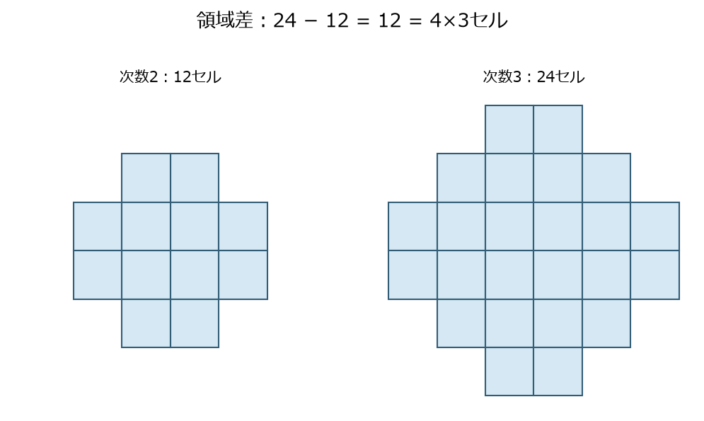
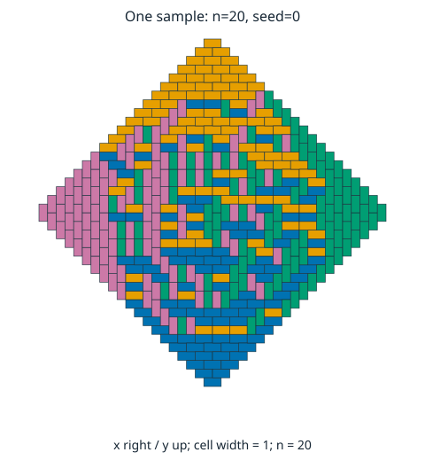
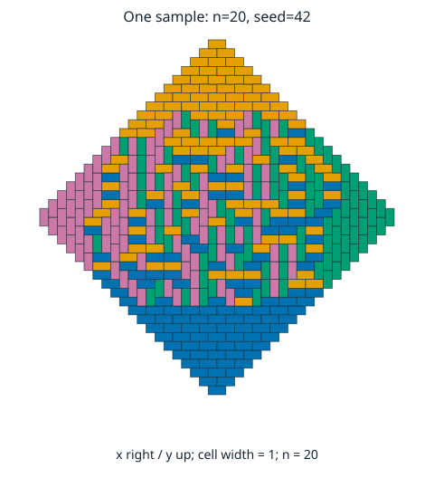
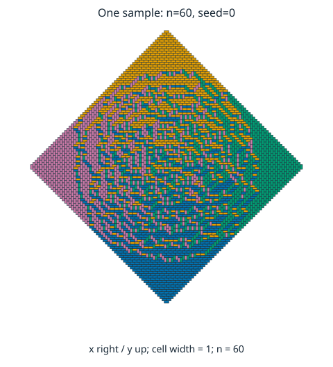
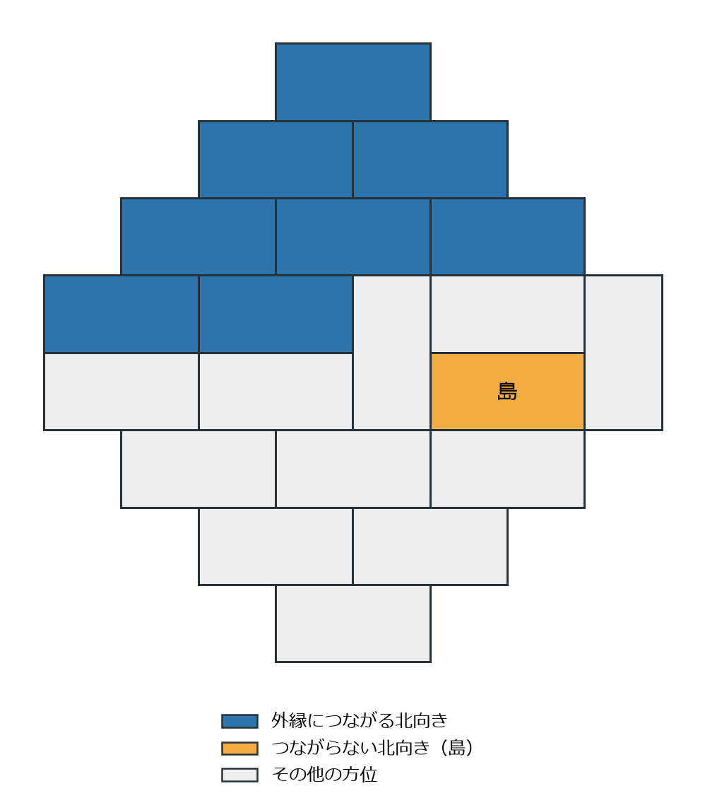

# 第1章　偶然の配置に、なぜ円が現れるのか

## 四角い小片でできた風景

正方形を二つつないだドミノを使い、下の階段状の領域を重なりも隙間もなく埋めよう。小さな領域なら、横に二枚を並べる方法と、縦に二枚を並べる方法がある。領域を大きくすると、完成した配置の数は急に増える。

図の左は次数2、右は次数3である。この階段状の領域をアステカ・ダイヤモンドと呼ぶ。

次の図は、生成手順で作った一つの配置である。これは一つの実験結果であって、円の定理を証明するものではない。色の違いは横・縦だけではなく、セルの位置によって決める四つの方位を表す。

同じ次数でも、コインの結果を変えると配置は変わる。次は乱数の種を42にした別の一例だ。二枚で小さな模様を比べ、変わるところと、隅に整列が見えるという大まかな特徴を分けて観察しよう。生成手順が一般次数で一様であることの独立確認は、第3章に残る数学上の課題である。

隅に、同じ向きが整然と続く部分が見える。中央に目を移すと、方位は細かく入り混じる。その境目を眺めると、四角い階段の中に丸い曲線が現れたように見える。なぜ、完成配置を一つ選んだだけで、このような図形が見えるのだろう。

次数を60にした例も見よう。局所的な模様は細かく変わる一方、四隅の整列と中央の入り混じり、その間の丸い輪郭が大きな尺度で残るように見える。図からまず「何が残り、何が変わるか」を予想しよう。この一例も生成手順の出力であり、全次数での一様性や極限定理の証明ではない。

次数が違う図を比べるときは、セル数をそのまま比べない。例えば同じ幅1セルの乱れも、次数2に対しては $1/2$、次数60に対しては $1/60$ の大きさだ。各座標を次数 $n$ で割って全体を同じ尺度にそろえ、その上で境目の位置やずれを比較する。二つの標本が細部まで同じになることを期待するのではなく、次数が大きいときに大きな形がどれほど安定するかを問う。

図形の大きさと位置を後で計算するため、ここで座標を定めておこう。次数 $n$ の領域は、中央に長さ $2n$ の行が二本あり、上下へ行くにつれて行の長さが2ずつ短くなる。領域の中心を原点とし、左下角が整数座標 $(i,j)$ の単位セルを使う。セル中心は $(i+1/2,j+1/2)$ であり、領域は $|i+1/2|+|j+1/2|\le n$ を満たすセルの集まりとしても定められる。$n=0$ では空領域になる。

この条件で判定するのは**セルの中心**であり、セル全体が $|x|+|y|\le n$ の菱形に入るという意味ではない。例えば次数1のセル $[0,1]\times[0,1]$ は、中心 $(1/2,1/2)$ では和が1なので採用されるが、角 $(1,1)$ では和が2になる。領域の外縁が直線ではなく階段になるのは、採用した正方形を丸ごと合わせているからだ。

この章で持ち帰る問いは一つだ。**公平に選んだ配置では、なぜ外側の整列部分と中央との境目が、大きな尺度で円に近づくのだろうか。** 以下ではまず、何を境目と呼び、何を「公平」と呼ぶかを決める。

## 何を「境界」と呼ぶか

同じ方位のドミノが集まっていても、その集まりが必ず外側の整列部分につながるとは限らない。中央に偶然できた小さな島を、領域の端から続く凍った部分と呼んでしまうと、探している境界が変わる。そこで、北向きなら北側、他の方位なら対応する側の外縁に接する同方位ドミノへ、辺を共有する同方位ドミノをたどって到達できる成分を、その方位の**凍結領域**として区別する。残りは、四方の凍結領域を取り除いて定める。境界セルの扱いは第10章で座標を固定する。

図では、青を辺づたいにたどると外縁へ届く。橙色の「島」も北向きだが、青にはつながらない。灰色は残りの三つの方位をまとめたものであり、四方すべての凍結領域を示した色分けではない。この例は、向きが同じというだけでは凍結成分に入らないことを確かめるための有限配置である。

「北向き」は縦横だけでは決まらない。水平ドミノの左セルの左下座標を $(i,j)$ とすると、次数 $n$ で $i+j+n$ が偶数なら北向きとする。橙色の左セルは $(1,-1)$、次数は4なので $1-1+4=4$ は偶数、確かに北向きである。四方位の規則と動く向きの関係は第4章で説明する。

四方の外縁からそれぞれ同じ方位をたどって取り除き、残った領域を $T_n$、その縁を $\partial T_n$ と呼ぶ。細かな集合の表現は次に置く。初読では図を手掛かりに、内部の島が残ることを押さえれば先へ進める。

::: {.callout-note collapse="true"}
## 数学的詳細：残る領域とその境界

この草稿で境界の対象を明確にするため、四方の凍結ドミノの閉じた長方形を合わせた集合を $F_n$、領域を $D_n$ とし、

$$T_n=\overline{D_n\setminus F_n}$$

を中央に残る領域として扱う。上線は閉包、つまり点の極限も含めるという意味である。比較するのは平面内の位相境界 $\partial T_n$ と円周であり、$D_n$ の外縁を最初から除外しているわけではない。ある配置で $T_n$ が空なら、境界距離による成功事象には数えず失敗とする。適切な内外包含が高い確率で成立すれば、十分大きい次数では外縁や空集合の問題も同時に抑えられる、というのが後の証明の構想だ。本文のこの集合が補助章Cの凍結成分・包含と厳密に一致することは、まだ独立完査を要する。

上の図に戻ろう。青い部分は $F_n$ の北側成分に入り、橙色の内部は四方の凍結領域を除いた後も残る。灰色のうち残るものを判定するには、それぞれの方位でも外縁からたどる操作が必要だ。そうして残った部分全体が $T_n$、その縁が $\partial T_n$ である。色自体は定義ではない。

:::

## 一枚の絵と、確率の定理

完成配置の選び方も決めなければならない。例えば、いつも横向きを優先する規則で一つを選べば、たくさんの配置の中から等しい機会で選んだことにはならない。この本では、固定した次数について、可能な**完成配置全体を等しい確率で選ぶ**。この意味での公平さを「一様」と呼ぶ。

北極円定理は、おおよそ次を主張する。次数 $n$ を大きくしたとき、上で定めた $\partial T_n$ と、中心が原点で半径が $n/\sqrt2$ の円は、双方の各点が互いに近くなる。正確には任意の $\varepsilon>0$ に対し、許されるずれを $\varepsilon n$ とした失敗確率が $n\to\infty$ で0へ向かう。この境界の定義と定理を結ぶ幾何は本書の補助章で独立確認中である。定理は「どの有限配置も円だ」とは言わない。

**この草稿の読み方。** 北極円定理は既知の数学的結果である。本書では有限例や計算を本文で導き、一般論につなぐ。さらに、定理と本書の境界の定義を結ぶ幾何や無限列の極限などには、独立検証中の橋がある。必要な仮定は使う場所にも記す。定理が知られていることと、この草稿の証明が全て認定済みであることは別だ。

## 何度も試せば、どこまで分かるか

実験を増やすと、固定した次数での失敗確率は推定できる。それでも、全ての大きな次数について失敗確率が0に向かうという極限は、有限回の実験だけでは証明できない。次の計算は、この違いを具体的な数字で確かめるためのものだ。

::: {.callout-note collapse="true"}
## 数学的詳細：失敗率の揺らぎ

次数 $n$ と許容幅 $\varepsilon n$ を固定し、配置の境界が円からその幅より大きく外れる事象を「失敗」と呼ぼう。もし一様な配置を独立に $M$ 回選べるなら、$r$ 回目が失敗したかを $I_r\in\{0,1\}$、真の失敗確率を $p_n$ として、実験での失敗率は

$$\widehat p_n=\frac{I_1+\cdots+I_M}{M}$$

となる。独立性を使うと $\mathbb E\widehat p_n=p_n$、$\operatorname{Var}(\widehat p_n)=p_n(1-p_n)/M\le1/(4M)$。つまり試行回数を増やせば、固定した $n$ に対する失敗確率を、誤差が揺れる量として推定できる。例えば分散は $M$ を4倍にすると4分の1になる。

一度も失敗を見なかった場合にも、真の失敗確率が0とは限らない。例えば本当の失敗確率が1％で、試行が独立なら、100回とも失敗しない確率は $(99/100)^{100}\approx0.366$。失敗しない画像100枚を見ても、この仮定の下では約3分の1の確率で起こりうる。もちろんこれは「本当に失敗確率が1％である」という意味ではなく、観察結果の読み方を考えるための仮定の計算である。

ただし、ここには二つの条件が隠れている。まず配置を本当に一様に、互いに独立に生成できなければ、この計算の対象が違う。次に、この評価は一つの固定された $n$ についてであり、全ての大きな $n$ で $p_n\to0$ となることは有限回の実験からは分からない。生成の一様性を次の章で調べ、$n$ を増やした一般の数学をその後で組み立てる理由がここにある。

:::

## 円までの道を、先に眺める

この本では、最初から円の方程式を配置に当てはめるのではなく、次の問いを順にたどる。

1. **何を公平に選ぶか。** 完成配置を一様に作れることを調べる。公平なコインを使うだけでは足りず、同じ出力に届く道の数も数える。
2. **何を記録するか。** 外縁につながる北向きのドミノから境界の階段を取り出す。階段の角に箱が増える動きを、粒子の $10\to01$ に読み替える。
3. **流れをどう調べるか。** 粒子の密度だけでは動ける $10$ の頻度は決まらない。変わらない確率法則と、動く段差の局所的な振る舞いを結び付ける。
4. **数から形へどう戻るか。** 粒子の累積数を上下から評価すると、候補の式に平方根が現れる。その式を元の平面の座標へ戻すと、上側の円弧が出る。
5. **円弧から円全体へ。** 四方向と境界全体を扱い、点ごとの近さを全体の近さにつなげる。

小さな配置や粒子列は、この道筋の各変換を手で確かめるために使う。それだけで一般の場合が証明されたことにはならない。特に、階段とドミノの対応や定常法則を段差へ適用する橋には、後の章と数学編で扱う条件がある。

## 二通りの読み方

まず全体像をつかみたいなら、本文中の図、有限例、式が何を測るか、各節の結論を追い、折りたたまれた「数学的詳細」はいったん後回しにしてよい。長い導出に出会ったときも、何を入力し何を得るのかを押さえて次へ進み、第10章で円に戻ってから読み直せる。

論証まで追いたいなら、本文の計算を再現し、折りたたみの詳細と対応する数学編も読む。必要になる確率・行列・極限の道具は有限例から説明するが、第7〜10章の無限列の結合や極限は、大学で学ぶ確率論に踏み込む。各節の条件と証明の状態を確認し、未検証の橋を自分で追試するときの手掛かりとして使おう。

## 最初の疑問

一枚の図から確率が高いことは分からず、確率を語るには配置の選び方が必要だった。だが配置の数は膨大で、全てを描いて番号を付ける方法はすぐに行き詰まる。そもそも「公平な小さな選択」を繰り返せば、完成配置も公平になるのだろうか。次章で、まず公平という言葉の落とし穴を調べる。

**考えてみよう。** 円に近い配置の画像を100枚見たとして、どんな選び方で画像を得たかが不明なら、定理のどの部分が確かめられないだろう。

::: {.callout-note collapse="true"}
## 考え方の例

画像の選び方が一様か不明なら、「一様に選んだとき円に近い確率」を推定できない。円に見える画像だけを選んだ100枚なら、残りの配置がどう見えるかも分からない。さらに有限枚を見ただけでは、次数を無限に大きくしたときの失敗確率の極限までは分からない。

:::
