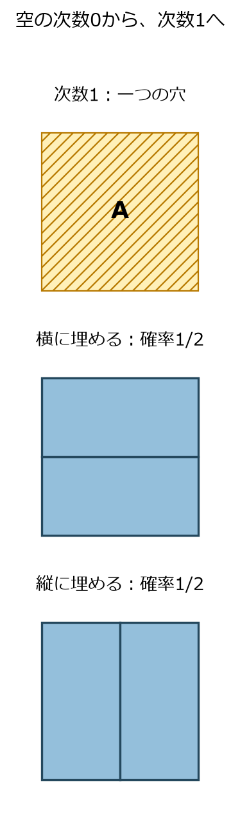

# 第2章　公平に選ぶとはどういうことか

## 選ぶ対象を先に決める

次数1の領域は $2\times2$ の正方形であり、ドミノの完成配置は横二枚と縦二枚の二通りである。公平なコインを一枚投げ、表なら横、裏なら縦を選べば、二つの**完成配置**はそれぞれ確率 $1/2$ で現れる。

ここで公平なのは完成配置である。一枚一枚のドミノの向きに独立に確率を割り当てたのではない。ドミノ同士は重なれず、向きの選択は互いを制約する。完成配置が全部で $A_n$ 種類なら、一様分布は各完成配置に $1/A_n$ を割り当てる法則だ。第1章の $T_n$ は中央に残る領域を表し、配置の総数ではない。

実際に依存を計算しよう。上の二つのセルを一枚の横ドミノが覆う事象を $A$、下の二つのセルを一枚の横ドミノが覆う事象を $B$ とする。横二枚の完成配置では $A$ と $B$ がともに起こり、縦二枚ではどちらも起こらない。したがって

$$P(A)=P(B)=\frac12,\qquad P(A\cap B)=\frac12.$$

もし $A$ と $B$ が独立なら、同時に起こる確率は $P(A)P(B)=1/4$ のはずだ。実際は上が横なら下も横でなければ残りを覆えないので、$P(B\mid A)=1$ である。完成配置を一様に選ぶことと、局所の出来事が互いに独立であることは別々の性質だ。

小さな領域では、実際に重なりのない敷き詰めを順番に列挙して、完成配置の個数を数えられる。空領域は「何も置かない配置」が一つあると数える。

| 次数 $n$ | セル数 | 完成配置の数 | 一様な場合の各配置の確率 |
|---:|---:|---:|---:|
| 0 | 0 | 1 | 1 |
| 1 | 4 | 2 | $1/2$ |
| 2 | 12 | 8 | $1/8$ |
| 3 | 24 | 64 | $1/64$ |
| 4 | 40 | 1024 | $1/1024$ |

表は有限領域の被覆を直接数えた結果として確かめられる。セル数が増えると、配置数はもっと速く増える。例えば次数4では40セルを20枚で覆うが、個々のドミノ20枚をそれぞれ独立に選ぶ問題ではない。一枚を決めると、そのセルを他のドミノは使えなくなるからだ。表の数は一般の公式の予想にもなるが、5以上を含む全次数の証明ではない。

列挙を計算機に任せるときも、何を数えるかははっきりさせたい。各セルを一つの点に置き換え、辺を共有するセルの点どうしを線で結ぶ。ドミノ一枚を置くことは、その二つのセルを結ぶ線を一本選ぶことに対応する。完成配置では各セルがちょうど一枚に覆われるので、どの点にも選んだ線がちょうど一本つながる。このような線の選び方を**完全マッチング**という。

逆に、各点に一本ずつ線がつながるように選べば、その各線の両端のセルをドミノで覆える。一本の線は隣り合う二セルを結び、各点は一度だけ使われるから、重なりも空きもない。こうして完成配置と完全マッチングは一対一に対応する。次数1なら四つの点が正方形につながり、向かい合う横の二辺を選ぶか縦の二辺を選ぶかの二通りで、先ほどの横二枚・縦二枚に戻る。したがって線の選び方を重複なく列挙すれば、配置を失ったり余分に加えたりせずに数えられる。

## 公平なコインでも偏る

公平なコインを投げ、表ならA、裏ならもう一度投げて表ならB、裏ならCとする。各コインは公平なのに、

$$P(A)=\tfrac12,\qquad P(B)=P(C)=\tfrac14.$$

なぜか。Aへは一回、BとCへは二回の選択を通るからである。和 $1/2+1/4+1/4=1$ は確かに1になるが、同じ値ではない。各段階の公平さだけで終点の公平さは決まらない。

ドミノでも、最初の一枚の選び方に同じ問題が起こる。次数2の領域で、上端の左のセル $(-1,1)$ を覆う相手は、右隣の $(0,1)$ または下隣の $(-1,0)$ の二つである。八つの完成配置を直接数えると、右隣を相手にする完成配置は6通り、下隣を相手にするものは2通りある。

もし最初の相手を公平なコインで選び、その後は選んだ相手に適合する完成配置の中から一様に選んだとしよう。右隣の枝に属する各配置の確率は $(1/2)(1/6)=1/12$、下隣の枝に属する各配置の確率は $(1/2)(1/2)=1/4$ となり、八配置で等しくない。八つを各 $1/8$ にしたいなら、最初の相手を右にする確率を $6/8$、下にする確率を $2/8$ にしなければならない。最初の選択肢の数だけでなく、**その先に完成配置がいくつあるか**が効いている。

もう一つ注意がある。同じ終点に異なる経路から到達できるなら、その終点の確率はそれぞれの経路の確率を足して求める。たとえば二本の排反な経路の重みが $1/8$ と $1/4$ なら、終点の確率は $3/8$ である。経路の本数だけでも足りず、経路ごとの重みが必要になる。

## 大きさごとに公平さを保ちたい

一様な次数1の配置を入力し、いくつかの公平なコインを投げて次数2の配置を作るとしよう。次数1の二配置から各四通りの出力があり、八本の経路が全て異なる完成配置へ到着すれば、各経路の確率は

$$\frac12\cdot\frac12\cdot\frac12=\frac18.$$

この場合、八つの出力は一様になる。だが同じ出力へ二本の経路が合流するなら、その出力の確率は $1/4$ になってしまう。一般の次数では穴の数が入力によって変わるので、もっと慎重に全経路の重みを数えなければならない。

有限個の配置でこれを確かめるのは実行できる。しかし、次数を一つ増やすたびに全配置を描いていては、円を見るほど大きな領域では使いにくい。必要なのは、入力を少し大きくする操作と、その操作で偏りが生じないことの証明である。

## 次に持ち越す問い

公平なコインは便利だが、それだけでは結論は出ない。次章では「消す・動かす・空きを埋める」という操作を実際に追い、ある出力に到達する元の入力、すなわち前像を数える。

**確かめよう。** 次数2の上端のセルを覆う相手について、右隣の枝に完成配置が6通り、下隣の枝に2通りある。各枝の内部では完成配置を一様に選ぶとして、八つの配置全体を一様にしたいなら、最初に右隣と下隣をそれぞれどの確率で選べばよいか。別の仕組みで一つの出力に複数の道が合流する場合、その出力の確率は何を足して求めるか。

::: {.callout-note collapse="true"}
## 考え方の例

八配置を各 $1/8$ にするには、右の枝の合計確率は $6/8=3/4$、下の枝は $2/8=1/4$。各枝の中で一様にすれば、どちらの枝でも各配置は $1/8$ になる。複数の道が同じ出力に達する別の仕組みでは、道の本数だけでなく、それぞれの道を通る確率を足す必要がある。

:::
