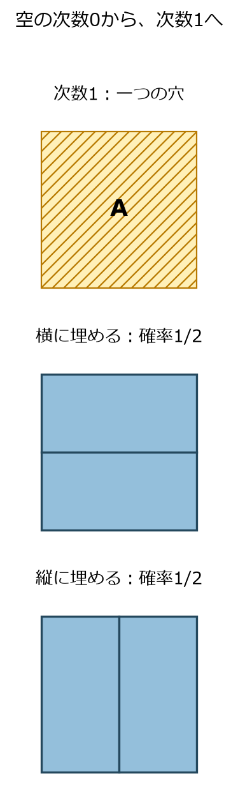
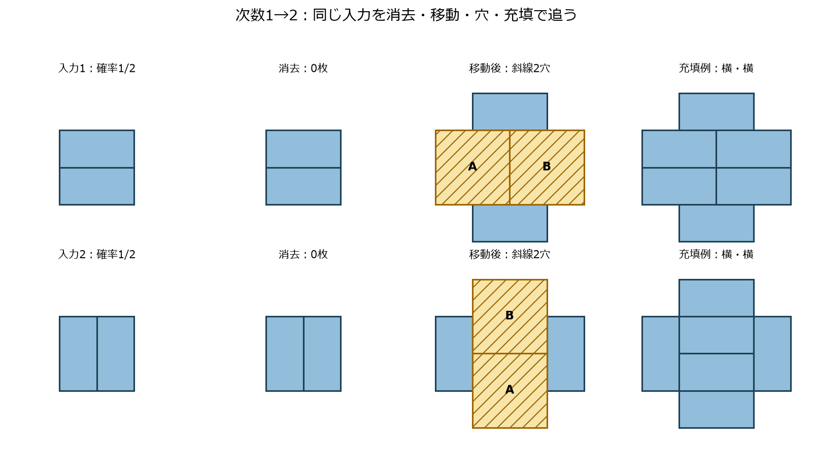
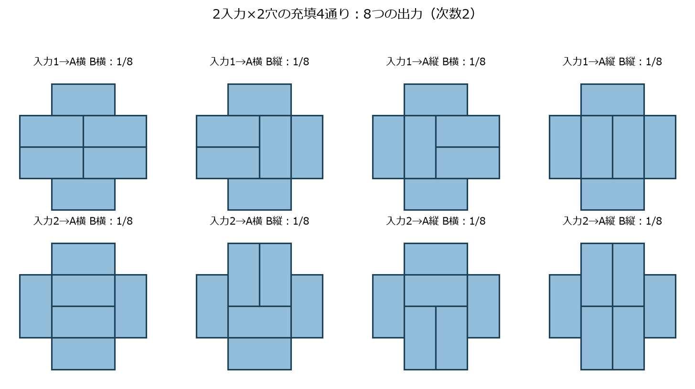
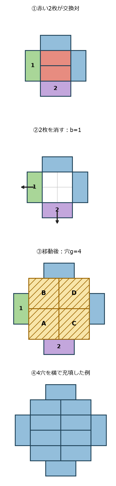
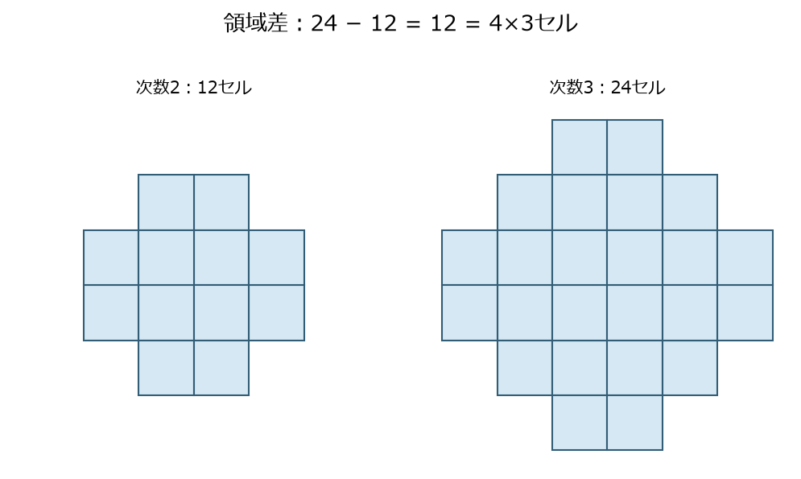
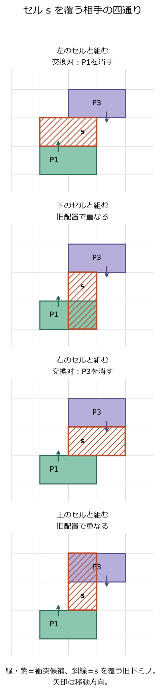
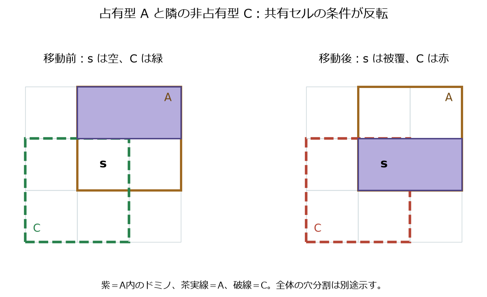
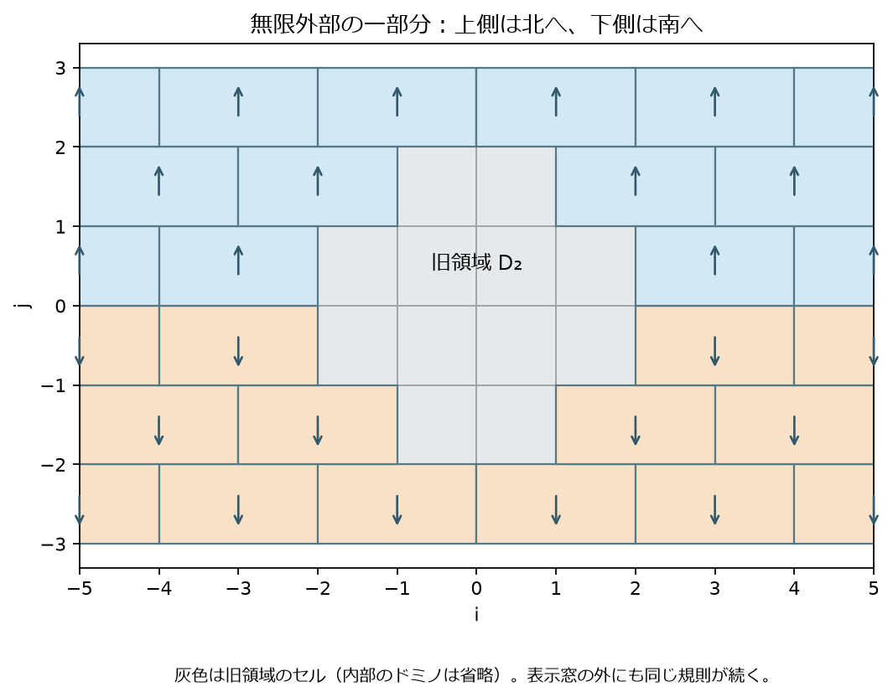
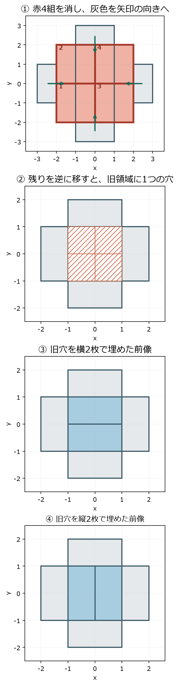

# 第3章　偏らず大きな配置を作る

*この章の一般次数の幾何と一様性には、独立検証中の部分がある。*

一様生成の一般の場合は、[Jockusch–Propp–Shor の第2節](https://arxiv.org/html/math/9801068v3)にも示されている。そこでの次数の付け方は本章と一つずれ、旧次数 $n-1$ から新次数 $n$ へ進む。穴の分割と移動後の非重複の幾何について、原典はさらに [Elkies–Kuperberg–Larsen–Propp](https://arxiv.org/abs/math/9201305) のシャッフル補題を使う。本章の有限例は、その一般結果を自分の手で見るためのものである。

決められた領域を、二つの正方形をつないだドミノで隙間なく埋める。小さい領域なら、完成した配置を一枚ずつ描いて、どれをどれくらいの確率で選ぶか決められる。だが領域が大きくなると、完成配置をすべて描き出すだけでも大変になる。そこで、小さい配置を少しずつ大きくする方法を考えたい。

前章では、公平なコインを使っても完成結果が公平とは限らないことを見た。ここではその教訓を、実際のドミノの配置に適用する。

ドミノの生成でも、似た問題が起きる。小さい完成配置から出発し、向かい合って位置を交換するドミノの対を消す。残りを決まった方向へ動かすと、空きができる。移動方向を決めるには、各セルを左下角が整数座標 $(i,j)$ の正方形とし、ドミノの左のセル（縦なら下のセル）を用いる。旧次数を $n$ として、$i+j+n$ が偶数なら横ドミノは北、縦ドミノは東へ、奇数なら横は南、縦は西へ一セル動く。各ドミノが互いの位置に移ろうとする二枚は、動かす前に両方とも消す。残りだけを同時に動かす。例えば次数2の図の赤い横二枚は、それぞれ南・北へ動けば互いの場所に重なるため交換対である。空きが互いに重ならない2×2の穴に分かれれば、それぞれを横二枚か縦二枚で埋められる。各穴の向きを公平な独立コインで決めよう。

交換対を消すとき、一枚のドミノを二つの対で二重に消してしまう心配はない。旧次数を固定して一枚を方位の方向へ動かすと、左セルまたは下セルの座標和の偶奇が反転する。そこで同じ規則をもう一度使えば反対方向へ戻る。つまり、一枚の交換相手は移動先の一枚に限られ、あれば一意である。元の完成配置では別々のドミノがセルを共有しないので、異なる交換対も互いに重ならない。ただし、残ったドミノの移動先が重ならないことは別の問題として、後で調べる。

なぜ、動かすと交換するだけの二枚をわざわざ消すのだろう。その二枚だけなら、交換後にも互いに重ならない。消去は「この二枚が互いに衝突するから」という意味ではなく、情報の一部をいったん消し、後の穴の充填で新しい配置を作る、この生成手順の一部である。実際、この消去によってできる余分な空きと、後で数える前像の数が、一様な確率の計算で組になる。消さずに動かす別の手順を考えることもできるが、その出力が一様かどうかは別に調べなければならない。

ここで「公平なコインを使ったから、どの完成配置も公平だ」と言ってよいだろうか。分岐木の経験から、すぐには言えない。ある完成配置には、異なる小さい配置から到達するかもしれない。別の完成配置には、もっと少ない道しかないかもしれない。同じ完成配置に届く道の確率は、足し合わせる必要がある。 ここでは、一つの出力に到達できる元の小さい完成配置を、その出力の**前像**と呼ぶ。旧配置と、そこからの各穴の充填選択を合わせると一本の「経路」になる。消去される対は旧配置から決まり、別にコインで選ぶものではない。一つの旧配置からの穴の分割が決まっていて各穴の充填が異なるセルの形を変えるなら、異なる充填選択は異なる出力を与える。ただし、異なる旧配置から同じ出力へ届く可能性は、この段階では排除できない。出力の確率は到達する全経路の確率を足して求める。

空の領域から最初の領域への一回は見通しがよい。空きは領域全体の一つの2×2穴で、横二枚と縦二枚の二通りを各1/2で選ぶ。次の段階で旧配置ごとに二つの穴ができ、異なる充填結果が八つの完成配置を一度ずつ与えることを有限列挙で確認できれば、二つの旧配置の確率1/2と二枚のコインの確率1/4を掛け、各出力1/8を得る。ただし、ここで述べた穴の形と重複のなさは、この小さい場合に図を用いて確かめる必要がある。

下の図は、次数1の二つの入力を、それぞれ同じ順番で追ったものである。この小さい例では消す対は0枚だが、何を消すかを調べてから動かしている。斜線は移動後に残った二つの2×2穴を表す。図の最後では両方の穴を横に埋めた。

それぞれの穴は横・縦の二通りで、二つの穴を独立に埋めるので、入力ごとに四つの出力がある。次の図で同じ形が重なっていないことも確認しよう。入力の確率1/2と各穴の向きの確率1/2を掛けると、図の各経路は1/8である。

この図の一つの出力を指で選び、どの入力と穴の横・縦の選択から来たか逆にたどろう。この図では、各出力への経路が一本ずつ見つかる。前像は入力の配置、経路はその入力と充填選択の組である。

この図で分かるのは次数1から2への一回であり、一般次数の穴分割や前像を漏れなく数える方法ではない。実際、次数を上げると、一つの出力に複数の前像ができることがある。後でその例を確かめよう。

次数2には、消去が実際に起きる配置もある。次の最初の図の赤い二枚は、動かすと互いの位置を交換する対だ。この二枚を先に消してから残りを移動すると、四つの2×2穴A〜Dができる。図の番号1・2は消えずに残る二枚で、矢印はその移動先を示す。移動後の同じ番号を探そう。図の最後は、四つとも横に埋めた一例である。

途中の穴が空いた状態は、領域を覆い切った完成タイリングではなく、ドミノが互いに重ならない**部分配置**である。最後に全ての穴を埋めて初めて、新しい領域の完成配置へ戻る。以下で完成配置の一様性を問うのは、この充填まで終えた結果についてである。

この例は消去した対が1個なのでb=1、移動後の穴がg=4個。この一例ではg−b=3であり、別の次数2配置で消去がなければ穴はいくつになるか、後で面積から考える。一例の一致だけで一般次数の式は証明できない。

さらに大きい次数では、穴の数が毎回同じとは限らない。それでも面積を数えると関係が見える。旧次数をn、消した2×2の対をb個、移動後の2×2穴をg個とする。次数2の領域には12セル、次数3には24セルがあり、増えるのは12=4×3セルである。下の二つの図で一段ずつ数えよう。次数nの領域は、中央に長さ2nの行が2本あり、上下へ向かって行の長さが2ずつ減る階段状の領域とする。したがってセル数は2×(2+4+⋯+2n)=2n(n+1)、次の領域は2(n+1)(n+2)で、その差は4(n+1)である。

消去によってさらに4bセルが空く。移動後にドミノが重ならず、空きがすべて2×2穴に分かれると仮定すれば、

　4g = 4(n+1)+4b、つまり g−b=n+1。

たとえばn=2でb=0なら、g=3である。旧配置を8通りから公平に選び、その一つから特定の三つの穴の埋め方を選ぶ経路の確率は(1/8)(1/2)^3=1/64。だが別の入力から同じ出力に来る道がないことを示すまでは、これを出力全体の確率と同一視できない。

ここから先の確率計算には、移動後のドミノが重ならないことと、空きが $2\times2$ の穴に分かれることが必要だ。どちらも面積だけでは分からない。下の数学的詳細では、衝突候補の有限例、穴の候補の色分け、領域外の補助配置を調べる。一般次数は補助章I・Q・Rに依存する。主筋を追う場合は、これらを条件として次の「前像」の計算へ進み、後で戻ることができる。

::: {.callout-note collapse="true"}
## 数学的詳細：重なりと穴の分割

## 移動後の重なりは、どう調べるのか

面積を数えるとき、移動後のドミノが重ならないと仮定した。この仮定が本当に必要なことを、領域の内部の小さな例で見よう。偶数次数 $n\ge4$ とし、セル $s=(0,0)$ が移動後に二枚のドミノに覆われる可能性を調べる。移動前の候補として、次の横ドミノを考える。

- $P_1$ はセル $(-1,-1),(0,-1)$ を覆い、北へ動く。
- $P_3$ はセル $(0,1),(1,1)$ を覆い、南へ動く。

確かに両方動けば、どちらもセル $s$ を覆う。しかし、移動前の完成配置では $s$ 自身も必ず誰かに覆われている。その相手のセルは、左・下・右・上の四通りだ。

左なら、$s$ を覆う横ドミノは $P_1$ と位置を交換する対になり、$P_1$ は移動前に消される。下なら $P_1$ とセルを共有してしまい、旧配置が完全な被覆であることに反する。右なら今度は $P_3$ と位置を交換する対となり、$P_3$ が消される。上なら $P_3$ とセルを共有する。どの場合も、消去後に $P_1$ と $P_3$ が両方残って衝突することはない。

これは衝突候補の一組を調べた結果だ。一般のセルについては、方位の偶奇ごとに候補を列挙し、候補の組をすべて調べなければならない。さらに、新しく広がった外側一層には旧配置のセルがないので、今の「旧配置が $s$ を覆う」という議論をそのまま使えない。補助章Iはこの有限の場合分けと外側一層を分けて扱うが、独立完査には残りがある。重ならないことだけでも、空きが $2\times2$ の穴に分かれることや、逆操作の一意性は出ない。

## 空きを穴に分けるための、もう一つの見方

重なりがなくても、残った空きがきれいな $2\times2$ の穴になるとは限らない。そこで個々の空きセルだけでなく、穴になりうる**候補ブロック**全体を調べる。旧次数 $n$ に対し、左下セルの座標が $i+j+n$ 偶数である $2\times2$ ブロックを候補とする。任意のセルを含む $2\times2$ の置き方は四つあるが、左下の偶奇が条件に合うのはそのうち二つだけだ。

候補を点で表し、一セルを共有する二候補を線で結ぶと、隣接する点の左下座標は横・縦とも1ずつ違う。したがって左下の横座標の偶奇を使えば、隣り合う点を必ず別の色に塗れる。このグラフを使うと、空きセルをどちらの候補ブロックに割り当てるか、全体として矛盾しないかを考えられる。

消去後に残るドミノを考え、候補ブロックにドミノが丸ごと入っていれば**占有型**、一枚も丸ごと入っていなければ**非占有型**と呼ぶ。交換対は既に消したので、占有型に二枚が丸ごと入ることはない。移動では、各候補ブロックの内部に丸ごと入るドミノは、その同じブロックの反対側へ移る。したがって、占有型か非占有型かは移動の前後で変わらない。

さらに、もとの空きセルが候補ブロックに分割され、移動後にもドミノが重ならないと仮定しよう。分割に使った非占有型を緑、それ以外を赤として、隣接候補の共有セルごとに「どちらがそのセルを担当するか」を調べる。占有型の中のドミノは移動後に反対側を覆うので、隣の非占有型へ課される色の条件も反転する。そこで非占有型の全ての色を同時に入れ替えると、隣同士は異色のままで、移動後の条件に対応する。これが移動前の穴分割を移動後の穴分割へ運ぶグラフ法の考え方だ。

色の条件を一か所で確かめよう。占有型ブロック $A$ と、セル $s$ を一つ共有する非占有型ブロック $C$ があるとする。$A$ 内のドミノが $s$ を覆っていれば、$C$ は全体が空の穴にはなれないので赤である。逆にそのドミノが $s$ を覆わないなら、$s$ は空いている。実際、別のドミノが $s$ を覆うと、そのドミノは $s$ を含む二候補 $A,C$ のどちらかに丸ごと入る。$C$ は非占有型なので前者しかないが、$A$ に二枚入れば交換対となり、既に消されたはずだからだ。従って $s$ を埋める穴は $C$ で、$C$ を緑にしなければならない。

この局所条件が移動後に反転する理由も見える。$A$ 内の一枚は、移動すると同じ $2\times2$ 内の残る二セルを覆う。だから上の共有セル $s$ は、覆われていた場合には空き、空いていた場合には覆われる。必要な色は赤から緑、または緑から赤へ入れ替わる。隣接する非占有型どうしの色の違いは、全てを一斉に反転しても保たれる。空きセルが二候補とも非占有型に含まれるときは、その二色が違うのでちょうど一つの緑候補が担当する。

今、移動前の部分配置を $T$、次数 $n$ の方位で一度移したものを $S_n(T)$ と書こう。両候補が占有型である空きセルが残る場合はどうか。各候補の一枚は $s$ と反対側を覆うので、それぞれを方位へ動かすと両方が $s$ を覆い、移動後の非重複に反する。ここでは対象が移動前の $T$ なので、その移動先 $S_n(T)$ の非重複を使った。反転後の色について同じ議論を移動後の $S_n(T)$ に適用するときは、さらに一度 $S_n$ を作用させると元の $T$ に戻ることと、元の $T$ の非重複を使う。また移動後に交換対があれば、再び移した元の $T$ にも交換対があったことになり、消去後である仮定に反する。移動前後のどちらを対象にしているかによって、非重複を確かめる時点が変わる。残りの「既に覆われたセルを緑の穴に入れない」ことも、二候補のうちドミノが丸ごと入る候補に着目して確かめる。こうして局所条件から穴の重複と抜けを排除できる。ただし有限領域の外側まで含めた最初の分割は、この局所計算とは別に作らなければならない。

この説明では二つの入力を隠していない。第一に、移動前の空き全体が候補ブロックに分かれていなければ、最初の色を決められない。第二に、移動後にドミノが重ならないことが必要だ。有限領域では外側に無限の空きがあるため、領域外に補助ドミノを置き、空きも分割できるよう延長してから、移動後の穴が有限領域の境界をまたがないと示す必要がある。具体的な色の条件とその証明は補助章Q、外側の二行を含む延長は補助章Rにある。これらは条件を追える証明草稿だが、無限外側と有限境界を含めた人間の専門家による独立認定はまだ受けていない。

### 外側を補うとは、どういうことか

無限格子で考えるのは、有限領域の外を放置するという意味ではない。例えば次数 $n$ の領域の外側を、次のような水平ドミノで埋める。左セルを $(i,j)$ とし、$j\ge0$ なら $i+j+n$ が偶数、$j<0$ なら奇数のものを候補にする。二セルとも旧領域の外にある候補だけを置く。上側の外部ドミノは北へ、下側は南へ動く。

次数2の行 $j=0$ では、旧領域のセルの横座標は $-2,-1,0,1$。外側の右では左セルが $i=2$ のドミノ $(2,0),(3,0)$ から、左では $(-4,0),(-3,0)$ まで、二つずつ隙間なく並ぶ。いずれも $i+j+n$ は偶数であり、外部のドミノは旧領域をまたがない。行を一つ上げた $j=1$ では旧領域は $i=-1,0$、外側の右の最初の左端は $i=1$ で、やはり $i+j+n=4$ は偶数だ。

図は無限外部の一部分であり、灰色の旧領域内のドミノは描いていない。表示窓の端で切れた外部ドミノも、窓の向こうへ続いている。矢印は外部配置の方位を示し、旧領域の内部に穴が分割されること自体を示すものではない。

全ての行でも同じように、内部区間の両側を偶数個ずつのセルに組める。補助章Rでは、消去後の内部とこの外側配置を合わせて移しても余分な交換対や重なりができないこと、外側に残る空きの帯を候補ブロックへ分けられることを座標で調べる。その上で前節の色反転を平面全体に適用し、得られた穴が新しい有限領域の境界をまたがないことを別に確かめる。逆方向には別の外部配置と境界の強制が必要で、順方向の図をそのまま逆向きに読むだけでは済まない。

::: 

## 前像が増えても、なぜ確率はそろうのか

前像の数と、一つの経路を通る確率の両方を、次数2から3の有限例で比べよう。まず、旧配置で消去がない場合は $b=0$ だから $g=3$。特定の入力は確率 $1/8$、その三穴を指定どおりに埋める確率は $1/8$ なので、一本の経路の重みは $1/64$ だ。この場合の出力に前像が一つだけなら、出力の確率も $1/64$。

一方、消去が一組なら $b=1$、$g=4$。特定の入力から四穴を指定どおりに埋める一本の経路の重みは $(1/8)(1/16)=1/128$。もし同じ出力に二つの異なる入力から届くなら、その出力の確率は $1/128+1/128=1/64$ になる。経路の数が二倍でも、一経路の重みは半分なので、合計がそろった。

この比較は実際の次数2の八配置を全列挙して確かめられる。出力64配置のうち48配置は前像1個・穴3個、残り16配置は前像2個・穴4個で、どの出力の確率も $1/64$ になる。[有限列挙プログラム](../assets/scripts/arctic_shuffle_probability_example.py) と [模型の共通コード](../assets/scripts/arctic_model.py) を同じフォルダに保存し、`python arctic_shuffle_probability_example.py` で再計算できる。ただし、この有限計算をそのまま一般次数の証明にしてはいけない。

前像が二つある出力を一つ選び、逆向きにたどってみよう。図①の赤い四組は、**旧次数2の方位規則**で動かすと、それぞれ二枚が互いの位置を交換する。まずその四組を消す。残った灰色の四枚を、同じ旧次数2の規則で矢印の向きへ動かすと、図②のように次数2の領域へ戻り、中央に一つの $2\times2$ の旧穴が現れる。

この旧穴は横二枚でも縦二枚でも埋められ、図③・④の異なる二つの旧配置になる。どちらを入力しても、青い二枚は最初に交換対として消え、灰色の四枚が同じように移る。そこで図①の赤い四つの穴を、元の出力に描かれた向きで埋めれば、同じ出力に戻る。図の番号は、出力で消す四組を区別するためのものだ。この有限例では旧穴が一つなので前像は $2^1=2$ 個。一般に出力から生成部分が漏れなく識別でき、逆向きの穴が同様に分かれることは、別に示す必要がある。

次数3から4への有限列挙も実行できる。この場合の旧配置は64個、出力は1024個であり、出力を逆操作で分類すると次の通りになる。

| 消去した対 $b$ | 新しい穴 $g$ | 一出力への前像数 | 出力数 | 一出力の確率 |
|---:|---:|---:|---:|---:|
| 0 | 4 | 1 | 384 | $1/1024$ |
| 1 | 5 | 2 | 512 | $1/1024$ |
| 2 | 6 | 4 | 128 | $1/1024$ |

例えば最後の行では、一経路の重みが $(1/64)(1/2^6)=1/4096$、四つの前像からの重みを足すと $1/1024$ だ。プログラムに `--order 3` を渡すとこの表を再計算できる。ただし次数を一つ増やした数値検算も、全次数の逆操作の証明の代わりにはならない。

一般次数の計数は、次の幾何が成立すると仮定すればできる。出力を一つ固定し、逆操作で得られる旧領域の穴が $b$ 個なら、各穴を二通りに埋めることで前像がちょうど $2^b$ 個得られる。さらに、その出力へ達する各前像からの生成穴数は同じ $g$ で、先ほどの面積計数 $g-b=n+1$ が成り立つ。旧配置の総数を $A_n$ とすると、出力の確率は

$$\underbrace{2^b}_{\text{前像の数}}\times\underbrace{\frac1{A_n}}_{\text{旧配置の確率}}\times\underbrace{2^{-g}}_{\text{指定された充填}}=\frac1{A_n2^{n+1}}.$$

右辺は選んだ出力に依存しないので、これらの仮定の下では出力は一様である。全出力の確率を足せば1だから、配置数について $A_{n+1}=2^{n+1}A_n$。空配置を $A_0=1$ とすれば、$A_n=2^{n(n+1)/2}$ が得られる。

ただし核心は「逆操作で得た穴の二通りの充填が、重複も漏れもなく全前像を与える」という幾何にある。出力から生成穴を識別できることや、領域の端でも逆操作が合法であることは、この確率計算で証明したわけではない。補助章I・Q・R・Nにある一般次数の草稿は独立完査を待っている。

ここで、二つの「一意」を分けよう。出力に対応する**旧配置**は複数あり得る。一方、逆操作後の空きセルが $2\times2$ ブロックに分割できると分かっていれば、その**ブロックの置き方**は一意である。例えば横4セル・縦2セルの長方形なら、左下セルを覆うブロックの左下は必ずそのセルで、残りも一つに決まる。一般の有限集合でも、まず最も左の列の最も下のセルを取ると、それを含むブロックは左にも下にもはみ出せないため位置が決まる。その4セルを除いて繰り返せばよい。

これは「分割できるなら、その分割は一意」という話であって、任意の空き集合が分割できるという証明ではない。また、決まった各ブロックを横・縦どちらで埋めるかは別々に選べるため、旧配置が複数あることとも矛盾しない。有限集合についての証明は補助章N-04にある。

そこで次の仕事が生まれる。空きは必ず2×2に分かれるのか。境界でもドミノははみ出したり重なったりしないか。完成した出力から、どの穴が新たに作られたか分かるのか。穴の分割と逆操作を扱う数学編は、これらを一般次数で確かめるためにある。その結果を使って前像と確率の計数を完成させた後、初めて大きな配置を一様に生成できると言える。ここまでの有限計算だけでは、その一般的な結論を証明していない。

**自分で確かめる。** 次数3から4への表で、消去した対が一組の出力を一つ選ぶ。前像は何個あり、各経路の重みとその合計はいくらか。表の三つの「出力数」の和が、次数4の完成配置数と合うことも確かめよう。

**転移問題（後で解く）。** 一様な旧配置が $A_n$ 通りあり、ある出力には四つの前像がある。どの前像からも六つの穴を指定どおりに埋めるとその出力になるとき、出力の確率を求めよう。この条件だけで、他の出力も同じ確率だと言えるだろうか。

**円の謎へ戻る問い。** 公平なコインを使う手順と、完成配置が一様であることの間に、まだどんな証明が必要か。それができても、配置の境界が円に近づくことはなぜまだ分からないか。自分の言葉で説明しよう。

::: {.callout-note collapse="true"}
## 考え方の例

前像が二つ、それぞれの経路の重みが $(1/64)(1/2^5)=1/2048$ なので、合計は $1/1024$。出力数も $384+512+128=1024$ と一致する。転移問題の出力では、四経路の合計は $4/(64A_n)=1/(16A_n)$ だが、他の出力の前像数や穴数を知らなければ一様性は言えない。一般次数の一様性には、合法な穴分解と逆像の漏れ・重複がないことが必要。その後にも、境界の粒子化と大きな次数での極限という別の論証が残る。

:::

**さらに詳しく。** [I：移動後の非重複](../appendices/i-deficient-geometry.qmd)、[Q：色分け](../appendices/q-block-graph.qmd)、[R：外部への延長](../appendices/r-exterior-extension.qmd)、[N：逆操作](../appendices/n-reverse-shuffle.qmd)、[H：確率の計数](../appendices/h-shuffle-probability.qmd)。各補助章の仮定と未完査の範囲も確認しよう。
