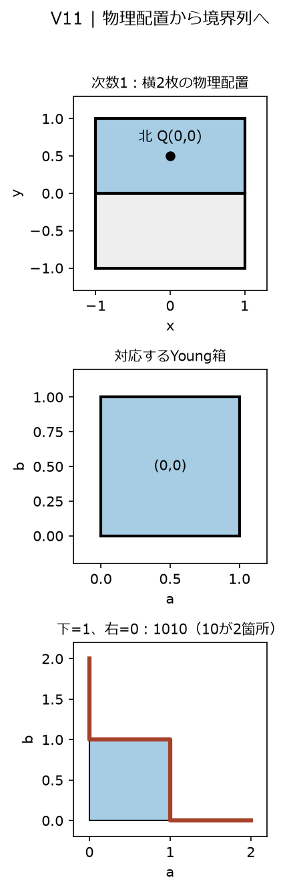
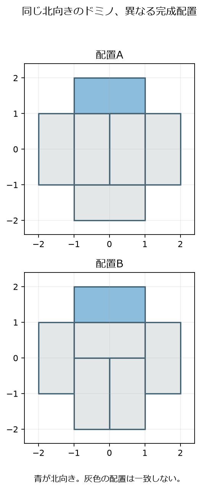
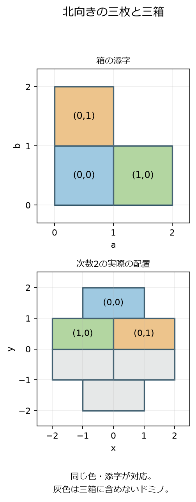

# 第4章　配置のすべてを覚えず、境界を読む

## 円を調べるのに必要な情報

一つの配置には、中央のドミノの並び、四隅の整列、あらゆる局所的な揺らぎが含まれる。私たちが最初に知りたかったのは、そのうち境界の大きな形だった。中央の小さな模様が違っても、外側の北向き成分の輪郭が同じことはありうる。

だから全配置をそのまま記録する代わりに、まず上側の境界から連結する北向きドミノを集める。北向きという言葉は、ドミノが縦という意味ではない。セルを $C_{i,j}=[i,i+1]\times[j,j+1]$ とし、水平ドミノの左セルを $C_{i,j}$ とし、旧次数を $n$ とすると、$i+j+n$ が偶数なら北、奇数なら南と定める。垂直ドミノは下セルの同じ偶奇が偶数なら東、奇数なら西に分ける。この四方位は、次のシャッフルでドミノが動く向きでもある。

たとえば、この図の次数1の上の横ドミノは、左セルが $C_{-1,0}$ なので $i+j+n=-1+0+1=0$、北向きである。下の横ドミノは左セルが $C_{-1,-1}$ なので $-1-1+1=-1$、南向きになる。同じ横向きでも、位置によって方位が変わる。縦ドミノも同様に、下セルについて偶数なら東、奇数なら西と判定する。

数字だけで定義される偶奇が、なぜ境界を追う役に立つのか。それは北向きのドミノを、斜めに置いた格子の箱へ対応させると、境界連結性と支持規則の幾何が成立すれば、北側の整列部分が階段状に表せるからである。この対応は補助章C・Sの幾何を入力とする。重要なのは、任意の北向きドミノではなく、外縁から北向きの隣接関係を通って届くものを選ぶことだ。内部に偶然できた孤立した北向きの島は含めない。

ここで隣接するとは、二枚のドミノがセルの辺を共有することをいう。角で触れるだけではつながらない。外縁に接するとは、領域内のセルの辺のうち、反対側が領域外にある辺にドミノが接することだ。北側に接する北向きのドミノを出発点とし、辺を共有する北向きドミノだけを順にたどって成分を集める。第1章の橙色の島はこのたどり方では届かなかった。

北側だけを記録すると何が失われるか、次数2で確かめよう。下の二つは、どちらも12セルを六枚で覆う完成配置である。北向きのドミノは、どちらも青い一枚だけで、左セルは $C_{-1,1}$。この一枚は上の外縁に接する。一方、灰色のドミノの並びは違うので、二つの完成配置は同じではない。

この二配置から記録する北向き成分は同じ一枚であり、そこから作る箱も同じ $(0,0)$ だ。北側の輪郭を調べる目的には役立つが、この記録だけで灰色部分まで復元することはできない。図は二配置を実際に列挙した有限例であり、異なる全ての配置の違いが必ず灰色部分に現れるという主張ではない。

## 階段の向こう側を箱で記録する

階段より下の箱が埋まっていると考えよう。左と下の箱がそろっていない位置に箱が突然浮かぶことはない。このような「箱があれば左と下の必要な箱もある」形を、ここではヤング図と呼ぶ。例えば

$$I=\{(0,0),(1,0),(0,1)\}$$

は左下へ閉じているが、$(1,1)$ だけからなる集合はそうでない。図の各箱の添字は、物理的なドミノの位置と取り違えない。添字は変換後の記録であり、実際のセルの座標とは別のものだからだ。

この表現の利点は、内部のドミノ全てを覚えずに、北の凍結部分の輪郭を階段として扱えることにある。ただし逆向きに、任意の階段から元の完成配置が一つに決まるとは言わない。異なる内部配置が同じ北境界を与えうる。

## 一つの箱を、実際のドミノに戻す

北向きの箱 $(a,b)$ に、左側のセルが $C_{b-a-1,\,n-a-b-1}$、右側がその一つ右のセルである水平ドミノを対応させる。例えば次数1の $(0,0)$ は $C_{-1,0}$ と $C_{0,0}$ を覆い、上側の横ドミノになる。次数2では $(0,0)$ の中心が $(0,3/2)$、$(1,0)$ と $(0,1)$ の中心がそれぞれ $(-1,1/2)$、$(1,1/2)$ だ。上の一枚が左右下の二枚を支える煉瓦の配置を思い浮かべよう。

この対応式が確かに北向きになることも、偶奇で確認できる。左セルを $i=b-a-1$、$j=n-a-b-1$ とすれば

$$i+j+n=2n-2a-2$$

は必ず偶数である。また、二セルの中点は $(i+1,j+1/2)$ なので、ドミノの中心は $(b-a,n-a-b-1/2)$。たとえば次数2の $(1,0)$ を入れると $(-1,1/2)$ になる。ここでは箱の添字から位置と方位が決まることを確認した。そこに実際にドミノがあることや、北側へつながることは別の確認だ。

この図の下段は、三枚の候補を含む次数2の完成配置そのものである。三枚はいずれも上側の境界につながり、同じ色の箱に対応する。灰色のドミノは配置を完成するために必要だが、北向き成分の三箱には数えない。数字と格子線を使って、上段の箱と下段の二セルを一組ずつ対応させよう。

この対応式は配置を一意に復元する式ではなく、北向きドミノの位置を箱の添字に移す式である。実際に外縁から連結するものが左下に閉じることは、完全被覆を使う別の幾何の主張で、補助章C・Sに依存する。小さな三箱の例だけを見て全次数で成立すると言うことはできない。

例えば次数2で $(a,b)=(1,0)$ の箱は、左セル $C_{-2,0}$ と右セル $C_{-1,0}$ に対応する。$(a,b)=(0,1)$ は $C_{0,0}$ と $C_{1,0}$ に対応する。どちらも $i+j+n$ が偶数なので北向きであり、上の $(0,0)$ に対応するドミノの左右下に並ぶ。この有限例を第5章の成長角と比べよう。

一般の配置に戻ると注意したいのは、同じ添字のドミノを置ける**位置の候補**が分かるだけだという点だ。直前の図では、その候補に三枚が実在している。実際のタイリングがその場所を北向きドミノで覆っているか、さらに外縁に連結しているかは、個々の配置を見て別に決める。

## 二つの支持が、なぜ消去を防ぐか

箱 $(a,b)$ の北向きドミノを考え、上にある二つの支持 $(a-1,b)$ と $(a,b-1)$ が実際に存在すると仮定する。中心座標の式から、それぞれの中心は、元のドミノの中心より高さが1だけ高く、横には右か左へ1だけずれる。元のドミノの真上にある二セルは、この二つの支持ドミノに一つずつ覆われる。

元のドミノが消去されるには、その真上の二セルを一枚の南向きドミノが覆い、互いの位置を交換する対にならなければならない。ところが真上の二セルは既に別々の支持に使われている。完全被覆では一つのセルを二枚が使えないから、そんな南向きドミノは置けず、元の北向きドミノは消去されない。

ただし、これだけで「北側の境界に連結したドミノは、必ず二つの支持を持つ」とは言えない。逆向きの含意と境界の端には、配置全体が重複なく覆われていることや、領域外に置く補助ドミノの規約が必要だ。特に形式的な軸の箱は、実際に旧領域にあるドミノと同一視しない。支持と境界連結が一致する一般の論証は補助章C・Sにあり、独立完査中である。

## 数字を戻すときの注意

物理セル $C_{i,j}$ は $[i,i+1]\times[j,j+1]$ とする。水平ドミノの左セルが $C_{i,j}$ なら、その中心は $(i+1,j+1/2)$ である。箱の左下角と中心を混同すると半セルずれる。大きさを $n$ で割れば半セルのずれは消えるとしても、その前に何を割るのかを決めなければ、円の中心や半径の係数を誤りかねない。

補助章Cでは座標式と境界の連結性を詳しく扱う。以後も上で述べた支持規則と連結性の対応を入力として使う。

階段ができたら、次は時間を一回進める。箱はどこに増えるのか。そして、増える場所は互いにどのような関係にあるのか。

下の問題では、箱の添字を $a,b\ge0$ とし、軸の外側の位置 $(-1,b)$ と $(a,-1)$ を形式的な支持として認める。これはそこに実ドミノがあるという意味ではない。一回の更新で新しい箱を増やせるかは、旧時刻の箱と形式的な支持だけを使って同時に判定する。

**考えてみよう。** $I=\{(0,0)\}$ に一度に足せる候補を、左と下の支持が必要という規則で挙げよう。$(1,1)$ を同時に足してはいけない理由は何か。

**もう一問。** 次数2の箱 $(1,0)$ に対応する北向きドミノの左セルと中心を求めよう。その真上の二セルが別々の支持ドミノに覆われているとき、なぜこのドミノを消去する南向きドミノを置けないか説明しよう。

::: {.callout-note collapse="true"}
## 考え方の例

旧集合に $(0,0)$ だけがあるとき、形式的な軸の支持を使えば $(1,0)$ と $(0,1)$ が候補になる。$(1,1)$ には旧時刻の $(1,0)$ と $(0,1)$ の両方が必要だ。今回同時に追加する二つを旧時刻の支持として使うことはできない。

二問目では、左セルは $C_{-2,0}$、右セルは $C_{-1,0}$ なので中心は $(-1,1/2)$。消去相手の南向きドミノは真上の二セルを同時に覆う必要があるが、その二セルが既に支持ドミノに使われていれば、重複を避けて置くことはできない。

:::

**さらに詳しく。** [C：座標と境界](../appendices/c-coordinates-boundary.qmd)、[S：添字範囲](../appendices/s-coordinate-ranges.qmd)。各補助章の仮定と未完査の範囲も確認しよう。
