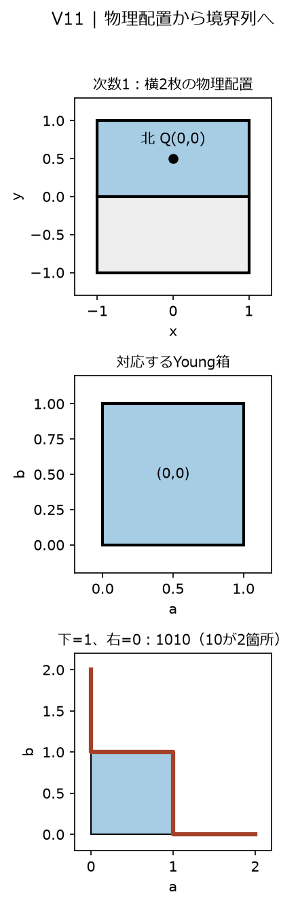
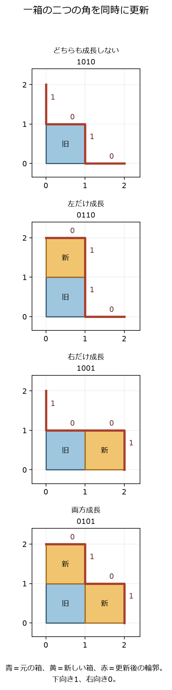
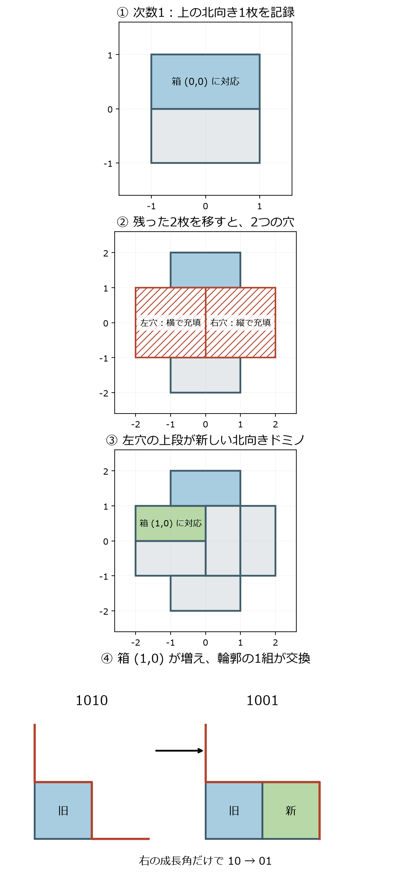
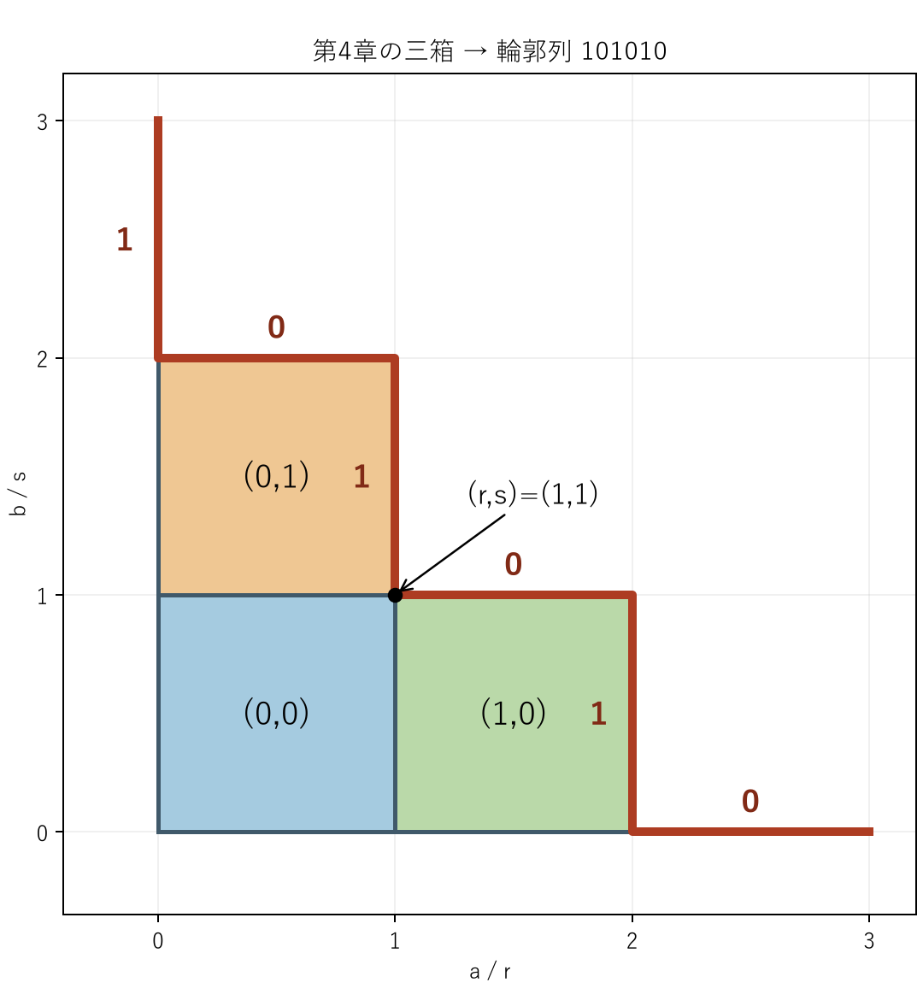
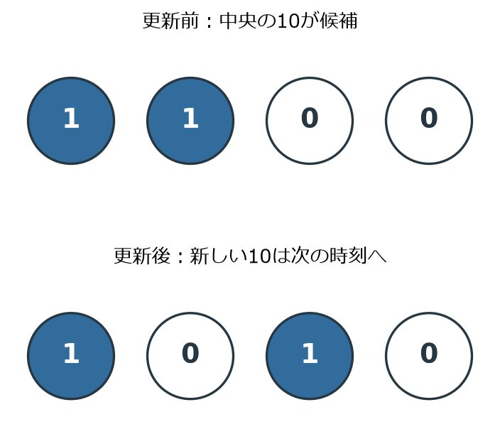

# 第5章　階段の角は、粒子の一歩になる

## 一度に増える箱を考える

前章の $I=\{(0,0)\}$ の外側では、$(1,0)$ と $(0,1)$ が成長候補になる。一方 $(1,1)$ を置くには、その左と下の支持がどちらも旧時刻に必要だ。同じ更新で新たに作る箱を、同じ更新の支持として先取りしてはいけない。

図形の輪郭を斜めの格子線に沿ってたどり、二種類の一歩を1と0で書く。隣接する一組が $10$ のとき、その角に箱を一つ加えると、二歩の順番が $01$ に入れ替わる。これを1を粒子、0を空き場所と見れば、粒子が右隣の空き場所へ一つ進む操作になる。

## 一箱から、二つの成長候補をたどる

図を上から順に見よう。次数1の領域を横のドミノ二枚で埋めた配置では、上の一枚は北向きで、境界につながる。第4章の対応式に $n=1$、$(a,b)=(0,0)$ を代入すると、その二セルは $C_{-1,0}$ と $C_{0,0}$。図の中央の一箱が、この上側ドミノを記録している。下の一枚まで二箱として数えているわけではない。

次に箱の輪郭を図の上からたどる。下向きの一歩を1、右向きの一歩を0と読むと、図に描いた範囲では $1010$ になる。左側の $10$ と右側の $10$ が、箱の左右上にある二つの成長角に対応する。成長角の外側にある形式的な軸は、隣の箱がなくても支持を数えるための約束で、実際のドミノが無限に並んでいるという意味ではない。

この有限の読み方で、左の候補だけが成長すれば $1010\to0110$、右だけなら $1010\to1001$、両方なら $1010\to0101$、どちらも成長しなければ $1010$ のままになる。次の図で、旧箱は青、新たに加えた箱は黄、更新後の輪郭は赤である。赤線を上から下向き1・右向き0として読み、四通りの文字列と照合しよう。

四通りのうち $1010\to1001$ を、今度は実ドミノから最後まで追おう。次数1の横二枚の配置には消去される対がなく、両方のドミノが残る。それぞれを動かすと、次数2に二つの穴ができる。左穴を横二枚、右穴を縦二枚で埋めると、左穴の上段は新しい北向きドミノになり、もとの北向きドミノにつながる。第4章の座標式では、この新しい一枚は箱 $(1,0)$ に対応する。

図④では箱の座標が右へ増えるので、$(1,0)$ は箱 $(0,0)$ の右に置かれる。実ドミノの図では左側の穴から生じているが、箱の横軸と物理平面の横軸は同じ向きではない。輪郭を同じ規則で読むと、右側の $10$ が $01$ に変わり、$1010\to1001$ となる。もとの次数1の配置を固定し、二つの穴の選択が公平・独立なら、この一連の出力の条件付き確率は $1/4$ である。

この図は一つの配置と一回の更新を直接つないだ例である。すべての次数で各成長角が別々の穴に対応することは、図から自動的には従わず、後で述べる幾何を使う。

各場合の確率は、二つの穴に対応する公平なコインが独立であることを使って $1/4$ ずつだ。この対応の独立性は図形だけから出るのではなく、穴分解と異なる角が異なる穴に対応するという幾何に依存する。

同じ場所に粒子が二つ入らないので、この運動は**排他**と呼ばれる。たとえば

$$1100\longrightarrow 1100\quad\text{または}\quad1010.$$

更新前の $10$ は真ん中に一つあり、コインが成功すればそこだけが $01$ に変わる。成功しなければ元のままだ。

## 第4章の三箱へ戻る

第4章で見た次数2の三枚の北向きドミノは、箱 $I=\{(0,0),(1,0),(0,1)\}$ に対応した。一箱から二つの成長候補がともに加わったとき、ちょうどこの三箱になる。実ドミノでも追ってみよう。第3章「次数1から2への消去・移動・二つの穴・横充填」の図で、横二枚の入力を選び、二つの穴をともに横で埋めた出力が、第4章で示した横六枚の次数2配置である。この実配置で北向きとして選んだ三枚が、今の三箱に対応する。二つの穴の充填を指定した条件付き確率は $1/4$ だ。ここでは同じ箱集合の輪郭を、上から下向きを1、右向きを0として追おう。外側に形式的な軸を一歩ずつ含めると、頂点は

$$(0,3)\to(0,2)\to(1,2)\to(1,1)\to(2,1)\to(2,0)\to(3,0)$$

で、列は $101010$ となる。

この列の三つの $10$ が三つの成長角 $(0,2),(1,1),(2,0)$ に対応する。外側の一歩を含めずに一箱の更新後だけを見ると $0101$ だった。両側に1と0を一つずつ補えば同じ $101010$ になる。

この計算は、三箱の輪郭から候補を読む手順を示す。第4章の図から読み取れるのは北側の情報なので、この列だけから灰色の部分を含む元の完成配置を一意に復元することはできない。また、箱の成長と実ドミノのシャッフルが一般に対応することは、後述の幾何の論証に依存する。第10章では、この同じ三箱の輪郭の頂点を物理座標へ戻す。

## 同時更新の意味

$1010$ には、更新前に二つの $10$ がある。それぞれ独立のコインで成功・失敗を決め、同時に交換する。どちらも成功すれば $0101$。一方、一つの交換が新しく作った $10$ を同じ時刻のうちにもう一度動かしてはならない。候補は必ず**更新前**の列から決める。

同時更新と、左から順に何度も交換する操作の違いを、$1100$ で確かめよう。旧列では真ん中の $10$ しか動けないので、一回の同時更新では、成功しても $1010$ までである。ところが $1010$ に新たにできた右側の $10$ を同じ時刻にもう一度交換すれば $1001$ に達する。二回目は旧列にはなかった候補なので、この本の一時刻の結果には含めない。

同時更新前の異なる $10$ は互いに一つの位置を共有しない。共有すると、共通する位置が片方の $10$ では0、もう片方では1でなければならず矛盾する。したがって、旧列の全候補に対する成功・失敗を先に決めれば、交換は互いに干渉せず、一斉に適用できる。

この決まりが重要なのは、ドミノ側でも穴が同じ一時刻に埋められ、そこで新しくできた箱をその時刻の支持に使わないからである。候補ごとに独立コインが使えるためには、対応する穴が異なり、穴の分割が正しいことも要る。単に絵が似ているだけでは、独立性は出ない。

## 成長角は領域のどこまで現れるか

次数 $n$ の凍結箱は $a+b\le n-1$ に収まり、旧時刻の成長角は $a+b\le n$ に収まる、という見通しがある。これを「実際の北向きドミノなら全て三角形内」と考えてはいけない。第4章の座標式で次数2の $(a,b)=(1,1)$ を入れると、$(-1,-1),(0,-1)$ を覆う北向きドミノは領域内に置けるが、$a+b=2>n-1=1$ である。実ドミノに許される位置と、境界に連結した凍結箱の範囲は別だ。

凍結箱の範囲は時間の帰納で得る。次数0では凍結箱はない。次数 $n$ の凍結箱が $a+b\le n-1$ にあり、次の次数で加わる箱が旧時刻の成長角に限られると仮定する。新しい箱 $(a,b)$ で $a>0$ なら、支持 $(a-1,b)$ は旧箱なので $a+b-1\le n-1$。よって $a+b\le n$。$a=0,b>0$ なら支持 $(0,b-1)$ を使い、$(0,0)$ も明らかに範囲に入る。

領域の端では形式的な軸を、実在する旧ドミノと取り違えないことが特に大切だ。例えば次数1の旧補助配置に含む軸添字は $(-1,-1),(-1,0),(0,-1)$。一箱からの成長角 $(0,1)$ に必要な形式的支持 $(-1,1)$ はこの旧補助配置には入っていない。したがって「その位置の旧ドミノが動いた」と言うことはできない。実際の外側セルが空き、候補の穴の一方が新領域外に出ることを直接調べるのが、補助章Gの軸端の場合分けである。

この帰納で使った「新しい凍結箱は旧成長角に限られる」ことは、同時に生成されたドミノを旧支持として先取りせずに示す必要がある。逆に、この三角形範囲を最初から仮定してその結論を出すと循環する。補助章Gでは、まず実ドミノの正方形の添字範囲を使って新旧の支持を比較し、その後で上の帰納を用いる。穴分解と支持規則の一般成立は、引き続き別の入力である。

## 二次元から一次元へ移すための宿題

ここまでで、階段の一つの角と列の $10$ の交換が対応することは、有限の図で追えた。一般のタイリングで、凍結境界が常にこの階段になり、全ての成長角が別々の穴に対応することは別の幾何の仕事である。補助章C・G・Sにはその論証草稿があり、穴分解と境界復帰の一般的な独立確認は未了である。この後の粒子計算を、二次元への対応まで自動的に証明したものとは扱わない。

それでも、もし対応が正しければ、円の境界の問題を「長い粒子列で、どんな並びがどれほど現れるか」という問題に変えられる。最初に粒子が左側を全部埋め、右側が全部空いている段差から出発しよう。

ここでいう無限列は、無限個の粒子を実際に用意する実験ではない。有限個の場所を有限時刻まで観察するとき、その結果を決めるのに必要な最初の範囲は有限だ。例えば時刻 $m$ の区間 $[a,b]$ の状態は、一回の更新を逆にたどると時刻 $m-1$ の $[a-1,b+1]$ とその周辺のコインから決まる。これを $m$ 回繰り返せば、初期状態について必要なのは高々 $[a-m,b+m]$ の範囲である。範囲外をどう埋めたかは、その有限の観察に影響しない。

無限列を使うのは、次数を大きくしていく議論を一つの規則で記述するためだ。有限次数のドミノ境界がこの段差の有限窓と本当に対応するか、また次数と観測時間を一緒に大きくするときに何が言えるかは、成長規則の幾何を使って別に確認する。

**確かめよう。** 更新前の $1010$ の二つの候補について、成功確率がともに $1/2$ のとき四つのコイン結果を挙げ、出力がそれぞれ何になるか計算しよう。

::: {.callout-note collapse="true"}
## 考え方の例

旧時刻の左の $10$ と右の $10$ の成功・失敗は、失敗失敗で $1010$、成功失敗で $0110$、失敗成功で $1001$、成功成功で $0101$。コインが公平で独立なら各確率は $1/4$。成功して新しくできた $10$ は、この時刻には使わない。

ここで両方成功した $0101$ の真ん中には、新しい $10$ が一つ見える。これは次の時刻には候補になるが、いま終えた時刻にもう一度動かしてはならない。もし続けて $0011$ に変えてしまえば、最初の旧列にはなかった候補まで同じ時刻に使ったことになる。成長する角を旧時刻の階段から一斉に選ぶという規則が、粒子側ではこの「次の時刻まで待つ」という約束に対応している。

:::

**さらに詳しく。** [G：成長と粒子化](../appendices/g-growth-encoding.qmd)、[S：添字範囲](../appendices/s-coordinate-ranges.qmd)。各補助章の仮定と未完査の範囲も確認しよう。
