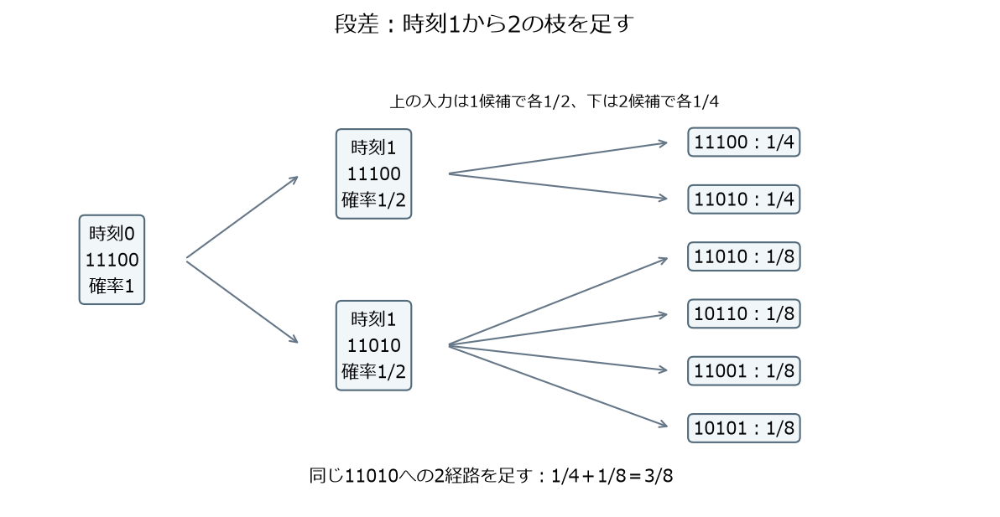
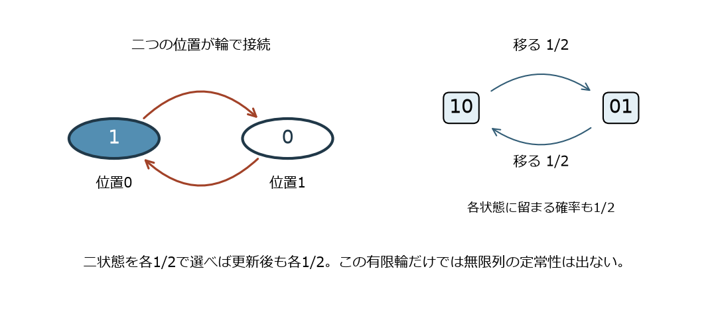
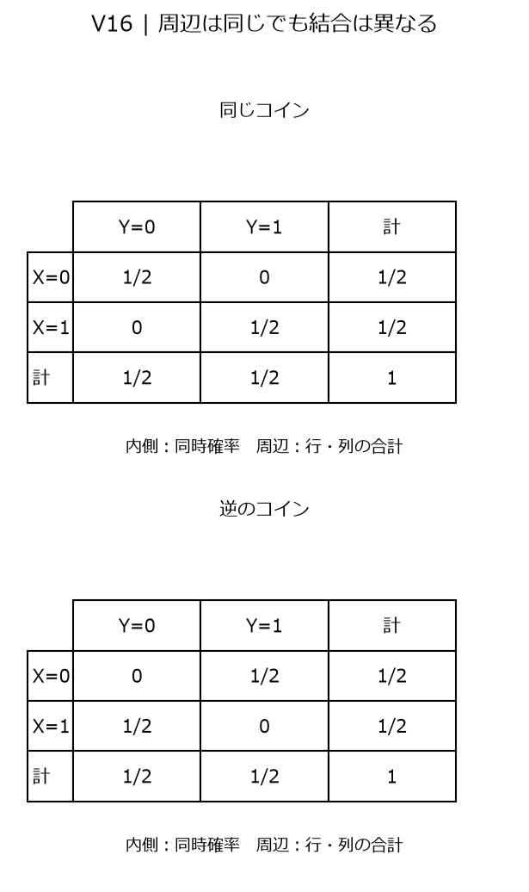
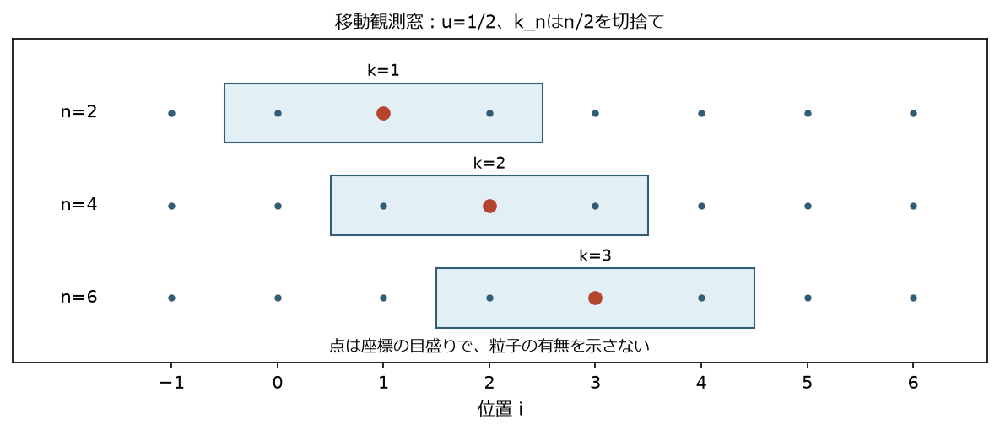
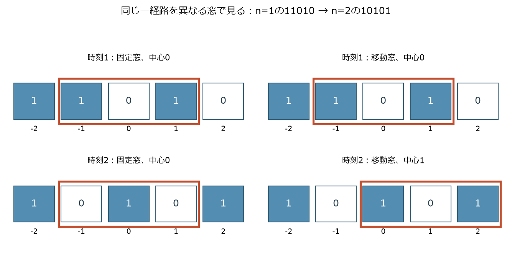
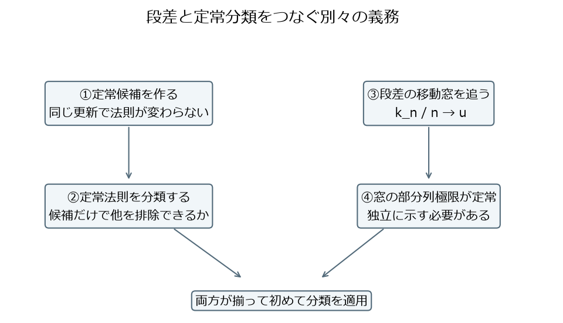

# 第6章　動いても変わらない分布

*局所極限と分類の一般論証は独立検証中である。*

## 1. 段差を二時刻だけ動かす

一直線に並んだ場所に、粒子があれば1、空なら0を書く。最初は場所0とその左すべてに粒子があり、場所1とその右は空だとする。場所−2から2だけを書き出すと11100である。窓の外も、左には1が、右には0が続いている。

一時刻の更新では、更新前に並びが10の隣接対をすべて探す。それぞれについて公平な独立コインを投げ、表なら10を01へ入れ替える。裏ならそのまま。同じ時刻に新しくできた10は次の時刻まで使わない。最初の11100には10が一つだから、時刻1の窓は11100または11010で、それぞれ確率1/2である。

場所0が粒子である確率を数えよう。時刻0には1、時刻1には1/2になる。次の時刻も1/2なら、場所0の状態はもう落ち着いたと言えるだろうか。答える前に、「場所0の粒子が次に動ける」条件を考えてみる。粒子があるだけでは足りず、その右隣も空でなければならない。必要なのは一か所の確率だけでなく、隣り合う二か所が10である確率だ。

時刻2の窓を、各時刻のコイン結果から列挙すると次の五通りになる。

| 場所−2,…,2 | 確率 |
|---|---:|
| 10101 | 1/8 |
| 10110 | 1/8 |
| 11001 | 1/8 |
| 11010 | 3/8 |
| 11100 | 1/4 |

次の図は、時刻1の11100からは一つのコイン、11010からは二つの独立コインを使うことを示す。同じ11010に二つの道で到達するため、確率1/4と1/8を足す。図の枝を一つ選び、時刻1の列にある旧10だけを実際に交換して確かめよう。



第5章の同じ例も、この表の中にある。一箱の状態は、この窓では時刻1の $11010$。その二つの候補がともに成功して三箱になると、時刻2の窓は $10101$ となる。最初に一箱になる確率 $1/2$ と、その後両方が成功する条件付き確率 $1/4$ を掛けると、表の $1/8$ になる。

確率の和は1である。真ん中の文字、つまり場所0が1なのは10101、10110、11100だから、その確率は1/8+1/8+1/4=1/2。場所0と1が10なのは10101と11100だから、確率は1/8+1/4=3/8になる。時刻1は場所0と1が10である確率が1/2だった。つまり場所0の粒子確率は同じ1/2でも、動ける対の頻度は変わっている。

この表で条件付き確率も計算してみよう。時刻2の位置 $i$ の状態を、粒子なら1、空きなら0として $X_i$ と書く。時刻2に場所0に粒子があるという条件の下で、その右が空である確率は、両方が起こる確率 $3/8$ を、条件の確率 $1/2$ で割った $3/4$ である。つまり $P(X_1=0\mid X_0=1)=P(X_0=1,X_1=0)/P(X_0=1)$。粒子のある場合だけを集めたとき、そのうち何割が動けるかを表す。ただし、条件の確率が0なら、この割り算では定義できない。

公平コインで実際に場所0から1へ動く期待通過率は、更新前の10の確率に1/2を掛ける。時刻1なら1/4、時刻2なら3/16だ。一つの場所の密度だけを計算しても、次の通過率は決まらない。もっと広い窓を追う方法はあるが、時間を増やすたびに候補が増え、いまの表をそのまま何百時刻も広げるのは骨が折れる。

ここで、動く境界の近くを観察する人が、時間とともに見る場所も動かす場面を考える。後の図では、ある一経路で時刻1の中心0と時刻2の中心1の三場所が、どちらも101になる。境界は全体として動いていても、追いかける窓からは似た景色が見えるかもしれない。この二つの一致は**一経路の事実**で、確率分布が同じという意味ではない。例えば同じ時刻1の別の経路11100では、中心0の三場所は110である。

実際に確率表を比べよう。時刻1に中心0の三場所が $101$ となるのは、五場所の列が $11010$ のときなので、確率は $1/2$。時刻2に中心1の三場所が $101$ となるのは、上の表では五場所の列が $10101$ のときだけなので、確率は $1/8$ だ。同じ一経路で見た窓は一致したが、この二つの時刻の窓の**法則**は一致していない。長時間の後の窓について何が言えるかは、この有限時刻の計算とは別に調べる必要がある。

そこで「長い時間の後、動く窓の確率法則は変わらない法則に近づくのでは」と**仮説**を立てる。これが確かなら変わらない候補を調べることが、元の動く段差を理解する手掛かりになる。しかし、単なる候補の存在も有限回の観察も仮説の証明ではない。移動窓の極限が存在するか、その極限が定常か、どの候補が選ばれるかは後で別々に確かめる。

## 2. 同じ更新で変わらない分布を作る

ここで、同じ粒子の更新で、動いているのに確率分布が変わらない例を探そう。場所が二つだけの輪を考える。輪の右端は左端につながるので、10と01のどちらにも動ける10が一つある。公平コインが表なら10と01が入れ替わり、裏なら変わらない。はじめに10と01を各1/2で選ぶと、次に10となる確率は「10から残る」1/4と「01から移る」1/4の和で1/2。01も同じである。



粒子は動けるのに、確率表は変わらない。このように更新しても変わらない確率法則を定常という。定常とは粒子一つ一つが止まることではない。有限輪の定常性だけで、段差の無限列や長時間極限の定常性が示されたわけではない。

## 3. 一つの候補で足りるか

では、密度1/2の定常法則を一つ作れたら、密度1/2の定常法則はそれしかないのだろうか。全て0の列は動ける10を持たず、全て1の列も持たない。この二つの列を最初に半々で選ぶ法則を考える。どちらも動かず、左や右へずらしても同じなので、この混合法則は空間についても時間についても定常である。各場所の粒子確率は1/2だが、10の確率は0だ。

一方、この模型には密度1/2で10の確率が正の別の定常候補がある。その具体的な構成と定常性の証明は、これから確かめる対象だ。同じ密度だけでは、定常な法則や通過率を一つに決められない。候補を一つ見つけることと、他の候補を漏れなく分類することは違う。

二位置の輪の表から先へ進むには、広い配置をどう比較するかが要る。まず、有限個の場所に限って、その並びごとの確率を表にする。無限に場所がある場合も、任意の有限窓についてこの確率を指定して法則を調べる。窓を固定して時刻を進めたとき、各有限窓の各並びの確率がある値に近づく、という意味で局所的な収束を考える。これだけでは、その極限が更新後に変わらないことはまだ分からない。

また、二つの動かない列を半々に選んだ法則は二つの法則を混ぜた例だった。混ぜて作れるものと、そう分けられない候補を区別する必要がある。ただし、分けられない候補を全て挙げられることや、一般の法則をその候補の混合として表せることは、ここではまだ示していない。

## 4. 二つの法則をどう比べるか

二つの法則を比べる方法も決めなければならない。その練習に、二枚の公平なコインX、Yの同時の結果を表で考える。XとYを必ず同じにする方法と、必ず逆にする方法では、表の内側の確率が違う。一方、どちらの表でも各行の合計はXの確率1/2、各列の合計はYの確率1/2である。二つの実験それぞれの確率を保ったまま、同じ場所で比較できるようにしたものを結合という。結合が二種類あることは、それぞれのコインの法則が二種類あるという意味ではない。



異なる二つの法則の比較では、結合の選び方によって両者の違いが見える頻度が変わる。違いをできるだけ少なくする結合を考えられれば、分類への手掛かりになりそうだ。ただし、最小の結合の存在や、それが更新に対して保たれるかは別の証明を要する。

## 5. 非定常な段差へ戻る

ただし、最初に計算した段差の窓は時刻ごとに変わっていた。定常法則の分類が分かったとしても、その有限時刻の窓へ直接当てはめることはできない。時刻nに位置k_n付近を見る観測者を考え、k_n/n→uとなるよう追いかける。この移動窓の法則に収束部分列があること、その極限が空間と時間に定常であることを別に示す。ここで時間定常というのは、極限の無限列に元の粒子更新を一回施してもその法則が変わらないという意味である。観測点を動かす操作と更新をそのまま取り違えてはならず、その接続も証明が必要だ。定常候補の存在、全定常法則の分類、移動窓の極限の定常性、そこへの分類の適用は、それぞれ別の論証である。例えばu=1/2なら、時刻2、4、6に観測窓の中心をそれぞれ1、2、3へ動かす。図の点は場所の目盛りで、粒子がそこにいるかどうかは表していない。固定位置0の表から移動窓の極限が直ちに得られるわけではない。



なぜ動く窓でも、元の更新に対する定常性を期待できるのだろう。直感では、十分先で隣り合う観測位置の窓が同じ法則に近ければ、窓を一歩ずらす影響は消える。そこで元の更新を一回行った法則を、ずらした窓の法則の間に挟めれば、両端が同じ極限に近づくことから更新後も同じ極限になる。これには隣接窓が同じ極限になることと、更新後の挟み込みを示すことが必要で、移動窓の部分列を取るだけでは得られない。第8章でこの二つを分けて追う。

具体的に、時刻1が11010、時刻2が10101となる一経路を見よう。時刻1では中心0の三場所は101。時刻2では固定窓（中心0）は010、移動窓（中心1）は101である。どちらも同じ粒子配置から切り出した値だ。この一経路だけから極限や定常性は結論できない。





私たちが知りたいのは元のドミノ配置で、同じ向きが続く凍った領域と、いろいろな向きが混じる領域との境界である。大きい配置を縮尺して重ねたとき、その境界が円に近づくのはなぜか、というのが出発点の謎だ。粒子の列は第4・5章で見たように境界の段差を記録する道具だが、その対応の一般的な幾何の完査はまだ残っている。定常法則を調べた後も、粒子の密度から境界へ戻る対応と円全体の極限を別に証明する必要がある。

**自分で確かめる。** 時刻2の五つの行から、場所0の粒子確率と、場所0・1が10となる確率をそれぞれ足し直そう。次に「密度1/2の定常法則を一つ見つけた」だけで、段差の時刻2の通過率を決定できるか、使えない推論を一つ挙げて説明しよう。

**転移問題（後で解く）。** 周期列0101で、更新前の10の頻度を端の接続も数え、各10が確率p=1/4で動くときの一辺一時刻あたりの期待通過率を求めよう。次に、その計算だけで段差過程の長時間極限まで決まるか、使えない推論を説明しよう。

**段階ごとの再構成と転移。** 二位置輪で10と01を半々に選んだ法則が一回の更新後も同じことを表にしよう。次に、三場所の窓で一場所の密度だけでは二場所の10の確率が決まらない例を二つ作ろう。無限列の法則を比べるとき、なぜ一つの窓だけでは足りないか説明しよう。最後に二枚の公平コインを同じにする結合と逆にする結合で、両者が違う確率を比べよう。これらの有限例だけで最小結合や分類の一般証明が済むだろうか。

**円の謎へ戻る問い。** 局所的な粒子の密度や通過率が分かったとして、元のドミノ境界の形へ戻るには、さらにどんな対応と極限の証明が必要だろうか。この診断で分かった有限例と、まだ示していないことを分けて説明しよう。

::: {.callout-note collapse="true"}
## 考え方の例

**自分で確かめる。** 時刻2で場所0が1の行は $10101,10110,11100$ だから、確率は $1/8+1/8+1/4=1/2$。場所0・1が $10$ なのは $10101,11100$ だから $1/8+1/4=3/8$。定常候補を一つ知っても、有限時刻の段差の法則がその候補と同じだとは言えない。

**転移問題。** 周期列 $0101$ では四辺のうち二辺が $10$ なので、成功確率 $p=1/4$ の一辺一時刻あたりの期待通過率は $(2/4)(1/4)=1/8$。これは指定した列と一時刻についての答えで、段差からの長時間極限ではない。

**段階ごとの再構成と転移。** 二位置輪では、$10$ から $10,01$ への確率も、$01$ から $10,01$ への確率も、それぞれ $1/2$ ずつ。入力を半々で選べば更新後も半々だ。三場所の窓では $000$ と $111$ を半々に選ぶ法則と、$010$ と $101$ を半々に選ぶ法則が、各位置の密度をいずれも $1/2$ にしながら、左端二位置が $10$ となる確率をそれぞれ0と $1/2$ にする。一つの場所だけの確率が同じでも他の窓の確率は違い得るので、無限列の法則を比較するときは、任意の有限窓の確率を考える必要がある。同じコインの結合では不一致確率0、逆コインでは1。有限例は結合の意味を示すが、無限列の分類の一般証明にはならない。

**円の謎へ戻る問い。** 凍結ドミノの境界と粒子列が対応すること、累積粒子数の極限を物理座標へ戻すこと、さらに四方向の境界全体の近さへ広げることが必要だ。ここでの有限表だけでは、これらの一般次数の主張は分からない。

:::

**計算を再現する。** 制作用コード `scripts/arctic_diagnostic.py` を実行すると、上の二時刻の確率表を分数のまま再計算できる。この有限計算は無限時間の結論を証明しない。

## 実験：コインを何回も投げたら

厳密な確率表を計算したあとで、乱数を使って同じ実験を繰り返してみよう。付属の [段差過程シミュレーション](../assets/scripts/arctic_step_simulation.py) は、更新前の $10$ を一斉に探し、それぞれについて公平なコインを投げる。ダウンロードしたファイルを置いたフォルダで、次の命令を使えば2万回、4時刻まで試し、乱数の種を42に固定できる。

```text
python arctic_step_simulation.py --trials 20000 --steps 4 --seed 42
```

ある実行では時刻2の位置0の占有頻度が0.4956、$10$ の頻度が0.3705だった。厳密値の $1/2$、$3/8$ に近いが一致はしない。乱数を変えれば結果も揺れる。実験回数が大きいほど比較しやすくなるが、有限の実験は無限時間の極限や円の定理の証明にはならない。プログラムは指定した時刻数だけ左まで初期粒子を用意する。そのさらに左の粒子は、指定時間内に位置0まで届かないので、ここで測る位置0・1の結果に影響しない。


