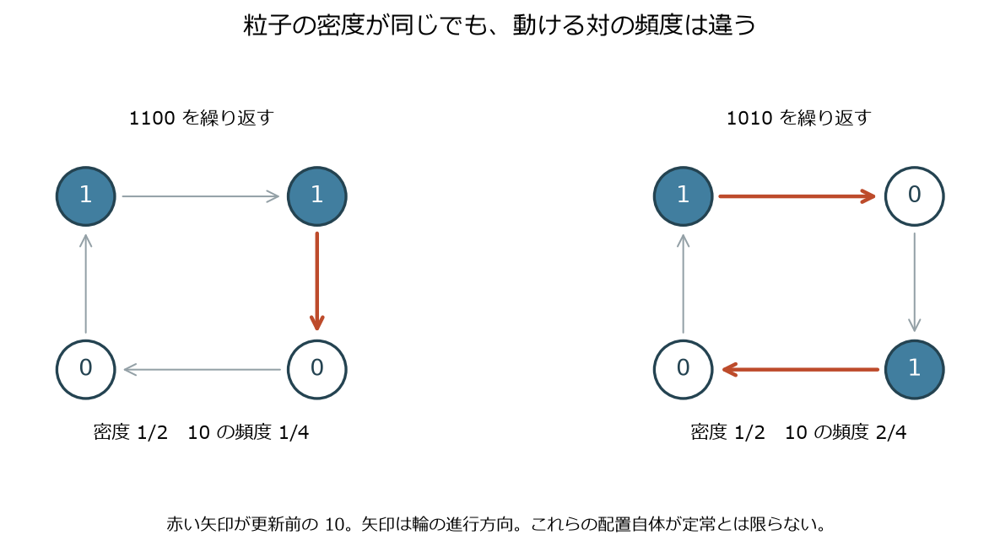
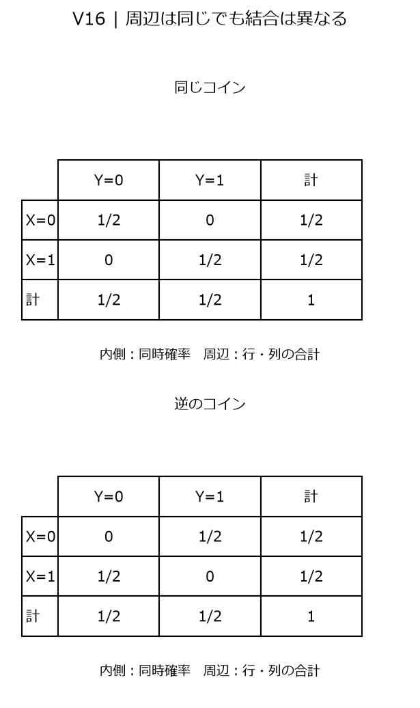

# 第7章　一つの定常法則では、なぜ足りないのか

この章で目指す分類の一般定理は、[Jockusch–Propp–Shor の定理3](https://arxiv.org/html/math/9801068v3)にある。対象は、本書と同じ公平コインによる同時並列更新について、空間平行移動不変かつ時間定常な無限列の確率法則である。その定理は、それらが密度 $d\in[0,1]$ の候補 $\mu_d$ の混合に尽きると述べる。有限時刻の段差に直ちに適用できるという主張ではなく、その接続は次章で扱う。

## 同じ密度、違う流れ

密度とは、ある場所に粒子がある確率である。全て0の列と全て1の列を半々で選ぶと、各場所の密度は $1/2$ になる。この列には動ける $10$ がないため、更新しても法則は変わらない。しかし、密度 $1/2$ の全ての法則で $10$ が現れないわけではない。

有限の周期列でも違いは見える。$1100$ を繰り返すと、端の接続を含む四辺のうち $10$ は一辺。$1010$ の繰り返しでは二辺だ。どちらも粒子は半分なのに、$10$ の頻度は $1/4$ と $1/2$。成功確率を $p$ とすれば、その瞬間の一辺あたり期待通過率はそれぞれ $p/4$ と $p/2$ になる。ここで二つの周期列が定常だとは主張していない。密度だけで流れが決まらない例として使っている。

このため、定常法則を一つ見つけても終わりではない。段差から遠い将来に現れる可能性がある法則を漏れなく押さえ、流束にどんな範囲が許されるかを調べる必要がある。

この章の目標は、密度を一つ決めればどんな定常法則も一つに決まる、と示すことではない。実際、全0と全1の半々の混合と、後で作る密度 $1/2$ の候補は異なる。それでも、定常法則をより基本的な法則に分解でき、その基本形を調べられれば、混合全体の流れも評価できる。ここでは「基本形の候補を作る」「ほかの基本形を排除する」「混合に戻る」という順に進もう。

## 輪で候補を一つ組み立てる

まず欲しいのは、更新の前後で同じ確率表になる有限輪の例だ。長さ4、粒子数2の輪では、候補が一つの $1100$ 型が4状態、二つの $1010$ 型が2状態ある。$1100$ への流入を見れば、$1100$ 自身からはコイン一枚で動かない経路、$0101$ からは二枚のコインで一方だけ動く経路がある。後者の経路確率は前者の半分なので、流入を揃えるには後者の状態に2倍の重みを試したくなる。

| 状態の型 | 状態数 | 動ける対 $k$ | 一状態の試す重み |
|---|---:|---:|---:|
| $1100$ 型 | 4 | 1 | $2$ |
| $1010$ 型 | 2 | 2 | $4$ |

一般には、$k$ 個のコインの特定の結果に $2^{-k}$ が掛かるから、これを相殺する $2^k$ を候補として試す。これは着想であり、この表だけで不変性が証明されたわけではない。さらに更新は粒子数を変えないので、粒子数ごとの重みを $z^m$ で調節しても、各粒子数内の流入と流出の釣り合いは壊れない。$z$ は異なる粒子数の状態の比率、ひいては密度を調整するための自由度だ。

公平コインで同時更新する長さ $N$ の輪を考える。状態 $x$ の粒子数を $m(x)$、巡回する隣接対 $10$ の個数を $k(x)$ とする。$z>0$ を固定し、状態に重み

$$w(x)=z^{m(x)}2^{k(x)}$$

をつけ、その総和で割って確率にする。なぜ $2^{k(x)}$ なのだろう。入力に動ける対が $k$ 個あれば、コイン結果の各組は確率 $2^{-k}$。よって入力の重みとコイン確率を掛けると $z^{m(x)}$ が残る。

出力 $y$ の各 $01$ のうち、どれを元の $10$ に戻すか選べば、対応する入力の候補を作れる。これらの対は重ならないので、候補は $2^{\#01(y)}$ 通り。輪では、一周したとき0から1への変化と1から0への変化は同数だから $\#01(y)=\#10(y)=k(y)$。各入力からの流入は同じ重み $z^{m(y)}$ であり、合計は $z^{m(y)}2^{k(y)}=w(y)$ に戻る。したがってこの有限輪の確率表は更新後も変わらない。

具体的に長さ4、粒子数2に限ると、$1100$ 型の4状態はそれぞれ $k=1$、$1010$ 型の2状態はそれぞれ $k=2$。重みの合計は $4\cdot2+2\cdot4=16$ で、前者の各確率は $1/8$、後者の各確率は $1/4$ となる。均等に6状態を選ぶのではない。例えば出力 $1100$ への流入を数えると、入力 $1100$ が候補一つを動かさない確率は $(1/8)(1/2)=1/16$。もう一つの入力 $0101$ には候補が二つあり、そのうち輪の端をまたぐ候補だけが動く確率は $(1/4)(1/4)=1/16$。和は $1/8$ で、出力 $1100$ 自体の更新前確率に戻る。他の状態も同じ要領で調べられる。$z$ を調節しながら輪を大きくし、固定有限窓の確率を極限へ渡すと、密度を指定した定常候補を作る道が見える。**密度 $d$ の無限列に対するこの候補を $\mu_d$ と書く。** 無限列への極限を渡す論証は補助章Eにあり、有限輪の計算だけで済ませない。

### 密度1/2の候補を、数字で見る

輪を大きくしたときの候補を、密度 $1/2$ で一つ具体的に書こう。左から右へ列を読むとき、次の場所の値が直前の値だけで決まる確率法則を考え、遷移確率を表にする。

$$Q=\frac1{1+\sqrt2}
\begin{pmatrix}1&\sqrt2\\\sqrt2&1\end{pmatrix}.$$

行は現在の値0・1、列は次の値0・1を表す。各行の和は1。最初の場所を0か1にそれぞれ確率 $1/2$ で選べば、次の場所も0・1がそれぞれ $1/2$ なので、この列の各場所の粒子密度は $1/2$ だ。

この法則の隣接する $10$ の確率は、現在が1である確率と、その次が0になる条件付き確率を掛けて

$$\mathbb P(10)=\frac12\cdot\frac{\sqrt2}{1+\sqrt2}=1-\frac1{\sqrt2}.$$

約0.2929であり、全0と全1を半々に混ぜた法則の0とも、各場所を独立に0か1とする法則の $1/4$ とも異なる。平均密度は三つとも $1/2$ である。

独立な列をそのまま定常候補に使えない理由も、一回の更新で見てみよう。最初の各場所が独立に確率 $1/2$ で1になり、各移動候補が公平なコインで動くとする。隣り合う二位置の**更新前**の値ごとに、更新後にそこが $10$ になる条件付き確率を計算すると次のようになる。二位置のすぐ外側の占有状態も独立に確率 $1/2$ で1となり、移動用コインとは独立である。

| 更新前の二位置 | 更新後に $10$ となる確率 | 理由 |
|---|---:|---|
| $00$ | $1/4$ | 左外側に粒子があり、そこから移動する |
| $01$ | $1/16$ | 左から粒子が入り、同時に右の粒子が右へ出る |
| $10$ | $1/2$ | この二位置の粒子が移動しない |
| $11$ | $1/4$ | 右外側が空きで、右の粒子が移動する |

例えば $01$ の行では、左外側が1で移動に成功する確率は $1/4$、右外側が0で移動に成功する確率も $1/4$。二つの候補は異なる場所にあり、必要な初期値とコインも独立なので積を取れる。更新前の四つの二文字はそれぞれ確率 $1/4$ だから、更新後の $10$ の確率は

$$\frac14\left(\frac14+\frac1{16}+\frac12+\frac14\right)=\frac{17}{64}.$$

更新前は $1/4=16/64$ だったので、独立な密度 $1/2$ の列は一回で元の法則から変わる。全位置の一様な密度は、入ってくる粒子と出ていく粒子の期待値が等しいため $1/2$ のままでも、隣接する値の相関は変わりうる。この有限窓の計算は、先ほどのMarkov候補の時間定常性を示すものではない。その確認には先ほどの輪からの極限を使う。

この候補は輪の重みから作る。空間方向に同じ法則が続くことと、粒子の時間更新で法則が変わらないことは別の主張で、後者には有限輪からの極限を渡す議論が必要だ。以下は行列から具体的な遷移確率を得る計算である。

::: {.callout-note collapse="true"}
## 数学的詳細：輪の重みから遷移確率へ

この行列は、先ほどの輪の重みで $z=1$ としたときの転送行列 $W=\begin{pmatrix}1&1\\2&1\end{pmatrix}$ から得られる。$W$ の正の固有値は $\lambda=1+\sqrt2$、正の右固有ベクトルの一つは $r=(1,\sqrt2)$。各成分を $Q_{ij}=W_{ij}r_j/(\lambda r_i)$ とすれば、上に書いた遷移表になる。列方向に定常なMarkov法則を作ったことと、それが粒子の**時間更新でも定常**であることは別々の主張だ。後者は有限輪の更新不変性を固定窓の極限へ渡す必要があり、その証明草稿は補助章Eにある。

固有ベクトルを使う理由を、この二行だけで確かめよう。$Wr=\lambda r$ とは、行列を掛けても向きが変わらず、長さが $\lambda$ 倍になるという式である。実際、第一成分は $1+\sqrt2=\lambda$、第二成分は $2+\sqrt2=\lambda\sqrt2$。これを使うと、どの行 $i$ についても

$$\sum_{j=0}^1Q_{ij}=\frac{\sum_jW_{ij}r_j}{\lambda r_i}=1$$

となる。つまり、単なる重み $W_{ij}$ を、各行の合計が1になる次の状態の確率へ変えられる。例えば $Q_{01}=\sqrt2/(1+\sqrt2)$ で、$Q_{00}=1/(1+\sqrt2)$ と合わせて1だ。ここでの $i,j$ は空間方向に並ぶ二つの値を表し、一回の時間更新の前後ではない。有限輪からこの遷移行列が現れる理由と、時間方向の不変性は、先ほど区別した別の議論に属する。

:::

この候補では隣り合う場所が独立でなくても、十分長い窓の平均密度は、確率の意味で $d$ に近づく。離れた場所どうしの相関が十分速く小さくなり、平均の揺らぎを抑えられるためだ。計算の詳細は次に置く。この結果は候補 $\mu_d$ 自身についての性質であり、段差から始めた有限時刻の列が $\mu_d$ に従うという意味ではない。

::: {.callout-note collapse="true"}
## 数学的詳細：相関がある列の平均密度

今の候補は、隣り合う場所が独立ではなかった。それでも十分長い窓の平均粒子数は密度に近づくのだろうか。一般に、空間方向の二状態Markov列の遷移を $q_{01}=a$、$q_{10}=b$、$0<a,b<1$ とする。定常密度は $d=a/(a+b)$、$\lambda=1-a-b$ とおく。

$X_i$ が0か1かで場合分けすると、

$$\mathbb E[X_{i+1}\mid X_i]=a+(1-a-b)X_i
=d+\lambda(X_i-d).$$

これを $m$ 回繰り返せば、$\mathbb E[X_{i+m}-d\mid X_i]=\lambda^m(X_i-d)$。定常列では $\operatorname{Var}(X_i)=d(1-d)$ だから

$$\operatorname{Cov}(X_i,X_{i+m})=d(1-d)\lambda^m.$$

$0<a,b<1$ より $|\lambda|<1$。したがって離れた位置の相関は幾何級数の速さで小さくなる。窓平均 $N^{-1}\sum_{i=1}^N X_i$ の分散を、同じ位置の項と異なる位置の共分散に分け、絶対値で上から抑えると

$$\operatorname{Var}\!\left(\frac1N\sum_{i=1}^N X_i\right)
\le\frac{d(1-d)}N\left(1+2\sum_{m=1}^{N-1}|\lambda|^m\right)
\le\frac{d(1-d)}N\frac{1+|\lambda|}{1-|\lambda|}.$$

右辺は $N\to\infty$ で0へ向かう。二乗誤差が0へ向かうので、平均密度は確率の意味で $d$ に近づく。各位置が独立である必要はなく、相関の和を抑えられることが効いている。密度 $1/2$ の先ほどの候補では $a=b=\sqrt2/(1+\sqrt2)$、$\lambda=2\sqrt2-3$ と負になり、隣接位置の相関は負だが、絶対値は1より小さい。

ただしこれは**候補 $\mu_d$ 自身**の空間平均についての計算である。段差初期条件から有限時刻に得た列が、このMarkov列に従うと結論したわけではない。また、この平均の計算だけで時間定常性や他の定常法則の分類が済んだわけでもない。

:::

候補を一つ作れたが、それだけでは、ほかの定常法則がないとは分からない。次に、未知の法則と候補を比較する道具として結合を考える。

## 比べるために一緒に置く

ここまでは一つの定常候補を作った。しかし未知の定常法則がその候補だけとは限らない。両者を同じ確率空間に置いて比較する結合が、候補以外を調べる次の道具になる。

公平な二枚のコイン $X,Y$ を、必ず同じにすることも、必ず反対にすることもできる。どちらの場合も個々のコインは公平だが、一致する確率は前者では1、後者では0である。個々の法則を変えず、二つの結果を同じ確率空間に置く方法を**結合**という。

粒子列でも同様に、二つの列を並べ、どの位置で片方だけが1になっているかを見る。結合をうまく選べば、更新のあとに不一致がどう変わるかを一緒に追える。ただし、最小の不一致を実現する結合が存在すること、同じ更新で周辺の法則を壊さないことは、有限コインの例から自動的に出ない。

### 一か所では、不一致をどこまで減らせるか

まず粒子の更新を忘れ、一か所の値だけ比べよう。$X,Y$ は0か1をとり、$P(X=1)=p$、$P(Y=1)=q$ とする。どんな結合でも

$$|p-q|=|\mathbb E(X-Y)|\le\mathbb E|X-Y|=\mathbb P(X\ne Y).$$

平均の差より不一致の確率を小さくすることはできない。ではこの下限に届くだろうか。$U$ を $[0,1]$ の一様乱数として、$X=\mathbf1_{\{U<p\}}$、$Y=\mathbf1_{\{U<q\}}$ と置けばよい。例えば $p\le q$ なら、二つが違うのは $p\le U<q$ のときだけで、確率は $q-p$。この結合は最小不一致 $|p-q|$ を実現する。

だが無限列の結合では、各場所で都合よく最小化したものをばらばらに並べても、各行の隣接相関や、更新後の法則まで正しく保てるとは限らない。そこで「二つの列の周辺法則を保つ」という条件の下で原点の不一致を小さくし、さらにその結合自体を時間定常にできるかが問題になる。一か所の計算は出発点であり、無限列の結合の存在証明ではない。

## 同じコインを使うだけでは足りない

二位置の輪で、上の列を $10$、下の列を $01$ としよう。どちらも動ける対を一つ持つ。同じ公平コインを使うと、裏なら両方そのまま、表なら上が $01$、下が $10$ となる。どちらの場合も二つの列は違ったままで、不一致は消えない。各列が本来の更新確率を保っていても、同じコインを与えるだけで必ず一致へ近づくわけではない。

結合を作るときは、各列の周辺の法則を壊さずに、不一致が近づくようにコインの依存関係を選ぶ必要がある。例えば二位置の輪の二列で、上のコインが表なら下を裏、上が裏なら下を表とすれば、それぞれのコインは公平なまま、両方の列は一回後に一致する。一方で、長い列では候補が複数あり、ある位置で決めたコインが別の位置の条件と衝突するかもしれない。有限の二位置でできた工夫を、無限列の全配置へ無条件に拡張してはならない。

この違いが、補助章Fの「不一致を近づけるコインの整合」を確認する理由だ。一般の場合の条件と可測性は証明草稿として扱い、単純な例だけで分類完了とはしない。

### ブロックに分けてコインを対応させる

一般の二列を比較する一つの方法は、少なくとも一方の列で $10$ が現れる隣接位置を線で結び、つながった場所を**ブロック**に分けることだ。ブロックをまたいで動ける $10$ は、定義により存在しない。ここでは一旦、各ブロックが有限である場合を考える。

例えば二位置の一つの辺について、上段が $10$、下段が $01$ で、その辺の外側に移動候補がないとしよう。上段の候補だけを公平コインで動かす。失敗なら二か所の不一致はそのまま、成功なら上下とも $01$ となり二つとも消える。この例は一列上の二位置の**一つの辺**の話で、先ほどの「二位置が輪になっている例」では反対側の辺もあるため、両者を取り違えない。

二位置のブロックで上下とも同じ辺が $10$ なら、両行に**同じ**公平コインを使う。これなら、元々同じ二文字は更新後も同じだ。上下に共通する $10$ の左右の隣の辺は、どちらの行でも $10$ にはなれない。したがって共通候補はこの長さ2のブロックとして孤立し、後で述べる長いブロックの相補コイン規則とは別に扱う。

長さ3以上の有限ブロックでは、上段の移動候補を左から1番、2番、……と番号付けし、下段の候補も左から番号付けする。両段に同じ番号の候補がある場合、上段には公平コイン $C_j$、下段には反対の結果 $1-C_j$ を与える。片方にしか残らない候補には、別の公平コインを使う。番号どうし・ブロックどうしのコインは独立とする。

ここで確かめるべきことは、上下を一緒に見たときではなく、**上段だけ、または下段だけを取り出したとき**に元の更新法則が得られることだ。一つの行では異なる候補が異なる番号のコインを使い、コインを反転しても公平性と番号間の独立性は変わらない。したがって、各行の更新前の候補はそれぞれ独立な公平コインで動く。二行の間には意図的な依存を作っているが、各行の法則は変えていない。

長さ3の具体例を一つ計算しよう。ブロック内の上段を $101$、下段を $010$ とすると、上段の候補は左の二位置、下段の候補は右の二位置にある。それぞれ第1候補なので、上段に $C_1$、下段に $1-C_1$ を使う。

| $C_1$ | 更新後の上段 | 更新後の下段 | 不一致の位置数 |
|---:|---:|---:|---:|
| 1 | 011 | 010 | 1 |
| 0 | 101 | 001 | 1 |

更新前の $101$ と $010$ は三位置とも異なるが、どちらのコイン結果でも不一致は一つに減る。一方、上段と下段の候補はそれぞれ確率 $1/2$ で動いている。この一例だけでは一般長の不一致数の非増大は示せないが、反対のコインを使う目的を具体的に見られる。

ここまでの三位置の例は、一度の更新で不一致を減らす仕組みを示した。一般の列でこの仕組みを使うには、不一致を近づける手順、周辺の確率を保つコイン、ブロックが有限である条件が要る。その検討は下の数学的詳細に置き、次節で「不一致が減ると定常性とどう矛盾するか」を先に見よう。

::: {.callout-note collapse="true"}
## 数学的詳細：不一致を近づける

逆符号の不一致を近づける前準備も、四位置で見られる。上段 $1100$、下段 $0101$ では、左端が上だけ1、右端が下だけ1で、真ん中の二文字 $10$ は上下で一致している。真ん中の $10$ を両行で同じコインにより同時に動かすと、

$$\begin{array}{c}1100\\0101\end{array}\quad\longrightarrow\quad\begin{array}{c}1010\\0011\end{array}.$$

真ん中の共通文字は $10$ から $01$ へ変わり、両端の逆符号の不一致は残る。この形では、次に左の不一致を右へ、または右の不一致を左へ動かす操作を考えられる。共通部分に $10$ がいくつもあれば、一回の $10\to01$ で「左に1、右に0がある組」の数が1減るので、有限回で整列できる。

ただし、全ての長い列でこの操作を行うとき、外側までつながるブロック内のコイン指定が両立し、他の移動で端点が壊れないことも確認しなければならない。図の四位置の計算は、その一般的な成立を示したものではない。補助章FのF-01が扱うのはこの外側を含む条件である。

無限列にこの操作を使うには、原点の周りのブロックが無限に続く可能性を調べなければならない。一方の周辺が密度 $0<d<1$ の候補 $\mu_d$ なら、長いブロックにはその周辺の長い交代列が必要で、その確率が長さとともに減ることを利用して、各ブロックが確率1で有限となる。これは任意の二列について無条件に有限だという意味ではない。有限ブロック内でこの結合が不一致数を増やさないこと、逆符号の不一致を消せることにはさらに場合分けが必要で、補助章A・Fに草稿がある。

:::

### 不一致が減れば、何が矛盾するか

長さ $N$ の輪で二つの列を結合し、位置 $i$ で異なれば $D_i=1$、同じなら $D_i=0$ とする。不一致の総数は $D=\sum_{i=0}^{N-1}D_i$ だ。更新前後の結合の法則が輪の回転で変わらないなら、各位置の不一致確率は等しいので

$$\mathbb E D=N\,\mathbb P(D_0=1).$$

仮に結合の更新で $D$ が必ず増えず、しかも正の確率で減るなら、$D$ は有限個の整数値しか取らないから $\mathbb E D$ は厳密に減る。その結果、原点の不一致確率も厳密に減る。もし結合全体が時間定常なら、この確率は更新前後で同じでなければならず、矛盾する。

この有限輪の計算は、無限列で不一致の総数をそのまま足してもよいと言っていない。無限列では総数が無限大になりうるため、有限ブロックの減少をブロック長で割って原点の不一致確率へ移す。さらに、正負二種類の不一致があるとき本当に有限回で減らせること、必要な結合が定常かつ周辺を保つことを別に示す。補助章F・Jはその論証草稿である。局所例から一般の分類までには、これらの仕事が残っている。

## 混合と、それ以上分けられない法則

結合は二つの法則の大小を調べる道具だった。まだ残るのは、比較の結果を一般の定常法則すべてについてまとめることだ。そのため、まず混合できない基本的な法則に分けて考える。

全0列の法則と全1列の法則を半々で選ぶのは、二つの法則の**混合**だ。混合した結果も定常でありうる。そこで、異なる定常法則の混合として表せるものと、そのようには分けられないものを区別する。後者を極端な定常法則という。

この「分けられない候補を先に調べる」考え方を、有限状態の模型で確認しよう。状態がA・Bの二つで、どちらも一度入ると動かないとする。Aを選ぶ確率が $p$ の分布は全て定常であり、

$$p\,\delta_A+(1-p)\,\delta_B$$

と書ける。$0<p<1$ の分布は異なる二つの定常法則の混合なので極端ではない。両端の $\delta_A,\delta_B$ はそれ以上異なる確率分布に分解できず、極端だ。この例では、極端な候補を二つ調べれば一般の定常法則も分かる。

一方、第6章の二位置輪で状態を $10,01$ に限ると、一回の更新後はいずれの入力からも二状態が半々になる。従って定常法則は半々の一つだけであり、全0・全1のように初期状態がそのまま保存されるわけではない。「極端」の意味と、実際に極端な候補が何かを特定する仕事は別である。無限列の場合、有限個ではなく連続的に並ぶ候補の混合も現れる。

この模型で使う分類の内容は、適切な平行移動不変・時間定常の法則が、密度 $d\in[0,1]$ で添字付けられた極端な候補 $\mu_d$ の混合として表される、というものだ。これは単に「ある候補が定常である」と確認するより強い。ほかの極端候補が存在しないことと、一般の法則を混合へ分解できることの両方が要る。

**証明の状態。** 候補の構成、結合の周辺保持、不一致の減少、極端分解は補助章A・D・E・F・Jの草稿にある。任意の外側配置に対するコインの整合や、分類までの一般論証は独立完査されていない。以下では分類を使うとき、その未検証の入力を明示する。

## 候補以外を排除する論証の骨格

排除の発想を先にまとめよう。未知の極端な定常法則と、同じ密度の候補を結合して比べる。不一致を適切に減らせるなら、最小の不一致を保つ定常な結合に矛盾する。残る順序付きの二列は、極端性と同じ密度を使って一致へ絞る。ただし各段階には、無限列に対する結合の構成など別途示すべき条件がある。次の詳細は、この発想がどの条件に依存するかを追うためのものである。

::: {.callout-note collapse="true"}
## 数学的詳細：分類に必要な結合と極端性

定常な法則 $\mu$ と、同じ密度 $d$ を持つ候補 $\mu_d$ を比べる。二つの周辺を保つ結合のうち、原点の不一致確率が最小となり、しかもブロック結合の更新に対して定常なものを取れると仮定する。第7章で見た「正の確率で不一致が減れば、定常性に反する」という考えを使いたいからだ。

この「最小で定常な結合」を取るところも、単なる名前では済まない。各有限窓で二列が取るパターンは有限個なので、結合法則の列から、窓を一つずつ広げながら対角部分列を取り、全有限窓の確率を収束させる。周辺を固定する条件と原点の不一致確率は有限窓で読めるため、この極限を使って最小値を実現する候補を作る。

次にその結合を繰り返し更新し、時刻0から $N-1$ までの結合法則を平均する。各周辺は元の定常法則のままで、不一致密度が増えなければ最小性も保たれる。平均を一回更新したものとの差は最初と最後の項が $1/N$ の重みで残るだけなので、形式上は $N\to\infty$ で定常な極限が期待できる。

ただし、原点のブロックが長いと、その更新を決めるために遠い位置まで読む必要がある。有限窓だけの収束から更新後の法則の収束が自動的に出るとは限らない。そこでブロックが長さ $L$ を超える場合をいったん除き、一方の周辺 $\mu_d$ に含まれる長い交代列の確率が、結合の選び方によらず $L\to\infty$ で一様に小さくなることを使う。この切断誤差を管理する構成は補助章AのSTA-07にあり、ここではその成立を入力としている。

上下の列の不一致には、上だけが1である「正」と、下だけが1である「負」の二種類がある。両方が現れる場合、隣り合う逆符号の組を一つ選び、周辺の更新法則を保ったまま、有限回の操作で二つを近づけ、正の確率で不一致を減らせる、というのが補助章Fの主張である。有限ブロックごとに不一致が増えないことと合わせれば、定常な結合の不一致密度が厳密に減って矛盾する。従って、結合は「全位置で上が下以上」または「全位置で上が下以下」の列対だけに集中する。

ここで一つ落とし穴がある。「二つの周辺の平均密度が同じ」だけで、この二種類の順序付き列対が全て一致するとは言えない。例えば二つの公平コインを常に逆にすれば、周辺の平均は同じでも、上が大きい場合と下が大きい場合が半々に混ざる。順序の向きが標本ごとに変わると、平均の差は相殺されうる。

さらに、条件を付けると周辺の法則が変わること自体も、二つの独立な公平コインで見られる。$(X,Y)$ の四通り $00,01,10,11$ はそれぞれ確率 $1/4$。$X\ge Y$ の場合だけを残すと $00,10,11$ が各 $1/3$ になり、$P(X=1\mid X\ge Y)=2/3$、$P(Y=1\mid X\ge Y)=1/3$ である。条件を付ける前はどちらも $1/2$ だった。したがって、以下で条件付きの密度を同じと使うには、特別な理由を別に示さなければならない。

そこで、$\mu$ と $\mu_d$ がどちらも極端な定常法則だという条件を使う。「全位置で $X_i\ge Y_i$」という事象を $E$ とし、二列が全位置で等しい場合は $E$ に含める。$E$ の確率を $p$ とし、まず $0<p<1$ とする。

もし定常な結合の更新が $E$ を保つなら、定常性により、補集合から $E$ へ入る確率も0になる。実際、$E$ から出る分は0なのに、更新前後で $P(E)$ が等しいので、外から入る分も0でなければならない。さらに $E$ は空間移動で変わらない。したがって $E$ とその補集合に条件付けた二つの結合は、ともに時間定常・空間移動不変で、それぞれの周辺も同じ種類の定常法則になる。元の第一周辺は、条件付き周辺をそれぞれ $\mu_E,\mu_{E^c}$ と書くと

$$\mu=p\mu_E+(1-p)\mu_{E^c}$$

という混合である。$\mu$ が極端なら、右の二つはどちらも $\mu$ 自身に限られる。第二周辺 $\mu_d$ にも同じことが言えるので、条件を付けても両方の周辺の密度は $d$ のままだ。$p=0,1$ は一方向の順序に集中する場合として直接扱う。順序の保存と、条件付き周辺が定常法則に残ることは補助章A・Jの入力であり、極端性だけから無条件に条件付き分布が変わらないわけではない。

こうして条件付きの列対が $X_i\ge Y_i$ を全位置で満たし、条件付きの各周辺密度も同じ $d$ なら

$$\mathbb P(X_i\ne Y_i)=\mathbb E(X_i-Y_i)=d-d=0.$$

各位置は可算個なので、両列は確率1で一致する。反対の順序でも同じだ。したがって、必要な条件付き結合・極端性・不一致減少が全て成立すれば、密度 $d$ の極端な定常法則は $\mu_d$ に限られる。密度0と1は各位置がそれぞれ0か1に確率1で固定されるため、別に扱える。

最後に、一般の定常法則を極端な法則の混合で表す論証が必要になる。有限個の状態の場合の図形的な直感だけでは、無限列の確率法則について混合表示を証明したことにならない。この接続と証明草稿は補助章D・Jにある。

:::

## 「混合で表す」と何が分かるのか

二つの確率分布を混ぜるとは、最初にどの分布を使うかをくじで決め、その後で選ばれた分布から配置を選ぶことだ。たとえば全0列を確率 $3/4$、全1列を確率 $1/4$ で選ぶ法則の密度は $1/4$、$10$ の確率は0である。混合の重みを変えると密度は変わるが、どちらの配置にも動ける対がないという性質は残る。

第7章の分類を入力として使える場合、任意の空間平行移動不変かつ時間定常な法則は、密度 $d$ の候補 $\mu_d$ を重み $\pi$ に従って混ぜたものと書ける。観測したい量が密度と通過率なら、混合の全ての成分について平均を取り

$$\rho=\int_0^1 d\,\pi(dd),\qquad J=\int_0^1 j(d)\,\pi(dd)$$

と表す。$\pi$ は $[0,1]$ 上の確率法則であり、有限個の候補だけを混ぜるなら普通の重み付き和である。たとえば候補 $\mu_{1/4}$ と $\mu_{3/4}$ を半々に混ぜると密度は $1/2$、通過率は $(j(1/4)+j(3/4))/2$。平均密度が $1/2$ だからといって、その法則が $\mu_{1/2}$ 自身であるとは限らない。

有限個に限らない例として、まず $d$ を区間 $[0,1]$ から一様に一度だけ選び、次にその $d$ に対応する $\mu_d$ から列を選ぶこともできる。このとき混合全体の密度は $\int_0^1t\,dt=1/2$。同じ列の各場所で別々に $d$ を選び直す操作ではない。密度の選択を一列全体で共有するので、混合によって遠く離れた場所どうしにも依存が生じうる。

第9章で得る流束式を使って、この数を先に比較してみよう。対称性から $j(1/4)=j(3/4)=(4-\sqrt{10})/8$ なので、半々の混合の流束もこの値、約0.1047となる。一方 $j(1/2)=(1-1/\sqrt2)/2$ は約0.1464だ。両法則とも平均密度は $1/2$ だが、流束が異なる。ここでは各候補の存在と流束式を仮定して計算しており、これだけで一般分類を証明したわけではない。

この混合表現が有効なのは、個々の候補の流束 $j(d)$ が分かれば、未知の定常法則の流束も重み付き平均として制限できるからだ。だが「すべての空間平行移動不変かつ時間定常な法則がこの混合になる」という分類は、候補を作る計算より強い別の主張である。

## 次は段差へ戻る

ここで次章へ持ち越すことをまとめよう。**入力**は、空間をずらしても、一時刻更新しても変わらない確率法則。**分類の結論**は、それが密度 $d$ ごとの候補 $\mu_d$ の混合として表されるというものだ。混合した流束は各候補の流束の平均なので、流束の凹性を使えば上界を評価できる。候補の時間定常性、他の極端な候補の排除、混合表示はそれぞれ証明が必要であり、その一般論証の独立完査は未了である。

そもそも段差は時刻とともに変わるので、定常分類を有限時刻へ直接当てることはできない。移動する窓の極限に限って定常性を示せるか。次章では、二つの議論をつなぐための条件を考える。

**確かめよう。** 全0と全1の半々の混合の密度と $10$ の確率を求めよ。この例が「密度 $1/2$ の定常法則は一つだけ」と言う主張にどう関係するか説明しよう。

::: {.callout-note collapse="true"}
## 考え方の例

混合では各位置が1である確率は $1/2$、$10$ の確率は0。密度 $1/2$ で $10$ の確率が正の別の定常候補があれば、密度だけで定常法則が一意とは言えない。ただし、その別候補の存在と定常性は有限の二位置輪だけからは出ず、輪の極限を扱う議論が必要。

:::

**さらに詳しく。** [A：定常結合](../appendices/a-stationary-coupling.qmd)、[D：極端分解](../appendices/d-extreme-mixtures.qmd)、[E：有限輪](../appendices/e-stationary-ring.qmd)、[F：不一致の接近](../appendices/f-discrepancy.qmd)、[J：分類への接続](../appendices/j-classification-bridge.qmd)。各補助章の仮定と未完査の範囲も確認しよう。
