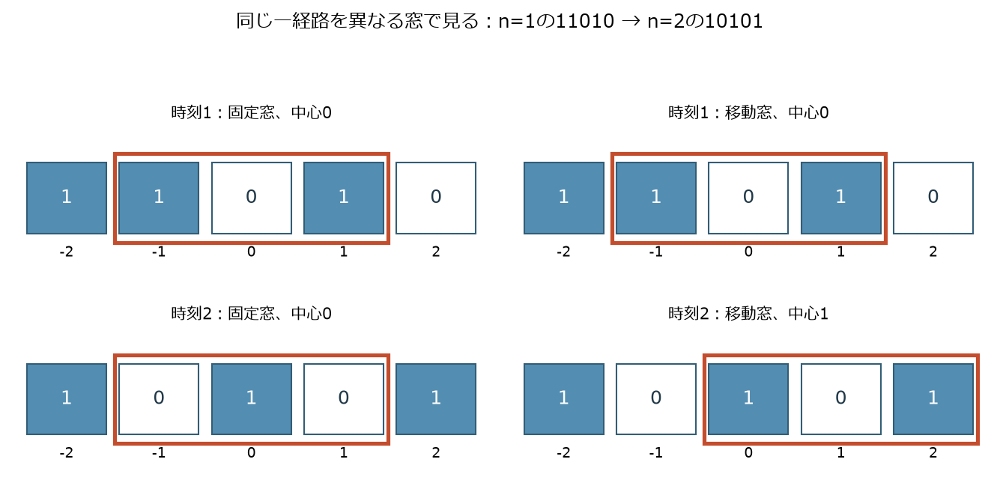
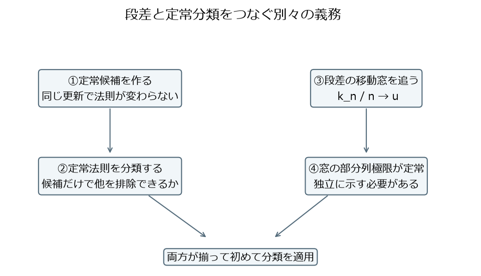
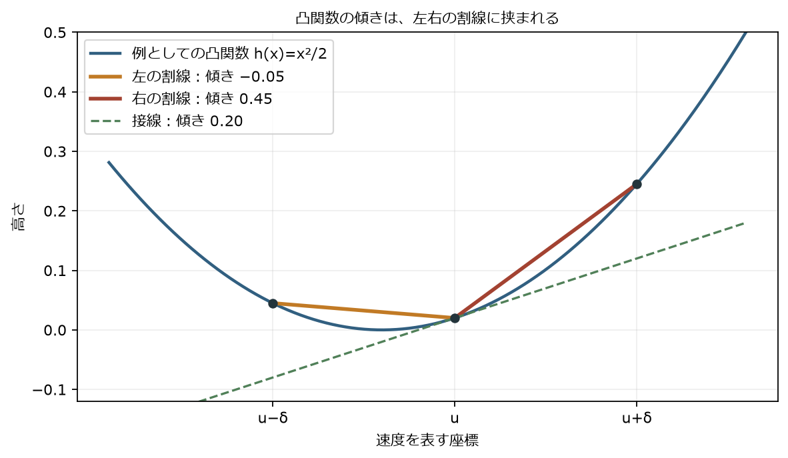

# 第8章　動く段差に、定常法則を使えるのか

## 観測点も動かす

第6章では、時刻1と2の位置0の占有確率が同じでも、隣の $10$ の確率が違った。最初の段差は時間定常ではない。したがって第7章の分類を、そのまま時刻2の法則に当ててはならない。

時刻 $n$ に位置 $i$ が粒子で占められていれば $X(i,n)=1$、空なら $X(i,n)=0$ と書く。時刻 $n$ に場所 $k_n$ を中心として周囲の固定個数の場所を見る。たとえば $k_n=\lfloor n/2\rfloor$ とすれば、観測点は境界を追うように右へ動く。より一般に $k_n/n\to u$ とする。窓の中の並びの確率表を、時刻を大きくしながら調べる。

この章では、二つの仕事を区別して進める。一つ目は、切断位置より右にある粒子の**合計**を時間で割ったものが、曲線 $h(u)$ に近づく道筋を追うこと。二つ目は、速度 $u$ で動く窓の**有限個の位置**を見たとき、長時間の部分列極限が定常法則になる条件を確かめることだ。前者は全体の形を測り、後者は第7章の定常分類を段差に使うための橋になる。次章ではこの二つを使い、まだ分からない $h(u)$ の値を上下から絞る。

| この章の目的 | 入力と道具 | 次章へ渡すもの |
|---|---|---|
| 全体の形 | 切断の右の粒子数を比較する | 累積量の極限候補 $h(u)$ |
| 局所の法則 | 動く窓の極限を取り、空間・時間の不変性を調べる | 第7章の分類を使うための条件 |

同じ「大きい」でも比較する対象は異なる。例えば同じ二位置の $10$ と $01$ は、左側の切断より右にある粒子数は同じだが、二位置の間の切断では後者の方が多い。一方、各位置の0/1は一方が両方で大きいわけではない。**累積数の順序**は切断ごとの数、**占有列の順序**は位置ごとの0/1を比べる。さらに**確率的順序**は二つの確率法則を比べる言葉で、例えば常に $00$ を出す法則と常に $10$ を出す法則は、前者が各位置で後者以下となる組として実現できる。第7章に渡すためには、これらを区別した上で窓の極限が空間にも時間にも定常となることが必要だ。

本文では累積数の比較を有限の式から組み立てる。一方、占有列の順序を保つ結合や無限列の局所極限は補助章A・Bに依存し、その一般的な独立完査は残る。したがって、次章へ渡す「移動窓の極限は定常」という結論も、それらの入力を伴うものとして読む。

たとえば中心一か所の占有確率が時刻ごとに $1/2+(-1)^n/4$ だとしよう。この数列は全体として収束しないが、偶数時刻だけなら $3/4$、奇数時刻だけなら $1/4$ に収束する。部分列極限を一つ見つけても、他の部分列が同じ極限を持つとは限らない。以下でまず部分列を調べるのは、全体の収束を前提にせず、可能な極限を絞り込むためである。

一つの窓は有限個の0と1しか含まない。したがって並びの種類も有限で、どの並びにどれだけの確率があるかを表にできる。時刻を適切に選び直した部分列で、それぞれの表の値が極限を持つことを考えよう。窓の大きさを順々に増やし、矛盾しないように部分列を選ぶと、全ての有限窓について極限の確率を与える候補を作れる。これを**局所的な部分列極限**と呼ぶ。

この選び方の具体的な対角線の手順と、互いに整合する有限窓から無限列の法則を作る橋は、次の数学的詳細で追える。ここで得られるのはあくまで極限の候補であり、候補の一意性や定常性は別途必要だ。

::: {.callout-note collapse="true"}
## 数学的詳細：部分列と無限列

### 窓を大きくしながら部分列を選ぶ

たとえば中心一か所を見るなら、時刻 $n$ ごとの $P(X_{k_n}=1)$ は0から1の間の数である。有界な数列からは収束する部分列を選べる。次に左右一か所ずつを加えた三か所の窓を見る。並びは $000$ から $111$ まで八通りなので、先ほど選んだ時刻列からさらに部分列を取り、八つの確率を同時に収束させることができる。

同じことを五か所、七か所、と繰り返す。第1段階で残した時刻列の第1項、第2段階で残した時刻列の第2項、というように対角線上の項を選ぶと、どの固定された窓についても、十分先ではその窓に対応する段階以降の部分列に属する。したがって各固定窓の各並びの確率は収束する。

窓を切り詰めた確率は、切り詰める前の並びの確率を足したものだ。この等式は各有限時刻に成り立ち、有限和の極限に移せるため、得られた有限窓の確率は互いに整合する。整合する有限窓から無限列の法則を作る一般的な橋は、別に必要である。また、この部分列の取り出しだけでは極限が一意とも定常とも言えない。

整合する窓の確率から、無限列をどのように作るかも一度考えてみよう。位置を $0,1,-1,2,-2,\ldots$ の順に並べ、最初の $m$ 位置の値を $w$ とする。そのパターンの確率を $p(w)$ と書けば、整合性は次の位置の二つの可能性について

$$p(w)=p(w0)+p(w1)$$

と書ける。$p(w)>0$ なら、すでに $w$ が現れた条件の下で次を1にする確率は $p(w1)/p(w)$、0にする確率は $p(w0)/p(w)$ だ。これを使い、独立な一様乱数を順に読んで一位置ずつ値を選ぶ。$p(w)=0$ のときは条件付き確率をどう決めても構わない。その枝に到達する確率が0だからである。

実際、空のパターンから始める確率は $p(\varnothing)=1$。長さ $m$ のパターン $w$ が選ばれる確率が $p(w)>0$ なら、その先に1を選ぶ確率は $p(w)\,p(w1)/p(w)=p(w1)$。0も同様だ。$p(w)=0$ の場合は整合性と非負性から $p(w0)=p(w1)=0$ であり、実際にその枝にも到達しない。こうして任意の有限個の初めの位置について、指定した確率を再現できる。任意に選んだ有限窓も、十分多くの初めの位置に含まれるので、窓の外の余計な位置の値を有限通りについて足せば、その窓の確率も再現する。ここでは可算個の独立な一様乱数を同時に扱う標準的な確率空間の構成を使っている。補助章AのSTA-01は、有限窓事象から無限列の法則への橋を別に扱う。有限表の整合性だけを書いて、無限列が理由なく現れたことにはしない。

:::

## 極限があっても、定常とは限らない

ここからは目的の二本目、移動窓の極限に第7章の分類を使う条件を調べる。

有限時刻の表が落ち着いて見えるだけでは、その極限を一回更新して同じ法則になるとは言えない。まして、一つの経路の二枚の写真が似ているだけならなおさらだ。必要な主張は次のように分かれる。

1. 移動窓の法則から、局所的な収束部分列を取り出せる。
2. その極限が空間の平行移動で変わらない。
3. その極限が元の粒子更新を一回行っても変わらない。
4. その条件に対して第7章の分類を適用できる。

ここでいう時間定常は、極限の無限列に**元の粒子更新**を施したときの不変性である。観測点の移動まで一回の更新に含めた別の操作と混同しない。段差の順序を保つ結合、隣り合う観測点の比較、有限窓における更新の連続性によって、この橋を架ける構想を補助章Bに記している。

## 累積粒子数で形を測る

ここからはいったん目的の一本目に戻り、切断の右側を数えて全体の形を記録する。

時間 $n$ に位置 $k$ より右にいる粒子の数を $S(k,n)$ とする。段差から有限時刻だけ進めるので、その数は有限だ。区間 $(a,b]$ にいる粒子数は

$$S(a,n)-S(b,n)$$

と書ける。一点の粒子の有無より、区間全体でどれだけ粒子が移ったかを見る量である。

第6章の時刻2の五通りでは、場所0より右に粒子がいるのは $10101,10110,11001,11010$ の四行で、どの行も右側の粒子数は1。$11100$ だけ0なので、$S(0,2)=1$ の確率は $1-1/4=3/4$、0の確率は $1/4$ である。したがって $\mathbb E[S(0,2)/2]=3/8$。これは位置0そのものが粒子である確率 $1/2$ とは違う。時刻2では右端より先に粒子がいないため、この有限窓だけで右側全体を数えられる。

区間を使った数え方も同じ表で確かめよう。時刻2には位置2より右に粒子がないので $S(2,2)=0$。したがって、位置1と2にいる粒子数の期待値は $\mathbb E[S(0,2)-S(2,2)]=3/4$ である。別々に足しても、位置1の占有確率 $1/2$ と位置2の占有確率 $1/4$ の和は $3/4$。二つの場所あたりの平均密度は、その半分の $3/8$ になる。ここで使ったのは期待値の加法であり、位置1と2の占有が独立だという仮定ではない。

実際、表の五行を調べると、この時刻には位置1と2がともに1になる行はない。両方が1である確率は0だが、それぞれの占有確率の積は $(1/2)(1/4)=1/8$ である。だから二つの占有状態は独立ではない。それでも「位置1の粒子数＋位置2の粒子数」の期待値は、各位置の期待値を足して求められる。区間の平均を計算するために、存在しない独立性を仮定する必要はなかった。

もし

$$\frac{S(\lfloor un\rfloor,n)}n\longrightarrow h(u)$$

という極限が適切な意味で得られれば、二点での値の差 $h(\alpha)-h(\beta)$ が、区間の粒子数を $n$ で割った値の候補になる。区間の長さで割った平均密度がほしければ、さらに $\beta-\alpha>0$ で割る。極限の存在や収束の意味は証明の対象であり、この式を単なる定義として使って結論を先取りしてはいけない。

ここで本書と既知の定理の接続を一つ確認する。[Jockusch–Propp–Shor の定理2](https://arxiv.org/html/math/9801068v3) は、左側が粒子・右側が空きという段差から、公平コインで $10\to01$ を並列更新したとき、固定された区間の粒子数を $n$ で割った値が $h(\alpha)-h(\beta)$ に確率収束すると述べる。本書の片側累積数は、例えば右端を $\beta=1$ にして得られる。初期状態の最右粒子は0にあり、一時刻に高々1歩進むので、時刻 $n$ に位置 $n$ より右の粒子はない。原典の閉区間と本書の切断で端点の数え方が違っても、差は高々一定個だから $n$ で割れば消える。定理の適用に必要な初期状態と並列更新の規約を変えてはいけない。

## なぜ累積数は比較に役立つのか

入力は二つの累積数の大小、道具は同じコインによる更新である。結論として、その大小が後の時刻にも保たれる。

同じ時刻の二つの粒子列を考え、どちらも各切断位置より右側の粒子が有限個であると仮定する。それぞれの右側粒子数を $H_i$、$K_i$ とする。各列で隣接差は0か1なので、$H_{i-1}-H_i$ は場所 $i$ の粒子の有無を表す。$i$ の粒子が右へ進む条件 $10$ は

$$H_{i-1}=H_i+1,\qquad H_{i+1}=H_i$$

に等しい。そのとき切断 $i$ の右側の粒子が一つ増え、$H_i$ が1増加する。

最初に全ての $i$ で $H_i\le K_i$ とし、各切断位置ごとに独立の公平なコインを用意し、二つの列では同じ位置に同じコインを使おう。整数値なので $H_i<K_i$ なら、$H_i$ が高々1増えても一気に逆転できない。$H_i=K_i$ で $H_i$ が増える場合はどうか。上の二条件と $H\le K$、隣接差0か1から、$K_{i-1}=K_i+1$、$K_{i+1}=K_i$ が強制される。したがって $K_i$ も同じコインで増える。こうして累積数の大小は一回の更新後も保たれる。

占有列の順序を保つ別の結合が必要になる理由も、同じ三位置で見える。下の列を $100$、上の列を $110$ とし、窓の外に新しい移動候補がないものとする。下の候補が成功するときは上の候補を失敗させ、下が失敗するときは上を成功させよう。コイン一枚の表・裏を反対向きに使えば、各列の成功確率はどちらも $1/2$ のままである。

表なら $(100,110)\to(010,110)$、裏なら $(100,110)\to(100,101)$。どちらも下の列が各位置で上以下になっている。これで三位置の二候補については順序を保つ結合を作れた。ただし、一般の長い列では候補が多数あるため、この反対向きの対応を各候補に矛盾なく配り、各列内のコインの独立性も保つ必要がある。その一般構成は補助章Aの入力であって、この一例が代わりになるわけではない。

ここで大事なのは、**累積数の大小**と、各場所の0/1占有の大小は別だということだ。例えば占有列 $100\le110$ でも、同じ時刻にそれぞれの候補が成功すると $010$ と $101$ になり、位置ごとの大小は保たれない。どちらの順序を使っているかを常に明記する。

## 累積量の極限は、なぜ存在する見込みがあるか

今得た累積数の比較を、時間を大きくしたときの形の候補へつなぐ。極限を取る条件は詳細で確認する。

ここからの目標は、時刻が大きくなると、右側の粒子数を時刻で割った量がどんな値に近づくかを調べることだ。そのために、ある時刻の配置を、その地点に置いた理想的な段差と比べる。元の配置はこの段差を超えず、更新後も高さの大小が保たれる。補助章Bに記す比較と極限操作の条件を認めれば、この比較を時間のブロックに繰り返して、平均の極限と、そこへの確率収束が得られる。

平均だけでは、個々の配置が同じ形に近づくとは分からない。例えば毎回0か2をそれぞれ確率 $1/2$ で選ぶ量は、どの回も平均1だが、値が1から $1/2$ より大きく離れる確率は常に1である。ここで欲しいのは、任意の $\varepsilon>0$ に対して、正規化した累積数がある値から $\varepsilon$ 以上離れる確率が0へ向かう、という**確率収束**だ。平均の極限を求めるだけでなく、この揺らぎを抑える必要がある。

さらに、切断位置を一つ動かしても粒子数は高々一つしか変わらないので、極限の候補 $h$ は連続になる。両端では先頭粒子と最後尾の空き場所を追うことで、$u>1/2$ では $h(u)=0$、$u<-1/2$ では $h(u)=-u$ と分かる。中央の値はまだ決まらず、次章で上下から挟む。ここで使う比較と極限操作の詳しい筋道は次にある。

::: {.callout-note collapse="true"}
## 数学的詳細：比較から累積量の極限へ

累積数の極限 $h$ を仮定したままでは、先へ進むための基礎が残る。ここでは、その存在を示す比較の骨格を追う。時刻 $m$ に切断位置 $k$ の高さが $C=S(k,m)$ であるとし、そこから右は高さ $C$、左は一歩ごとに1ずつ高くなる理想的な段差

$$R_j=C+(k-j)_+$$

を作る。ここで $(x)_+=\max(x,0)$。もとの累積数は隣接差が0か1だから、全位置でこの段差を超えない。先ほどの高さの順序保存を使えば、その後に同じコインを与えても、もとの高さは理想的な段差を超えない。

理想的な段差は、形だけ見れば最初の段差を位置 $k$ へ移し、高さを $C$ だけ足したものだ。 ただし $C>0$ なら右の無限遠でも高さが $C$ のままで、右側に有限個の粒子を数えた累積量そのものではない。ここでは隣接差が0か1の高さ列に対して局所更新と順序比較を拡張して使っている。時刻 $m$ より後のコインは、それまでのコインから決まった $C$ と独立である。そのため、別に用意した独立な変数 $U,V$ を $U\overset d=S(k,m)$、$V\overset d=S(l,n)$ と選べば

$$S(k+l,m+n)\le_{\rm st} U+V$$

という分布の比較が得られる。右側は同じ実験の前半と後半をそのまま足したものではない。比較のために独立に作った二つの変数である。位置の丸めを加えて $A_n=S(\lfloor un\rfloor,n)$ とすれば、$\lfloor um\rfloor+\lfloor un\rfloor\le\lfloor u(m+n)\rfloor$ と、$S$ が位置について減少することから、$A_{m+n}$ も独立な $A_m,A_n$ の和以下という比較が使える。

独立なコピーの和へ何回も延ばすには、確率的な大小に両辺と独立な同じ分布の変数を足しても、大小が保たれることを使う。固定ブロック長で $n=bq+r$ としたとき、余りの長さ $r<q$ は固定した $q$ 以下なので、余りブロックの寄与を $n$ で割れば0へ近づく。

この比較と、ある定数 $C_u$ について $0\le A_n\le C_u n$ となる有限速度の評価から、決定論的な極限への収束を示す。まず期待値を $a_n=\mathbb E A_n$ とすると $a_{m+n}\le a_m+a_n$。固定したブロック長 $q$ で $n=bq+r$ と割り算すれば

$$\frac{a_n}{n}\le\frac{b a_q+C_u r}{n},\qquad 0\le r<q.$$

$n\to\infty$ とすると上極限は $a_q/q$ 以下。$q$ を自由に選べるので、$a_n/n$ は $\inf_q a_q/q$ に収束する。

次に、その下限に平均が近いブロック長を一つ固定し、同じ長さの独立コピーを多数足す。独立コピーの和の分散は個数に比例する一方、$n$ で割るときは分散を $n^2$ で割るので、上側へ大きく外れる確率を抑えられる。これだけでは下側へのずれは排除できないが、平均値そのものが先ほどの極限へ収束することと、$A_n/n$ が一様に有界なことを合わせれば、下側のずれも消える。その上側評価で、順番を一度書いておこう。$a=\inf_q a_q/q$ とし、先に許容誤差 $\varepsilon>0$ を決める。下限の定義から $a_q/q<a+\varepsilon/4$ となる一つの $q$ を選び、その $q$ は固定する。独立コピーと余りの和を $B_n$ とすると、十分大きい $n$ で $\mathbb E B_n/n<a+\varepsilon/2$。各ブロックは $C_uq$ 以下なので $\operatorname{Var}(B_n)=O(n)$ であり、Chebyshevの不等式から

$$\mathbb P(A_n/n>a+\varepsilon)
\le \mathbb P(B_n/n>a+\varepsilon)
\le \frac{4\operatorname{Var}(B_n)}{\varepsilon^2n^2}\longrightarrow0.$$

最初の不等式では $A_n\le_{\rm st}B_n$ を使った。$q$ を $n$ と一緒に変えず先に固定することで、同じ分布の独立ブロックを多数足す分散評価が成り立つ。

下側の一段を式で見るには $W_n=A_n/n$、先ほどの平均の極限を $a$ とし、$x_+=\max(x,0)$ と書く。正のずれと負のずれには

$$\mathbb E(a-W_n)_+=\mathbb E(W_n-a)_+ + a-\mathbb E W_n$$

という関係がある。右辺の最後は平均の収束で0へ、正のずれの項は上側の確率評価と一様有界性で0へ向かう。だから負のずれの平均も0へ向かい、両側を合わせた $\mathbb E|W_n-a|$ が0になる。これは $L^1$ 収束であり、特に確率収束を意味する。

この三段階を補助章BのD-02〜04で詳しく書いている。

極限関数の連続性も、この模型では累積数の差から分かる。二つの切断 $k,l$ の間で数え方が変わる粒子は高々 $|k-l|$ 個なので

$$|S(k,n)-S(l,n)|\le|k-l|.$$

$k=\lfloor un\rfloor,l=\lfloor vn\rfloor$ として $n$ で割り、各固定 $u,v$ での確率極限を使えば $|h(u)-h(v)|\le|u-v|$。同時に全ての速度で収束すると仮定したのではなく、今選んだ二つの固定速度の収束だけを使っている。特に $h$ は連続であり、第9章の下界で $\delta\downarrow0$ とする理由になる。

両端の外側では、極限値をもう少し具体的に決められる。最も右の粒子の前は常に空だから、一時刻ごとに確率 $1/2$ で右へ進む。その位置 $R_n$ は $\operatorname{Bin}(n,1/2)$ の分布を持ち、$R_n/n$ は確率の意味で $1/2$ へ近づく。$u>1/2$ なら、位置 $\lfloor un\rfloor$ の右に粒子がない確率は1へ近づくので $h(u)=0$。

反対側は粒子でなく、最も左の空き場所を追う。初期位置は1で、その左の粒子がそこへ動くたびに空きは一つ左へ移る。よって位置の分布は $1-\operatorname{Bin}(n,1/2)$ であり、$u<-1/2$ の切断より右に最左空孔がある確率は1へ近づく。このとき切断以下に空孔はなく、右側粒子数は初期値と同じ $-\lfloor un\rfloor$。従って $h(u)=-u$。両方とも二項分布の平均・分散を使った確率評価であり、位置が毎回ちょうど $n/2$ 動くという意味ではない。

結論は各固定 $u$ についての確率収束であり、この説明だけで全 $u$ の同時収束や概収束を主張しない。また上の比較は高さの順序で作ったもので、次節で使う占有列の順序とは区別する。

確率収束では、固定した誤差 $\varepsilon$ に対して「時刻 $n$ で誤差を超える確率」が0へ向かう。一方、概収束では、確率1で選ばれた各標本について「十分大きな全ての $n$ で誤差以下」が成り立つ。後者は時刻をまたいだ一経路の主張で、量化の順序が強い。この本の後の有限ネットの議論には、固定した有限個の速度での確率収束があればよい。従ってここで概収束を仮定したり、証明済みと扱ったりしない。

二つの違いは、互いに独立な出来事 $E_n$ を $P(E_n)=1/n$（$n\ge2$）として、$Y_n=\mathbf1_{E_n}$ と置くと見える。$P(Y_n=1)=1/n\to0$ だから $Y_n$ は0へ確率収束する。しかし、ある $N$ 以降ずっと0である確率は、有限個の場合の積が

$$\prod_{n=N}^{M}\left(1-\frac1n\right)=\frac{N-1}{M}\longrightarrow0$$

となるため0である。そのような $N$ は可算個しかないので、いつかずっと0になる確率も0。実際には確率1で1が何度も現れ、概収束はしない。これは違いを示す別の確率模型であり、ドミノの累積数が概収束しないという主張ではない。

:::

## 局所極限が定常になるための、二つの比較

再び目的の二本目に戻る。段差の平行移動との比較を使い、移動窓の極限に必要な不変性を調べる。

累積数を使って大きな形を記録する準備はできたが、それだけでは移動窓に第7章の分類を使えない。空間の平行移動で法則が変わらないことと、時間更新で変わらないことを、それぞれ比較して確かめる。

「窓を動かすと落ち着くかもしれない」を証明へ変えるには、比較の対象を明確にする。時刻 $n$ の位置 $k$ を原点として見た列の法則を $\mu(k,n)$ と書く。観測点を $k_n/n\to u$ と選び、ある部分列で $\mu(k_n,n)$ が局所的に $\nu$ へ近づいたとしよう。以下は、補助章A・Bにある順序結合と密度極限を入力とした説明である。

まず空間方向を考える。段差は左側に粒子が多く、適切な結合で占有列の大小を保てるなら、位置 $k$ の窓の法則は位置 $k+1$ の窓の法則と順序付きで比較できる。ただし、この占有列の順序保存は、先ほど示した累積数の順序保存とは別物である。同じ位置のコインを両列で共有するだけでは、占有列の順序は一般には保たれない。

### 累積数を微分するときの落とし穴

なぜ $f(u)=-h'(u)$ が一場所の密度なのだろう。有限の段差では、$S(k-1,n)-S(k,n)=X(k,n)$ だから、平均をとれば隣り合う累積数の差は一場所の占有確率になる。ただし、$S(\lfloor un\rfloor,n)/n\to h(u)$ を知っただけで、差の極限と微分を交換してはいけない。非常に小さな振動が関数の値には見えなくても、差分の傾きには残りうる。

例えば $g_n(v)=-v/2+\sin(nv)/(4n)$ は、どの $v$ でも $g(v)=-v/2$ に近づく。誤差は高々 $1/(4n)$ なので、区間全体でも一様に近づく。ところが $g_n'(0)=-1/4$ で、極限の導関数 $g'(0)=-1/2$ には近づかない。各 $g_n$ の傾きは常に $-3/4$ から $-1/4$ の間にあっても、細かな波が残るためだ。この例は粒子模型から作った関数ではない。値が近いことだけでは傾きが決まらない理由を示している。

以下では、注目する速度 $u$ の近くにある**各固定した** $v$ について、$S(\lfloor vn\rfloor,n)/n$ が決定論的な $h(v)$ に確率収束すると仮定する。$u$ の一点だけの収束では、左右の割線の端に必要な極限が足りない。この収束の存在自体も補助章Bの独立した入力である。

段差の適切な順序結合から、時刻 $n$ の平均密度 $\rho_n(k)=\mathbb E X(k,n)$ は $k$ とともに減少する。この単調性を使い、階段状の密度を積分して、区分的に直線な関数

$$h_n(v)=\int_v^\infty\rho_n(\lfloor wn\rfloor)\,dw$$

を作る。傾きは $-\rho_n$ だから、$h_n$ は凸で、傾きの絶対値は高々1となる。整数の端の補正は高々 $1/n$ である。固定した $v$ では、時刻 $n$ の右端粒子は高々位置 $n$ にいるので、$S(\lfloor vn\rfloor,n)/n$ は $n$ に依らない有限定数で抑えられる。したがって確率収束を平均へ移せる。実際、誤差の絶対値を任意の $\varepsilon$ 以下の部分と超える部分に分ければ、平均誤差は $\varepsilon$ と、一定の上界に失敗確率を掛けたものの和以下になる。こうして各固定 $v$ で $h_n(v)\to h(v)$。一様な傾きの制限によって、$v_n=k_n/n\to u$ でも左右の固定幅の割線を極限へ移せる。

式の意味を、第6章の時刻2の表で確かめよう。位置 $-1,0,1,2$ の占有確率を表の該当する行から足すと、それぞれ $3/4,1/2,1/2,1/4$ になる。例えば位置 $2$ が1なのは $10101$ と $11001$ の二行で、確率は $1/8+1/8=1/4$ だ。したがって $h_2$ の傾きは、$v$ が $-1/2$ から0の間では $-3/4$、0から $1/2$ の間では $-1/2$、1から $3/2$ の間では $-1/4$ となる。右へ進むにつれて傾きが減らずに増える様子が、ここでいう凸性の有限例である。有限例で単調性が見えたことと、全ての時刻で成立すると示すことは分けておこう。

凸関数では、ある点の傾きはその左右の割線の傾きに挟まれる。$h$ が $u$ で微分可能なら、まず $n\to\infty$、次に割線の幅を0へ近づけることで、両側はともに $h'(u)$ へ向かう。この挟み込みが、$\rho_n(k_n)\to-h'(u)$ の根拠だ。微分可能でない点については、ここでの説明だけでは同じ結論を出さない。

図の曲線は説明用の $x^2/2$ であり、この模型の極限 $h$ ではない。描いた点では左の割線の傾き $-0.05$、接線の傾き $0.20$、右の割線の傾き $0.45$ の順に並ぶ。実際の議論では $h_n$ の左右の割線を先に $n\to\infty$ で比較し、その後で幅 $\delta$ を小さくする。

さらに、累積粒子数の極限 $h$ が $u$ で微分可能であり、密度の単調性から各固定整数 $l$ に対し $\mathbb E X(k_n+l,n)\to f(u)=-h'(u)$ と仮定する。一つ右の窓の法則は極限では $\nu$ の空間移動 $T\nu$ に対応する。有限時刻の順序が局所極限でも保たれ、その順序を実現する結合が存在するという補助章Aの入力を使い、極限の列 $U$ と、その移動に対応する列 $V$ を全位置で $U_i\ge V_i$ と結合する。そのとき各位置で

$$\mathbb P(U_i\ne V_i)=\mathbb E(U_i-V_i)=0.$$

$U_i,V_i$ は0か1で平均が等しいので、違いの確率は0だ。位置は可算個だから、どの位置でも一致する確率は1となり、$\nu$ は一位置移動しても同じ法則になる。ここで使ったのは「各一位置の密度が同じ」という事実だけでなく、**順序を保つ結合もある**という事実である。前者だけでは、異なる相関を持つ列を区別できない。

次は時間方向だ。段差の最初の一回の更新では、裏なら元の段差のまま、表なら境界付近の粒子が一つ動く。その列は、元の段差を左右に一位置ずらした二つの列の間に挟まれる。残りの更新で適切な占有列の順序結合を使えば、一時刻余分に更新した窓の法則も、位置を一つずらした窓の法則の間に挟まれる。

この最初の挟み込みを、第6章と同じ位置 $-2$ から $2$ の窓で確認しよう。元の段差は $11100$、表が出た直後は $11010$。元の段差を一位置左にずらすと $11000$、右にずらすと $11110$ なので、各位置の0/1を一つずつ比べると

$$11000\ \le\ 11010\ \le\ 11110$$

となる。元の段差 $11100$ 自身も同じ二つの列の間にある。これは文字列を整数として比べる不等式ではなく、各位置で左の数字が右以下という意味だ。窓の外も段差の形を保つので、全位置で同じ大小が成り立つ。次の時刻以降にもこの大小を引き継ぐためには、第7章で見た、占有列の順序を保つ結合を使う。単に同じ場所で同じコインを使えば済むとは限らない。

この挟み込みでは最初のコインの表・裏を混ぜる。たとえば記号 $\le_{\rm st}$ を、大小を保つ結合があるという確率的な順序として、補助章Bの規約では

$$\tfrac12\mu(k,n)+\tfrac12\mu(k+1,n)
\le_{\rm st}\mu(k,n+1)
\le_{\rm st}\tfrac12\mu(k,n)+\tfrac12\mu(k-1,n).$$

中央は $\mu(k,n)$ を元の更新で一回動かした法則だ。左右の項の確率 $1/2$ は最初のコインの裏と表に対応する。混合しているので、各項を一つの決定的な配置と考えてはいけない。

有限窓の更新結果は、更新前の少し広い有限窓と有限個のコインだけで決まる。したがって、その有限個の確率を足す更新操作は局所極限に通せる。すでに極限 $\nu$ が空間移動で変わらないなら、左右の挟み込みの極限はともに $\nu$。一回更新後の極限も $\nu$ に挟まれ、時間定常性が得られる。全ての初期法則が一つの定常法則へ収束すると言ったのではない。

**成立条件と証明への道筋。** この説明には、$h$ の微分可能性、局所密度の極限、占有列の順序を保ち周辺法則も正しい結合、局所極限の整合性が必要である。特に微分可能でない速度まで、同じ文章をそのまま適用してはいけない。部分列極限の定常性と分類への接続は補助章A・Bにあり、上流の一般論証には独立確認が残る。次章では、これらの条件のもとで密度と流束から形を絞る。

**考えてみよう。** 「有限時刻で段差が変化する」ことと「ある移動窓の部分列極限が定常である」ことは矛盾するだろうか。それぞれが何について述べているか区別しよう。

**もう一問。** 移動窓の極限と、その一位置移動が各場所で同じ密度を持つだけで、二つの法則が等しいと言えるか。本文の順序を保つ結合は、そこに何を付け加えるか。空間の平行移動不変性を得た後、時間定常性を別に調べるのはなぜか。

::: {.callout-note collapse="true"}
## 考え方の例

矛盾しない。前者は、特定の有限時刻に元の段差から得た法則が時刻によって変わるという主張。後者は、観測位置も時間とともに動かし、長い時刻の部分列で得る局所的な極限についての主張である。後者の定常性は前者から自動的には出ず、本章で分けた仮定と証明が要る。

二問目では、一場所の密度だけが等しくても、二場所以上の相関は異なりうる。加えて大小を保つ結合があれば、同密度である各位置の非負の差の平均は0なので、全位置で一致する。これは空間移動についての主張であり、粒子を一時刻更新して法則が保たれることは、更新を伴う別の挟み込みで確認する。

:::

**さらに詳しく。** [A：順序結合](../appendices/a-stationary-coupling.qmd)、[B：累積量と局所極限](../appendices/b-density-limit.qmd)。各補助章の仮定と未完査の範囲も確認しよう。
