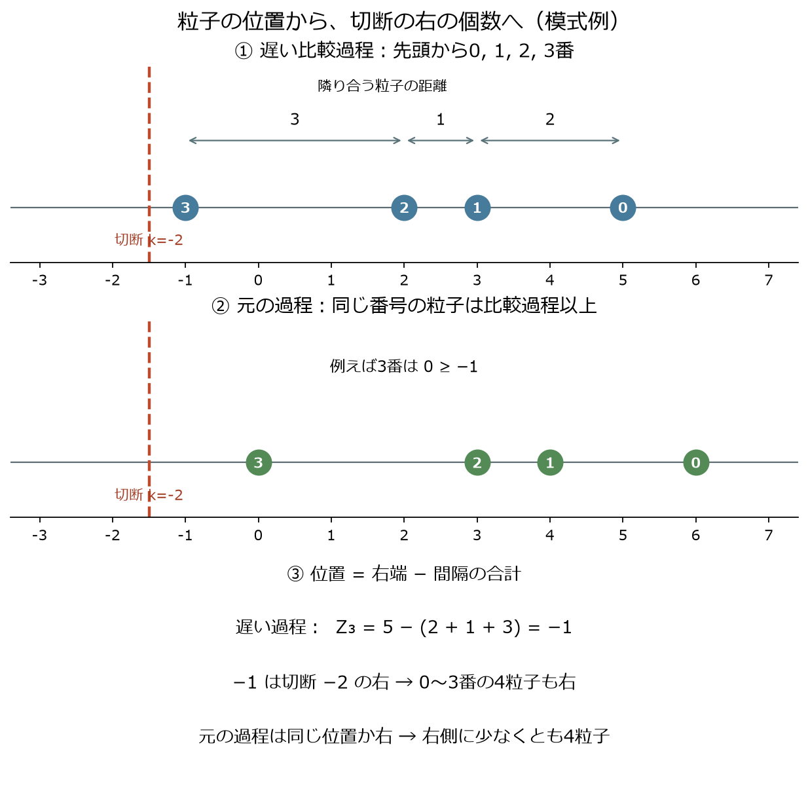
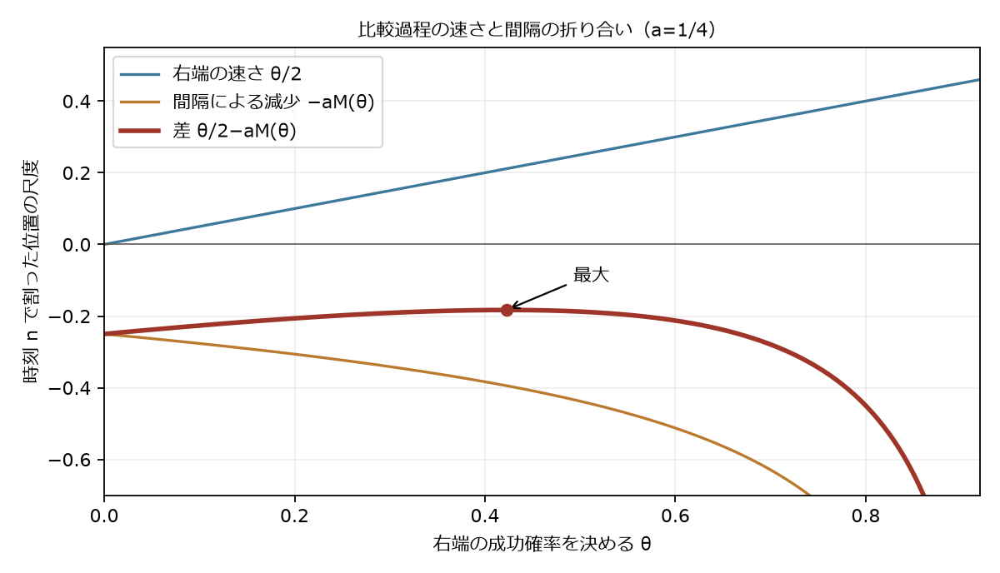
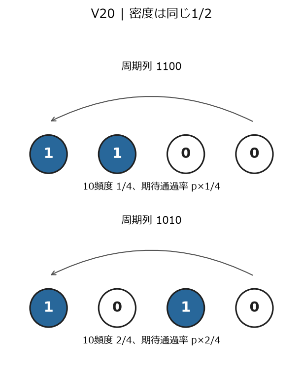
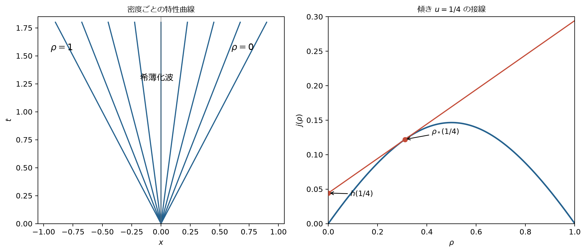

# 第9章　密度と流束から、形を絞る

この章の道筋を先に示そう。流束から累積粒子数の**上界**を求める。しかし上界だけでは、実際にそこまで達するか分からない。そこで元の段差より遅い粒子過程を作り、そこから**下界**を求める。両者が一致すれば累積量 $h(u)$ が決まり、その式に平方根が現れる。次章で元の座標へ戻すと円弧になる。折りたたんだ計算は、主筋を追った後に読み直せる。

## 動ける対を数える

並列更新では、粒子が右へ一歩進むには、更新前にその場所と右隣が $10$ でなければならない。成功確率を $p$ とすると、一辺を一時刻に通過する粒子の期待値は

$$j=p\,\mathbb P(10)$$

である。粒子密度 $\mathbb P(X_i=1)$ は $\mathbb P(10)$ とは異なる。第7章の周期例では密度が同じでも通過率が異なった。

この本の公平コイン模型は $p=1/2$ だ。第7章の定常候補 $\mu_d$ では、密度 $d$ に対する流束の式が

$$j(d)=\frac{1-\sqrt{d^2+(1-d)^2}}2$$

になる。これは独立なベルヌーイ列の式 $d(1-d)/2$ とは違う。たとえば $d=1/2$ なら

$$j(1/2)=\frac{1-1/\sqrt2}{2}\approx0.1464.$$

独立列なら $P(10)=1/4$ だから同じ成功確率で流束は $1/8$。密度が等しくても、隣接関係が異なれば流束も違う。定常候補の構成とこの式の導出には補助章Eを使い、一般の定常法則を扱うには第7章の分類が別に必要である。

第7章では、密度 $1/2$ の独立列を一回更新すると $P(10)$ が $1/4$ から $17/64$ に変わることを計算した。したがって $1/8$ はその独立列の**更新前の流束**であり、定常候補の流束として使ってはいけない。ここで必要なのは、長時間の移動窓の極限を定常法則と比較し、その候補の相関を使うことである。

第6章の有限時刻も含め、同じ一場所の密度 $1/2$ を持つ三つの場合を並べよう。通過率は、いずれも次の公平な更新一回についての値である。

| 粒子列または法則 | 注目位置の $P(10)$ | 一辺の期待通過率 |
|---|---:|---:|
| 段差から時刻2、位置0と1 | $3/8$ | $3/16$ |
| 独立な密度 $1/2$ の列、更新前 | $1/4$ | $1/8$ |
| 密度 $1/2$ のMarkov定常候補 | $1-1/\sqrt2$ | $(1-1/\sqrt2)/2$ |

最後の行の時間定常性は第7章で挙げた輪の極限を入力とする。第6章の時刻2の値が最後の行と違っても矛盾しない。有限時刻の段差の窓が、その定常候補に従うとはまだ言っていないからだ。

この式は、候補の隣接する二地点の確率を調べて得られる。必要なら次の計算を開こう。

::: {.callout-note collapse="true"}
## 数学的詳細：流束の平方根

この式の平方根は、定常候補の隣接確率から導ける。$q=\mathbb P(10)$ とし、空間的に定常な列では $\mathbb P(01)=q$ とする。密度が $d$ なら $\mathbb P(11)=d-q$、$\mathbb P(00)=1-d-q$。有限輪から得るMarkov候補では、遷移確率の関係をこれらの二点確率に直すと

$$q^2=2(1-d-q)(d-q)$$

となる。この関係を少し詳しく見る。第7章の輪の重みは、隣接する状態0,1に行列

$$W=\begin{pmatrix}1&1\\2z&z\end{pmatrix}$$

の対応する成分を掛け、一周分を積にしたものだ。輪を大きくしたMarkov候補では、二点確率は $W_{ij}$ に両端の正の固有ベクトル因子と規格化因子を掛けた形になる。$P(01)P(10)/[P(00)P(11)]$ を作るとこれらの因子は消え、$W_{01}W_{10}/(W_{00}W_{11})=2$ が残る。これは $0<d<1$ の場合の説明で、$d=0,1$ は全0または全1の退化した法則として直接扱う。有限輪からの極限そのものは補助章Eの入力である。

この二次方程式の解は $q=1\pm\sqrt{d^2+(1-d)^2}$。確率が $0\le q\le\min(d,1-d)$ を満たすには、マイナスの解を選ぶ。公平なコインの成功確率 $1/2$ を掛ければ、上の $j(d)$ が出る。二次方程式を解くだけでなく、確率として許される根を選ぶことが必要だ。

:::

**ここまでの道筋。** まず密度だけでなく、動ける $10$ の頻度から流束 $j(d)$ を得た。次は動く観測点から見た粒子数を、この流束と結び付ける。

## 切断を動かしたときの収支

位置 $k$ より右の粒子数 $S(k,n)$ は、粒子がその切断を左から右へ通過すれば一つ増える。観測位置自体を右へ動かせば、数える範囲から粒子を一つ除くことがある。つまり、移動観測者にとっての増加は「通過した分」から「観測位置を動かして数えなくなった分」を引いたものだ。

局所密度を $d$ とすれば、粒子の通過による増加から、移動する観測点が追い越す分を引いて $j(d)-ud$ が現れる。極限と定常分類を使う条件は前章の通りである。整数時刻の正確な収支と極限への橋は、次に置く。

::: {.callout-note collapse="true"}
## 数学的詳細：動く切断の収支

もう少し細かく、整数時刻ごとに式にしよう。時刻 $t$ の切断位置を $k_t=\lfloor ut\rfloor$、一時刻の移動を $r_t=k_{t+1}-k_t$ とする。$|u|\le1/2$ では $r_t$ は $-1,0,1$ のいずれかだ。$J_t$ は位置 $k_t$ から右へ粒子が実際に通過したとき1、それ以外は0とし、$z_t=\max(k_t,k_{t+1})$ とする。そのとき、更新を先に行い、次に切断を動かすと

$$S(k_{t+1},t+1)-S(k_t,t)=J_t-r_tX(z_t,t+1).$$

$r_t=1$ なら切断を右へ動かすことで位置 $k_t+1$ の粒子を数えなくなり、$r_t=-1$ なら位置 $k_t$ の粒子を新たに数える。$r_t=0$ なら数える範囲の移動による補正はない。補正に使うのは**更新後の**占有状態である。

例えば切断の左側にあった粒子が右へ渡り、その直後に切断も一歩右へ動いてその粒子を追い越したとする。$J_t=1$、$r_t=1$、更新後の $X(z_t,t+1)=1$ なので、数える粒子数の変化は $1-1=0$。粒子は動いたが、観測者も一緒に動いたため、右側の粒子は増えない。これが後に現れる $j(d)-ud$ の引き算の意味である。

両辺を $t=0,\ldots,n-1$ で足すと左辺は望遠和になり、初期段差では $S(k_0,0)=S(0,0)=0$ だから、$S(k_n,n)$ が残る。また $\sum r_t=k_n-k_0=k_n$。局所窓の密度がある値 $d$ に近づくとき、適切な極限交換を認めれば、第二項を $nd\,(k_n/n)$ に近いものとして扱える。第一項は時間平均した通過数に対応する。

期待値を取り $n$ で割ると、公平コインなので $\mathbb E J_t=\tfrac12\mathbb P(X(k_t,t)=1,X(k_t+1,t)=0)$。よって

$$\frac{\mathbb E S(k_n,n)}n=
\frac1{2n}\sum_{t=0}^{n-1}\mathbb P(X(k_t,t)=1,X(k_t+1,t)=0)
-\frac1n\sum_{t=0}^{n-1}r_t\,\mathbb E X(z_t,t+1).$$

$h$ が $u$ で微分可能で、前章の移動窓の密度極限が使えると仮定すると、$z_t/(t+1)\to u$ だから、第二項の占有期待値は $f(u)=-h'(u)$ に近づく。$|r_t|\le1$ と $\sum r_t=k_n$ を使えば、有限個の初めの時刻を除いた誤差の平均は0へ向かい、第二項全体は $u f(u)$ に近づく。ここで $r_t$ に負の値があっても、絶対値を用いて誤差を抑える。

第一項については、各時刻の局所法則が単一の定常法則へ収束すると仮定する必要はない。任意の部分列から局所収束する部分列を取れ、その極限が第8章の条件を満たして定常分類に入るなら、どの部分列極限の流束も平均密度 $f(u)$ に対する $j(f(u))$ 以下になる。このことから元の局所流束列の上極限も同じ値以下、したがって時間平均の上極限も同じ値以下である。これには局所部分列のコンパクト性・定常性・分類が必要で、単なる有限時刻の確率表では代用できない。

速度 $u$ で動く観測点において局所密度が $d$、局所流束が $j(d)$ なら、この収支は $j(d)-ud$ という形を示唆する。ただし、この説明だけでは極限の交換を正当化できない。補助章BのD-11では、整数時刻の正確な収支を書き、部分列極限の定常性と分類を使って上界を作る。

:::

分類が使えると仮定し、許される密度の中で最も大きい値をとれば、形の候補に対して

$$h(u)\le \max_{0\le d\le1}\{j(d)-ud\}$$

という上界が出る。反対向きの下界も得られて初めて、上界と下界が一致し、実際の極限が決まる。「最大化できた」だけでは、段差の極限そのものがその値だとは言えない。

一例として $u=0$、つまり原点で観測する場合は、右辺は $\max_d j(d)$ だ。$d^2+(1-d)^2=2(d-1/2)^2+1/2$ は $d=1/2$ で最小なので、$j(d)$ はそこで最大となる。したがって $h(0)\le(1-1/\sqrt2)/2$。約0.1464より多くはならないと分かったが、例えば0.1である可能性はまだ残る。下界が必要なのはそのためだ。

混合した定常法則の流束も、$j(d)$ の凹性により平均密度の流束以下になる。したがって密度を変えて最大を取れば上界を得る。以下はその理由と最大化の計算である。

::: {.callout-note collapse="true"}
## 数学的詳細：混合と最大化

混合に対して、なぜ一つの密度で評価できるのだろう。$j$ は $0<d<1$ で凹関数であり、平均密度を $\rho=\int d\,\pi(dd)$ とすると

$$\int j(d)\,\pi(dd)\le j(\rho).$$

有限個の候補の混合なら、これは曲線上の二点を結ぶ線分が凹曲線の下にあるという図形的な事実を、重み付き平均に適用したものだ。別の見方では、$j(d)\le j(\rho)+j'(\rho)(d-\rho)$ という接線の上界を各成分に書いて平均すれば、一次のずれの平均は $\int(d-\rho)\,\pi(dd)=0$ になる。$\rho=0$ または1なら、$0\le d\le1$ の確率分布で平均が端点になるのは、その端点に集中するときだけだ。

実際に凹性も確かめられる。$s(d)=\sqrt{d^2+(1-d)^2}$ とおくと

$$j'(d)=\frac{1-2d}{2s(d)},\qquad j''(d)=-\frac1{2s(d)^3}<0.$$

$0<d<1$ では $s(d)>0$ なので、二階微分は負である。端点には $j$ の連続性を用いればよい。図で分かったつもりの「混ぜると上へ出ない」という性質は、この符号の計算で確かめられる。

この不等式は定常混合の流束を抑える。段差の移動窓で本当にその定常混合を使えることは、第8章で分けた極限と定常性の証明を別に必要とする。

最大化も具体的に見よう。$s(d)=\sqrt{d^2+(1-d)^2}$ とおくと、内部点では

$$\frac{d}{dd}\{j(d)-ud\}=\frac{1-2d}{2s(d)}-u.$$

$u=0$ なら導関数は $d<1/2$ で正、$d>1/2$ で負なので、最大は $d=1/2$ で実現する。一般に $|u|<1/2$ では、この導関数を0とおいて、二乗後に $1-2d$ と $u$ の符号が同じという条件も残すと

$$d_*(u)=\frac12-\frac{u}{\sqrt{2-4u^2}}.$$

速度を一つ入れて、最適化が何をしているか確かめよう。$u=1/4$ なら、候補となる密度は $d_*=1/2-1/(2\sqrt7)\approx0.311$。この密度での流束は $j(d_*)=1/2-1/\sqrt7\approx0.122$、動く切断に追い越される分は $ud_*\approx0.078$ なので、差は約0.044となる。正確には

$$j(d_*)-\tfrac14d_*=\frac{3-\sqrt7}{8}.$$

ただし、この数はここでは**上界**である。最も大きい候補を計算しただけでは、実際の段差から出発した粒子数がそこまで達するか分からない。

一般の $|u|<1/2$ でも、平方根がどこから出るかを代入して確かめよう。$D=\sqrt{2-4u^2}$ と置けば $d_*=(1/2)-u/D$ であり、二つの平方を足して

$$\sqrt{d_*^2+(1-d_*)^2}=\frac1D.$$

よって、最大化した値は

$$j(d_*)-ud_*=\frac{1-u}{2}+\frac{u^2-1/2}{D}
=\frac{1-u}{2}-\frac12\sqrt{\frac12-u^2}.$$

$D>0$ を使い、二乗して現れる別の符号を選ばない。$j''(d)<0$ なので停留点は最大点であり、$|u|<1/2$ のとき先ほどの $d_*$ は0と1の間にある。この平方根は、流束から $ud$ を引いた式の最適化で現れた。ここではまだ物理平面の円を仮定していない。

ここまでの時間平均からの導出は、$h$ が $u$ で微分可能な点で行った。全ての速度へ広げるには別の一歩が要る。補助章Bで得る $h$ の凸性から、微分可能な点は各区間にある。$h$ 自身と、最大化して得られる右辺は連続なので、微分可能な速度を列として選び、その極限を取って上界を延長する。微分できない点で $h'(u)$ を勝手に代入するわけではない。

この値を $j(d)-ud$ に戻すと下の中央部分が出る。$u=\pm1/2$ では最大点が端の $d=0$ または $1$ に達する。$|u|>1/2$ の形の値については、伝播速度と初期段差を用いた別の議論が必要で、内部最大化だけからは導かない。

:::

**ここまでの道筋。** 動く切断の収支と定常分類から上界が出て、その最適化に平方根が現れた。上界だけでは実際の値は決まらないため、次は反対方向から押さえる。

## 反対向きの下界は、どこから来るのか

たとえば、ある量が $0\le a\le 3$ と分かっても、$a=1$ と $a=3$ はどちらも条件を満たす。上界3に達すると言うには $a\ge3$ という反対側の評価が必要だ。ここでも、先ほどの最大化が与えた上界に実際の累積量が達することを、別の比較で確かめる。

上界は「これより多くは流れられない」を示すが、それだけでは実際の段差がどれだけ右へ進むか分からない。下界では、元の過程より意図的に遅い比較用の粒子過程を作る。右端粒子の移動成功確率だけを $\theta/2$（$0\le\theta<1$）に下げ、他の粒子は公平コインで動かす。同じ乱数を使って元の過程と比べると、遅い過程の粒子は対応する元の粒子を追い越さない、という順序を使える。

下界を作る道筋を先に見ておこう。ある番号の粒子が、遅い比較過程ですら切断位置より右に届くなら、元の過程の同じ番号の粒子もその右にいる。そこから切断の右側に少なくとも何個の粒子があるか分かる。比較過程で粒子の位置を評価するには、右端の進む速さを下から、右端からその粒子までの間隔の合計を上から抑えればよい。以下の間隔分布と $\theta$ の最適化は、この二つの評価を組み合わせるために導入する。

先に式で道順を書くと、右端の速さから、粒子番号の割合に平均間隔を掛けたものを引いた

$$\frac\theta2-aM(\theta)$$

を使い、粒子の位置を時刻 $n$ で割った量の下側を評価する。そこから切断の右の粒子数を数え、$h(u)$ の下界へ移る。定常な間隔分布を調べる目的は、この $M(\theta)$ を確保することである。

この順序は、対応する番号の粒子について右から順に確認できる。二つの模型の同じ番号の粒子に、更新前から位置の差が1以上あれば、一回に高々1しか動かないため、遅い模型の粒子が追い越すことはできない。位置が同じときに、遅い模型の粒子が進める場合を考えよう。その一つ前の粒子は、元の模型では遅い模型と同じか、さらに右にいる。したがって遅い模型で前が空いていれば、元の模型でも前は空いている。同じ乱数を使い、元の模型の成功条件を遅い模型より厳しくしなければ、元の粒子も進む。右端だけは、遅い模型の成功確率を $\theta/2$、元を $1/2$ とするので、この条件を満たせる。

こうして一回後も各番号の位置の大小が保たれ、初めは二つの模型が同じ段差なので、更新ごとに繰り返せる。ここで比較するのは**同じ番号の粒子の位置**である。各場所の0/1占有状態が常に大小関係を持つ、という第8章の別の結合と混同しない。

右端の粒子を0番、その左隣を1番、さらに左を2番というように番号を付け、$i$ 番の粒子の位置を $Z_i(n)$ とする。隣接する粒子の距離を $Y_i(n)=Z_{i-1}(n)-Z_i(n)$ とすると、望遠和により

$$Z_k(n)=Z_0(n)-\sum_{i=1}^kY_i(n).$$

図は考え方を示す模式例である。比較過程で0番が位置5、間隔が順に2・1・3なら、3番の位置は $5-(2+1+3)=-1$。切断を $k=-2$ に置くと、3番が切断の右にいるので、0〜3番の4粒子も右にいる。元の過程では同じ番号の粒子がそれぞれ比較過程以上の位置にあるから、元の過程の切断の右にも少なくとも4粒子がいる。図の数値は説明用で、特定の $n$ における確率や、先ほどの $\theta$ から計算した標本ではない。

右端の前には粒子がいないので、遅い模型では右端は一時刻に確率 $\theta/2$ で進む。一方、粒子の間隔が広すぎれば、後ろの粒子は右端から大きく遅れる。速い右端と狭い間隔を同時に得ることが、下界をよくする鍵だ。

ここで分布を設計する。右端の平均速度を確保したまま、各粒子までの距離を多数の間隔の和として扱いたい。そのため、間隔が互いに独立で、更新しても同じ分布に戻る候補を探す。空き数を $q=Y-1$、後ろの粒子が出発したかを $D$、出発後の空き数を $R=q-D$ とする。$q=0$ では $D=0$、$q>0$ では公平コインで $D=0,1$ が半々だ。

更新後の隣の間隔へ渡る $D$ を、残った $R$ と独立にできれば、間隔ごとの独立性を保つ手掛かりになる。正の $l$ で $R=l$ になるには $(q,D)=(l,0)$ または $(l+1,1)$ の二通りがあり、両方にコインの確率 $1/2$ が掛かる。したがって独立性を求めると $P(q=l+1)/P(q=l)$ は $l$ によらない。このため正の空き数の分布に等比型を試す。$P(q>0)=\theta$ なら $P(D=1)=\theta/2$ で、出発と不出発の比から公比は $r=\theta/(2-\theta)$ と決まる。$R=0$ の場合や間隔全体の独立性も確認する必要があり、それを後の詳細で行う。

こうして得る比較用の定常な間隔分布は、間隔 $Y$ が正の整数をとり、$m\ge1$ で

$$\mathbb P(Y>m)=\theta\left(\frac{\theta}{2-\theta}\right)^{m-1}$$

となるものだ。$Y\ge1$ なので、平均は「各段を超える確率」の和 $\sum_{m\ge0}P(Y>m)$ で計算できる。$r=\theta/(2-\theta)$ と書けば、$\theta<1$ から $r<1$ であり、等比級数を足して

$$M(\theta)=1+\frac{\theta}{1-r}=\frac{2-\theta^2}{2(1-\theta)}.$$

例えば $\theta=1/2$ なら $r=1/3$、平均間隔は $7/4$ である。この独立な間隔分布が更新で保たれることは、下の数学的詳細で確かめる。そこで使うのは、間隔から粒子が出た後の残りの空き数と、粒子が出たかどうかの独立性だ。初期間隔1の過程との大小比較は、その後で別に扱う。

このとき間隔の確率を最初の三つだけ書くと、$P(Y=1)=1/2$、$P(Y=2)=1/3$、$P(Y=3)=1/9$ だ。例えば $P(Y=2)=P(Y>1)-P(Y>2)=1/2-1/6=1/3$。残りの確率も4以上の間隔に割り当てられ、平均 $7/4$ にはその長い尾も含まれる。各間隔が必ず $7/4$ という意味ではない。

::: {.callout-note collapse="true"}
## 数学的詳細：間隔分布が保たれる理由

補助章BのD-07では、この保存を次のように確かめる。まず $0<\theta<1$ とする。$q=Y-1$ を二粒子の間にある空き場所の数とし、後ろの粒子がその空き区間へ進む指示変数を $D$ とする。$q>0$ なら $D$ は公平コインで0か1、$q=0$ なら $D=0$。出発後の空き数を $R=q-D$ と置く。

上の間隔分布では $P(q=0)=1-\theta$、$P(q=k)=\theta(1-r)r^{k-1}$（$k\ge1$）。$l\ge1$ に対して、出発後に $R=l$ が残る二つの場合の確率の比は

$$\frac{P(R=l,D=1)}{P(R=l,D=0)}
=\frac{P(q=l+1)/2}{P(q=l)/2}=r.$$

$l=0$ の場合も、$r=\theta/(2-\theta)$ を代入すると同じ比 $r$ になる。したがって $R$ の値にかかわらず $D=1$ と $D=0$ の確率比は同じで、$R$ と $D$ は独立だ。また $P(D=1)=P(q>0)/2=\theta/2$ となる。

初期間隔どうしが独立で、更新用コインもそれらと互いに独立なら、各間隔の「残り $R_i$」と「出たかどうか $D_i$」も互いに独立である。更新後の空き数は、自分の残りと前の粒子が動いて増えた空き場所を足した $q'_i=R_i+D_{i-1}$。ここで隣から移るのは粒子そのものではなく、間隔の空きが一つ増える効果だ。$i=1$ には、間隔の左隣の代わりに右端からの到着 $D_0$ を使う。$D_0$ も確率 $\theta/2$ の独立なコインで与えるので、$D_{i-1}$ の法則は $D_i$ と同じだ。よって $q'_i$ は $R_i+D_i=q_i$ と同じ分布を持つ。隣り合う $q'_i,q'_{i+1}$ は同じ番号の $R_i,D_i$ をそれぞれ使うが、上でこの二つが独立だと確かめたため、全ての更新後空き数も互いに独立に保たれる。$\theta=0$ は全間隔が1の場合として直接確認する。こうして、有限な平均間隔を持つ比較用の定常分布が現れる。

例えば $\theta=1/2$ で、最初の二つの更新後の空き数がともに0となる確率を直接数えよう。$q'_1=R_1+D_0=0$ と $q'_2=R_2+D_1=0$ には、$D_0=0$、$R_2=0$、そして $R_1=D_1=0$ が必要十分だ。最後の条件は $q_1=0$ と同じで、その確率は $1/2$。また $P(D_0=0)=3/4$、$P(R_2=0)=P(q_2=0)+P(q_2=1,D_2=1)=1/2+(1/3)(1/2)=2/3$。これらは異なる初期間隔とコインから決まるので、同時確率は $(1/2)(3/4)(2/3)=1/4$ になる。更新前に $q_1=q_2=0$ である確率 $(1/2)^2$ と一致する。これは二つの値についての具体的な確認であり、全ての空き数についての独立性には、直前の一般計算が必要である。

:::

この定常分布を、最初の段差から始める遅い過程の**上からの比較**に使う。段差の初期間隔は全て1であり、定常分布の間隔も必ず1以上だから、初めは各間隔で大小が成り立つ。空き数の更新は $i\ge2$ では

$$q_i'=q_i-B_i\mathbf1_{\{q_i>0\}}+B_{i-1}\mathbf1_{\{q_{i-1}>0\}}$$

の形だ。端の $i=1$ では最後の項を右端からの入力 $D_0$（確率 $\theta/2$）に置き換える。同じコイン $B_i$ を二つの間隔列で使うと、$q\mapsto q-B\mathbf1_{\{q>0\}}$ と $q\mapsto B\mathbf1_{\{q>0\}}$ はどちらも整数 $q\ge0$ の非減少関数なので、各間隔の大小が次の時刻にも保たれる。端からの入力も同じ乱数で結合する。したがって、段差からの間隔の和は、定常な比較列の間隔の和を超えない。

遅い右端粒子の位置 $Z_0(n)$ は、独立な成功確率 $\theta/2$ のコインを $n$ 回足したものだ。平均は $n\theta/2$、分散は $n(\theta/2)(1-\theta/2)$ なので、$Z_0(n)/n$ は確率の意味で $\theta/2$ に近づく。一方、定常間隔は各固定時刻に独立同分布で有限分散を持つため、最初の $\lfloor an\rfloor$ 個の和を $n$ で割ると $aM(\theta)$ に近づく。右端位置と間隔和が互いに独立である必要はない。各評価が失敗する確率の和で、どちらかが失敗する確率を抑えられるからだ。

この局所計算には、異なる間隔の初期独立性、更新用コインの独立性、端からの入力の分布が必要である。元の段差過程の粒子間隔が常に独立だと主張したのではない。$k\approx an$ 番目の粒子について、大きい $n$ で期待される位置の尺度は、概略 $\theta/2-aM(\theta)$ となる。独立な定常間隔の大数的評価、元の過程との順序比較、誤差と確率の扱いは補助章BのD-07・D-08にある。ここではそれらを入力として計算を追う。

$t=1-\theta$ とおけば $M=1+1/(2t)-t/2$ なので

$$\frac\theta2-aM=\frac12-a-\frac12\left((1-a)t+\frac at\right).$$

最適化する前に数値を一つ入れよう。$a=1/4$、$\theta=1/2$ では、右端の速さは $1/4$、間隔の合計による差し引きは $(1/4)(7/4)=7/16$。したがって第 $\lfloor n/4\rfloor$ 粒子の位置に対する下側の候補は $1/4-7/16=-3/16$ となる。負の値は、粒子が初期の原点より左にいる尺度を表す。この値は一つの $\theta$ で得た評価であり、次に $\theta$ を変えてよりよい下界を探す。

$0<a\le1/2$ では相加相乗平均の不等式により、括弧内は $2\sqrt{a(1-a)}$ 以上で、$t=\sqrt{a/(1-a)}\le1$ で等号になる。したがって比較から得る位置の下側の候補は

$$u(a)=\frac12-a-\sqrt{a(1-a)}.$$

$a$ を0から $1/2$ まで動かすと、$u(a)$ は $1/2$ から $-1/2$ へ下がる。たとえば $a=1/4$ では $u=(1-\sqrt3)/4$。正確には、任意の $\delta>0$ について、第 $\lfloor an\rfloor$ 番目の粒子が $u(a)-\delta$ に対応する切断より右にある確率が1へ近づく。したがってその切断の右側には、少なくとも約 $an$ 個の粒子がある。累積粒子数の確率収束から $h(u(a)-\delta)\ge a$ を得て、さらに $h$ の連続性を使って $\delta\downarrow0$ とすると、初めて $h(u(a))\ge a$ となる。$a=0$ では最適な $\theta=1$ を実際には選べないので、端点は連続性または自明な下界で扱う。

図は $a=1/4$ の場合を示す。$\theta$ を増やすと右端の速さ（青）は上がるが、平均間隔による負の項（橙）の絶対値も大きくなる。その差（赤）が最大になるのは $\theta=1-1/\sqrt3$。図は比較過程の式のグラフであり、粒子の標本経路を描いたものではない。

さらに $h(u(a))\ge a$ を $u$ についての下界に直す。$u=1/2-a-\sqrt{a(1-a)}$ を変形して $1/2-u-a\ge0$ を残したまま二乗すると

$$2a^2-2(1-u)a+(1/2-u)^2=0.$$

この二次方程式を解き、$u=1/2$ で $a=0$ となる枝を選べば

$$a=\frac{1-u-\sqrt{1/2-u^2}}2.$$

先ほどの $a=1/4$ で数値を照合しよう。$u=(1-\sqrt3)/4\simeq-0.1830$ に対し、上界の最大化で選ばれる密度は $d_*=(3-\sqrt3)/2\simeq0.6340$。実際、$j(d_*)-ud_*=1/4$ となり、下界の粒子番号の割合 $a=1/4$ と一致する。ここで $d_*$ は局所密度、$a$ はその切断の右側にある累積粒子数を $n$ で割った値で、別の量である。

右辺は、先に上界の最大化で出た候補と同じである。したがって、上界と下界のそれぞれに使った仮定と極限操作が全て成立すれば、両側から挟むことで $h$ をこの値に決められる。式が同じに見えること自体が、両方の不等式の証明にはならない。

この議論は、先頭粒子の速さだけから全粒子の位置を決めるものではない。定常間隔との比較と、粒子番号ごとの順序が必要だ。また有限回の実験で下界を確認することと、全ての大きな $n$ に対する確率極限を証明することは違う。補助章のこれらの依存を含め、一般証明の独立完査は残っている。

## 曲線の候補

必要な極限の存在、下界、定常分類、上の上界を仮定して一致させると、中央部分 $|u|\le1/2$ の候補は

$$h(u)=\frac{1-u}{2}-\frac12\sqrt{\frac12-u^2}.$$

外側の $u<-1/2$ では $h(u)=-u$、$u>1/2$ では $h(u)=0$ につながる。$u=0$ を代入すると $h(0)=(1-1/\sqrt2)/2$ で、先ほどの中心の流束と同じ数が現れる。ただし $h(0)$ は「原点より右の累積粒子数を $n$ で割った極限」であり、局所密度 $1/2$ ではない。同じ数が現れても観測量は区別する。

第8章で計算した時刻2の値にも戻ろう。そこでは $\mathbb E[S(0,2)/2]=3/8=0.375$ だった。上の極限候補は約0.1464であり、二時刻の値と同じではない。有限時刻の分岐表は観測量の意味を確かめるためのもので、たった二回の更新から極限値を決定するものではなかった。時間を十分大きくしたときの値を上下から押さえるために、この章の二つの比較が必要だった。

## 数学を一段深く：保存則から広がる波へ

ここまでの上下界には、もう一つの見方がある。粒子が消えたり生まれたりせず、隣の位置へ移るという事実は、巨視的には「密度の変化は流束の出入りで決まる」という保存則になる。以下は、十分な局所平衡と収束があると**仮定した形式的な導出**であり、この計算自体が本模型の流体力学極限を証明するわけではない。段差からの粒子数極限に関する厳密な粒子系の結果は Jockusch–Propp–Shor の論文 [Random Domino Tilings and the Arctic Circle Theorem](https://arxiv.org/abs/math/9801068v3) の定理2を参照する。同定理では初期状態を $i\le0$ で粒子、$i>0$ で空きとし、元の並列更新を実行する。固定した $\alpha\le\beta$ に対して区間 $[\alpha n,\beta n]$ の粒子数を $n$ で割ると、確率の意味で $h(\alpha)-h(\beta)$ に収束する。これは固定時刻スケールでの区間粒子数の主張であり、以下のPDE解釈に必要な一般初期条件・時空間全体での収束を、そのまま与えると主張するものではない。

位置 $i$ の占有を $\eta_i(n)\in\{0,1\}$、時刻 $n$ の $i\to i+1$ の移動数を $J_i(n)\in\{0,1\}$ と書く。並列更新でも、各位置では正確に

$$\eta_i(n+1)-\eta_i(n)=J_{i-1}(n)-J_i(n)$$

が成立する。区間で足すと途中の流れが消え、粒子数の変化は左端からの流入と右端からの流出だけになる。この等式は有限時刻の恒等式だ。位置と時刻を $x=i/N$、$t=n/N$ に拡大し、粗視化した占有と流れがそれぞれ滑らかな $\rho(x,t)$ と $j(\rho(x,t))$ に、差分を $1/N$ で割った後の誤差も消えるだけの精度で近づくと仮定する。単に値が収束するだけでは、この差分商の収束は保証されない。位置差と時間差はいずれも $1/N$ なので、この強い仮定の下で形式的に

$$\partial_t\rho+\partial_x j(\rho)=0,\qquad
j(\rho)=\frac{1-\sqrt{\rho^2+(1-\rho)^2}}2$$

を得る。$j(\rho)$ が局所密度だけの関数になること自体に局所定常法則という入力が要る。有限時刻の粒子が独立になると仮定してはいない。

滑らかな場所では合成関数の微分で $\rho_t+j'(\rho)\rho_x=0$。$x'(t)=j'(\rho)$ を満たす曲線上では $d\rho/dt=\rho_t+x'(t)\rho_x=0$ となるので、密度を運ぶ速度は

$$j'(\rho)=\frac{1-2\rho}{2\sqrt{\rho^2+(1-\rho)^2}},\qquad
j''(\rho)=-\frac1{2[\rho^2+(1-\rho)^2]^{3/2}}<0.$$

例えば密度1は速度 $-1/2$、密度 $1/2$ は速度0、密度0は速度 $1/2$。左に粒子が詰まり右が空の段差では、これらの速度が左から右へ広がる。$\rho(x,t)=R(u)$、$u=x/t$ と置くと、波の内部では $j'(R(u))=u$。符号を保って解けば

$$R(u)=\begin{cases}
1&u\le-1/2,\\
\frac12-\frac{u}{\sqrt{2-4u^2}}&|u|<1/2,\\
0&u\ge1/2.
\end{cases}$$

端で1と0に連続につながり、原点では $R(0)=1/2$。扇状に広がるので**希薄化波**という。数式の $\rho$ は粒子系の一方向密度であり、後に扱う二次元の高さ関数そのものではない。

不連続な初期段差では、通常の微分だけでPDEを解けない。積分した保存則を満たす**弱解**を使うが、それだけでは解が一つに決まらない。実際、$\rho=1$ を左、$0$ を右に固定したままの不連続列も、両端の流束 $j(1)=j(0)=0$ が等しいため、切断を横切る収支の意味では弱解になる。しかしその境界を少し滑らかにすると、中間密度の特性速度は $-1/2$ から $1/2$ に広がり、静止段差ではなく扇が生じる。微小な粘性を入れてからゼロへ近づけるなどの**エントロピー条件**が、この弱解の中から希薄化波を選ぶ。これはPDE解の選択原理の説明であり、粒子系からその解への収束を別途示す必要がある。

## 接線と双対：同じ平方根がもう一度現れる

切断位置 $ut$ より右の密度を積分した量を、$H(ut,t)=\int_{ut}^{\infty}\rho(x,t)\,dx$ と置く。粒子は右側の無限遠で消えるとし、自己相似波なら $H(ut,t)=t\int_u^\infty R(v)\,dv$。したがって $h'(u)=-R(u)$ だ。一方、先に確率論的な上下界を一致させたときの値は

$$h(u)=\sup_{0\le\rho\le1}\{j(\rho)-u\rho\}.$$

凹関数 $j$ に対して傾き $u$ の直線 $y=u\rho+b$ を上から当てる。曲線の全点を覆う最小の切片 $b$ が、この最大値 $h(u)$ だ。これを凸関数 $-j$ のルジャンドル–フェンシェル共役で書けば $h(u)=(-j)^*(-u)$。符号は定義によって変わるので、最大化する式と接線の図を基準にしよう。内部の接点では $j'(\rho_*)=u$、ゆえに $\rho_*(u)=R(u)$。包絡線の微分は $h'(u)=-\rho_*(u)$ で、累積数と密度の関係と合う。内部での接線と境界密度0・1の扱いを合わせると、上で求めた区分的な $h$ が得られる。

$u=0$ の接点は $\rho_*=1/2$、切片は $h(0)=(1-1/\sqrt2)/2\simeq0.1464$。$u=1/4$ なら $\rho_*=1/2-1/(2\sqrt7)\simeq0.3110$、$j(\rho_*)=1/2-1/\sqrt7\simeq0.1220$、引く分は $u\rho_*\simeq0.0778$、よって

$$h(1/4)=\frac{3-\sqrt7}{8}\simeq0.0443.$$

例えば図の接線の縦軸切片がこの量だ。これは先に証明すべき条件を分けた確率論の上下界と同じ計算を、接線という形で見直したものである。数式が一致することは、確率論的な極限定理の証明を省いてよいという意味ではない。

**演習：速度、扇、双対。** (1) 上の $j'(\rho)$ から $\rho=0,1/2,1$ の特性速度を計算し、扇の左右を確かめよ。(2) $u=1/4$ について $j'(\rho)=u$ を解き、$h(1/4)$ を求めよ。(3) 原点に固定した段差が弱解であっても、そのまま物理的な解に決められない理由を説明せよ。

::: {.callout-note collapse="true"}
## 演習の考え方

(1) 順に $1/2,0,-1/2$。左の密度1は左、右の密度0は右へ特性が広がる。(2) 符号を選ぶと $\rho=1/2-1/(2\sqrt7)$、$j-u\rho=(3-\sqrt7)/8$。(3) 弱い保存則だけでは静止段差と希薄化波の双方を排除できない。粘性消失などの選択条件が必要で、その条件を粒子系から導くことも別に必要だ。

:::

平方根が出たからといって、それだけで元の平面に円が現れたことにはならない。$u$ は粒子の位置の尺度であり、物理的なドミノの座標ではない。次章では座標を戻し、一点での収束を境界全体の主張へ強める。

**確かめよう。** $j(0)$、$j(1)$、$j(1/2)$ を計算し、$u=0$ の上界を与える密度を求めよう。その後、$h(0)\le j(1/2)$ という上界だけで $h(0)$ が決まらない理由を説明しよう。上下界が一致した場合でも、局所密度 $d$ と累積量 $h(0)$ は何を別々に数えているだろうか。

**道筋をたどろう。** 本文の $a=1/4$ の例について、(1) $\theta=1/2$ の比較から得られる位置の下界を計算する。(2) 最適化した位置 $u(a)$ で、なぜ累積数の下界 $h(u(a))\ge 1/4$ が得られるか、切断線と粒子数の言葉で説明する。(3) 別に得た上界が $h(u(a))\le 1/4$ なら、何が結論できるか。下界だけの場合と区別しよう。極限の存在と連続性など、本文の条件を仮定してよい。

::: {.callout-note collapse="true"}
## 考え方の例

$j(0)=j(1)=0$、$j(1/2)=(1-1/\sqrt2)/2$。$u=0$ では $j(d)$ は $d=1/2$ で最大となる。全0なら動く粒子がなく、全1なら空き場所がないので、いずれも流束0という値と合う。上界だけでは、より小さい値も排除できず、反対向きの下界が要る。上下界が一致したとき、$d$ は注目する場所付近の粒子密度、$h(0)$ は原点より右の粒子数を時間で割った極限であり、同じ観測量ではない。

道筋の例：(1) 右端速度 $1/4$ から間隔の寄与 $7/16$ を引き、$-3/16$。(2) 最適化後は $u(1/4)=(1-\sqrt3)/4$。任意の正の $\delta$ について、その少し左の切断線より右に約 $n/4$ 個の粒子があることから $h(u(1/4)-\delta)\ge1/4$。連続性を使って $\delta\downarrow0$ とする。(3) 下界と上界を合わせて初めて $h(u(1/4))=1/4$ となる。下界だけでは、より大きな値を排除できない。

:::

**さらに詳しく。** [B：上下界と極限](../appendices/b-density-limit.qmd)、[E：有限輪からの定常候補](../appendices/e-stationary-ring.qmd)。各補助章の仮定と未完査の範囲も確認しよう。
