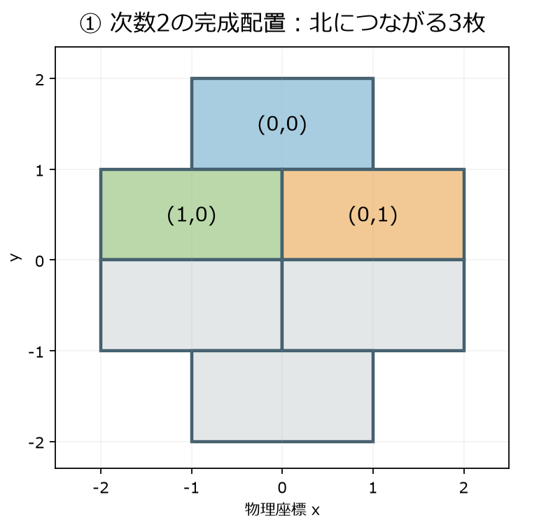
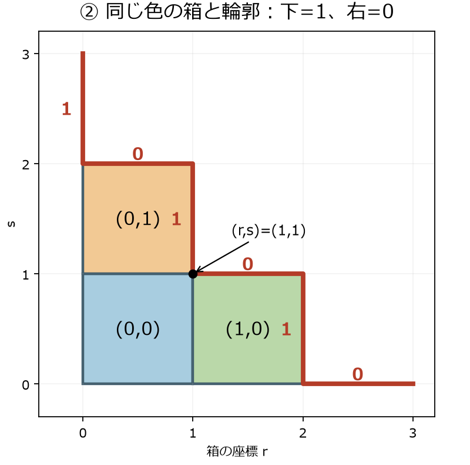
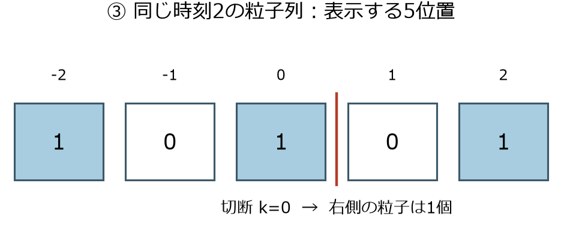
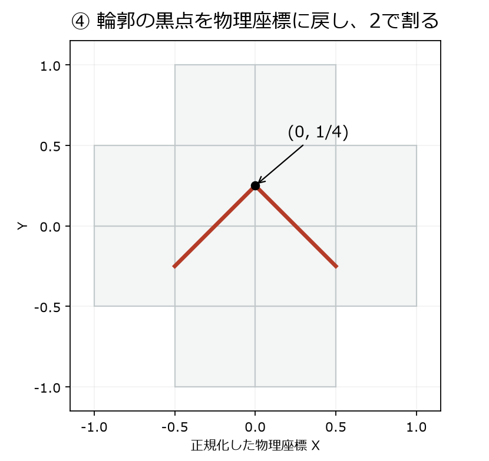
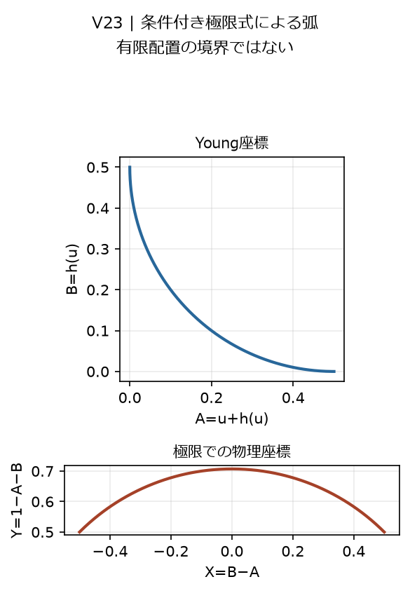
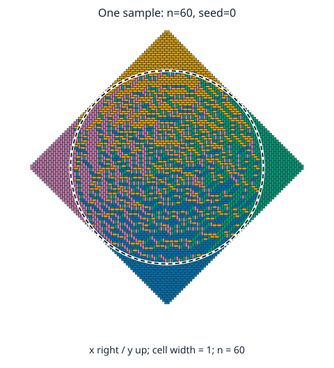
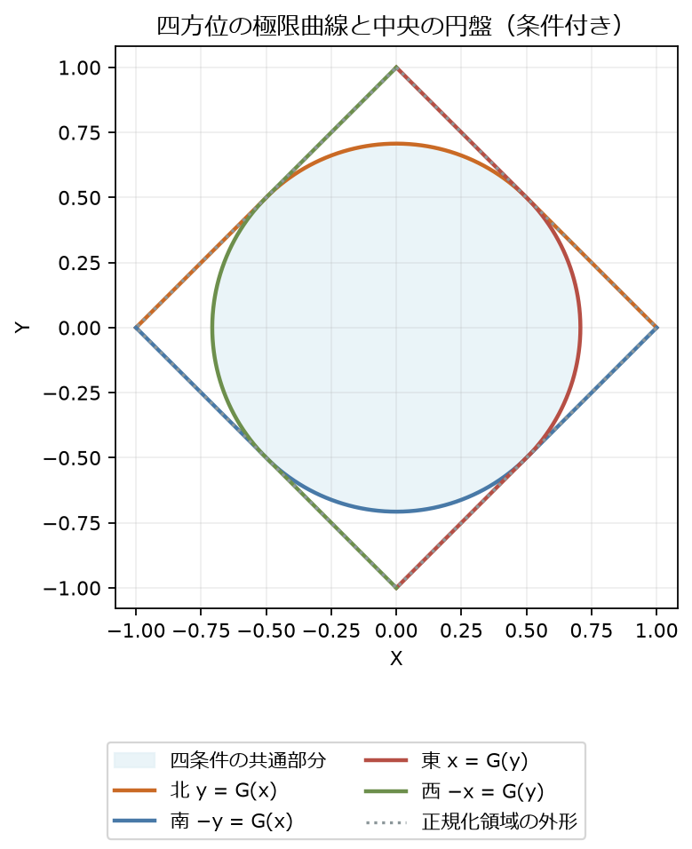

# 第10章　一点の極限から、円全体へ

## 粒子の座標を元の平面へ

第9章の曲線は、物理平面の座標そのものではなかった。北の凍結境界を箱で記録し、箱の輪郭を粒子列に変換したのだから、この道を逆にたどる必要がある。

補助章Cの規約では、北向き水平ドミノと箱の添字を明確に対応させる。セルの左下角、ドミノの中心、箱の中心は別の点であり、差は半セル程度でも有限次数では無視しない。次数 $n$ で割って極限を取ると、この固定された半セルの差は0になる。だからこそ、まず差が本当に一定個のセル以内だと示しておく。

第4章の箱の座標を $(a,b)$ と書いたように、箱の輪郭の頂点を $(r,s)$ としよう。対応する物理座標への変換は

$$\Psi_n(r,s)=(s-r,\ n+1/2-r-s)$$

である。これは、第4章で見た箱の中心 $(a+1/2,b+1/2)$ を代入すると、対応する北向きドミノの中心 $(b-a,n-a-b-1/2)$ を与える。

輪郭上で対角線 $r-s=k$ と交わる頂点から先をたどると、最後は高さ0の水平な部分に到達する。その先で残る下向きの一歩の数は頂点の高さ $s$ に等しい。第5章では下向きの一歩を粒子1と読んだので、この数は切断 $k$ より右の粒子数 $S(k,n)$ に等しい。よって $s=S(k,n)$、$r=k+S(k,n)$ となる。

なぜ、この頂点が粒子列の切断位置 $k$ に対応するのだろう。輪郭を上からたどると、下向きの一歩では $s$ が1減り、右向きの一歩では $r$ が1増える。どちらの歩でも $r-s$ はちょうど1増える。そこで、一歩を終えた頂点の $r-s$ を、その歩が表す粒子列の位置番号とする。頂点 $r-s=k$ の先に続く歩は、位置 $k+1,k+2,\ldots$ に対応し、そのうち下向きの歩が粒子1だ。したがって、頂点の高さを下げる残りの歩数 $s$ が、位置 $k$ より右の粒子数 $S(k,n)$ になる。

先ほどの二つの式を $\Psi_n$ に代入すると、輪郭点の物理座標は

$$(-k,\ n+1/2-k-2S(k,n))$$

になる。一箱の図で数字を入れてみよう。第5章の $1010$ の赤い輪郭は $(0,2)\to(0,1)\to(1,1)\to(1,0)\to(2,0)$ と進む。中央の頂点 $(r,s)=(1,1)$ では $k=r-s=0$。そこから先の下向きの一歩は一つだけなので $S(0,1)=1$ であり、確かに $(r,s)=(k+S,S)=(1,1)$。次数1の式に入れると物理点は $(0,-1/2)$ になる。ここでは左から右への列の添字を $r-s$ で固定しているので、第6章の初期段差の場所0と、時間発展後のこの切断位置との対応にも同じ添字規約を使う。

第4・5章の同じ三箱についても計算しよう。次数2の輪郭上の頂点 $(r,s)=(1,1)$ は $k=r-s=0$、そこから先の下向きの歩数は一つなので $S(0,2)=1$ である。したがって $\Psi_2(1,1)=(0,1/2)$、次数2で割った座標は $(0,1/4)$ となる。これは輪郭の有限次数の一点であり、そのまま円周上の点だという主張ではない。第4章の三枚のドミノの中心と、この輪郭頂点も異なる点である。

以下の四つの図は、同じ次数2の配置を順に追ったものだ。小さな画面でも一段ずつ見られるように分けている。[四段を一枚にした全体図](../production/figure-prototypes/phase2_same_configuration_trace.png)も参照できる。

図②の黒点から赤線を右へたどると、下向きの一歩は残り一つだ。図の箱を数えるのでなく、**輪郭の歩数**を数えることが $S(0,2)=1$ の理由になる。右向き二歩は粒子数に入れない。図②の $101010$ は位置 $-2$ から $3$、図③の $10101$ は位置 $-2$ から $2$ を切り取ったもので、同じ無限列の窓である。第4章では色を手掛かりに実ドミノから三箱を選び、第5章ではその境界を $101010$ と読み、ここでは黒点を物理座標へ戻した。三箱の情報だけでは、北側以外のドミノまで復元できないことも変わらない。

図④の赤線は箱の輪郭を $\Psi_2$ で写した線であり、実ドミノを長方形のまま合わせた集合の境界と、有限次数で完全に同じ線だという意味ではない。両者がどの程度ずれるかは、後で対応する菱形と長方形を比較する際に扱う。

黒点の左右の頂点も同じ規則で戻してみよう。いずれも第5章の三箱の輪郭にあり、$S$ はその頂点から先の下向きの歩数である。

| 輪郭の頂点 $(r,s)$ | 切断 $k=r-s$ | $S(k,2)$ | 物理座標 $\Psi_2(r,s)$ | 次数2で割った座標 |
|---|---:|---:|---|---|
| $(1,2)$ | $-1$ | $2$ | $(1,-1/2)$ | $(1/2,-1/4)$ |
| $(1,1)$ | $0$ | $1$ | $(0,1/2)$ | $(0,1/4)$ |
| $(2,1)$ | $1$ | $1$ | $(-1,-1/2)$ | $(-1/2,-1/4)$ |

例えば最初の行では、頂点から先に下向きが二歩残るので $S(-1,2)=2$。式 $(-k,2+1/2-k-2S)$ に入れれば $(1,-1/2)$ になる。切断 $k$ が右へ増えると物理座標の $X=-k/2$ は左へ動く。ここに並べたのは有限次数の階段上の三点であり、円周上の三点ではない。大きな次数で各点を $n$ で割った輪郭がどうなるかが、この先の問いである。

第6章の粒子列からも同じ数を確認できる。二つの成長角がともに成功したとき、位置 $-2,-1,0,1,2$ の列は $10101$ だった。$k=-1$ より右には位置0と2の二粒子、$k=0$ または1より右には位置2の一粒子がある。窓のさらに右に粒子はいないので、順に $S(-1,2)=2$、$S(0,2)=1$、$S(1,2)=1$。輪郭の下向き歩数と粒子列で直接数えた結果が、表の各行で一致する。これは第3章の横二枚の入力から始めて二穴を横に埋めた、同じ次数2の配置を二通りの記録で見ている計算である。

空の箱の図と比べると、場所0の決め方が見える。空図形の輪郭は上から $(0,0)$ まで下り、そこから右へ進む。$k=r-s=-1,0,1$ の頂点は順に $(0,1),(0,0),(1,0)$ で、そこから先に残る下向きの歩数は $1,0,0$。これは最初に位置 $i\le0$ を粒子、$i>0$ を空きとした列について、右側粒子数 $S(-1,0)=1$、$S(0,0)=S(1,0)=0$ と一致する。空図形の軸は形式的な境界であり、次数0の空領域に実ドミノがあると言っているのではない。

有限の箱から無限に続く二本の外側の軸を付け足して輪郭を定めること、どの対角線とも対応する頂点が一つであることは補助章Cの規約である。これは今の記号を読むための有限幾何の対応で、$S/n$ の確率極限そのものは別に証明しなければならない。$k/n\to u$、$S(k,n)/n\to h(u)$ の条件付き極限を代入すると、正規化座標は

$$(X,Y)=(-u,\ 1-u-2h(u)).$$

中央範囲 $|u|\le1/2$ の $h(u)$ を代入し、取り消される項を一度書いておこう。

$$Y=1-u-2\left(\frac{1-u}{2}-\frac12\sqrt{\frac12-u^2}\right)
=\sqrt{\frac12-u^2}\ge0.$$

同時に $X=-u$ だから、$X^2+Y^2=u^2+(1/2-u^2)=1/2$。この計算で得たのは $|X|\le1/2$ の上側の円弧であって、一度に円全体を得たわけではない。他の方位と境界を接続する仕事が残る。

三点を代入して、座標変換と選んだ枝を自分で確かめよう。

| $u$ | $h(u)$ | $(X,Y)=(-u,1-u-2h(u))$ |
|---:|---:|---:|
| $-1/2$ | $1/2$ | $(1/2,1/2)$ |
| $0$ | $(1-1/\sqrt2)/2$ | $(0,1/\sqrt2)$ |
| $1/2$ | $0$ | $(-1/2,1/2)$ |

いずれも $X^2+Y^2=1/2$ を満たし、$Y$ は正である。$u$ が正になると物理座標 $X$ は負になることにも注意しよう。左右の符号を変えた図を使うことはできるが、粒子の添字から戻す式もそれに合わせて変えなければならない。

第9章の希薄化波と照合すると、$u=-1/2,0,1/2$ はそれぞれ $(X,Y)=(1/2,1/2),(0,1/\sqrt2),(-1/2,1/2)$ に戻る。$u$ の符号と物理座標の左右が逆である。北の円弧の中央点を原点のまわりに90度ずつ回せば、円周の軸上の四点 $(0,1/\sqrt2)$、$(-1/\sqrt2,0)$、$(0,-1/\sqrt2)$、$(1/\sqrt2,0)$ が得られる。これは候補円弧の座標計算であり、四方向の実際の有限配置が同時に近づくことは、後で別に扱う。

中央の曲線に対応する座標を整理すると、適切な区間では平方根から円の方程式が現れる。正規化した元の平面での候補は

$$x^2+y^2=\frac12,$$

すなわち半径 $1/\sqrt2$ の円である。元の尺度に戻せば半径は $n/\sqrt2$。円が出たのは平方根を見た瞬間ではなく、箱と物理座標を対応させ、許される枝と領域を確認した後だ。

第1章の次数60の同じ配置に、いま導いた半径 $n/\sqrt2$ の円を重ねよう。点線は理論上の円であり、画像から抽出した実際の凍結境界ではない。円と色の境目が近く見えることは問いの出発点を視覚的に回収するが、この一枚から確率収束は結論できない。

## グラフの傾きが制限される理由

整数の切断位置の間も直線でつないだ累積数を $\widetilde S(t,n)$ とし、輪郭の高さを

$$G_n(u)=1+\frac1{2n}-u-\frac2n\widetilde S(nu,n)$$

と書く。先ほどの物理座標の第2成分を $n$ で割り、整数間を線形補間したもので、正規化した物理平面の横座標は $X=-u$ である。$k$ から $k+1$ へ切断を動かすと累積数は $X(k+1,n)\in\{0,1\}$ だけ減る。その区間で $G_n$ の傾きは $-1$ または $+1$。したがって二点の間で高さが変わる大きさは、横の距離を超えない。

第9章の候補 $h$ を代入した極限グラフは

$$G(u)=1-u-2h(u)=
\begin{cases}
\sqrt{1/2-u^2},& |u|\le1/2,\\
1-|u|,& |u|\ge1/2.
\end{cases}$$

円弧部分の微分の絶対値は $|u|/\sqrt{1/2-u^2}\le1$、外側の直線部分の傾きの絶対値も1だ。接続点でも連続なので $G$ も同じ変化幅の制限を持つ。この二つのグラフの性質が、後で有限個の観測点の間を埋める具体的な道具になる。固定した $u$ に対し、線形補間値 $\widetilde S(nu,n)$ と整数切断での $S(\lfloor nu\rfloor,n)$ の差は高々1。したがって $n$ で割った誤差は高々 $1/n$ で、各固定 $u$ で累積粒子数の確率極限を仮定すれば $G_n(u)\to G(u)$ が得られる。この入力の証明は第8・9章の別の仕事である。

## 一点ずつの収束では足りない

曲線の各固定位置で誤差が小さくなるとしても、誤差の大きな細い突起が次数とともに移動すれば、一つ一つの固定位置では見逃すことがある。知りたいのは、境界の**全ての点**が円に近いことである。

この落とし穴は、確率を使わずに一つの式で作れる。区間 $[0,1]$ で、$n\ge2$ に対し

$$f_n(x)=\max\{0,1-n^2|x-1/n|\}$$

と置く。高さ1の三角形の山が位置 $1/n$ にあり、その幅は $2/n^2$ だ。固定した $x>0$ では、十分大きな $n$ で山が $x$ の左へ移るので $f_n(x)=0$。$x=0$ でも全ての $n\ge2$ で0。つまり各固定点では0へ収束する。しかし毎回 $f_n(1/n)=1$ なので、区間全体の最大値はいつまでも1である。山の斜面は $n^2$ の速さで急になり、一様な傾きの制約はない。

そこで、まず有限個の観測点を一定間隔で置く。各点での誤差が小さい確率を十分高くすれば、有限個すべてで同時に小さい確率も高くできる。失敗確率の和を使うだけなので、各点の失敗が独立である必要はない。観測点と観測点の間は、回転した座標で表す高さ関数の変化が距離以下という性質、または単調な階段の挟み込みを使って補間する。元の階段には垂直な辺もあるので、元の座標で傾きが有限だと仮定しているわけではない。

たとえば四方位それぞれについて、観測点を $K$ 個選ぶとする。ある許容誤差を超える確率を各点で $\eta/(8K)$ 未満に抑えられるよう十分大きい $n$ を選べば、$4K$ 個のうち一つでも失敗する確率は $\eta/2$ 未満である。観測点の数は、先に決めた許容誤差に応じて有限に選び、その後で $n$ を大きくする。$n$ とともに無制限に観測点を増やすと、各点の失敗確率が0に近づくだけでは和を抑えられない。

有限ネットの補間を、一行の不等式で書いてみる。比較するグラフを $G_n,G$ とし、どちらも傾きの絶対値が1以下、すなわち $|G(x)-G(y)|\le|x-y|$ と仮定する。各 $x$ から距離 $\delta$ 以内にネット点 $x_j$ があるなら、三角不等式から

$$|G_n(x)-G(x)|\le |G_n(x_j)-G(x_j)|+2\delta.$$

最初の項は有限個の点での誤差、残りの二つは $G_n$ と $G$ をそれぞれ $x_j$ から $x$ まで動かした誤差だ。たとえば各ネット点の誤差が $\delta$ 未満なら、区間全体の誤差は $3\delta$ 未満と抑えられる。実際の離散座標には $1/n$ 程度の丸め誤差もあり、補助章Cではその項と定数を含めて扱う。この説明のために、元の物理平面で階段の傾きが有限と仮定しているのではない。

北側だけでは円全体にならない。四方向へ同じ議論を適用し、各方向で失敗する確率の和を抑える。ここでも独立性は不要だが、各方向で同じ仮定が使えることは確認しなければならない。

## 四つのグラフが円盤を挟む

一つの北の境界だけでは円周の一部分しか見えない。正規化した物理座標で、北の温帯側に残る条件を $y\le G(x)$ とすると、回転した他の三方向を合わせて

$$y\le G(x),\quad -y\le G(x),\quad x\le G(y),\quad -x\le G(y)$$

という四つの条件を考える。ここで $G$ は先ほどの円弧と外側の直線からなる関数だ。

第1章の $T_n$ は、四方の凍結領域を取り除いた後に中央へ残る集合だった。いまは $n$ で割った領域の中で、各方向の凍結側から**残る側**を一つずつ考え、その四つに共通して残る点を調べている。例えば $(0,1/2)$ は四条件を満たす。一方、$(0,3/4)$ は領域内にあるが、北の条件 $3/4\le G(0)=1/\sqrt2$ を満たさない。同様に $(3/4,0)$ は東の条件を満たさない。条件は「円らしく見える点を選ぶ」ためのものではなく、それぞれの方向から取り除いた後に中央へ残る点を指定している。

図は第9章の候補曲線を四方向に描いたもので、有限次数の標本画像や極限の証明ではない。条件を満たす範囲が、極限では半径 $r=1/\sqrt2$ の円盤になる。

ここで図の淡い部分は、あくまで**候補の四条件の共通部分**であり、第1章の有限次数の実際の $T_n/n$ をそのまま描いたものではない。実際の四つの凍結成分と各グラフが対応し、そのグラフが同時に候補へ近づくなら、実際に残る集合は、この共通部分の内側・外側にそれぞれ少し余裕を持たせた集合の間に挟まれる。そのための対応と誤差を、この後で別に扱う。

どう確かめるのか。まず半径 $r-t$ 以下の点を取り、上へ $t$ だけ動かす。三角不等式により動かした先も半径 $r$ の円盤内だ。円盤は北のグラフの下にある。$|x|\le1/2$ では $G(x)$ が円の上半分そのもの、$1/2\le|x|\le r$ では両辺が非負で

$$(1-|x|)^2-(1/2-x^2)=2(|x|-1/2)^2\ge0$$

だから $1-|x|\ge\sqrt{1/2-x^2}$ となる。よって元の点は $y\le G(x)-t$ を満たす。同じ議論を下・右・左へ使えば、四方向全てについて少なくとも $t$ の余裕がある。

逆に半径 $r+t$ 以上の点は、四方向のどれかで少なくとも $t$ だけ条件を破る。対称性を使い $y\ge x\ge0$ として考える。$x\le1/2$ なら $(x,G(x))$ は円周上にあり、三角不等式から $y-G(x)\ge\sqrt{x^2+y^2}-r\ge t$。$x\ge1/2$ なら $y\ge1/2$ でもあり、$(x,y)=(1/2,1/2)+(x-1/2,y-1/2)$ と分ければ、$x+y-1\ge\sqrt{x^2+y^2}-r\ge t$。この範囲では $G(x)=1-x$ なので、やはり $y-G(x)\ge t$ となる。

有限次数では四つの実際のグラフがそれぞれ $\delta$ 以内なら、余裕 $2\delta$ のうち $\delta$ が残る。さらに、箱を回転してできる菱形と、実ドミノの長方形との対応誤差は一定個のセル以内で、$n$ で割ると0へ向かう。十分大きな $n$ ではこの誤差も残りの余裕より小さくできる。ただし、対応する一組の菱形と長方形が近いというだけでは、それらの合併の内側・外側が一致するとは限らない。補助章Cでは、選ばれたタイルだけでなく選ばれなかったタイルも対応させ、二つの合併で所属が食い違う点はYoung領域の境界の近くにしかないことを別に示す。例えば点が選ばれた長方形の中でYoung領域の外なら、対応する菱形は近くにあり、その点から菱形へ進む途中で境界を通る。反対向きの食い違いには、選ばれなかったタイルを使う。ここで領域境界上の点は閉包を使って扱う必要があり、四方位の箱集合が実際の境界連結凍結領域に対応することも入力である。補助章CのC-03・07・08では、それらを明示して内外の包含へ戻している。具体的には $0<\delta<1/8$、四方向のグラフ誤差が全て $\delta$ 未満、$n\ge16/\delta$ で、対応する凍結成分と箱の幾何が成立すると仮定し、正規化した温帯域 $\widehat T_n=T_n/n$ について

$$\overline B(0,r-2\delta)\subset\widehat T_n\subset\overline B(0,r+2\delta)$$

を得る。右の包含で領域の境界にある点も除外するには、その点の小さな近傍の領域内部が凍結側に入ることと、温帯域を閉包で定義したことを使う。負添字の補助タイルが外縁に接する可能性を、領域内部に入らないという事実だけで片付けない。

## 二方向の近さ

境界の全点が円に近くても、円の一部に対応する境界が欠けていれば、両者が同じ形だとは言いにくい。逆に円の各点の近くに境界があっても、境界に長い余分な突起があるかもしれない。そこで「境界から円への距離」と「円から境界への距離」の両方を抑える。二つの最大距離の大きい方をハウスドルフ距離という。

第1章の「誤差 $\varepsilon n$」を、半径に対する割合とも比べておこう。円の半径は $R=n/\sqrt2$ なので、境界のある点が円から距離 $\varepsilon n$ 以内にあれば、その点の原点からの距離は $R-\varepsilon n$ から $R+\varepsilon n$ の間にある。これは半径の比でいえば $1\pm\sqrt2\varepsilon$ の範囲だ。$R(1\pm\varepsilon)$ という帯なら幅は $\varepsilon n/\sqrt2$ で、同じ記号の $\varepsilon$ に対して幅が異なる。どちらの表現も定数倍を調整すれば極限定理に使えるが、有限の $n$ で数値を代入するときは区別する。

ただし、境界の全点がこの帯に入ることは、円の全ての部分の近くに境界があることまでは保証しない。後者がハウスドルフ距離のもう一方の向きであり、次の内外包含から別に確かめる。

半径 $r>t>0$ とし、対象を閉じた集合 $T$ とし、測る境界をその位相境界 $\partial T$ とする。原点中心の半径 $r-t$ の閉円盤が $T$ に含まれ、$T$ が半径 $r+t$ の閉円盤に含まれれば、$\partial T$ と半径 $r$ の円の双方向の距離は $t$ 以下になる。円の各方向の半直線で、内部から外部へ出る最初の境界を考えればよい。第1章の $T_n$ を正規化した集合にこの包含が使えること、すなわち四方の凍結域とYoung領域が対応することは別途示す必要がある。ただし、物理的な凍結成分・温帯域と箱の対応、領域外縁の扱い、四方位の幾何は証明を必要とする。

**証明の状態。** 候補曲線、有限ネット、四方向、二つの包含をつなぐ証明草稿は補助章B・Cにある。特に物理境界と図形の対応、各上流仮定の一般性は独立完査されていない。この章は証明の道筋を示す草稿であり、主定理が本書内で完成したという認定ではない。

原典の [Jockusch–Propp–Shor の定理1](https://arxiv.org/html/math/9801068v3) は、温帯域の境界が円から一様に近いことを述べ、直後で温帯域と円盤の面積の差にも言及する。本書で測る**両方向の**ハウスドルフ距離まで述べるには、原典の温帯域と本書の $T_n$ の対応に加え、上の内外包含などによって円から境界への距離も別に抑える必要がある。原典の定理を引用しただけで、この本の集合の規約まで照合が済んだことにはしない。

**考えてみよう。** 円の各固定点の近くだけを調べる実験では、移動する細い突起をどう見逃しうるか。有限ネットに加えて回転した高さ関数の変化幅を抑えることが必要な理由を説明しよう。

::: {.callout-note collapse="true"}
## 考え方の例

本文の $f_n(x)=\max\{0,1-n^2|x-1/n|\}$ では、高さ1の突起が $1/n$ にあり、固定した各点では値が0に近づく。一方、常に $f_n(1/n)=1$ なので最大のずれは消えない。単に「位置が変わり幅が縮む」とだけ言っても、同じ点を何度も通る場合があるため、このような具体的な配置が必要だ。有限ネットで見た点の間でもずれが急に増えないと示すために、適切な座標の高さ関数の変化幅などを使う。

:::

**さらに詳しく。** [C：座標と境界の証明草稿](../appendices/c-coordinates-boundary.qmd)。各補助章の仮定と未完査の範囲も確認しよう。
