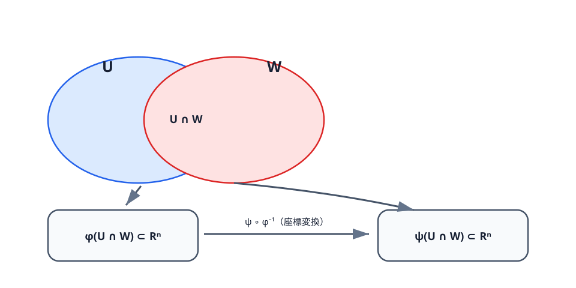
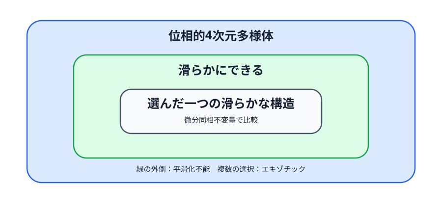

<!-- contract: contracts/01-smooth-structures.json -->

# この章の出発点

この章では、読者が知っている微積分を「曲がった空間」へ運ぶところから始める。多様体、座標近傍、アトラスを既知とはしない。英語の専門語は検索の手掛かりとして初出に添えるが、以後は日本語を用いる。

まず三つの「同じ」を区別する。

- **同相**（homeomorphic）：連続変形の立場で同じである。
- **微分同相**（diffeomorphic）：微分できる構造まで含めて同じである。
- **等長**（isometric）：さらに長さや角度まで同じである。

後ろへ行くほど条件が強い。等長なら微分同相であり、微分同相なら同相であるが、逆は一般には成り立たない。本書の中心問題は、二番目と一番目の間に4次元特有の隔たりがあることから始まる。

# 位相空間とは何か

実数直線では、点 $x$ の「十分近く」を開区間 $(x-\varepsilon,x+\varepsilon)$ で表す。この近さの情報だけを抽象化したものが**位相**である。集合 $X$ の部分集合族 $\mathcal T$ が次を満たすとき、$(X,\mathcal T)$ を位相空間と呼ぶ。

1. $\varnothing$ と $X$ は $\mathcal T$ に属する。
2. $\mathcal T$ の要素をいくつ集めて和集合を取っても $\mathcal T$ に属する。
3. $\mathcal T$ の要素を有限個集めて共通部分を取っても $\mathcal T$ に属する。

$\mathcal T$ の要素を開集合と呼ぶ。写像 $f:X\to Y$ が連続であるとは、$Y$ の任意の開集合 $V$ に対して逆像 $f^{-1}(V)$ が $X$ の開集合になることをいう。連続な全単射で逆写像も連続なものが**同相写像**である。

例えば円周 $S^1$ と正方形の周は同相である。正方形の角は尖って見えるが、位相は角度を測らない。一方、円周と閉区間 $[0,1]$ は同相でない。区間の内部から一点を除くと二つに分かれるが、円周から一点を除いてもつながったままだからである。このように、同相写像は「穴の数」や「切れ方」を保つ。

# 局所座標から多様体を作る

地球全体を一枚の平面地図でゆがみなく表せなくても、町の周辺なら緯度・経度のような二つの数で表せる。この考えを定義にする。

$X$ の開集合 $U$ と、$\mathbb R^n$ の開集合 $V$ の間の同相写像

$$
\varphi:U\longrightarrow V
$$

を**座標近傍**または**チャート**と呼ぶ。各点が少なくとも一つのチャートに入る位相空間を、通常の分離性・可算性の条件も満たすとき、$n$ 次元**位相多様体**という。ここで $n$ は、各点の近くを記述するのに必要な実数の個数である。

円周 $S^1$ を例にする。一点を除いた円周は開区間へほどけるので、一つのチャートで表せる。しかし円周全体を一つの実数座標で表すと切れ目ができる。そこで異なる点を除いた二つ以上のチャートを重ねる。チャート $(U,\varphi)$ と $(W,\psi)$ が重なる場所では、同じ点の二つの座標表示を比較する写像

$$
\psi\circ\varphi^{-1}:\varphi(U\cap W)\longrightarrow\psi(U\cap W)
$$

が現れる。これを**座標変換**という。

具体式で見る。$S^1=\{(x,y):x^2+y^2=1\}$ とし、北極 $N=(0,1)$、南極 $S=(0,-1)$ を除いた

$$
U_N=S^1\setminus\{N\},\qquad U_S=S^1\setminus\{S\}
$$

を取る。北極からの立体射影を

$$
\varphi_N(x,y)=\frac{x}{1-y}:U_N\to\mathbb R
$$

とし、南極からの立体射影を

$$
\varphi_S(x,y)=\frac{x}{1+y}:U_S\to\mathbb R
$$

とする。逆写像はそれぞれ

$$
t\longmapsto
\left(\frac{2t}{t^2+1},\frac{t^2-1}{t^2+1}\right),
\qquad
u\longmapsto
\left(\frac{2u}{u^2+1},\frac{1-u^2}{u^2+1}\right)
$$

である。重なり $U_N\cap U_S$ は円周から二点を除いた部分なので、座標では $t\ne0$、$u\ne0$ に対応する。両方の式を比べると

$$
u=\varphi_S\circ\varphi_N^{-1}(t)=\frac1t
$$

となる。これは $t\ne0$ 上の滑らかな関数で、逆も同じ式で滑らかである。したがってこの二枚のチャートは滑らかに両立する。

{#fig-coordinate-overlap fig-alt="多様体上の座標近傍UとW、その重なりU交W、二つの座標像を結ぶ座標変換を示す図"}

@fig-coordinate-overlap で座標変換の定義域が $\varphi(U\cap W)$ であることに注意する。$\varphi(U)$ 全体から $\psi(W)$ 全体への写像ではない。同じ点を両方の地図で表せる重なり上だけで、二つの数値表示を比較する。

# 「滑らか」を大域的に定める

多様体上で微分するには、座標変換が微分を壊さない必要がある。重なり上の全ての座標変換が $C^\infty$ 級、すなわち何回でも微分可能であるチャートの集まりを**滑らかなアトラス**という。互いに滑らかに両立するチャートを全て加えたものが**滑らかな構造**である。

ここで重要なのは、滑らかな構造が「一枚の好みの地図」ではないことである。同じ滑らかな構造の中では、極座標と直交座標のように座標表示を替えてよい。重なりで座標変換が滑らかなら、どちらで計算しても同じ微分可能性を表している。

具体例として、実数直線上で $y=x^3$ を新しい座標だと思うと、写像 $x\mapsto x^3$ 自体は連続な全単射で逆も連続なので同相写像である。しかし逆変換 $x=y^{1/3}$ は $y=0$ で微分可能でない。この一枚だけを見れば「座標を替えただけ」に見えるが、通常の座標とは滑らかに両立しない。ここで起きているのは「同じ位相空間上で、通常の座標系と両立しない別の座標を入れた」という局所的な模型である。4次元で問題になる異種滑らかな構造は、これを大域的な多様体全体で比較する問題であり、単一の写像が同相だが微分同相でないという事実だけとは区別して読む必要がある。

二つの滑らかな多様体 $X,Y$ の写像 $f:X\to Y$ が滑らかであるとは、任意の座標表示 $\varphi,\psi$ の下で

$$
\psi\circ f\circ\varphi^{-1}
$$

が通常の多変数関数として滑らかであることをいう。$f$ が全単射で、$f$ と $f^{-1}$ がともに滑らかなとき、$f$ を**微分同相写像**という。

::: {.callout-note title="節内演習1：同相と微分同相"}
写像 $f:\mathbb R\to\mathbb R$, $f(x)=x^3$ は同相写像であることを確かめよ。また通常の滑らかな構造に関して微分同相写像でない理由を述べよ。

**解答。** $f$ は連続な狭義単調全単射で、逆写像 $y\mapsto y^{1/3}$ も連続なので同相写像である。しかし逆写像の導関数は $y=0$ で有限値を持たないため、逆写像は滑らかでない。したがって微分同相写像ではない。
:::

# 地図だけでは微分できない

球面をゴムの膜として連続に変形しても、球面であることは変わらない。位相幾何が保存するのは、この「切らず貼らずに変形できる」という情報である。しかしゲージ理論で扱う接続、曲率、ホッジ作用素、偏微分方程式は微分を要求する。同じ点集合と同じ位相を持つ二つの多様体でも、どの関数を滑らかと認めるかが異なれば、同じ微分方程式を書けるとは限らない。

位相多様体 $X$ 上の**滑らかな構造**とは、座標変換が $C^\infty$ 級になるアトラスの極大同値類である。二つの滑らかな構造が同じとは、恒等写像が滑らかという意味ではなく、両者の間に微分同相写像が存在するという意味である。したがって比較すべき三段階は明確に異なる。

1. 位相空間として同相か。
2. 滑らかな構造を少なくとも一つ持つか。
3. 二つの滑らかな構造は微分同相か。

第2問が否定なら「非平滑化可能」であり、第3問が否定なら同じ位相多様体上の**エキゾチックな滑らかな構造**である。後者を示すには、同相写像の存在と微分同相写像の不存在を別々に証明しなければならない。

{#fig-category fig-alt="位相、PL、滑らかな構造と、それらの間に現れる存在・一意性の障害を示す図"}

# 何が「同じ」なら同じ滑らかさか

読者が最初に混乱しやすい点は、同じ位相空間上に二つの滑らかな atlasがあるとき、恒等写像で比較しなければならないと思ってしまうことである。そうではない。滑らかな構造の同一性は、ある同相写像

$$
f:(X,\mathcal S_0)\longrightarrow (X,\mathcal S_1)
$$

が両向きに滑らか、つまり微分同相写像になるかどうかで判定する。恒等写像が滑らかでなくても、別の写像が微分同相写像なら、二つの滑らかな構造は同じと見る。

したがって異種滑らかな構造を示すには、次の二段階が必要である。

1. 位相的には同じ対象であることを示す。
2. どの同相写像を選んでも微分同相写像にはならないことを示す。

第二段階は直接調べにくい。そこで微分同相写像で保存される量を作り、その値が異なることを示す。ゲージ理論の役割はここにある。

# 比較の順序を間違えると何が破綻するか

ここで、よくある誤った証明を一つ見ておく。二つの滑らかな多様体 $X_0,X_1$ に対し、あるゲージ不変量の値が違うことが分かったとする。この事実だけから言えるのは

$$
X_0\not\cong_{\mathrm{diff}}X_1
$$

である。まだ

$$
X_0\cong_{\mathrm{homeo}}X_1
$$

は言えていない。したがって、これだけでは「同じ位相多様体上の異なる滑らかな構造」とは言えない。単に別の位相多様体を区別しただけかもしれない。

逆に、Freedman型の分類で $X_0$ と $X_1$ が同相だと分かったとしても、それだけでは異種滑らかな構造とは言えない。微分同相である可能性が残るからである。したがって異種滑らかな構造の証明は、必ず次の形を持つ。

```text
位相的データを照合する
→ 同相写像を得る
→ 滑らかな不変量を比較する
→ 微分同相写像を否定する
```

この順序は以後何度も出てくる。読者が「どちらの圏の主張をしているのか」を見失わないことが、4次元トポロジーを読む最初の安全装置である。

# なぜ4次元だけが難しいのか

低次元では位相構造と滑らかな構造が強く結びつき、高次元では手術理論が働く。4次元では、局所的には $\mathbb R^4$ に見えるという条件と、大域的な貼り合わせを滑らかに制御する条件の間に特有のずれが生じる。ここで重要なのは「4次元は不思議だ」という標語ではない。後で二つの具体的な機構が同時に現れる。

- 中間次元が2なので、2次元サイクル同士の交点が数になり、交点形式を作る。
- 2形式に対するホッジ作用素が再び2形式へ戻るので、曲率方程式を自己双対・反自己双対に分けられる。

前者は位相的な入力、後者は解析的な入力である。教材全体の中心は、この二つが同じ整数を介して接続することにある。

# 何を観測量にすればよいか

滑らかな構造を直接一覧にすることは難しい。そこで、滑らかな構造が与えられたときだけ定義でき、微分同相写像では変わらない量を作る。その量が二つの構造で異なれば、両者は微分同相ではない。

ゲージ理論の戦略は次の通りである。多様体 $X$ の上に主束 $P$ を置き、接続 $A$ に楕円型方程式を課す。解を座標表示の冗長性であるゲージ変換で割り、有限次元のモジュライ空間を作る。その向き付けられた交点数や積分から整数・多項式を得る。補助計量を変えても値が変わらないことを示せれば、それは滑らかな不変量になる。

この説明にはまだ空白が多い。なぜ解空間は有限次元なのか、なぜコンパクト性が成り立つのか、数え上げが補助計量に依存しないのかは、どれも自動ではない。以後の章はこの空白を順に埋める。

ここで大事なのは、ゲージ理論が滑らかな構造そのものを「見る」のではないという点である。見るのは、滑らかな構造が許す微分方程式の解空間である。滑らかな構造が変わると、接続、曲率、ホッジ作用素、楕円作用素の意味が変わり、その結果としてモジュライ空間の数え上げが変わりうる。

# 観測量の条件

滑らかな不変量として使える量には、最低限三つの条件がある。

第一に、定義が滑らかな圏に依存している必要がある。単なるホモロジーや交点形式だけでは、同相写像で保存されるため、同じ位相型の中の滑らかな構造の違いを検出できない。

第二に、微分同相写像で保存されなければならない。座標や計量を選んで作った量が、その選択に依存したままなら、不変量ではなく補助データの測定値にすぎない。

第三に、実際に計算または比較できなければならない。非常に抽象的に存在するだけの不変量では、具体的な多様体の滑らかさを区別できない。Donaldson理論が重く、Seiberg--Witten理論が急速に使われた理由の一つは、この第三条件に関係する。

以後、各章で作る道具はこの三条件に照らして読むとよい。接続と曲率は滑らかな依存性を与え、モジュライ空間の不変性証明は微分同相写像不変性を与え、具体的な指数やコンパクト性は計算可能性を支える。

# 最初に残る問い

解析へ急ぐ前に、ゲージ理論が区別すべき位相的データを知る必要がある。4次元で2次元サイクル同士を交差させると整数が出る。この整数を双線形形式として束ねた交点形式は、なぜ分類問題の中心になるのだろうか。
