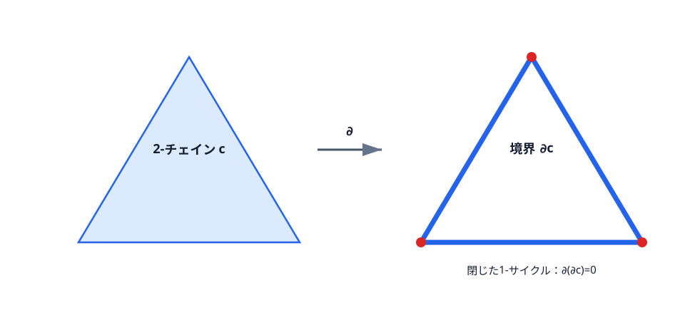
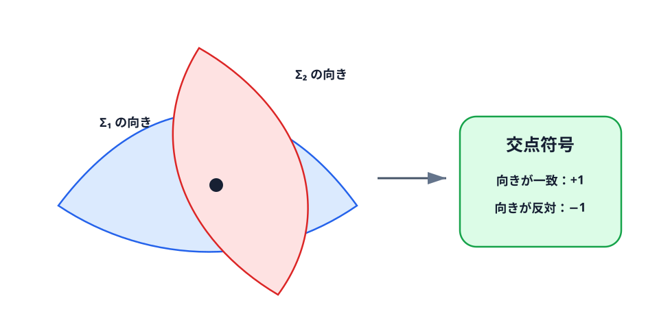

<!-- contract: contracts/02-intersection-form.json -->

# 穴を数えるための準備

前章では、多様体の局所座標と滑らかな構造を導入した。本章では「多様体の中にどのような輪や曲面が残るか」を整数で記録する。交点形式を定義する前に、ホモロジーとコホモロジーを具体例から組み立てる。

## チェイン、境界、サイクル

多様体を三角形や四面体などの単純な部品に分けたと考える。向きを付けた $k$ 次元の部品を整数係数で形式的に足したものを **$k$-チェイン**という。チェイン全体を $C_k(X;\mathbb Z)$ と書く。

向き付き線分 $[v_0v_1]$ の境界は

$$
\partial[v_0v_1]=[v_1]-[v_0]
$$

である。向き付き三角形なら

$$
\partial[v_0v_1v_2]
=[v_1v_2]-[v_0v_2]+[v_0v_1].
$$

もう一度境界を取ると各頂点が反対符号で二度現れ、$\partial^2=0$ になる。境界を持たないチェイン、すなわち $\partial z=0$ を満たすものを**サイクル**と呼ぶ。何かの境界 $z=\partial c$ になっているサイクルは、その内部を埋められるので大域的な穴を表さない。そこで

$$
H_k(X;\mathbb Z)
=\frac{\ker(\partial:C_k\to C_{k-1})}
{\operatorname{im}(\partial:C_{k+1}\to C_k)}
$$

を $k$ 次**ホモロジー群**という。「閉じているもの」を「中身を持つ境界」で同一視した群である。

{#fig-chains-cycles fig-alt="向き付き三角形から三辺の境界サイクルを取り出し、境界の境界がゼロになることを示す図"}

@fig-chains-cycles の三角形の周はサイクルだが、この三角形を含む空間では2-チェインの境界でもある。したがってホモロジー類としては0になる。同じ形の閉曲線でも、それを埋める2-チェインが空間内にあるかどうかが「穴」の有無を分ける。

## 境界写像を行列で計算する

後の章では $\ker$、$\operatorname{im}$、$\operatorname{coker}$ という線形代数の言葉が、変形複体や楕円作用素の有限次元性を読むために繰り返し出てくる。そこで、最初に一つだけ完全に計算しておく。

円周を一つの頂点 $v$ と一つの向き付き辺 $e$ で作るセル分割を考える。辺 $e$ は始点も終点も同じ頂点 $v$ へ戻るので

$$
\partial e=v-v=0.
$$

従って $C_1\cong\mathbb Z\langle e\rangle$、$C_0\cong\mathbb Z\langle v\rangle$ に対して、境界写像 $\partial_1:C_1\to C_0$ は $1\times1$ の零行列である。さらに $C_2=0$ だから $\operatorname{im}\partial_2=0$ であり、

$$
H_1(S^1;\mathbb Z)
=\ker\partial_1/\operatorname{im}\partial_2
=\mathbb Z/0
\cong\mathbb Z.
$$

一方、区間 $I=[0,1]$ を二つの頂点 $v_0,v_1$ と一つの辺 $e$ で作ると

$$
\partial e=v_1-v_0.
$$

基底を $(e)$、$(v_0,v_1)$ と取れば、境界写像は列ベクトル

$$
\partial_1=
\begin{pmatrix}
-1\\
1
\end{pmatrix}
$$

である。この核は0なので $H_1(I;\mathbb Z)=0$ である。円周と区間はどちらも「一本の辺」に見えるが、境界行列が違うため、円周だけが一次元の穴を持つ。この小計算が、後で「核は方程式を満たす変形、像は見かけの変形、商が本当の変形」という読み方の原型になる。

## 円周、球面、トーラス

円周 $S^1$ を一周する向き付きの道は境界を持たない。しかし円周の中にはその道を埋める円板がないので、境界ではない。この一周が $H_1(S^1;\mathbb Z)\cong\mathbb Z$ の生成元になる。$m\in\mathbb Z$ は向きを考えて $m$ 周することを表す。

二次元球面 $S^2$ では、閉じた道は球面上で円板に縮められるので $H_1(S^2;\mathbb Z)=0$ である。一方、球面全体は境界を持たない二次元サイクルであり、$H_2(S^2;\mathbb Z)\cong\mathbb Z$ を与える。

トーラス $T^2=S^1\times S^1$ には、経線と緯線という独立な二つの一周がある。このため

$$
H_1(T^2;\mathbb Z)\cong\mathbb Z\oplus\mathbb Z,
\qquad H_2(T^2;\mathbb Z)\cong\mathbb Z.
$$

整数 $m\neq0$ を掛けるとゼロになるホモロジー類を**ねじれ元**と呼ぶ。ねじれ元全体を $\mathrm{Tor}$ と書く。交点形式は整数値の双線形形式として扱うため、後では $H_2(X;\mathbb Z)/\mathrm{Tor}$、すなわちねじれを除いた自由部分を用いる。

# 接ベクトルと余接ベクトルを先に用意する

次に微分形式を使うが、その前に「ベクトルを入れて数を返す」という言葉の意味を決めておく。多様体上の点 $p$ を通る曲線 $\gamma(t)$ を取り、$\gamma(0)=p$ とする。座標で見た速度

$$
\gamma'(0)=\left(\frac{d x^1(\gamma(t))}{dt},\ldots,
\frac{d x^n(\gamma(t))}{dt}\right)_{t=0}
$$

が同じ曲線同士を同一視すると、点 $p$ での速度の集まりが接空間 $T_pX$ になる。座標を一つ選べば

$$
v=v^1\frac{\partial}{\partial x^1}+\cdots+
v^n\frac{\partial}{\partial x^n}
$$

と書ける。ここで $\partial/\partial x^i$ は座標方向の速度を表す基底である。

接空間 $T_pX$ 上の線形関数全体を余接空間 $T_p^*X$ という。座標微分 $dx^i$ は

$$
dx^i\!\left(\frac{\partial}{\partial x^j}\right)=\delta^i_j
$$

を満たす余接基底である。したがって、1形式とは各点で余接ベクトルを滑らかに選んだもの、つまり接ベクトルを一つ入れて数を返す道具である。この段階では接束の一般論をまだ使わない。必要なのは、$dx,dy$ が「座標成分を読む線形関数」であり、曲線や曲面上で積分できるという事実である。

# 微分形式と積分

多変数微積分の $dx,dy$ を座標に依らない形へ一般化したものが**微分形式**である。点 $p$ で接ベクトルを一つ入れて数を返す線形写像が1形式、接ベクトルを二つ入れて交代的な数を返すものが2形式である。

1形式 $\alpha,\beta$ から作る外積 $\alpha\wedge\beta$ は

$$
(\alpha\wedge\beta)(v,w)
=\alpha(v)\beta(w)-\alpha(w)\beta(v)
$$

で定義される。従って $\alpha\wedge\beta=-\beta\wedge\alpha$ であり、特に $dx\wedge dx=0$ である。$dx\wedge dy$ は向き付き面積を測る。

外微分 $d$ は関数 $f$ を $df$ へ送り、積の規則

$$
d(\alpha\wedge\beta)
=d\alpha\wedge\beta+(-1)^{\deg\alpha}\alpha\wedge d\beta
$$

と $d^2=0$ を満たす。微積分学の基本定理、Greenの定理、Gaussの定理は、まとめて**Stokesの定理**

$$
\int_M d\omega=\int_{\partial M}\omega
$$

と書ける。

$d\omega=0$ を満たす形式を閉形式、$\omega=d\eta$ と書ける形式を完全形式という。$d^2=0$ なので完全形式は必ず閉形式である。閉形式を完全形式で割ったもの

$$
H^k_{\mathrm{dR}}(X)
=\frac{\ker(d:\Omega^k\to\Omega^{k+1})}
{\operatorname{im}(d:\Omega^{k-1}\to\Omega^k)}
$$

が**ド・ラームコホモロジー**である。円周上の角度1形式 $d\theta$ は局所的には微分だが、円周全体で一価な角度関数の微分にはならない。実際、$\int_{S^1}d\theta=2\pi$ なので、Stokesの定理から完全形式ではありえない。これが「穴」を微分形式で検出する最初の例である。

# コチェインと余境界

整数係数のコホモロジーを、微分形式だけでなくチェインの双対としても見ておく。$k$-チェイン群 $C_k(X;\mathbb Z)$ から整数への準同型

$$
\varphi:C_k(X;\mathbb Z)\longrightarrow \mathbb Z
$$

を **$k$-コチェイン** と呼び、全体を

$$
C^k(X;\mathbb Z)=\operatorname{Hom}(C_k(X;\mathbb Z),\mathbb Z)
$$

と書く。コチェインは「$k$ 次元の部品を測る測定器」である。境界写像 $\partial:C_k\to C_{k-1}$ があると、向きを逆にたどって

$$
\delta:C^{k-1}\longrightarrow C^k,\qquad
(\delta\psi)(c)=\psi(\partial c)
$$

を定められる。これを余境界という。$\partial^2=0$ から $\delta^2=0$ が従うので、

$$
H^k(X;\mathbb Z)
=\frac{\ker(\delta:C^k\to C^{k+1})}
{\operatorname{im}(\delta:C^{k-1}\to C^k)}
$$

が定義できる。ここでも「閉じた測定器」を「一つ低い次元から来る見かけの測定器」で割っている。

円周の一頂点一辺のセル分割では、$\partial_1=0$ だった。双対側でも $\delta^0=0$ なので、辺 $e$ に1を返す1-コチェインは余境界ではない。したがって

$$
H^1(S^1;\mathbb Z)\cong\mathbb Z
$$

を得る。これは「円周を一周するサイクルを何回横切るか」を測る整数である。

# カップ積をトーラスで見る

コホモロジーには、二つの測定器を組み合わせて高い次元の測定器を作る積がある。これが**カップ積**である。一般の単体公式は少し記号が多いので、まずトーラスで意味を確認する。

トーラスを

$$
T^2=\mathbb R^2/\mathbb Z^2
$$

と書き、座標を $x,y$ とする。$dx,dy$ は商空間上で大域的な閉1形式を定める。基本領域 $[0,1]\times[0,1]$ で正規化すると

$$
\int_{S^1_x}dx=1,\qquad
\int_{S^1_y}dy=1,
$$

であり、逆の組み合わせは0である。さらに

$$
\int_{T^2}dx\wedge dy
=\int_0^1\int_0^1 dx\,dy
=1.
$$

従って、$[dx]\smile[dy]$ に対応する実係数コホモロジー類は、トーラス全体の基本類で評価すると1を返す。これは経線と緯線が符号付きに一度交わることと同じ情報である。

ここで注意がある。$dx,dy$ は実係数のド・ラームコホモロジーの代表であり、整数係数のカップ積そのものではない。しかし、この例では周期を整数に正規化しているため、整数コホモロジーの生成元を実係数へ送ったものとして読める。以後、交点形式を

$$
\langle \operatorname{PD}(x)\smile\operatorname{PD}(y),[X]\rangle
$$

と書くときも、背後には「サイクルを測るコチェインを掛け、基本類で評価する」という操作がある。

# 曲面を動かしても残る整数

前章では滑らかな構造を直接比較せず、不変量で観測する方針を立てた。本章前半で準備した言葉を使い、閉じた向き付き4多様体 $X$ で、二つの2次元ホモロジー類 $x,y\in H_2(X;\mathbb Z)/\mathrm{Tor}$ を横断的に交わる向き付き曲面で表す。ここで**横断的**とは、交点 $p$ で二つの接平面を合わせると4次元の接空間 $T_pX$ 全体になることをいう。従って交点は孤立点になる。交点 $p$ ごとに、二つの接平面の向きが $T_pX$ の向きと一致するかを $\varepsilon_p=\pm1$ で記録し、

$$
Q_X(x,y)=\sum_{p\in \Sigma_x\cap\Sigma_y}\varepsilon_p
$$

と置く。曲面の代表を動かすと交点は生成・消滅するが、局所的には符号が反対の対で起こるため総和は変わらない。

{#fig-intersection-sign fig-alt="二つの向き付き曲面の横断交点と、向きの一致ならプラス、不一致ならマイナスとする規則の図"}

@fig-intersection-sign は4次元形状そのものではなく、交点での二つの2次元接平面を模式化したものである。$\Sigma_1$ の向き付き基底を先に、$\Sigma_2$ の向き付き基底を後に並べ、その4本が $T_pX$ の向き付き基底になれば符号は $+1$、逆なら $-1$ とする。

# 計算例：$S^2\times S^2$

$X=S^2\times S^2$ とし、

$$
A=[S^2\times\{\mathrm{pt}\}],\quad
B=[\{\mathrm{pt}\}\times S^2]
$$

を取る。$A$ と $B$ は一点で横断的に交わるので

$$
Q_X(A,B)=1.
$$

一方、$A$ は第一因子方向の曲面であり、少し第二因子方向へ押せば自分自身と交わらない。従って

$$
Q_X(A,A)=0.
$$

同様に $Q_X(B,B)=0$ である。基底 $(A,B)$ に関する交点形式は

$$
Q_{S^2\times S^2}=
\begin{pmatrix}
0&1\\
1&0
\end{pmatrix}
=H
$$

となる。この一つの計算で、自己交点と相互交点が別物であること、そして4次元で曲面同士が点で交わることが見える。

# 幾何的交点をカップ積で書き直す

ここまでで交点数を、曲面を実際に横断させて符号付きに数える整数として理解した。次に、この幾何的定義を計算しやすい代数へ翻訳する。

ホモロジーの $k$ 次元サイクルへ整数を割り当てる線形な測定器を $k$ 次**コサイクル**と考える。コサイクルを適切な同値関係で割って得るのがコホモロジー群 $H^k(X;\mathbb Z)$ である。微分形式の積分

$$
[\omega],[z]\longmapsto\int_z\omega
$$

はド・ラームコホモロジーと実係数ホモロジーを結ぶ。コホモロジーには次数を足す積

$$
\smile:H^p(X;\mathbb Z)\times H^q(X;\mathbb Z)
\longrightarrow H^{p+q}(X;\mathbb Z)
$$

があり、**カップ積**と呼ぶ。微分形式では外積 $\wedge$ に対応する。

閉じた向き付き $n$ 次元多様体には、多様体全体の向きを表す**基本類** $[X]\in H_n(X;\mathbb Z)$ がある。

::: {.callout-important title="ポアンカレ双対性（引用定理、深度D）"}
$X$ を閉・連結・向き付き $n$ 次元多様体とする。基本類とのキャップ積により、任意の整数 $k$ について
$$
H^{n-k}(X;\mathbb Z)\xrightarrow{\ \frown[X]\ }H_k(X;\mathbb Z)
$$
は同型になる。ねじれを捨てた自由部分に限れば、逆写像を
$$
\mathrm{PD}:H_k(X;\mathbb Z)/\mathrm{Tor}
\longrightarrow H^{n-k}(X;\mathbb Z)/\mathrm{Tor}
$$
と書ける。本書では定理の完全証明は引用し、交点形式では整数値の非退化双線形形式を得るため自由部分を使う。[@gompfStipsicz1999]
:::

4次元で $k=2$ とすると、二次元サイクルと二次コホモロジー類が対応する。先ほど幾何的に定義した交点数は

$$
Q_X(x,y)=\langle \operatorname{PD}(x)\smile\operatorname{PD}(y),[X]\rangle
$$

と書き直せる。次数2の類を二つ掛けると次数4となり、基本類上で整数として評価できるからである。この式は新しい定義を突然与えるものではなく、符号付き交点数の代数的な再表現である。

::: {.callout-note title="節内演習2：境界と穴"}
1. 三角形の境界にもう一度 $\partial$ を作用させ、$\partial^2=0$ を確かめよ。
2. トーラスの経線と緯線が一点で交わることから、両者が独立な一次ホモロジー類であることを直感的に説明せよ。

**解答。** 1では各頂点が正負一回ずつ現れて相殺する。2では、もし一方が境界なら閉じた他方との符号付き交点数はStokes型の議論で0になるはずだが、実際には1である。従ってどちらも消えず、互いの整数倍でもない。
:::

# 自己交点は「同じ曲面をそのまま交わらせる」ことではない

自己交点数で読者がつまずく点は、同じ曲面 $\Sigma$ と自分自身の交点をどう数えるのか、という疑問である。同じ集合として見れば、$\Sigma$ は全ての点で自分自身と交わってしまう。そこで実際には、$\Sigma$ を少し押し出した曲面 $\Sigma'$ と $\Sigma$ の交点を数える。

この押し出しは法束の切断を選ぶことに対応する。各点 $p\in\Sigma$ で、接平面 $T_p\Sigma$ は4次元接空間 $T_pX$ の中の2次元部分空間である。$T_p\Sigma$ に垂直な2次元方向を集めたものを法束 $N\Sigma$ と呼ぶ。法束の切断

$$
s:\Sigma\longrightarrow N\Sigma
$$

は、曲面の各点へ「どちら向きに少し押すか」を選ぶデータである。$s(p)\ne0$ なら $p$ は押し出された曲面 $\Sigma_s$ へ移動し、元の $\Sigma$ から離れる。したがって $\Sigma$ と $\Sigma_s$ が交わるのは、一般には $s(p)=0$ となる孤立点だけである。

零点 $p$ の近くで $s$ を局所座標 $(u,v)$ により

$$
s(u,v)=(s_1(u,v),s_2(u,v))
$$

と書く。零点が横断的なら、ヤコビ行列

$$
\begin{pmatrix}
\partial s_1/\partial u & \partial s_1/\partial v\\
\partial s_2/\partial u & \partial s_2/\partial v
\end{pmatrix}_{p}
$$

の行列式の符号で零点の符号を決める。符号付き零点数

$$
\sum_{s(p)=0}\operatorname{sign}\det(ds)_p
$$

が法束のオイラー数であり、同時に $\Sigma$ の自己交点数 $\Sigma\cdot\Sigma$ である。この説明は「法束」という語を、束の一般論へ先送りするためではなく、自己交点が押し出しの零点数であることを手で読めるようにするために入れている。

この見方は後で効く。埋め込まれた曲面の自己交点 $\Sigma\cdot\Sigma$ は、随伴不等式で種数とSW基本類に結びつく。つまり第18章で現れる不等式の右辺の一部は、すでにここで定義した自己交点数である。

# 計算例：$\mathbb{CP}^2$

$\mathbb{CP}^2$ は、ゼロでない複素数の三つ組 $(z_0,z_1,z_2)\in\mathbb C^3\setminus\{0\}$ を

$$
(z_0,z_1,z_2)\sim(\lambda z_0,\lambda z_1,\lambda z_2),
\qquad \lambda\in\mathbb C^\times
$$

で同一視した空間である。一点を同次座標 $[z_0:z_1:z_2]$ と書く。$z_0\neq0$ の領域では

$$
[z_0:z_1:z_2]\longmapsto
\left(\frac{z_1}{z_0},\frac{z_2}{z_0}\right)\in\mathbb C^2\cong\mathbb R^4
$$

が局所座標になる。他の成分がゼロでない領域も同様で、重なりの座標変換は滑らかである。このため $\mathbb{CP}^2$ は実4次元の閉じた滑らかな多様体である。

一次方程式 $a_0z_0+a_1z_1+a_2z_2=0$ は複素射影直線 $L\cong\mathbb{CP}^1\cong S^2$ を定める。$\mathbb{CP}^2$ の $H_2$ はこの $L$ のホモロジー類で生成される。独立な二つの一次方程式は一つの射影点を定めるため、二つの異なる射影直線は一点で交わる。複素向きから交点の符号は正である。従って

$$
Q_{\mathbb{CP}^2}([L],[L])=1.
$$

ここで「同じ直線を二回交わらせる」と考えると曖昧になる。正しくは、同じホモロジー類を表す二つの代表を一般位置に動かして交点を数える。代数幾何の言葉では、二つの一次方程式が一つの点を定める、という事実がこの自己交点数である。

以上から、基底 $[L]$ に関する交点形式は一行一列の行列 $(1)$ である。従って $b_2=1$, $b_2^+=1$, $b_2^-=0$ となる。この数値は第5章のHodge分解、第9章の指数計算、第16章のSeiberg--Witten期待次元で繰り返し用いる。

# ユニモジュラーという制約

ねじれ部分を除いた $H_2(X;\mathbb Z)$ は自由Abel群であり、基底を選ぶと $Q_X$ は対称整数行列になる。ポアンカレ双対性により随伴写像

$$
H_2(X;\mathbb Z)/\mathrm{Tor}\longrightarrow
\operatorname{Hom}(H_2(X;\mathbb Z)/\mathrm{Tor},\mathbb Z)
$$

は同型なので、行列式は $\pm1$ である。これがユニモジュラー性である。基底変更 $S\in GL(n,\mathbb Z)$ は行列を $Q\mapsto S^{\mathsf T}QS$ と変えるため、分類対象は行列そのものではなく整数合同類である。

実数上ではSylvesterの慣性法則により

$$
Q_X\otimes\mathbb R\cong (+1)^{b_2^+}\oplus(-1)^{b_2^-}
$$

となる。signatureは $\sigma(X)=b_2^+-b_2^-$、階数は $b_2=b_2^++b_2^-$ である。後で $b_2^+$ が計量の族を動かす際の壁の余次元を支配するので、単なる線形代数の記号では終わらない。

# 偶形式と奇形式

$Q_X(x,x)$ が全ての $x$ で偶数なら偶形式、そうでなければ奇形式と呼ぶ。例えば

$$
Q_{\mathbb{CP}^2}=(1),\quad
Q_{S^2\times S^2}=H=
\begin{pmatrix}0&1\\1&0\end{pmatrix}.
$$

$H$ は偶形式で不定値、$(1)$ は奇形式で正定値である。向きを反転すると $Q_{\bar X}=-Q_X$ となり、連結和では直和 $Q_{X\#Y}=Q_X\oplus Q_Y$ になる。これら二つの操作だけで、多数の例の形式を計算できる。

# 整数上と実数上の違い

実数上で同じsignatureを持つ形式は同型になる。しかし、4多様体の交点形式は整数格子として扱うため、実数上の分類では情報を捨てすぎる。

例えば

$$
H=
\begin{pmatrix}0&1\\1&0\end{pmatrix},
\quad
I_{1,1}=
\begin{pmatrix}1&0\\0&-1\end{pmatrix}
$$

はどちらもsignature 0で階数 2である。実数上では同型だが、整数上では偶奇が違う。$H$ では

$$
Q(aA+bB,aA+bB)=2ab
$$

なので常に偶数である。一方、$I_{1,1}$ では第一基底ベクトルの自己交点が1である。偶奇は整数基底変換で保存されるため、両者は整数格子として同型ではない。

この差は細かすぎる代数ではない。Freedman分類とDonaldson定理の衝突は、まさに「整数格子として何が許されるか」に依存する。実数上で対角化して満足してしまうと、4次元の本質を見落とす。

# 連結和で形式が足し合わされる理由

$X\#Y$ は、$X$ と $Y$ から4-ballを一つずつ抜き、境界 $S^3$ を貼り合わせて作る。2-サイクルは一般位置に動かせば、この貼り合わせneckを避けて $X$ 側または $Y$ 側に置ける。したがって $X$ 側のサイクルと $Y$ 側のサイクルは交わらない。

このため、$H_2(X\#Y)$ はねじれ部分を無視すれば $H_2(X)\oplus H_2(Y)$ と見なせ、交点形式はブロック対角形になる。

$$
Q_{X\#Y}=
\begin{pmatrix}
Q_X&0\\
0&Q_Y
\end{pmatrix}.
$$

例えば $\mathbb{CP}^2\#\overline{\mathbb{CP}}^{2}$ の交点形式は $\langle1\rangle\oplus\langle-1\rangle$ である。向きを反転していない $\mathbb{CP}^2\#\mathbb{CP}^2$ の形式は $\langle1\rangle\oplus\langle1\rangle$ であり、両者を混同してはならない。前者は $S^2\times S^2$ の双曲形式 $H$ と実数上では同じ符号数を持つが、整数上の偶奇が異なる。滑らかな分類では、このような整数格子の細部が消えずに残る。

::: {.callout-note title="形式が同じなら多様体も同じか"}
単連結な閉4多様体では交点形式は非常に強いが、滑らかな圏では完全不変量ではない。同じ形式を持ちながら微分同相ではない多様体が存在することこそ、後半で作る不変量の出番である。
:::

# 代数から存在問題へ

滑らかな閉単連結4多様体の交点形式としては、任意のユニモジュラー形式が実現できるわけではない。一方、位相的4多様体ではFreedmanの定理により、任意のユニモジュラー対称整数形式が交点形式として実現される。この二つを混同してはいけない。次章ではFreedmanの位相的分類とDonaldsonの滑らかな制約を同じ表に置く。両者の許容範囲の差が、ゲージ理論を必要とする最初の衝突になる。
