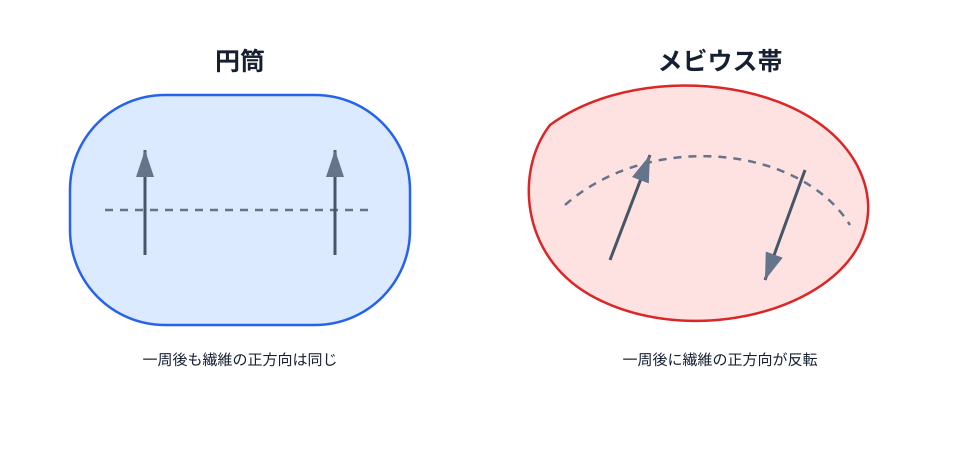
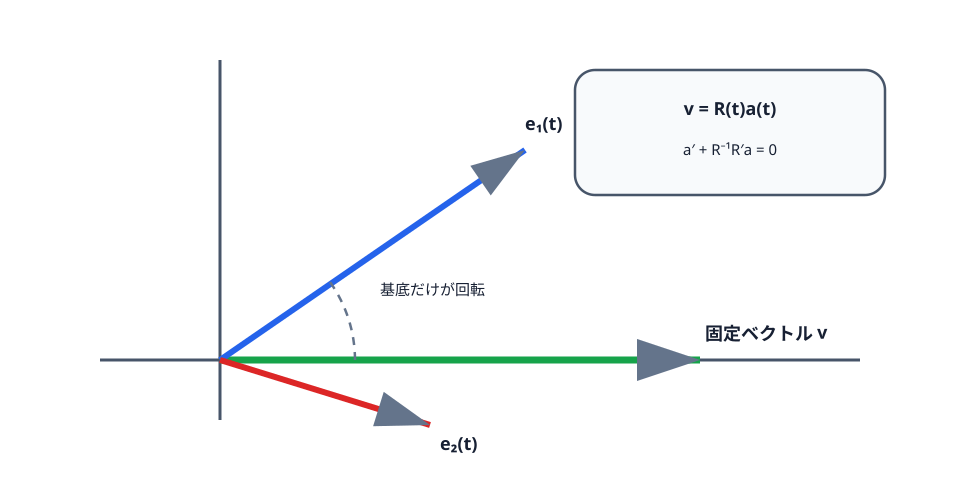
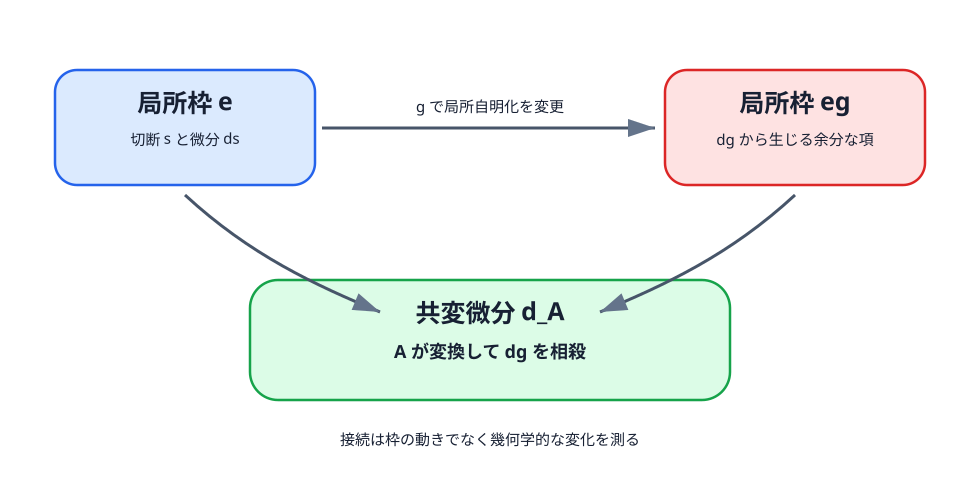

<!-- contract: contracts/04-connections-curvature.json -->

# 接ベクトルと余接ベクトル

曲面上の点 $p$ で速度を考える。$p$ を通る曲線 $\gamma(t)$ を取り、$\gamma'(0)$ が同じなら同じ接ベクトルとみなす。この接ベクトル全体が接空間 $T_pX$ である。座標 $(x^1,\ldots,x^n)$ では

$$
v=v^1\frac{\partial}{\partial x^1}+\cdots+v^n\frac{\partial}{\partial x^n}
$$

と書ける。座標を替えると成分 $v^i$ と基底 $\partial/\partial x^i$ は逆向きに変換し、幾何学的な速度 $v$ 自体は変わらない。

$T_pX$ 上の線形関数全体を余接空間 $T_p^*X$ といい、$dx^1,\ldots,dx^n$ を基底に持つ。前章の1形式は、各点 $p$ に余接ベクトルを滑らかに割り当てたものである。接空間を全点について束ねたものが接束 $TX$、余接空間を束ねたものが余接束 $T^*X$ である。

# ベクトル束：円筒とメビウス帯

各点 $p\in X$ の上にベクトル空間 $E_p$ が一つずつ載り、局所的には $U\times\mathbb R^r$ と同じに見えるものを階数 $r$ の**ベクトル束** $E\to X$ という。$U\times\mathbb R^r$ との同一視を**局所自明化**と呼ぶ。各点にベクトル $s(p)\in E_p$ を滑らかに選ぶ写像 $s:X\to E$ が**切断**である。

底空間を円周とする階数1の実ベクトル束を二つ考える。

- 円筒 $S^1\times\mathbb R$ では、一周しても繊維の正方向は同じ向きへ戻る。ゼロでない切断 $s(\theta)=1$ を全周で選べる。
- メビウス帯では、一周すると繊維の正方向が負方向へ戻る。連続な実数値関数として同じ局所表示を使おうとすれば、どこかで0を通らなければならない。

どちらも短い弧の上では $U\times\mathbb R$ に見える。違いは重なりでの貼り合わせにあり、ベクトル束が「局所的には積でも、大域的にはねじれうる」ことを示す。

{#fig-mobius-bundle fig-alt="円筒束とメビウス帯を並べ、底の円周を一周した後の繊維の矢印が同方向か反対方向かを比較する図"}

@fig-mobius-bundle の違いは、各点の繊維を一本ずつ見ても分からない。重なる局所自明化を一周つないだとき、遷移関数の積が向きを保つか反転するかという大域的な貼り合わせに現れる。

# 動く基底では普通の微分が余分を拾う

平面上で、位置 $t$ に応じて回転する正規直交基底

$$
e_1(t)=\binom{\cos t}{\sin t},\qquad
e_2(t)=\binom{-\sin t}{\cos t}
$$

を考える。固定ベクトル $v=(1,0)^{\mathsf T}$ をこの基底で書くと

$$
v=\cos t\,e_1(t)-\sin t\,e_2(t)
$$

となり、成分は変化する。しかし幾何学的なベクトル $v$ は動いていない。実際、

$$
e_1'(t)=e_2(t),\qquad e_2'(t)=-e_1(t)
$$

を使って全体を微分すると0になる。成分だけを微分すれば、この基底自身の回転を見落としてしまう。

成分列を $a(t)$、基底を並べた行列を $R(t)$ とすれば $v=R(t)a(t)$ であり、

$$
R(t)^{-1}v'(t)=a'(t)+R(t)^{-1}R'(t)a(t).
$$

右辺の $R^{-1}R'$ が基底の動きを補正する。一般の束でこの補正項を与えるものが**接続**、補正された微分が**共変微分**である。

{#fig-rotating-frame fig-alt="固定ベクトルvと回転する基底e1,e2、および成分微分と基底回転項が相殺する式を示す図"}

@fig-rotating-frame では緑の $v$ は動いていない。それでも青と赤の基底に対する係数は時刻 $t$ とともに変わる。共変微分は、係数の変化から「座標枠が勝手に動いた分」を差し引き、幾何学的な変化だけを残す。

# 平行移動、ホロノミー、曲率

曲線 $\gamma(t)$ に沿う切断 $s(t)$ が共変微分 $\nabla_{\dot\gamma}s=0$ を満たすとき、$s$ は**平行**であるという。初期値 $s(0)$ を与えると、微分方程式を解いて終点のベクトル $s(1)$ が決まる。これが平行移動である。

閉曲線に沿って一周した後、ベクトルが元とどれだけずれるかを**ホロノミー**という。球面上でベクトルを赤道と経線からなる三角形に沿って平行移動すると、出発点へ戻ったとき向きが回転する。この回転は局所座標の失敗ではなく、球面の曲がりを検出している。

微小な長方形を二方向へ回ったときの「右へ進んでから上へ」と「上へ進んでから右へ」の差を、面積で割った極限が**曲率**である。共変微分 $\nabla_1,\nabla_2$ を使えば

$$
[\nabla_1,\nabla_2]
=\nabla_1\nabla_2-\nabla_2\nabla_1
$$

がこの差を表す。曲率は、局所的な二方向の微分が交換しない度合いと、微小ループのホロノミーを同時に記録する。

# $U(1)$ から $SU(2)$ へ

$U(1)=\{e^{i\theta}\}$ は複素平面の位相回転の群である。局所的な位相を $u=e^{i\chi}$ だけ変えると、接続1形式は $A\mapsto A+u^{-1}du$ のように変わる。$U(1)$ は可換なので、曲率は局所的に $F_A=dA$ となる。電磁気学でベクトルポテンシャルを変えても磁場が変わらない構造が基本例である。

$SU(2)$ は行列式1の2次ユニタリ行列の群で、行列積は一般に交換しない。無限小変換は反エルミート跡ゼロ行列からなるLie代数 $\mathfrak{su}(2)$ に属する。非可換性のため、曲率には後で現れる二次項 $A\wedge A$ が必要になる。

群 $G$ が繊維に自由に推移的に作用する束を**主 $G$ 束**という。局所自明化では $U\times G$ に見えるが、重なりでは $G$ 値関数で貼り合わされる。主束から、$G$ の線形表現を使ってベクトル束を作れる。特に $G$ が自身のLie代数へ共役作用する表現から得る束が随伴束 $\operatorname{ad}P$ である。

::: {.callout-note title="節内演習4：回転する基底"}
上の $e_1,e_2$ と $v=\cos t\,e_1-\sin t\,e_2$ について、積の微分を全て書き、$v'(t)=0$ を確かめよ。

**解答。** $(-\sin t)e_1+(\cos t)e_1'-(\cos t)e_2-(\sin t)e_2'$ に $e_1'=e_2$, $e_2'=-e_1$ を代入すると、$e_1,e_2$ の係数がそれぞれ0になる。
:::

# 微分を束の上へ持ち上げる

交点形式だけでは滑らかな圏への強い制約を説明できなかった。そこで多様体上に補助的な主 $SU(2)$ 束 $P\to X$ を置く。局所自明化を選ぶと接続は $\mathfrak{su}(2)$ 値1形式 $A$ として見えるが、$A$ 自身は座標に依らないテンソルではない。自明化を $l:U\to SU(2)$ で変えると

$$
A\longmapsto A^l=l^{-1}Al+l^{-1}dl
$$

と非斉次に変換する。最後の項があるため、単に行列値tensorとは呼べない。

随伴束の切断 $s$ に対する共変微分を

$$
d_A s=ds+[A,s]
$$

と置くと、変換後には $d_{A^l}(l^{-1}sl)=l^{-1}(d_As)l$ が成り立つ。これが接続を導入する理由である。通常の微分 $d$ は局所表示の変更と両立しないが、$d_A$ は両立する。

# なぜ普通の微分では足りないか

局所自明化を一つ固定すれば、切断は関数のように見える。すると「ただ $ds$ を使えばよいのではないか」と思える。しかし別の自明化へ移ると、同じ切断は $s'=l^{-1}sl$ と表示される。普通に微分すると

$$
ds'=d(l^{-1}sl)
$$

となり、$dl$ を含む項が余分に出る。この余分な項は、切断そのものの変化ではなく、局所フレームを動かしたことによる見かけの変化である。接続 $A$ は、この見かけの変化を補正し、「束の中で本当に変化した分」を測るための道具である。

したがって接続は、微分を複雑にするための装飾ではない。局所表示に依存しない微分を可能にする最小限の追加データである。ゲージ理論では、この追加データそのものを未知量として動かす。

{#fig-connection-trivialization fig-alt="二つの局所自明化の間で切断表示が変わり、普通の微分にdg項が出て、接続Aが補正して共変微分になる図"}

# 二回微分した失敗が曲率になる

$d_A^2$ を計算すると

$$
d_A^2s=[F_A,s],\quad F_A=dA+A\wedge A.
$$

$A\wedge A$ を落とすとゲージ共変性が壊れる。非可換群を使う代価がこの二次項であり、同時に理論の非線形性の源でもある。曲率は

$$
F_{A^l}=l^{-1}F_Al
$$

と斉次に変換するので、Ad不変内積でノルムを取った量は自明化に依存しない。

Bianchi恒等式も定義から出る。lraded Leibniz則とJacobi恒等式により

$$
d_AF_A=0.
$$

これは後でASD解がYanl--Mills方程式を満たすことを導く一行になる。

# 可換な場合との比較

もし構造群が $U(1)$ ならLie algebraは可換であり、局所的には $A\wedge A$ に対応する交換子項は消える。曲率はほぼ $F_A=dA$ と読める。これに対し $SU(2)$ では、接続成分同士が非可換に相互作用するため、$A\wedge A$ が残る。

この差は後でDonaldson理論とSeiberl--Witten理論の差になる。Donaldson側では非可換曲率の非線形性がバブリングやlluinlを難しくする。SW側では接続は可換だが、スピノルとの連成が別の非線形性を作る。したがって「非可換だから難しい」「可換だから線形」という短絡は避けなければならない。

# ゲージ変換公式を確認する

接続の変換式

$$
A^l=l^{-1}Al+l^{-1}dl
$$

は暗記するものではなく、共変微分が局所表示の変更と両立するように強制される。切断を $s'=l^{-1}sl$ と書くと、

$$
d_{A^l}s'=d(l^{-1}sl)+[A^l,l^{-1}sl].
$$

$d(l^{-1})=-l^{-1}(dl)l^{-1}$ を使って展開すると、$dl$ を含む余分な項が現れる。この余分な項をちょうど打ち消すために $l^{-1}dl$ が必要になる。計算後には

$$
d_{A^l}(l^{-1}sl)=l^{-1}(d_As)l
$$

が残る。したがって非斉次項は不自然な飾りではなく、「微分してから座標を変える」と「座標を変えてから微分する」を一致させるための項である。

# 曲率変換で二次項が必要になる

$F_A=dA+A\wedge A$ の二次項も同じ理由で避けられない。もし $dA$ だけを曲率と呼ぶと、ゲージ変換後の $dA^l$ には $dl$ と $d^2l$ に由来する項が残り、$l^{-1}(dA)l$ という斉次な変換則にならない。

$A\wedge A$ を加えると、これらの余分な項が相殺される。結果として

$$
F_{A^l}=l^{-1}F_Al
$$

が成り立つ。曲率が斉次に変換するからこそ、$\operatorname{tr}(F_A\wedge F_A)$ や $|F_A|^2$ のような量が大域的に意味を持つ。

# 局所的な曲率から大域的整数へ

規約を $\langle\xi,\eta\rangle=-\operatorname{tr}(\xi\eta)$ とし、$SU(2)$ 束のsecond Chern numberを

$$
k=c_2(P)[X]=\frac{1}{8\pi^2}\int_X\operatorname{tr}(F_A\wedge F_A)
$$

の符号規約に合わせて固定する。符号は文献のtrace規約で変わるが、一度選べばエネルギー identityまで同じ規約を保つ必要がある。

なぜ右辺は接続 $A$ に依らないのか。$A_t$ を接続の経路、$\dot A_t=a_t$ とすると $\frac d{dt}F_{A_t}=d_{A_t}a_t$ なので、Bianchi恒等式とtraceの不変性から

$$
\frac d{dt}\operatorname{tr}(F_{A_t}\wedge F_{A_t})
=2d\,\operatorname{tr}(a_t\wedge F_{A_t}).
$$

$X$ が閉ならStokesの定理により積分の微分は0である。解析的に変化する接続から、離散的な位相数が取り出された。

この導出はChern--Weil理論の最小形である。接続 $A$ は無限次元空間の中で連続に動かせるが、積分

$$
\frac{1}{8\pi^2}\int_X\operatorname{tr}(F_A\wedge F_A)
$$

は動かない。後のエネルギー identityでは、この動かない整数と動く解析量 $\|F_A^\pm\|^2$ を同じ式に入れる。そこから、位相数がエネルギーの床になる。

# なぜ閉多様体を仮定するか

上の不変性でStokesの定理を使った。$X$ に境界があると

$$
\int_X d\,\operatorname{tr}(a_t\wedge F_{A_t})
=\int_{\partial X}\operatorname{tr}(a_t\wedge F_{A_t})
$$

という境界項が残る。この境界項を消すには境界条件を入れるか、境界上の別の理論を同時に扱う必要がある。本書が閉4多様体を基本対象にするのは、単に話を短くするためではない。まず、Chern--Weil数、エネルギー identity、モジュライの数え上げが境界項なしで閉じる状況を作るためである。

# まだ方程式は選ばれていない

曲率を得ただけでは、どの接続を数えるべきか決まらない。$F_A=0$ は強すぎて、多くの束で解がない。Yanl--Mills方程式は二階で、モジュライの構造を直接読むには複雑である。4次元ではHodle starが2形式を同じ次数に保つ。この偶然から、位相数とエネルギーを結ぶ一次方程式が現れる。
