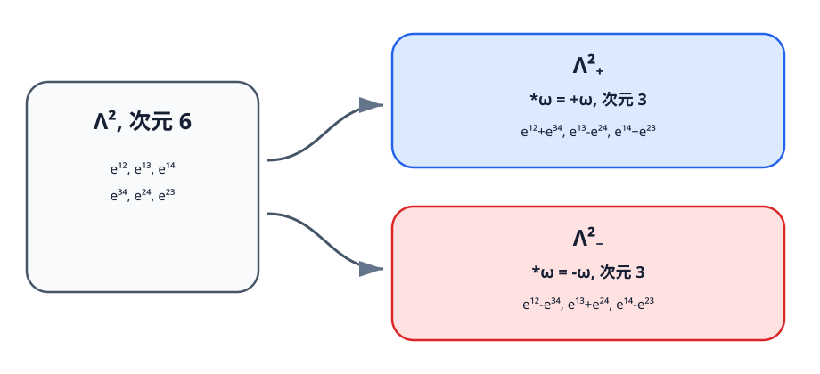

<!-- contract: contracts/05-why-four-dimensions.json -->

# ホッジ作用素を定義するまで

前章で曲率がLie代数値2形式になることを見た。本章では、2形式を二つに分けるHodge作用素を、線形代数から構成する。

## 計量と向き

実ベクトル空間 $V$ の内積 $g$ は長さと角度を定める。多様体の各接空間 $T_pX$ に滑らかに内積を与えたものが**Riemann計量**である。局所座標では対称正定値行列 $(g_{ij})$ で表される。

向きは、順序付き基底を「正」と「負」の二群へ分ける選択である。$\mathbb R^2$ では $(e_1,e_2)$ を正と決めると $(e_2,e_1)$ は負になる。向きと計量を選ぶと、正規直交余標構 $(e^1,\ldots,e^n)$ に対して

$$
d\mathrm{vol}=e^1\wedge\cdots\wedge e^n
$$

という体積形式が定まる。

## 形式の内積

$p$ 形式は、$p$ 個の接ベクトルを入れると符号付きの $p$ 次元体積を返す交代多重線形写像である。$n$ 次元空間の $p$ 形式全体の次元は

$$
\dim\Lambda^pV^*=\binom np
$$

である。例えば4次元の2形式は

$$
e^{12},e^{13},e^{14},e^{23},e^{24},e^{34},
\qquad e^{ij}=e^i\wedge e^j
$$

の6個を基底に持つ。計量から、これらを正規直交基底とする内積 $\langle\ ,\ \rangle$ が形式の空間にも入る。

## 定義

$p$ 形式 $\alpha$ に対し、Hodge作用素 $*\alpha$ は $(n-p)$ 形式であり、全ての $p$ 形式 $\beta$ に対して

$$
\beta\wedge *\alpha
=\langle\beta,\alpha\rangle d\mathrm{vol}
$$

を満たすものとして定義される。右辺が計量と向きを使うため、Hodge作用素もその両方に依存する。

二次元で $d\mathrm{vol}=e^1\wedge e^2$ とすれば

$$
*1=e^{12},\qquad *e^1=e^2,\qquad *e^2=-e^1,
\qquad *e^{12}=1.
$$

特に1形式上では $*^2=-1$ で、90度回転に似ている。一般にはRiemann計量が正定値なら

$$
*^2=(-1)^{p(n-p)}
$$

が成り立つ。4次元の2形式では指数が4なので $*^2=1$ となる。従って固有値は $+1$ と $-1$ だけであり、2形式を二群へ分けられる。

::: {.callout-note title="節内演習5：Hodge作用素の符号"}
正向き正規直交余標構 $(e^1,e^2,e^3,e^4)$ について、定義から $*e^{12}=e^{34}$ と $*e^{13}=-e^{24}$ を確かめよ。

**解答。** $e^{12}\wedge e^{34}=e^{1234}=d\mathrm{vol}$ なので前者を得る。$e^{13}\wedge e^{24}=-e^{1234}$ なので、正の体積形式を得るには後者に負号が必要である。
:::

# 2形式を同じ次数のまま分ける

向きとRiemann計量を備えた $n$ 次元多様体では、Hodge作用素は $p$ 形式を $(n-p)$ 形式へ送る。曲率は2形式なので、$*F_A$ を再び曲率と同じ型として比較できるのは $n=4$ のときである。4次元では $*^2=1$ が成り立ち、

$$
\Lambda^2=\Lambda^2_+\oplus\Lambda^2_-,\quad
\omega^\pm=\frac12(\omega\pm *\omega)
$$

と直交分解できる。

正向き正規直交余標構 $(e^1,e^2,e^3,e^4)$ を取り、$e^{ij}=e^i\wedge e^j$ と書くと

$$
*e^{12}=e^{34},\quad *e^{13}=-e^{24},\quad *e^{14}=e^{23}.
$$

したがって $\Lambda^2_+$ と $\Lambda^2_-$ はそれぞれ3次元である。

{#fig-hodge-split fig-alt="4次元の2形式が自己双対部分と反自己双対部分へ3次元ずつ分かれる図"}

# 符号を一つ確認する

$*e^{13}=-e^{24}$ の負号は、向きの規約から強制される。Hodge starは

$$
\alpha\wedge *\alpha=|\alpha|^2d\mathrm{vol}
$$

を満たすように定義される。ところが

$$
e^{13}\wedge e^{24}
=e^1\wedge e^3\wedge e^2\wedge e^4
=-e^{1234}.
$$

したがって $*e^{13}=e^{24}$ では符号が合わない。$*e^{13}=-e^{24}$ として初めて

$$
e^{13}\wedge(-e^{24})=e^{1234}
$$

となる。この小さな符号確認は、後の自己双対基底の符号、さらに位相数規約へつながる。

# 自己双対基底を実際に作る

上の計算から、自己双対2形式の基底は例えば

$$
\omega_1^+=e^{12}+e^{34},\quad
\omega_2^+=e^{13}-e^{24},\quad
\omega_3^+=e^{14}+e^{23}
$$

である。反自己双対基底は符号を反対にして

$$
\omega_1^-=e^{12}-e^{34},\quad
\omega_2^-=e^{13}+e^{24},\quad
\omega_3^-=e^{14}-e^{23}.
$$

例えば

$$
*(e^{13}-e^{24})=-e^{24}+e^{13}=e^{13}-e^{24}
$$

なので $\omega_2^+$ は自己双対である。ここで符号が一つでもずれると、ASD方程式の向き規約までずれる。4次元ゲージ理論では、こうした線形代数の符号が後の位相数に直結する。

# 外積の符号を読む

$\omega=\omega^++\omega^-$ に対し、自己双対・反自己双対部分の直交性から

$$
\omega\wedge\omega
=\bigl(|\omega^+|^2-|\omega^-|^2\bigr)\,d\mathrm{vol}.
$$

一方、$\omega\wedge *\omega=|\omega|^2d\mathrm{vol}$ なので

$$
|\omega|^2=|\omega^+|^2+|\omega^-|^2.
$$

同じ二成分が「差では位相的な積」「和では解析的なノルム」を与える。これが次章のエネルギー identityの線形代数的核心である。

この式を一行で済ませず確認する。自己双対なら $*\omega^+=\omega^+$、反自己双対なら $*\omega^-=-\omega^-$ なので

$$
\omega^+\wedge\omega^+
=\omega^+\wedge *\omega^+
=|\omega^+|^2d\mathrm{vol},
$$

一方

$$
\omega^-\wedge\omega^-
=-\omega^-\wedge *\omega^-
=-|\omega^-|^2d\mathrm{vol}.
$$

また $\omega^+$ と $\omega^-$ は直交しているので交差項は消える。したがってwedge squareは差になり、norm squareは和になる。この「和と差」が、エネルギーと位相数を同時に扱える理由である。

# 交差項はなぜ消えるか

$\omega^+\wedge\omega^-$ が消える理由も確認しておく。自己双対性と反自己双対性から

$$
\omega^+\wedge\omega^-
=\omega^+\wedge(-*\omega^-).
$$

右辺は内積で書けば

$$
-\langle \omega^+,\omega^-\rangle d\mathrm{vol}
$$

である。$\Lambda^2_+$ と $\Lambda^2_-$ はHodge starの異なる固有値の固有空間なので直交し、内積は0になる。したがってcross termは消える。ここで使っているのは、2形式のwedge積とHodge内積が4次元で同じ体積形式に落ちるという事実である。

# 共形不変性という第二の一致

計量を $g'=e^{2f}g$ と変えると、$p$ 形式上のHodge starは $*_{g'}=e^{(n-2p)f}*_g$ と変わる。$n=4,p=2$ では指数が0となり、$\Lambda^2_\pm$ の分解はconformal 類だけに依存する。

同じことはエネルギーのスケーリングにも現れる。Euclid空間で $x\mapsto \lambda x$ とし、接続を $A_\lambda(x)=\lambda A(\lambda x)$ と縮尺すると、$F_{A_\lambda}(x)=\lambda^2F_A(\lambda x)$ だから

$$
\int_{\mathbb R^n}|F_{A_\lambda}|^2dx
=\lambda^{4-n}\int_{\mathbb R^n}|F_A|^2dx.
$$

$n=4$ でのみエネルギーが尺度不変になる。この臨界性は美点だけではない。解列が小さな尺度へエネルギーを集中させても全エネルギーを失わず、バブリングを起こせることを意味する。

# なぜ3次元や5次元では同じ話にならないか

3次元では曲率は2形式で、Hodge starは1形式へ送る。$F_A=\pm *F_A$ のような同じ型の一次方程式は書けない。5次元では $*F_A$ は3形式であり、やはり曲率と直接比較できない。

もちろん他次元にも重要なゲージ理論はある。しかし本書の筋道、すなわち

$$
\text{曲率2形式}
\longrightarrow
\Lambda^2_+\oplus\Lambda^2_-
\longrightarrow
\text{一次方程式}
\longrightarrow
\text{4多様体の交点形式}
$$

という連鎖は4次元に固有である。ここで初めて、解析方程式と中間次元の位相形式が同じ舞台に乗る。

# 三つの4次元性

ここまでに三つの一致が見えた。

- 中間次元サイクルの交点が整数になる。
- 曲率2形式が $\Lambda^2_+\oplus\Lambda^2_-$ に分かれる。
- $L^2$ 曲率エネルギーが尺度不変になる。

これらは別々の偶然ではない。Chern--Weil積分が曲率の二次式であり、4形式として $X$ 上で積分されるため、代数・解析・位相が同じ次数に集まる。次章ではこの一致を一つの等式へまとめ、ASD方程式を「思いつき」でなくエネルギー最小化から導く。
