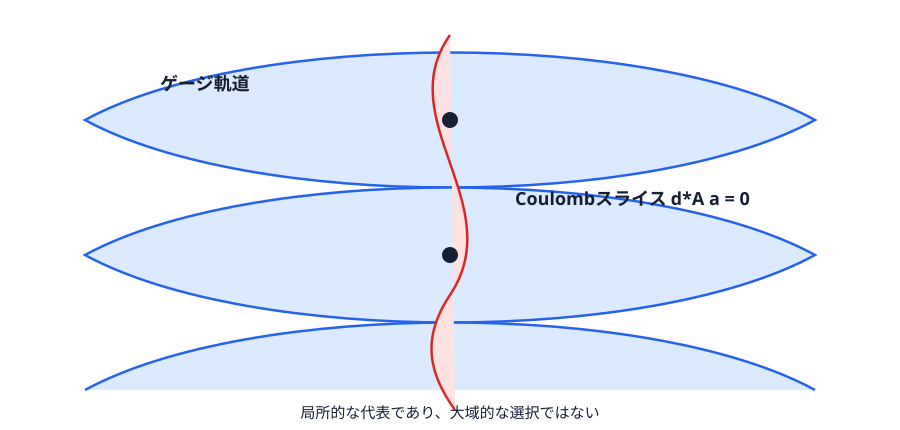

<!-- contract: contracts/07-gauge-quotient.json -->

# この章の作戦

この章では「方程式を解く」前に、「同じ解を何度も数えない」ための座標を作る。流れは有限次元の線形代数と同じである。

1. 対称性が動かす方向を微分して求める。
2. その方向に直交する面を選ぶ。
3. 各軌道がその面と一度だけ交わることを示す。
4. 固定点ではこの議論が壊れることを確認する。

接続の空間では、1が $d_A\phi$、2が $d_A^*a=0$、3が局所スライス定理、4が可約接続である。以下では、まず行列でこの四段階を計算してから、ゲージ理論へ移す。

# 有限次元の予行演習：冗長な座標を除く

写像

$$
q:\mathbb R^2\longrightarrow\mathbb R,
\qquad q(x,y)=x
$$

を考え、変換 $(x,y)\mapsto(x,y+t)$ を同じ点の別表示とみなす。軌道は縦線であり、その接方向は

$$
\frac d{dt}(x,y+t)\Big|_{t=0}=(0,1)
$$

である。横軸 $S=\{(x,0)\}$ は軌道方向に直交し、各軌道とちょうど一度交わる。したがって商 $\mathbb R^2/\mathbb R$ は、抽象的な同値類の集合として扱うより、横軸上の座標 $x$ で扱う方がよい。

この模型で、点 $(x,y)$ を横軸へ移す変換量は $t=-y$ と明示的に解ける。ゲージ理論で同じ役割を果たす方程式が

$$
d_A^*d_A\phi=-d_A^*a
$$

である。右辺の符号は、本章で採るゲージ作用 $A^g=g^{-1}Ag+g^{-1}dg$ と $g=e^\phi$ の規約から来る。左辺を逆にできれば、接続 $A+a$ を軌道に沿ってCoulombスライスへ動かす $\phi$ が決まる。

# 同じ場の別表示を除く

ASD方程式はエネルギー最小解を選んだが、解 $A$ と $A^g$ は同じ幾何を異なるフレームで表示している。接続全体のアフィン空間を $\mathcal A(P)$、ゲージ群を $\mathcal G(P)$ と書けば、調べたいのは

$$
\mathcal M_k=\{A\in\mathcal A(P):F_A^+=0\}/\mathcal G(P)
$$

である。これは単なる集合の商では不十分で、局所座標、接空間、向き、コンパクト化を持つ解析的な商でなければならない。

無限小ゲージ変換を確認する。$g_t=\exp(t\phi)$ とすると

$$
\frac d{dt}A^{g_t}\Big|_{t=0}=d_A\phi.
$$

従って軌道の接方向は $\operatorname{im}d_A\subset\Omega^1(X;\operatorname{ad}P)$ である。接続 $A+a$ を軌道に横断させる自然な条件は

$$
d_A^*a=0
$$

であり、これをCoulombゲージ条件と呼ぶ。

{#fig-gauge-slice fig-alt="接続空間内の曲線状のゲージ軌道と、それを横切るCoulombスライスの局所図"}

# スライスはなぜ存在するか

$A+a$ に小さなゲージ変換 $e^\phi$ を施し、Coulomb条件を満たす $\phi$ を探す。一次近似では

$$
d_A^*(a+d_A\phi)=0,\quad
d_A^*d_A\phi=-d_A^*a.
$$

左辺は0形式上の楕円作用素である。$A$ が既約、すなわち共変定数な随伴切断が中心から来るもの以外にないなら、適切な中心の処理後に逆作用素を持つ。非線形項はSobolev乗法評価で制御し、陰関数定理を適用する。

::: {.callout-important title="局所スライス定理（証明アーキテクチャ、深度C）"}
$A$ の近傍で、各ゲージ軌道は小さなCoulombスライスと一意に交わる。ただし安定化群が非自明なら一意性はその有限次元作用を除いた意味になる。解析にはSobolev完備化、楕円評価、非線形写像の滑らかさが必要である。[@freedUhlenbeck1991]
:::

# ソボレフ完備化は何をしているか

ここで一度、解析の足場を明示しておく。$\mathcal A(P)$ は滑らかな接続の空間としてはFréchet空間であり、そのままでは通常のBanach空間の陰関数定理を使えない。

まず一変数の例で読む。区間 $[0,1]$ 上の $L^2$ 関数は二乗積分可能な関数であり、点ごとの値よりも平均的な大きさを測る。$H^1=L^2_1$ は、関数自身と一階の弱微分がともに $L^2$ に入る空間である。弱微分とは、古典的に微分できない点があっても、部分積分の恒等式

$$
\int_0^1 f\,\varphi'=-\int_0^1 g\,\varphi
$$

が全ての滑らかなテスト関数 $\varphi$ に対して成り立つとき、$g$ を $f$ の微分として扱うという定義である。例えば角を持つ絶対値関数は古典的には角で微分できないが、弱微分の意味では扱える。強収束はノルムそのものが近づくこと、弱収束は全てのテスト対象で評価した値が近づくことであり、コンパクト性ではしばしば弱収束から始めて楕円正則性で滑らかさを回復する。

ゲージ理論でソボレフ空間を使うのは、この一変数の考えを多様体上の微分形式と束の切断へ拡張しているだけである。粗い対象を最終目的にするのではなく、微分、積、商、陰関数定理をBanach空間の上で正しく使うために、いったん完備な作業場を作る。そこで固定した滑らかな接続 $A_0$ を基点に

$$
\mathcal A_k=A_0+L^2_k\Omega^1(X;\operatorname{ad}P),
\quad
\mathcal G_{k+1}=L^2_{k+1}(X,G)
$$

と完備化する。$4$ 次元では $k>2$ を選ぶと $L^2_k\hookrightarrow C^0$ であり、積や合成が連続に扱える。ゲージ群を一階高い $k+1$ にするのは、$g(A)=g^{-1}Ag+g^{-1}dg$ に微分 $dg$ が現れるからである。

この選択は「粗い接続を本当に研究対象にする」という意味ではない。Banach多様体上で解いたあと、楕円正則性により、滑らかなデータから来る弱解は適切なゲージで滑らかになる。完備化は、無限次元の微分を正当化するための足場である。

ここで添字の差を具体的に確認する。$g\in L^2_{k+1}$ なら、弱微分 $dg$ は $L^2_k$ に属する。従って

$$
g^{-1}Ag+g^{-1}dg
$$

の二項はともに $L^2_k$ の1形式になる。もしゲージ変換も $L^2_k$ にすると、$dg$ は一階低い $L^2_{k-1}$ にしか入らず、接続空間 $\mathcal A_k$ を保つ作用にならない。ゲージ群を一階高く取る理由は、この型合わせである。

# スライス方程式の非線形項

一次近似だけを見ると、$d_A^*d_A\phi=-d_A^*a$ を解けばよいように見える。しかし実際のゲージ変換は線形ではない。本書では接続へのゲージ作用を

$$
A^u=u^{-1}Au+u^{-1}du
$$

と固定する。$u=e^\phi$ として、$\phi$ と $a$ をともに小さい量と数えると、Baker--Campbell--Hausdorff展開から

$$
u(A+a)-A
=a+d_A\phi+[a,\phi]-\frac12[\phi,d_A\phi]
+O_{\ge3}(a,\phi)
$$

となる。ここで $O_{\ge3}(a,\phi)$ は $\phi,a$ の総次数が3以上の項を表す。例えば $[\phi,[\phi,a]]$ は総次数3なので、この二次までの表示では剰余に含める。一次項だけを取り出せば $a+d_A\phi$ であり、符号は上の無限小計算

$$
\frac d{dt}A^{e^{t\phi}}\Big|_{t=0}=d_A\phi
$$

と一致する。交換子項 $[a,\phi]$ は $u^{-1}au$ から、$-\frac12[\phi,d_A\phi]$ は $u^{-1}Au+u^{-1}du$ の二次項から出る。従って求める方程式は

$$
\Psi(\phi,a)=d_A^*(u(A+a)-A)=0
$$

であり、$\phi$ についての微分が $+d_A^*d_A$ になる、というのが本当の入力である。方程式を解くとき右辺へ移せば $d_A^*d_A\phi=-d_A^*a+\text{非線形項}$ となる。$d_A^*d_A$ の核は $H_A^0$、つまり無限小安定化群である。既約性を仮定する理由は、ここで逆写像を得るためであり、単なる技術的な好みではない。

読者がここで持つ自然な疑問は「なぜ $d_A^*a=0$ という条件だけで軌道と一回だけ交わると言えるのか」である。答えは、$d_A^*$ が軌道方向 $d_A\phi$ の形式的随伴であり、$L^2$ 内積に関して

$$
\langle a,d_A\phi\rangle_{L^2}
=\langle d_A^*a,\phi\rangle_{L^2}
$$

となるからである。Coulomb条件は「軌道方向に直交する」という幾何的条件を微分方程式で書いたものに他ならない。

# 有限次元模型：円周作用をスライスで割る

無限次元の商が見えにくいときは、$\mathbb R^2$ 上の $S^1$ 作用を考えるとよい。$S^1$ は原点を中心に回転し、軌道は円である。点 $p=(r,0)$、$r>0$ の近くでは、軌道方向は縦方向、横方向の直線は軌道に横断するスライスになる。近くの各軌道はこの横線と一度だけ交わる。

しかし原点では事情が変わる。原点は $S^1$ 全体で固定されるので安定化群が大きい。どの方向をスライスに選んでも、商 $\mathbb R^2/S^1$ の原点近くは通常の滑らかな1次元多様体というより、半直線の端点である。

接続空間でも同じことが起こる。既約接続の近くではCoulombスライスが横断座標を与えるが、可約接続では安定化群が大きく、商に特異性が出る。有限次元模型の「原点」が、ゲージ理論では可約軌跡に対応する。

# 可約解が作る特異性

$A^g=A$ を満たすゲージ変換全体を安定化群 $\Gamma_A$ と呼ぶ。$SU(2)$ 接続が既約なら典型的に中心 $\{\pm1\}$ だけだが、可約接続ではより大きい。商の局所模型はスライスそのものではなく $S_A/\Gamma_A$ になるため、安定化群が増える点でオービフォールド型またはより悪い特異性が現れる。

従って「ゲージで割れば冗長性が消える」だけでは足りない。既約性条件を確保するか、特異層を別に管理する必要がある。また全体でスライスを一枚選べない問題は残り、局所チャートを貼るという通常の多様体と同じ発想を使う。

用語をここで固定する。本書では、$\mathcal G(P)$ を**ゲージ群**、その作用の軌道を**ゲージ軌道**、局所的な横断面を**局所スライス**、商を**モジュライ空間**と呼ぶ。英語は記号や文献検索に必要な初出に限って併記する。

# 例：平坦な自明接続で何が壊れるか

閉4多様体上の自明 $SU(2)$ 束を考え、平坦な自明接続 $A=d$ を取る。このとき定数写像 $X\to SU(2)$ は $A$ を固定する。つまり安定化群は中心だけではなく、少なくとも全体の $SU(2)$ を含む。無限小にも、定数 $\mathfrak{su}(2)$ 値関数は $d_A\phi=0$ を満たすので $H_A^0\ne0$ である。

この例では、スライス方程式の線形化 $d^*d$ は定数関数を核に持つ。従って逆作用素は存在しない。商の局所構造は「Banach空間を滑らかに割ったもの」ではなく、安定化群作用を持つ特異な局所模型になる。Donaldson理論でしばしば既約接続に制限するのは、見た目を整えるためではなく、商空間を多様体として扱える地点を確保するためである。

# 何を次章へ渡したか

この章で得たものは、モジュライ空間そのものではなく、モジュライを局所的に調べるための座標候補である。

1. 接続の変化は $a\in\Omega^1(\operatorname{ad}P)$ で表す。
2. ゲージ方向は $d_A\phi$ で表す。
3. それに横断する代表は $d_A^*a=0$ で選ぶ。
4. この選択は既約性とSobolev解析に支えられる。

残った方程式はASD条件である。スライスを入れたあと、ASD方程式の線形化がどのような有限次元情報を持つかを調べなければならない。

# 次の線形化

スライスはゲージ方向を除いた。次にASD方程式を $A+a$ で展開すると

$$
F_{A+a}^+=F_A^++d_A^+a+(a\wedge a)^+.
$$

線形項 $d_A^+a$ とゲージ方向 $d_A\phi$ が連続して並ぶ。$d_A^+d_A=0$ がASD条件から従うため、この二つは複体を作る。次章では「方程式を線形化した作用素」だけでなく、「対称性も含めた複体」が正しい変形問題であることを見る。

::: {.callout-note title="節内演習：軌道とスライスを有限次元で見る"}
$\mathbb R$ が $\mathbb R^3$ に
$t\cdot(x,y,z)=(x+t,y,z)$ と作用する。点 $(x,y,z)$ の軌道を求め、平面 $S=\{x=0\}$ が各軌道とただ1点で交わることを確かめよ。

**解答。** 軌道は
$$
\mathcal O_{(x,y,z)}=\{(x+t,y,z):t\in\mathbb R\}
=\{(s,y,z):s\in\mathbb R\}
$$
である。$S$ に入る条件は $x+t=0$ なので $t=-x$ と一意に決まり、交点は $(0,y,z)$ である。したがって商の局所座標は $(y,z)$ であり、$S$ はゲージ固定条件 $d_A^*a=0$ の有限次元模型になっている。
:::
