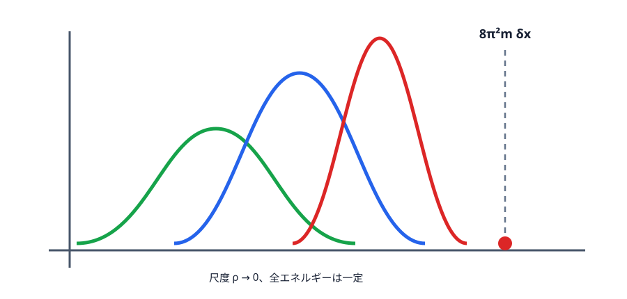

<!-- contract: contracts/11-bubbling.json -->

# まず1変数の集中列を見る

関数

$$
f_n(x)=n\,\mathbf 1_{[0,1/n]}(x)
$$

は、各点で素直に収束する関数列ではないが、積分は常に1である。連続関数 $\varphi$ に対して

$$
\int_0^1 f_n(x)\varphi(x)\,dx
=n\int_0^{1/n}\varphi(x)\,dx
\longrightarrow\varphi(0)
$$

なので、測度としてはDirac測度 $\delta_0$ に弱収束する。総量は消えず、一点へ集中したのである。

バブリングでも追跡する対象は接続係数そのものではなく、非負の曲率エネルギー測度 $|F_A|^2d\mathrm{vol}$ である。違いは、集中量が任意の実数ではなく、インスタントン数によって整数単位に量子化される点にある。

# 有界なエネルギーだけでは強収束しない

固定位相数 $k$ のASD接続はエネルギー $8\pi^2k$ を持つため、一様な $L^2$ boundがある。しかし4次元では $L^2$ 曲率エネルギーが尺度不変なので、BPST インスタントンを半径 $\rho_n\to0$ へ縮めてもboundは改善しない。曲率は一点へ集中し、接続列はその点を含む通常の位相では収束しない。

曲率測度

$$
\mu_n=|F_{A_n}|^2d\mathrm{vol}
$$

を考えると、弱極限は滑らかな部分と原子部分へ分かれる。

$$
\mu_n\rightharpoonup |F_{A_\infty}|^2d\mathrm{vol}
+8\pi^2\sum_{i=1}^\ell m_i\delta_{x_i},\quad m_i\in\mathbb N.
$$

整数 $m_i$ は局所的に拡大した極限が $S^4$ 上のインスタントンを作ることから現れる。

{#fig-bubbling fig-alt="幅が狭く高さが増す三つの曲率密度曲線と、極限の集中点を示す図"}

# BPSTインスタントンが示す尺度の消失

$\mathbb R^4$ 上の基本インスタントンは、中心 $x_0$ と尺度 $\rho>0$ を持つ。局所式を細部まで使わなくても、曲率密度が

$$
|F_{A_{\rho,x_0}}(x)|^2
\sim \frac{\rho^4}{(\rho^2+|x-x_0|^2)^4}
$$

の形を持つことを覚えておけばよい。積分は $\rho$ に依存せず一定だが、$\rho\to0$ とすると密度は $x_0$ に集中する。

これはコンパクト性失敗の模型である。接続の係数そのものが単に大きくなるのではない。エネルギーが一点へ集まり、極限で尺度情報が消える。Uhlenbeckコンパクト化が記録するのは、失われたインスタントンの位置と位相数であり、消えた尺度や向きの全てではない。

# 尺度不変性を積分で確認する

上の密度模型

$$
e_\rho(r)=C\frac{\rho^4}{(\rho^2+r^2)^4}
$$

を4次元極座標で積分すると、体積要素は $r^3dr\,d\Omega_3$ である。$r=\rho s$ と置けば

$$
\int_0^\infty \frac{\rho^4}{(\rho^2+r^2)^4}r^3\,dr
=\int_0^\infty
\frac{\rho^4}{\rho^8(1+s^2)^4}\rho^3s^3\,\rho\,ds
=\int_0^\infty \frac{s^3}{(1+s^2)^4}\,ds.
$$

$\rho$ が完全に消える。これが4次元の臨界性である。半径を小さくしても総エネルギーは減らず、ただ集中する。したがってエネルギー上界だけでは、尺度が0へ落ちる現象を防げない。

次元が4であることも計算に現れている。$n$ 次元なら体積要素は $r^{n-1}dr$ なので、同じ置換で全体に $\rho^{n-4}$ が残る。$n=4$ のときだけ指数が0になり、縮尺を変えてもエネルギーが同じである。この臨界性が、4次元ゲージ理論で尺度が消失する直接の理由である。

# 小エネルギーならゲージを選べる

コンパクト性の核心は、曲率が小さいballでは接続をCoulombゲージへ入れ、

$$
d^*a=0,\quad
\|a\|_{L_1^2(B)}\le C\|F_A\|_{L^2(B)}
$$

のような評価を得ることである。有限個のballでのみ小エネルギー thresholdを超えられるため、その中心を除けば一様評価とRellichコンパクト性が使える。対角列を取り、ゲージ変換後に $A_n$ は $X\setminus\{x_1,\dots,x_\ell\}$ 上で $A_\infty$ へ収束する。

::: {.callout-important title="Uhlenbeckコンパクト性（引用定理を含む証明の骨格、深度C）"}
一様な $L^2$ 曲率上界を持つ接続列から、有限個の集中点を除いてゲージ収束する部分列を取れる。ASD列では極限もASDで、除去可能特異点定理により低い位相数の束へ延長される。失われた位相数は有限個の整数重複度として記録される。難所は小エネルギー ゲージ固定とremovable singularityである。[@freedUhlenbeck1991]
:::

# エネルギー量子化の読み方

なぜ集中するエネルギーが $8\pi^2$ の整数倍になるのか。ASD接続ではエネルギー identityにより

$$
\|F_A\|_{L^2}^2=8\pi^2 k
$$

である。集中点の周りを拡大して見ると、極限は $\mathbb R^4$、一点コンパクト化後には $S^4$ 上の有限エネルギー ASD接続になる。除去可能特異点定理により、それは $S^4$ 上の滑らかなインスタントンへ延長される。従って局所的に失われたエネルギーは、そのインスタントンのsecond Chern numberに対応し、$8\pi^2m$ となる。

ここで使っているのは、単なる測度収束ではない。PDE、ゲージ固定、除去可能特異点、特性類が連動して、連続的に見えたエネルギー lossを整数に量子化している。

# 理想インスタントンで閉じる

通常のモジュライ $\mathcal M_k$ に、低い位相数のASD接続と点のunordered tupleを加え、

$$
\overline{\mathcal M}_k^{U}
=\bigsqcup_{\ell=0}^k
\mathcal M_{k-\ell}\times\operatorname{Sym}^{\ell}(X)
$$

というUhlenbeckコンパクト化を作る。右辺の点は「粒子を追加した」のではなく、接続から消えた尺度と位置のうち、極限で残る位置と位相数だけを記録するideal objectである。

$\operatorname{Sym}^{\ell}(X)=X^\ell/S_\ell$ は、順序を忘れた $\ell$ 個の点の空間である。例えば $\ell=2$ では $(x_1,x_2)$ と $(x_2,x_1)$ を同一視する。二つのバブルが同じ点へ集まる場合は対角成分 $(x,x)$ が多重度2を表す。このため、集中点を単なる集合として記録するのではなく、重複を許す対称積が必要になる。

位相数 $k=2$ の場合を展開すると、集合としての層は

$$
\mathcal M_2
\;\sqcup\;
\mathcal M_1\times X
\;\sqcup\;
\mathcal M_0\times\operatorname{Sym}^2(X)
$$

となる。第一層はバブルなし、第二層は位相数 1を接続に残して1個を点へ失った場合、第三層は2単位を点へ失った場合である。層同士をどの位相で貼るかがコンパクト化の本体であり、単なる非交和を取るだけではない。

層間の余次元が十分大きければ、低次元数え上げはバブリング境界の影響を受けない。一方、1次元パラメータ付き モジュライでは端として現れる可能性を次元数え上げで毎回確認しなければならない。

# 余次元を実際に見積もる

$SU(2)$ のASDモジュライで位相数を一つ落とすと、期待次元は

$$
d(k)-d(k-1)=8
$$

だけ下がる。一方、bubbleの位置 $x\in X$ を記録することで $4$ 次元が戻る。従って一つのbubbleを持つ層は、粗く言えば主層に比べて余次元 $4$ である。

この数が重要である。0次元モジュライのコンパクト化では、余次元 $4$ の層は一般には現れない。1次元パラメータ付き モジュライでも、次元数え上げ上は端になりにくい。もちろん、これは正則性や可約の問題が別途制御されている場合の話である。次元数え上げだけで全てを証明したことにはならないが、なぜ低次元のDonaldson不変量でバブリングを避けられる場面があるのかを説明する。

$\ell$ 個の単純バブルが互いに異なる点へ生じるなら、位相数低下で $8\ell$ 次元を失い、位置で $4\ell$ 次元を戻すため、期待余次元は $4\ell$ である。点が衝突する対角成分では対称積自体が特異な層を持つので、この単純計算だけでは局所形を決められない。そこで実際の境界解析には貼り合わせ定理が必要になる。

# 除去可能特異点定理は何を保証するか

集中点を除いた $X\setminus\{x_i\}$ 上で極限接続 $A_\infty$ が得られても、そのままでは元の閉多様体上の接続ではない。除去可能特異点定理は、有限エネルギー ASD接続が孤立特異点を越えて、適切な束上の滑らかな接続へ延長されることを保証する。

この結果がなければ、コンパクト化の境界は「穴の空いた多様体上の解」という扱いにくい対象になってしまう。延長定理により、低い位相数の通常のASDモジュライと点の情報だけで境界を記述できる。

# コンパクト化は目的でなく次の入力

コンパクト空間を得ただけでは不変量にならない。計量を変えたときのparameterized モジュライが向き付きコボルディズムを作り、その境界が両端のモジュライだけであることを示す必要がある。可約、バブリング、壁越えが余分な境界を作らない条件は何か。次章で「PDE解空間から数を取る」一般機械を組み立てる。

::: {.callout-note title="節内演習：バブリング層の余次元"}
$SU(2)$ ASDモジュライの期待次元を $d(k)=8k-C$ とする。$\ell$ 個のインスタントンsが点へ集中した層は、低い電荷のモジュライ $M_{k-\ell}$ と点配置 $\operatorname{Sym}^{\ell}(X)$ からなる。上位層との差を計算せよ。

**解答。** 4次元多様体上の1点は実4自由度を持つので、下位層の期待次元は
$$
d(k-\ell)+4\ell
=8(k-\ell)-C+4\ell
=d(k)-4\ell.
$$
したがって $\ell$ 点バブリング層の期待余次元は $4\ell$ である。たとえば $\ell=2$ なら余次元は8となる。この次元差が、低次元の切断モジュライでバブリング境界を避ける基本理由である。
:::
