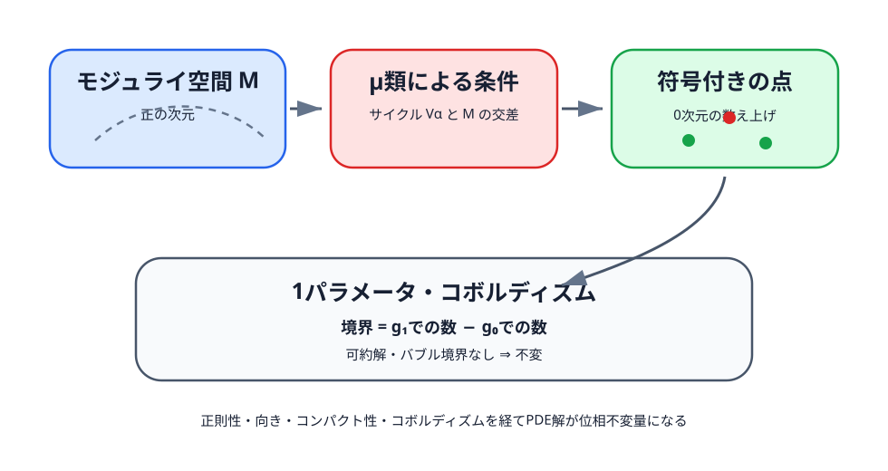

<!-- contract: contracts/12-invariant-machine.json -->

# 数を作る前に必要な五つの条件

偏微分方程式の解を有限個見つけても、それだけでは多様体の不変量にならない。少なくとも次を確認する必要がある。

1. **有限次元性**：ゲージ固定後の線形化がFredholmである。
2. **正則性**：余核が消え、期待次元が実際の次元になる。
3. **向き**：各零点へ整合的に符号を付けられる。
4. **コンパクト性**：解の列が数え上げから逃げない。
5. **補助データからの独立性**：計量や摂動を変えた間をコボルディズムが結ぶ。

第7〜11章はこの順番を準備してきた。本章の仕事は、五条件を一つの数え上げへ接続することである。

# 0次元なら点を数える

正則でコンパクトな0次元モジュライ空間 $\mathcal M$ は有限集合である。各点の行列式線束の向きから $\varepsilon([A])=\pm1$ を定め、

$$
n=\sum_{[A]\in\mathcal M}\varepsilon([A])
$$

と数える。向きを無視した点数は、パラメータを動かしたとき点が対生成・対消滅する現象を相殺できない。符号付き数え上げなら局所生成・消滅で寄与が $+1-1=0$ になる。

# 符号付き数え上げの有限次元模型

写像族

$$
f_t(x)=x^2-t
$$

を考える。$t>0$ では零点が二つ、$t<0$ では零点がない。向きを無視した点数は $2$ から $0$ へ変わるので不変ではない。これは1次元の零点問題で、$t=0$ に非正則な零点が現れる。

一方、写像

$$
g_s(x)=x-s
$$

では零点は常に一つで、導関数は正なので符号は常に $+1$ である。より一般に、0次元モジュライの点の符号は、線形化のdeterminantの向きで決まる。点が対生成するとき、二つの点は反対符号で現れるため、符号付き和は変わらない。

Donaldson理論の向きは、この有限次元の「導関数の符号」を、楕円作用素の行列式線束へ拡張したものである。

より直接に計算するため、$f(x)=x^3-x$ を取る。零点は $-1,0,1$ で、導関数は

$$
f'(x)=3x^2-1
$$

だから符号は順に $+,-,+$、符号付き和は1である。グラフを小さく変形して零点が二つ増減しても、新しい二点の傾きは反対符号になる。符号なし個数は変わるが、符号付き和が保たれる仕組みを手で確認できる。

付録Aでは、この行列式線束をFredholm作用素の核と余核から定義した。本文で使う符号付き数え上げは、単に点へ任意に符号を付ける操作ではなく、Fredholm族の向きから強制される符号である。このため、向きの選択は不変量の定義の一部であり、後から好みで変える装飾ではない。

# 計量依存性をコボルディズムへ変える

二つの一般的な計量 $g_0,g_1$ を経路 $g_t$ で結び、

$$
\mathcal W=\bigcup_{t\in[0,1]}\{t\}\times\mathcal M(g_t)
$$

を考える。普遍横断性が成り立てば $\mathcal W$ は1次元向き付き多様体になる。コンパクトで余分な境界がなければ

$$
\partial\mathcal W=\mathcal M(g_1)\sqcup(-\mathcal M(g_0))
$$

なので、向き付き境界の総数が0であることから $n(g_1)=n(g_0)$ を得る。

ここでコンパクト性を確認せずに「コボルディズムだから不変」と結論してはいけない。バブリング層や可約軌跡へ列が逃げれば、コンパクト化後の境界に新成分が加わる。

# コンパクト化後に貼り合わせが必要な理由

コンパクト化で境界層を付け加えただけでは、まだ不変量の証明は終わらない。付け加えた層が、本当にモジュライの端として現れているかを知る必要がある。ここで貼り合わせ解析が使われる。

たとえばバブルを持つ理想インスタントンがコンパクト化の境界に現れたとする。貼り合わせ定理は、バブルの尺度を小さく選び、背景解と標準インスタントンを貼り合わせ、誤差を補正して真のASD解を作る。これにより、境界層の近くのモジュライがどのような局所形を持つかが分かる。

したがってコンパクト性は「逃げた列の極限を記録する」定理であり、貼り合わせは「記録された極限の近くに実際の解が存在する」ことを戻す定理である。境界寄与を数える議論では、この二つが対になって働く。

# パラメータ付きモジュライ空間の線形化

$g_t$ を動かすとき、方程式は

$$
F_A^{+,g_t}=0
$$

である。線形化には接続方向 $a$ だけでなく、計量方向 $\dot g$ も現れる。

$$
(a,\dot g)\longmapsto d_A^{+,g}a+\dot\pi_+(F_A)
$$

ここで $\dot\pi_+$ はホッジ作用素、したがって自己双対射影の変化である。固定計量で $d_A^+$ が全射でなくても、計量方向が余核を埋めれば普遍モジュライは正則になりうる。これが一般的な計量の横断性の中身である。

ただし、$F_A$ の形によっては計量方向が十分に効かない。特に可約や低い位相数の特殊解では、計量を動かすだけで全射性を得られないことがある。その場合、方程式への摂動を導入するか、対象を避ける仮定を置く必要がある。

# $b_2^+>1$ の役割

可約が現れる条件は、概略的にはあるコホモロジー類の自己双対調和部分が0になることとして書ける。計量空間内でその条件は $b_2^+$ 個の実条件を課す。1パラメータ経路がこの壁を避けるには余次元が2以上、すなわち $b_2^+>1$ が自然な安全条件になる。

$b_2^+=1$ では壁は余次元 1で、経路が横切る可能性がある。この場合、不変量は計量から完全に独立ではなく部屋に依存し、壁越え公式が差を記述する。「例外」ではなく、仮定を弱めたときに何が境界へ現れるかを示す構造である。

# 壁越えを境界として見る

$b_2^+=1$ のとき、二つの計量を結ぶ経路は可約の壁を横切ることがある。パラメータ付きモジュライをコンパクト化すると、境界は

$$
\mathcal M(g_1)\sqcup(-\mathcal M(g_0))
$$

だけではなく、壁上の可約を中心とする局所模型から来る成分を持つ。この余分な境界の符号付き寄与が壁越え項である。

この見方をすると、$b_2^+>1$ の仮定は突然の魔法ではない。1パラメータ・コボルディズムが避けるべき悪い集合の余次元を上げ、余分な境界を消すための仮定である。

# 正次元モジュライ空間ではコホモロジー類を積分する

Donaldson理論では普遍束から得る $\mu$ 写像

$$
\mu:H_i(X)\longrightarrow H^{4-i}(\mathcal B^*)
$$

を用いる。その前に、この記号に入る特性類を整理しておく。$P\to X$ がDonaldson理論で使う $SO(3)$ 束なら、$w_2(P)\in H^2(X;\mathbb Z/2)$ はその束の第二Stiefel--Whitney類である。これは第15章で接束に対して使う $w_2(TX)$ とは別の対象で、前者は補助束 $P$ の貼り合わせ障害、後者は接束のspin構造の障害を測る。$SO(3)$ 束は向き付き3次元実ベクトル束に対応するので $w_1(P)=0$ であり、Spinへ持ち上げる障害として $w_2(P)$ が現れる。

もう一つ使うのがPontryagin類である。随伴束 $\operatorname{ad}P$ は実3次元ベクトル束で、$p_1(\operatorname{ad}P)\in H^4(X;\mathbb Z)$ を持つ。モジュライ空間上の条件を作るには、個々の $X$ 上の束だけでなく、$X\times\mathcal B_P^*$ 上の普遍 $SO(3)$ 束 $\mathbb P$ を使う。ここで $\mathcal B_P^*$ は既約接続をゲージで割った空間である。普遍束は構成に基点付きゲージ群や中心の処理を伴うため、厳密な定義は標準文献に従うが、本文で必要なのは「$X$ 方向のサイクルを入れると、残った $\mathcal B_P^*$ 方向のコホモロジー類が出る」という型である。

$\mu(\alpha_j)$ を表す幾何学的代表 $V_{\alpha_j}\subset\mathcal B^*$ を一般位置に選び、次数の和をモジュライ空間の次元に合わせる。切り下げた集合

$$
\mathcal M_k\cap V_{\alpha_1}\cap\cdots\cap V_{\alpha_m}
$$

が有限個の正則点からなり、その閉包がUhlenbeckコンパクト化の低い層へ当たらないことを次元評価で確認したとき、その符号付き点数をDonaldson不変量と定義する。特異なコンパクト化全体に通常の多様体の基本類があると仮定しているのではない。文献で使う

$$
D_X(z)=\langle \mu(z),[\overline{\mathcal M}_k]\rangle
$$

という表示は、この幾何学的切り下げと境界回避が正当化された場合の略記である。

# 有限次元の切り下げを計算する

$M=\mathbb R^2$ を2次元モジュライ空間の模型とし、二つの次数1条件を

$$
V_1=\{(x,y):y=0\},\qquad
V_2=\{(x,y):y=x+1\}
$$

とする。連立方程式を解くと交点は $(-1,0)$ の一つである。接ベクトル $(1,0)$ と $(1,1)$ の行列式は1なので、交点符号は $+1$ である。

$V_2$ を平行移動して $y=x+c$ としても、交点は $(-c,0)$ へ動くだけで符号は変わらない。ただし交点が無限遠へ逃げる空間や、二つの条件が接する非横断な配置では、この議論は壊れる。ゲージ理論では、コンパクト化が「無限遠へ逃げない」を、横断性が「接しない」を保証する。

この模型で、2次元空間に次数1の条件を二つ課すと0次元になる。Donaldson理論では、$\mu(\Sigma)$ は $\Sigma\in H_2(X)$ に対して次数2、$\mu(\mathrm{pt})$ は点類に対して次数4を持つので、条件の次数和をモジュライ空間の実次元へ一致させる。

# $\mu$写像は何を測るか

$\mu$写像は、$X$ 内のサイクルを「そのサイクル上で接続が満たす条件」としてモジュライ上のコホモロジー類へ移す装置である。定義には普遍束のPontryagin類、またはChern類を使う。形式的には

$$
\mu(\alpha)=-\frac14 p_1(\mathbb P)/\alpha
$$

のように、普遍束の特性類を $\alpha\in H_i(X)$ に対してスラント積する。ここで $\mathbb P$ は $X\times\mathcal B^*$ 上の普遍 $SO(3)$ 束である。

係数についても注意が必要である。$-\frac14p_1(\mathbb P)$ がどの係数環で整った類になるかは、$SO(3)$ 束か $SU(2)$ 束か、普遍束をどの商で作るか、$w_2(P)$ をどう固定するかに依存する。多くの入門的な式では有理係数で書き、整数性が必要な場合は束の型と係数環を明示する。本書ではまず次数と切り下げの型を使い、整数係数の完全な扱いは引用定理の仮定に含める。

スラント積の型を一度だけ確認する。$X\times\mathcal B^*$ 上の4次コホモロジー類 $p_1(\mathbb P)$ を、$X$ 側の $i$ 次元サイクル $\alpha$ で評価すると、残りは $\mathcal B^*$ 側の次数 $4-i$ のコホモロジー類になる。記号では

$$
p_1(\mathbb P)/\alpha\in H^{4-i}(\mathcal B^*)
$$

である。したがって点類 $\mathrm{pt}\in H_0(X)$ を入れると4次類、曲面類 $\Sigma\in H_2(X)$ を入れると2次類が出る。この次数が、切り下げ条件の個数を決める。

積の例で見ると、型はもっと単純である。仮に $X=S^2$、$\mathcal B^*=S^2$ とし、$u\in H^2(S^2_X)$、$v\in H^2(S^2_{\mathcal B})$ をそれぞれ基本類に1を返す生成元とする。$X\times\mathcal B^*$ 上の類 $u\otimes v$ を $[S^2_X]$ でスラント積すると

$$
(u\otimes v)/[S^2_X]=\langle u,[S^2_X]\rangle v=v
$$

となり、$X$ 側の次数2が消えて $\mathcal B^*$ 側の2次類が残る。点類で割る場合は $X$ 側の次数0成分だけを拾う。Donaldson理論の $\mu(\Sigma)$ と $\mu(\mathrm{pt})$ は、この積分方向の違いを普遍束の特性類に対して行っている。

直感的には、点類 $\mathrm{pt}\in H_0(X)$ からは次数4の条件、曲面類 $\Sigma\in H_2(X)$ からは次数2の条件が出る。モジュライの次元と挿入次数が一致したときだけ、有限個の交点を数える形になる。

最初は、$\mu$類を「モジュライ空間を測るための測定器」と考えてよい。どの測定器を何個入れるかは、まず次数合わせで決まり、その後に横断性と向きの議論で符号付き数へ変わる。

この説明で重要なのは、Donaldson不変量が「ASD接続の個数」だけではないことである。正次元モジュライでは、幾何的条件を何個か課して0次元へ切り下げ、その符号付き交点数を取っている。

# Donaldson不変量の構成を最後まで追う

ここまでの説明は一般形だったので、定義がまだ宙に浮いて見える。そこで、典型的な状況を一つ固定して、不変量が本当に数になるまでを追う。ここで行うのは公刊文献中の特定多様体に対するDonaldson多項式の数値再計算ではなく、構成の全手順を追うための模型である。実在するDonaldson側の具体的出力は、次章の $E_8$ 排除で、入力、引用定理、格子計算、幾何的結論までを閉じる。

閉・向き付き・単連結な滑らかな4多様体 $X$ を取り、$b_2^+(X)>1$ とする。$SO(3)$ 束 $P\to X$ を固定し、$w=w_2(P)$ と $p_1(\operatorname{ad}P)$ により位相型を固定する。既約 ASD接続のモジュライを $\mathcal M_P$ と書き、一般的な計量により正則で実次元 $2r$ になっていると仮定する。

このときDonaldson不変量の一つの値は、ホモロジー類

$$
\alpha_1,\dots,\alpha_m\in H_0(X)\oplus H_2(X)
$$

を選び、

$$
\sum_{j=1}^m \deg \mu(\alpha_j)=2r
$$

が成り立つ場合に

$$
D_X^w(\alpha_1\cdots\alpha_m)
=\left\langle
\mu(\alpha_1)\cdots\mu(\alpha_m),[\overline{\mathcal M}_P]
\right\rangle
$$

として定義される。ここで $\overline{\mathcal M}_P$ はUhlenbeckコンパクト化であり、ペアリングが境界層に邪魔されない次数範囲を選ぶ。$\mathbb P$ は $X\times\mathcal B_P^*$ 上の普遍 $SO(3)$ 束で、$\mathcal B_P^*$ は既約接続をゲージで割った空間である。全ゲージ群で割ると中心や普遍束の定義に細工が要るため、文献では基点付きゲージ群を通して作ってから必要な商へ降ろす、または普遍随伴束を使う、という処理を行う。本書ではこの構成上の細部を丸ごと引用定理へ送らず、値の定義に必要な入力として明示しておく。

幾何的には、$\mu(\alpha_j)$ を代表するサイクルを $\mathcal B_P^*$ 上に選び、それらを $\mathcal M_P$ と横断に交わらせる。交わり

$$
\mathcal M_P\cap V_{\alpha_1}\cap\cdots\cap V_{\alpha_m}
$$

が0次元になれば、その点を向きで符号付きに数える。これが上のコホモロジー・ペアリングである。

例えば $\dim\mathcal M_P=4$ なら、許される次数合わせには次の二通りがある。

$$
\mu(\mathrm{pt})
\qquad\text{または}\qquad
\mu(\Sigma_1)\,\mu(\Sigma_2).
$$

前者は次数4の条件を一つ、後者は次数2の条件を二つ課す。どちらも切り下げ後の期待次元は0である。対して、曲面条件を一つだけ課すと期待次元は2のままで、まだ点を数えられない。次数合わせは形式的な規則ではなく、「何個の連立条件で自由度を使い切るか」という次元計算である。

{#fig-cutdown-cobordism fig-alt="正次元モジュライに複数の条件面を交差させて有限個の点を得て、二つの計量の間のコボルディズムで境界の符号付き数が一致する図"}

補助計量を $g_0$ から $g_1$ へ動かしたときは、同じ挿入サイクルをパラメータ付きモジュライへ引き上げる。正則なら切り下げ後の空間は1次元向き付き多様体になり、その境界は

$$
\left(\mathcal M_{P,g_1}\cap V_{\alpha_1}\cap\cdots\cap V_{\alpha_m}\right)
\sqcup
-\left(\mathcal M_{P,g_0}\cap V_{\alpha_1}\cap\cdots\cap V_{\alpha_m}\right)
$$

に、もしあればバブリング境界や可約境界を加えたものになる。$b_2^+>1$ は1パラメータ経路で可約の壁を避けるための標準仮定であり、次元条件はバブリング層が切り下げ後の1次元コボルディズムへ余分な端として入らないように選ぶ。余分な境界がなければ、向き付き境界の総数が0であることから、$D_X^w$ は計量に依存しない。

この段階で、PDEの解空間が滑らかな不変量へ変わる理由を一文で言える。方程式と商は滑らかな構造に依存して定義されるが、正則性、向き、コンパクト化、コボルディズムにより、補助計量や代表サイクルを変えても同じ数を返すからである。したがって微分同相写像はこの構成全体を対応させるが、単なる同相写像には同じ対応を期待できない。

# 一つの不変量を作る九段階

ここまでの機械は、方程式、対称性、線形化、複体、指数、正則性、向き、コンパクト化、数え上げの順で動く。どれか一段を省くと「有限次元か」「滑らかか」「符号を付けられるか」「逃げないか」のいずれかが未解決になる。

各段の入出力を明示すると次のようになる。

| 段階 | 入力 | 出力 |
|---|---|---|
| 方程式 | 接続 $A$ | ASD解集合 |
| 対称性 | ゲージ群の作用 | 同じ幾何の同定 |
| 線形化 | 解 $A$ | $d_A,d_A^+$ |
| 複体 | $d_A^+d_A=0$ | $H_A^0,H_A^1,H_A^2$ |
| 指数 | 主記号 | 期待次元 |
| 正則性 | 摂動・計量 | 滑らかなモジュライ空間 |
| 向き | 行列式線 | 符号 |
| コンパクト化 | 解列 | 理想インスタントンを含む極限 |
| 数え上げ | $\mu$ 類とコボルディズム | 補助データに依存しない数 |

# 実例へ渡すもの

この九段階は抽象的な点検表だけではない。第14章の K3 結び目手術 では、同じ K3 の位相型の上に作った $X_K$ に対して Seiberg--Witten 級数

$$
\mathcal{SW}_{X_K}=\mathcal{SW}_{K3}\Delta_K(t)
$$

を比較する [@fintushelStern1998]。右辺の係数を微分同相不変量として使えるのは、まさに正則性、向き、コンパクト性、コボルディズムという本章の工程が背後にあるからである。公式そのものの証明には トーラス手術に対する貼り合わせ がさらに必要であり、本書では第14章で定理として入力する。

# 失敗モードの対応表

最後に、このPartで出てきた失敗を一覧にしておく。これは後のDonaldson定理とSW理論を読むための点検表でもある。

| 失敗 | 数学的な場所 | 対応する道具 |
|---|---|---|
| 同じ接続を何度も数える | ゲージ軌道 | 商、スライス |
| 商が特異になる | 安定化群、$H_A^0$ | 既約条件、特異層管理 |
| 一次解が本物の解にならない | 障害、$H_A^2$ | Kuranishi模型、摂動 |
| 期待次元が実次元でない | 正則性の失敗 | Sard--Smale、一般的な計量 |
| 点数の符号が決まらない | 行列式線束 | ホモロジー向き |
| 解列が逃げる | バブリング | Uhlenbeckコンパクト化 |
| 計量を変えると値が変わる | 余分な境界 | コボルディズム、$b_2^+>1$、壁越え |

次章ではこの共通機械から得られるDonaldsonの二つの出力を分離する。対角化定理は定値交点形式への制約であり、Donaldson多項式はより精密な滑らかな不変量である。同じ解析基盤を使うが、同じ主張ではない。

::: {.callout-note title="節内演習：0次元解の符号付き数え上げ"}
$f:\mathbb R\to\mathbb R$、$f(x)=x^3-x$ の零点を、標準の向きから定まる符号付きで数えよ。

**解答。** 零点は
$$
f(x)=x(x-1)(x+1)=0
\quad\Longrightarrow\quad x=-1,0,1
$$
である。$f'(x)=3x^2-1$ だから各点の符号は
$$
\operatorname{sign}f'(-1)=+1,
\quad \operatorname{sign}f'(0)=-1,
\quad \operatorname{sign}f'(1)=+1.
$$
よって符号付き個数は $1-1+1=1$ である。絶対値だけを足した3ではなく、向きが変形で保存される数を作る。
:::
