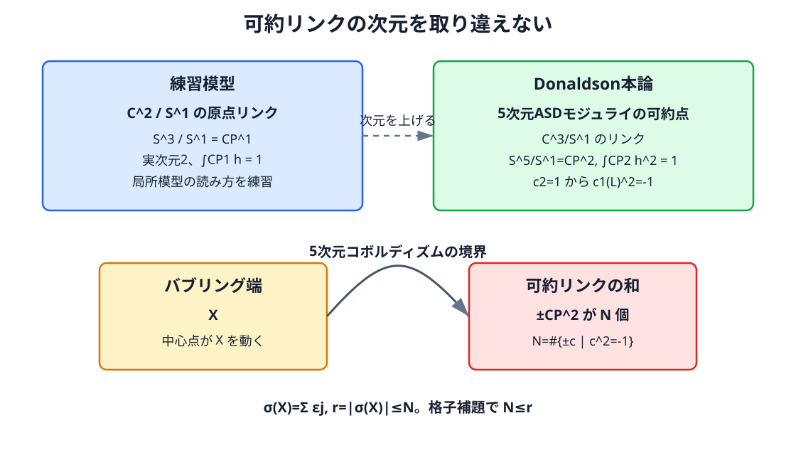

<!-- contract: contracts/13-donaldson-outputs.json -->

# 出力A：定値形式への制約

Donaldson対角化定理は、$X$ を閉・連結・向き付き・滑らか・単連結な4次元多様体とし、交点形式 $Q_X$ が正定値なら、$Q_X$ は整数上で $\langle1,\ldots,1\rangle$ と同値である、と述べる。負定値の場合は向きを反転して $\langle-1,\ldots,-1\rangle$ を得る。証明では低チャージのASDモジュライ空間をコンパクト化し、その端の構造を解析して格子へ矛盾を返す。結論は「多項式の値」ではなく、滑らかな多様体が持ちうる交点形式への制約である。[@donaldson1983]

入力を整理すると、滑らかさはASD解析を可能にし、単連結性は可約と束の分類を単純化し、定値性はモジュライの次元と端を制御する。結論だけをFreedman分類と並べれば短いが、背後には第7--11章の全機械がある。

ここで読者が止まりやすいのは、「解析的なモジュライ空間の端が、なぜ整数格子の対角化を強制するのか」という点である。証明を完全に再現するには長い準備が必要だが、論理の骨格は次のように分解できる。

1. 交点形式 $Q_X$ から、ある $SO(3)$ または $SU(2)$ 束 $P$ を選ぶ。
2. その束上のASDモジュライ空間 $\mathcal M(P)$ を作る。
3. 指数公式により、期待次元が低い場合を選ぶ。
4. Uhlenbeckコンパクト化で、非コンパクトな逃走を「有限個の点で位相数が落ちる」という境界として管理する。
5. 境界やリンクの組合せが、$H^2(X;\mathbb Z)$ の格子構造と矛盾する。

つまり、モジュライ空間が直接「交点形式そのもの」なのではない。交点形式は束の特性類と次元公式に入り、コンパクト化の端の個数・リンク・向きの整合性を通じて制約として戻ってくる。この戻り方がDonaldson理論の非自明な点である。

もっと粗い比喩で言えば、Freedman理論は「この格子を交点形式として持つ位相的4多様体はあるか」を問う。一方Donaldson対角化定理は、「それが滑らかな多様体なら、そこから作ったASDモジュライの端が矛盾なく閉じるか」を問う。$E_8$ のような定値で非対角な格子は前者では許されるが、後者では許されない。

::: {.callout-note title="証明の骨格：Donaldson対角化定理"}
本書ではDonaldson対角化定理の解析的貼り合わせを完全証明しない。使用する深い入力は、ASDモジュライの正則性、向き、Uhlenbeckコンパクト性、低チャージモジュライの端の解析である。ただし、束の選択、可約解から長さ $-1$ の格子ベクトルが出る計算、リンクが $\mathbb{CP}^2$ になる次元計算、最後の格子補題は本文内で追う。以下の経路はDonaldsonの原論文と標準教科書に基づく骨格であり、Perutzの講義ノートにも同じ流れで要約されている。[@donaldson1983; @donaldsonKronheimer1990; @perutzGaugeSymplectic]
:::

# 対角化定理の証明骨格をもう一段具体化する

対角化定理の証明で読者が見失いやすいのは、「どの束を見ているのか」である。文献には、負定値の場合に $SO(3)$ 束 $P$ を選び、$w_2(P)$ が交点格子の特定の特性ベクトルを表すようにする説明も多い。すると $p_1(\operatorname{ad}P)$ と $Q_X$ がASDモジュライの期待次元に入る。これは同じ対角化定理へ向かう別ルートの言葉であり、本章で実際に数式を追う主線ではない。

本章の主線は、このあと固定する $SU(2)$ 束 $E$、すなわち

$$
c_1(E)=0,\qquad c_2(E)[X]=1
$$

から出発する5次元モジュライの経路である。SO(3)・特性ベクトルの記述は、標準文献で同じ定理がどのように語られるかを理解するための補足として読む。束を選ぶ目的はどちらの経路でも同じで、単に解を作ることではなく、期待次元と可約の形を格子から読める状況に置くことである。

次に、一般的な計量で既約部分を正則にし、低次元のモジュライを得る。典型的には、1次元または少し高い次元のモジュライをコンパクト化し、その端を見る。Uhlenbeckコンパクト化により、非コンパクト性は位相数の減少として記録される。一方、可約接続が現れると、その近傍のリンクは複素射影空間に似た構造を持ち、向き付き境界やコホモロジー・ペアリングに具体的な寄与を返す。

ここで格子論が入る。可約は、接続が線束の和に分裂することに対応し、その第一Chern類が $H^2(X;\mathbb Z)$ のベクトルを与える。分裂の条件、期待次元、リンクのコホモロジーが組み合わさると、「各格子ベクトルに対して特定のペアリングが成り立たなければならない」という条件が出る。負定値で滑らかな場合、この条件を満たす格子は標準対角格子でなければならない、というのが対角化定理の格子論的帰結である。

本書で完全証明しない研究級入力は二つある。第一に、可約近傍の局所模型を正確に作り、コンパクト化の端とリンクの向き・コホモロジーを整合させる解析である。第二に、5次元モジュライの境界から署名の不等式 $r\le N$ を得る部分である。一方、そこから先の有限次元格子計算、すなわち $N\le r$ と $Q_X\cong -I_r$ は本章で追う。したがって以下では「引用する解析」と「本文で計算する格子論」を分けて読む。

したがって、対角化定理は単に「ASDモジュライを使う」と言うだけでは足りない。証明の骨格は

```text
定値交点格子
→ 特性類を持つ補助束（本章の主線では SU(2), c2=1）
→ 低次元 ASDモジュライ
→ Uhlenbeck端と可約リンク
→ リンクのコホモロジー と向きの関係
→ 特性ベクトルに関する格子条件
→ 整数上の対角化
```

である。この経路を知っておくと、Freedmanの存在定理とDonaldsonの非存在定理がどこで衝突するかを、単なる有名定理の比較ではなく、解析から格子へ戻る論理として読める。

# 低次元モジュライは何を数えるのか

第12章では、0次元 モジュライなら点を符号付きで数え、正次元 モジュライならコホモロジー類を挿入して数を得る、と説明した。対角化定理の証明で現れる低次元モジュライは、この一般機械の極端な使い方である。

例えば1次元のコンパクトな向き付き多様体なら、境界点の符号付き和は0でなければならない。ところがASDモジュライをコンパクト化すると、境界に見える点は単なる任意の点ではなく、位相数の減少、可約、格子の特定のベクトルに対応する。そこで「境界の符号付き和は0」という解析・位相的事実が、「格子に特定の形のベクトルが存在しなければならない」という整数論的条件へ翻訳される。

この説明だけでは証明には足りない。だが、少なくとも「モジュライ空間の端を見る」という操作がなぜ交点形式に関係するのかは分かる。端はコンパクト性の失敗の記録であり、その失敗は束の特性類、従って $H^2(X;\mathbb Z)$ の格子に記録されるからである。

# 可約リンクを小さな模型で見る

ここで、一般定理の代用品ではなく、リンクがコホモロジーを返す仕組みだけを有限次元で見る。$\mathbb C^2$ に $S^1$ が

$$
e^{i\theta}\cdot(z_1,z_2)=(e^{i\theta}z_1,e^{i\theta}z_2)
$$

で作用すると、原点以外の半径 $\varepsilon$ の球面 $S^3_\varepsilon$ の商は

$$
S^3_\varepsilon/S^1=\mathbb{CP}^1
$$

である。$\mathbb{CP}^1$ には2次の生成元 $h\in H^2(\mathbb{CP}^1;\mathbb Z)$ があり、

$$
\int_{\mathbb{CP}^1}h=1
$$

で正規化できる。したがって「孤立した特異点の近くを小球でくり抜き、その境界商にコホモロジー類を積分する」と、整数が一つ返る。

ASDモジュライで可約接続が現れると、局所模型はこの例より高次元で、しかも複素線束の和への分裂を伴う。典型的には随伴束の分裂から、ある線束の第一Chern類

$$
c_1(L)\in H^2(X;\mathbb Z)
$$

が現れ、これは交点格子のベクトルとして読める。リンクの射影空間型コホモロジーに、普遍束から来る類を制限して積分すると、その値は $c_1(L)$ と交点形式のペアリングで書かれる。この「積分値が格子ベクトルの数値になる」という一点が、解析から整数格子へ戻る橋である。

ただし、本書はここでDonaldson対角化定理を証明し切っているわけではない。一般の場合に引用する研究級入力は、次の二点である。

1. 可約接続の近傍を、安定化群を含めて正確な局所模型にすること。
2. Uhlenbeck端、可約リンク、向きの符号を一つのコンパクト化境界として整合させ、署名比較から $r\le N$ を得ること。

本章で手計算した $\mathbb{CP}^1$ の模型は1の局所的な影だけを示す。次の節では、Perutzの講義ノートにも現れる5次元経路に沿って、$c_2=1$、可約リンク $\mathbb{CP}^2$、署名不等式、格子計算の主線を本文内で追う。模型を定理の完全証明と取り違えないことが重要である。

# 実際の5次元経路：$c_2=1$ から $\mathbb{CP}^2$ リンクへ

ここで、対角化定理の中心だけは数式で追う。$X$ を閉・連結・向き付き・滑らか・単連結で、交点形式が負定値である4多様体とする。階数を

$$
r=b_2(X)=-\sigma(X)
$$

と書く。正定値の場合は向きを反転すればよい。

まず $SU(2)$ 束 $P\to X$ と付随する階数2複素ベクトル束 $E$ を取り、

$$
c_1(E)=0,\qquad c_2(E)[X]=1
$$

となるように選ぶ。この一文には三つの主張が混ざりやすい。

1. その位相型の束が存在する。
2. その束上にASD解が存在する。
3. 解のモジュライ空間が、必要な正則性と端の構造を持つ。

ここで束の存在だけは、4次元の位相的な束分類で説明できる。最小模型は $S^4$ である。北半球と南半球では束を自明化し、赤道 $S^3$ 上で二つの自明化を貼り合わせる。構造群が $SU(2)$ の場合、行列

$$
\begin{pmatrix}
a & b\\
-\bar b & \bar a
\end{pmatrix},
\qquad |a|^2+|b|^2=1,
$$

で $SU(2)\cong S^3$ と見られるので、貼り合わせ写像は

$$
g:S^3\longrightarrow SU(2)\cong S^3
$$

である。この写像の次数が、直観的には束の「ねじれ数」であり、$S^4$ 上では第2Chern数を与える。正確な符号は、$S^4$ の向き、赤道の境界向き、$SU(2)\cong S^3$ の同一視の規約に依存する。本書ではこれらを固定し、次数1の写像から $c_2=1$ の基本例を得るという規約で読む。

一般の閉・連結・向き付き4多様体でも、4次元CW複体上の $SU(2)$ 束は、第2Chern類

$$
c_2(E)\in H^4(X;\mathbb Z)
$$

で分類される、という標準定理を使う。ここでは分類定理そのものは引用する。$X$ が閉・連結・向き付きなら、向きの基本類 $[X]$ により $H^4(X;\mathbb Z)\cong\mathbb Z$ と読めるので、評価

$$
\langle c_2(E),[X]\rangle=1
$$

となる $SU(2)$ 束を選べる。単連結性は後で可約やゲージ群を扱うときに効くが、この段階で言っているのは、まず補助束の位相型を選べるということである。

ただし、$c_2(E)[X]=1$ の束が存在することは、その束上にASD接続があることを意味しない。さらに、解空間が期待通りの5次元多様体になり、Uhlenbeck端と可約リンクを持つことも、束分類からは出ない。そこはDonaldson理論の研究級解析として引用する。

::: {.callout-note title="確認：束の存在と解の存在は違う"}
「$c_2=1$ の束があるからASD解もある」と言ってはいけない。束の存在は、貼り合わせ写像や $c_2\in H^4(X;\mathbb Z)$ による位相的分類の主張である。ASD解の存在は、その束上の接続が非線形偏微分方程式 $F_A^+=0$ を満たすかという解析的主張であり、一般の計量・摂動・コンパクト化の議論を別に必要とする。
:::

この束上のASD接続のモジュライを考える。指数公式は、ここでは

$$
d=8c_2(E)[X]-3(1-b_1+b_2^+)
$$

であり、$X$ は単連結だから $b_1=0$、負定値だから $b_2^+=0$ である。従って

$$
d=8\cdot1-3(1-0+0)=5.
$$

なぜ5次元を選ぶのか。Uhlenbeck端では、1単位のエネルギーが一点へ集中し、その中心点が $X$ の4次元パラメータになる。一方、可約点のリンクも4次元の $\mathbb{CP}^2$ になる。5次元モジュライを切って端を見ると、4次元の境界成分を比較できるからである。

次に可約接続を格子ベクトルへ変換する。可約とは、$E$ が線束の和

$$
E\cong L\oplus L^{-1}
$$

へ分裂し、接続もこの分裂を保つ状況である。Whitney積公式から

$$
c(E)=c(L)c(L^{-1})
=(1+c_1(L))(1-c_1(L))
=1-c_1(L)^2.
$$

したがって

$$
c_2(E)=-c_1(L)^2.
$$

$c_2(E)[X]=1$ なので

$$
Q_X(c_1(L),c_1(L))=\langle c_1(L)^2,[X]\rangle=-1.
$$

つまり、可約点は交点格子の長さ $-1$ のベクトルを要求する。$L$ と $L^{-1}$ を入れ替えると $c_1(L)$ は符号反転するので、候補は符号を同一視した対

$$
\{\pm c:c\in H^2(X;\mathbb Z),\ c^2=-1\}
$$

で数える。この個数を $N$ と書く。

可約点近傍の有限次元模型も、先ほどの $\mathbb C^2/S^1$ では足りない。5次元ASDモジュライでは、可約点の横方向の複素次元が3になり、局所模型は

$$
\mathbb C^3/S^1
$$

に似た錐になる。半径を固定したリンクは

$$
S^5/S^1=\mathbb{CP}^2
$$

である。$\mathbb{CP}^2$ の超平面類 $h\in H^2(\mathbb{CP}^2;\mathbb Z)$ は

$$
\langle h^2,[\mathbb{CP}^2]\rangle=1
$$

で正規化される。練習用の $\mathbb{CP}^1$ では $h$ を一回積分して数を得たが、本論の $\mathbb{CP}^2$ では $h^2$ を4次元基本類で評価する。この次数の違いが、リンクの次元を見失わないための目印である。

{#fig-donaldson-cp2-link fig-alt="CP1練習模型とCP2可約リンク、および5次元モジュライの境界がXとCP2の和になる構造を比較する図"}

ここまでが本文で追える有限次元部分である。研究級の入力は次の一文に集約される。一般的な計量を選び、可約点の小近傍を取り除き、Uhlenbeck端を付けると、5次元の向き付きコンパクトなコボルディズム $W$ が得られ、その境界は $X$ と、$N$ 個の $\mathbb{CP}^2$ に向きを付けたものの直和になる。ここでは正則性、可約近傍の解析、貼り合わせ、向きの整合性をDonaldson理論の定理として引用する。

向きの符号は、1次元の区間で先に見ると分かりやすい。向き付き区間 $[0,1]$ の境界は、終点が正、始点が負なので

$$
\partial[0,1]=\{1\}-\{0\}
$$

と書く。同じように、5次元の向き付き境界は4次元閉多様体の符号付き和である。ここでは向き規約を

$$
\partial W
=X\sqcup\coprod_{j=1}^N(-\varepsilon_j\mathbb{CP}^2),
\qquad \varepsilon_j=\pm1
$$

と取る。$-\mathbb{CP}^2$ は $\mathbb{CP}^2$ の向きを反転したものを表す。

署名について使う性質は三つである。第一に $\sigma(\mathbb{CP}^2)=1$、向きを反転すると $\sigma(-\mathbb{CP}^2)=-1$。第二に、非交和では署名が加法的である。第三に、向き付き境界全体の署名は0である。最後の性質は本書で証明するのではなく、Hirzebruch署名定理やコボルディズム不変性に属する標準定理として引用する。

したがって

$$
0=\sigma(\partial W)
=\sigma(X)-\sum_{j=1}^N\varepsilon_j
$$

であり、すなわち

$$
\sigma(X)=\sum_{j=1}^N \varepsilon_j.
$$

負定値なので $\sigma(X)=-r$ であり、絶対値を取ると

$$
r=|\sigma(X)|\le N
$$

を得る。解析から得た結論は、「長さ $-1$ の符号対が少なくとも $r$ 個必要」という整数不等式である。

ここで「少なくとも」という向きに注意する。可約点が $N$ 個あると、解析から $|\sum\varepsilon_j|=r$ が出る。符号付き和の絶対値は項数を超えられないので、$r\le N$ である。つまり解析は、階数 $r$ の負定値格子に、長さ $-1$ の符号対が少なくとも $r$ 個なければならない、と要求する。

最後は初等的な格子論である。負定値格子で $c^2=d^2=-1$ とする。正定値形式 $-Q$ にCauchy--Schwarzを使うと

$$
|Q(c,d)|\le1.
$$

もし $|Q(c,d)|=1$ なら等号成立なので、$c$ と $d$ は実数倍である。どちらも整数格子の長さ $-1$ だから、$d=\pm c$ である。従って、符号対として異なる長さ $-1$ ベクトルは互いに直交する。互いに直交する非零ベクトルは一次独立なので、符号対の個数は階数を超えられず

$$
N\le r
$$

である。解析からの $r\le N$ と合わせて $N=r$ となる。さらに $r$ 本の互いに直交する長さ $-1$ のベクトルを基底に取ると、その張る部分格子の行列式は $1$ である。元の交点格子も単連結閉4多様体のポアンカレ双対性によりユニモジュラーだから、指数の二乗が行列式比になることから指数は1で、これらは全格子の整数基底をなす。従って

$$
Q_X\cong -I_r.
$$

これでDonaldson対角化の有限次元の主線は閉じる。

# 出力B：多項式不変量

一方、Donaldson多項式不変量は正次元モジュライ空間へ $\mu$ 類を挿入して得る。概略的には

$$
D_X^w:\operatorname{Sym}^*(H_0(X)\oplus H_2(X))\to\mathbb Z
$$

であり、束の特性類 $w$、ホモロジー向き、次元合同条件などを固定して定義される。$b_2^+>1$ では一般的な補助データに依存しない微分同相不変量になる。[@donaldsonKronheimer1990; @donaldson1987]

多項式不変量は交点形式だけからは決まらない。従って同相な多様体を区別できる可能性がある。例えば複素曲面や楕円曲面では、代数幾何的構造と結びついた非自明な値が滑らかな構造の情報を保持する。

ここで $\mu$-類は、ホモロジー類をモジュライ空間上のコホモロジー類へ移す装置である。直感的には、$X$ の中の点・曲面・サイクルが、ASD接続の族に対してどう見えるかを測る。モジュライ空間の次元が $2d$ なら、合計次数が $2d$ になるように $\mu(\alpha_1),\dots,\mu(\alpha_r)$ を掛けて基本類とペアリングする。

記号的には

$$
\langle \mu(\alpha_1)\cdots\mu(\alpha_r),[\mathcal M]\rangle
$$

と書くが、これはUhlenbeckコンパクト化全体が滑らかな基本類を持つという意味ではない。実際の定義では $\mu$ 類の幾何学的代表を正則な主層と横断に交わらせ、切り下げた0次元集合の閉包が低いバブリング層や可約解へ当たらないことを次元評価で保証して符号付きに数える。向きがなければ符号は定義できず、次数が合わなければ有限個の点にならない。この注意を外すと、特異なコンパクト化に形式的な基本類を置く誤りになる。

# Donaldson側の具体経路：$E_8$ 形式を排除する

$E_8$ 格子は階数8、正定値、偶、ユニモジュラーである。Freedmanの存在定理は、この交点形式を持つ閉・単連結な位相的4次元多様体 $X_{E_8}$ を与える。ここで $X_{E_8}$ が滑らかな構造を持つと仮定すると、Donaldson対角化定理の全仮定が満たされるため

$$
E_8\cong\langle1,\ldots,1\rangle
$$

でなければならない。しかし左辺は偶形式、右辺は自己交点1の基底ベクトルを持つ奇形式であり、整数格子として同型ではない。従って $X_{E_8}$ は平滑化できない。この例の論理は

```text
E8格子 → Freedmanによる位相的実現
→ 滑らかと仮定 → ASDモジュライに基づくDonaldson対角化
→ 偶奇の矛盾 → 非平滑化可能
```

で閉じる。ASDモジュライ空間の内部計算をやり直してはいないが、入力、引用定理、格子計算、幾何的結論が一つの実例で最後までつながる。これは異種滑らかな構造の組の構成ではなく、滑らかな構造が一つも存在しないという結論である。

上で追った負定値版を直接使うなら、向きを反転して $-E_8$ を見る。$-E_8$ は負定値、偶、ユニモジュラーで階数 $r=8$ である。偶格子なので $c^2=-1$ を満たす整数ベクトルは存在せず、$N=0$ である。しかし5次元ASDモジュライの境界計算は $r\le N$、すなわち $8\le0$ を要求する。これが有限次元の主線から見た矛盾である。正定値の $E_8$ と負定値の $-E_8$ は向き反転で行き来するだけなので、同じ平滑化不能性を表している。

小さな模型で言えば、2次元の向き付き曲面 $M$ と2次コホモロジー類 $\eta$ があるとき、$\langle\eta,[M]\rangle$ は数である。しかし1次類を一つだけ挿入しても次数が合わず、3次類はそもそも存在しない。Donaldson多項式で次数合わせをうるさく言う理由はこれと同じで、モジュライの期待次元と挿入の次数が合って初めて「数える」操作になる。

# $\mu$-類挿入の小さな模型

実際のDonaldson多項式を一つ完全計算するには、モジュライ空間の向き、コンパクト化、貼り合わせまで必要になる。ここでは計算の代わりに、数え上げの型だけを有限次元模型で確認する。

仮に正則なモジュライ空間 $\mathcal M$ が向き付き4次元多様体で、ホモロジー類 $\Sigma\in H_2(X)$ から2次類 $\mu(\Sigma)\in H^2(\mathcal M)$ が得られているとする。このとき

$$
\langle \mu(\Sigma)^2,[\mathcal M]\rangle
$$

は数である。$\mu(\Sigma)$ を一回だけ挿入すると次数2で足りず、三回挿入すると次数6で大きすぎる。したがって、Donaldson多項式は「好きな類を入れて値を見る」操作ではなく、モジュライの次元と挿入次数が一致する場合だけ数を返す。

この模型は実不変量の計算ではない。しかし、読者が押さえるべき構造はここにある。$X$ のホモロジー類は $\mu$写像でモジュライ空間上のコホモロジー類へ移され、モジュライ空間の基本類とペアリングされる。このペアリングが微分同相不変量になるには、前章までの正則性、向き、コンパクト性、計量独立性の全てが必要になる。

# 具体例を読むときの注意

文献中のDonaldson多項式計算では、楕円曲面や代数曲面のように追加の幾何を持つ例が多い。追加構造によりモジュライ空間が代数幾何的対象と対応し、計算が可能になるからである。これは「Donaldson不変量は代数曲面でしか定義できない」という意味ではない。定義は滑らかな4多様体に対して行うが、実際に値を求めるには計算を助ける幾何が必要になることが多い、という意味である。

また、Donaldson多項式が異なると分かっても、それだけで「二つの多様体が同相」とは言えない。多項式は滑らかな側の識別器であり、位相的同一性はFreedman分類や具体的構成で別に確認する。この分担を崩すと、次章の異種滑らかな構造の組の論理が曖昧になる。

# 同じ機械、異なる論理

両者の共通部分はASD方程式、ゲージ商、変形複体、Uhlenbeckコンパクト化である。相違は、どの次元のモジュライをどう使い、何を結論するかにある。

| 観点 | 対角化定理 | Donaldson多項式 |
|---|---|---|
| 主な入力 | 定値交点形式 | ホモロジー類への挿入 |
| モジュライの利用 | 端・境界構造 | コホモロジー・ペアリング |
| 出力 | 交点形式の整数対角化 | 数・多項式 |
| 主な用途 | 平滑化可能性の障害 | 滑らかな構造の識別 |

この区別により、「Donaldson理論が交点形式を分類する」という曖昧な説明を避けられる。対角化定理は強い必要条件を与えるが、全滑らかな4多様体を分類しない。多項式も完全不変量ではない。

もう一つの混同も避けたい。対角化定理は、ある位相的4多様体が平滑化できないことを示すのに使える。一方、多項式不変量は、すでに滑らかな構造を持つ二つの多様体を比較し、その滑らかな構造が同じではないことを示すのに使うことが多い。

したがって、同じ「Donaldson理論」でも、証明の文は次の二種類に分かれる。

```text
Freedmanでは存在する
しかしDonaldson対角化に反する
したがって滑らかな構造は存在しない
```

と

```text
Freedmanまたは構成により同相
しかしDonaldson不変量が異なる
したがって微分同相ではない
```

である。前者は平滑化可能性の障害、後者は異種滑らかな構造の検出である。第14章でこの二つを照合する。

# 実在する異種滑らかな構造の組への橋

ここまでの $E_8$ の経路は「位相的には存在するが滑らかにはできない」例を与える。これとは別に「両方とも滑らかだが互いに微分同相でない」例を得るには、同相性を先に保証したうえで滑らかな不変量を比較しなければならない。第14章では Fintushel--Stern の K3 結び目手術 を用い、自明結び目 と 三葉結び目 から得る二つの多様体がともに K3 と同相である一方、Seiberg--Witten 基本類の個数が異なることを最後まで追う [@fintushelStern1998]。これは Donaldson 対角化定理とは別の具体経路である。

# 計算できる不変量と計算できない不変量

Donaldson多項式は定義できれば強力だが、実際の計算は重い。ASD方程式は非可換で、モジュライ空間のコンパクト化、向き、貼り合わせ、壁越えを同時に扱う必要がある。特に$b_2^+=1$では部屋依存があり、$b_2^+>1$の場合より不変量性の主張が繊細になる。

この困難は欠点だけではない。Donaldson理論が重いからこそ、滑らかな構造に対して非常に敏感な情報を持つ。しかし、教材の流れとしてはここで限界も見える。読者が次に自然に問うのは、「同じ滑らかな情報を、もっと計算しやすい方程式から取り出せないか」である。この問いがSeiberg--Witten理論へ向かう。

# どこまで分かったか

解析的な解空間から滑らかな不変量を作れるようになった。だが実例で「位相は同じ、滑らかさは違う」と結論するには二本の証明が要る。同相写像は位相的分類から、非微分同相写像は滑らかな不変量から得る。次章でその論理を図式化し、非平滑化可能性との混同を解く。

::: {.callout-note title="節内演習：挿入次数と切断次元"}
実4次元のASDモジュライに、曲面類 $[\Sigma]\in H_2(X)$ に対応する次数2の類 $\mu([\Sigma])$ と、点類 $[p]\in H_0(X)$ に対応する次数4の類 $\mu([p])$ を挿入する。0次元まで切る組合せを全て挙げよ。

**解答。** 挿入の総次数が4になればよい。非負整数 $a,b$ をそれぞれ曲面挿入、点挿入の個数とすると
$$
2a+4b=4
\quad\Longleftrightarrow\quad a+2b=2.
$$
解は $(a,b)=(2,0),(0,1)$ である。したがって二つの曲面挿入 $\mu([\Sigma_1])\mu([\Sigma_2])$、または一つの点挿入 $\mu([p])$ が0次元の符号付き数え上げを与える。
:::
