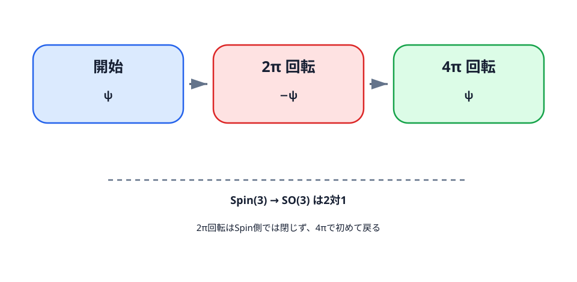

<!-- contract: contracts/15-spinors.json -->

# 2形式だけでなく一次の作用素を使う

Donaldson理論では接続の曲率を自己双対成分へ射影した。第二の理論では、接続に加えて一次微分を受ける場を導入する。その自然な候補がスピノルである。

# 90度回転から複素数へ

平面で

$$
J=\begin{pmatrix}0&-1\\1&0\end{pmatrix},
\qquad J^2=-I
$$

と置くと、$J(x,y)=(-y,x)$ は反時計回りの90度回転である。実平面を複素直線と見れば、$J$ は $i$ 倍であり、角度 $\theta$ の回転は

$$
e^{\theta J}=\cos\theta\,I+\sin\theta\,J
$$

となる。通常のベクトルは $2\pi$ 回転で元へ戻る。スピノルでは回転角の半分が現れる。

# パウリ行列を手で掛ける

三つのパウリ行列を

$$
\sigma_1=\begin{pmatrix}0&1\\1&0\end{pmatrix},\quad
\sigma_2=\begin{pmatrix}0&-i\\i&0\end{pmatrix},\quad
\sigma_3=\begin{pmatrix}1&0\\0&-1\end{pmatrix}
$$

とする。直接掛け算すると $\sigma_j^2=I$ で、例えば $\sigma_1\sigma_2=i\sigma_3$、$\sigma_2\sigma_1=-i\sigma_3$ である。まとめると

$$
\sigma_j\sigma_k+\sigma_k\sigma_j=2\delta_{jk}I,
\qquad
\sigma_j\sigma_k=\delta_{jk}I+i\sum_{\ell=1}^3\varepsilon_{jk\ell}\sigma_\ell.
$$

第一式がClifford反交換関係の原型である。$\tau_j=-i\sigma_j/2$ と置けば

$$
[\tau_j,\tau_k]=\sum_\ell\varepsilon_{jk\ell}\tau_\ell
$$

となり、$\tau_1,\tau_2,\tau_3$ は $\mathfrak{su}(2)$ の実基底をなす。

# $SU(2)$ が $SO(3)$ を二重に覆う

$x=(x_1,x_2,x_3)\in\mathbb R^3$ を $x\cdot\sigma=\sum_jx_j\sigma_j$ に対応させる。$U\in SU(2)$ による共役 $x\cdot\sigma\mapsto U(x\cdot\sigma)U^{-1}$ は

$$
\det(x\cdot\sigma)=-|x|^2
$$

を保つので、$\mathbb R^3$ の向きを保つ回転を定める。これが準同型 $SU(2)\to SO(3)$ であり、核は $\{I,-I\}$ である。単位ベクトル $n$ の周りの角度 $\theta$ の回転を持ち上げる元は

$$
U(\theta,n)=\exp\!\left(-\frac{i\theta}{2}n\cdot\sigma\right)
=\cos\frac\theta2 I-i\sin\frac\theta2 n\cdot\sigma.
$$

従って $U(2\pi,n)=-I$、$U(4\pi,n)=I$ である。ベクトルは $U$ と $-U$ を同じ回転と見るが、スピノルは $U$ 自身で変換するため、$2\pi$ 回転で符号が反転する。

# $\mathbb R^4$ のClifford作用とDirac作用素

$W^+\cong\mathbb C^2$、$W^-\cong\mathbb C^2$ とし、$W^+\oplus W^-$ 上で

$$
c(e_j)=\begin{pmatrix}0&-i\sigma_j\\-i\sigma_j&0\end{pmatrix}
\quad(j=1,2,3),
\qquad
c(e_4)=\begin{pmatrix}0&I\\-I&0\end{pmatrix}
$$

と置く。パウリ行列の反交換関係から

$$
c(e_\mu)c(e_\nu)+c(e_\nu)c(e_\mu)=-2\delta_{\mu\nu}I
$$

が従う。これがEuclid計量に対するClifford関係である。平坦な $\mathbb R^4$ の正スピノルに作用するDirac作用素は、この規約では

$$
D^+=-\left(\partial_4I+i\sigma_1\partial_1+i\sigma_2\partial_2+i\sigma_3\partial_3\right).
$$

$\Phi=(f,g)^T$ に作用させると

$$
D^+\Phi=-
\begin{pmatrix}
\partial_4+i\partial_3&i\partial_1+\partial_2\\
i\partial_1-\partial_2&\partial_4-i\partial_3
\end{pmatrix}
\begin{pmatrix}f\\g\end{pmatrix}.
$$

反交換関係により随伴との合成では混合微分が相殺し、成分ごとのラプラシアンが残る。曲がった多様体では偏微分を共変微分へ置き換え、その交換子としてスカラー曲率と束の曲率が現れる。これが第16章のWeitzenböck公式へ続く。

普通のベクトルは空間内で $2\pi$ 回転すると元に戻る。これに対してスピノル $\psi$ は $2\pi$ 回転で $-\psi$ となり、さらにもう一周、合計 $4\pi$ 回転して初めて $\psi$ に戻る。この違いは、スピノルが回転群 $SO(3)$ そのものではなく、その二重被覆 $Spin(3)\cong SU(2)$ の表現として変換することを表す。

{#fig-spinor-rotation fig-alt="開始時のスピノルpsi、2π回転後のマイナスpsi、4π回転後のpsiを三段階で示す図"}

@fig-spinor-rotation の符号反転は、同じ幾何学的な回転に二つのSpin側の元が対応することから生じる。ただし量子状態を射線として見る文脈では全体位相だけを直接観測できない場合もある。本書で必要なのは、スピノル場の変換則が通常の接ベクトルの変換則とは異なるという数学的事実である。

向き付きRiemannian 4多様体上の $\mathrm{Spin}^c$ 構造は、階数2の複素ベクトル束 $W^+,W^-$ とClifford作用

$$
\rho:T^*X\otimes\mathbb C\longrightarrow
\operatorname{Hom}(W^+,W^-)
$$

を与える。$W^+$ の行列式線束を $L$ と書く。$L$ 上のユニタリ接続 $A$ とLevi--Civita接続から $W^+$ の共変微分が定まり、合成

$$
D_A:\Gamma(W^+)\xrightarrow{\nabla_A}
\Gamma(T^*X\otimes W^+)\xrightarrow{\rho}
\Gamma(W^-)
$$

が $\mathrm{Spin}^c$ Dirac作用素である。

ここで使う「接続」は、$L$ 上の $U(1)$ 接続を選ぶと $W^\pm$ 上の接続が誘導される、という意味である。従ってSW理論の未知量は、任意のベクトル束接続ではなく、固定した $\mathrm{Spin}^c$ 構造の行列式線束上の接続 $A$ と、正スピノル $\Phi\in\Gamma(W^+)$ である。

# SpinでなくSpin^cなのはなぜか

spin構造の存在には $w_2(TX)=0$ が必要で、全ての向き付き4多様体で満たされるわけではない。$\mathrm{Spin}^c$ 構造では線束の $c_1(L)$ がmod 2で $w_2(TX)$ を持ち上げるため、向き付き4多様体上で広く利用できる。理論の適用範囲を保つための一般化であり、記号の装飾ではない。

# Spin^c構造をどう数えるか

$\mathrm{Spin}^c$ 構造は一つだけではない。固定した向き付き4多様体上で、同型類の集合は $H^2(X;\mathbb Z)$ のトーサー、すなわち主等質空間として振る舞う。直感的には、行列式線束 $L$ を別の線束でひねると別の $\mathrm{Spin}^c$ 構造が得られる。

重要な制約は

$$
c_1(L)\equiv w_2(TX)\pmod 2
$$

である。従ってSW不変量は、単に多様体に一つ付く数ではなく、許される特性類ごとに並ぶ数である。後でSW基本類と呼ぶものは、この $c_1(L)$ のうち不変量が非零になる特別な類である。ただし、$c_1(L)$ だけで $\mathrm{Spin}^c$ 構造が常に一意に決まるわけではない。$H^2(X;\mathbb Z)$ に2-torsionがあると、同じ $c_1(L)$ を持つ異なる $\mathrm{Spin}^c$ 構造がありうる。本書で $c_1(L)$ を添字のように使うときは、torsionのない模型または「構造 $\mathfrak s$ を固定し、その行列式線束の $c_1$ を読む」という意味である。

この時点でDonaldson理論との違いが見え始める。Donaldson側では主に非可換束の位相数を動かしてモジュライを作った。SW側では、$\mathrm{Spin}^c$ 構造そのものが不変量の添字になる。

# 例：$\mathbb{CP}^2$ で特性類を見る

$\mathbb{CP}^2$ では $H^2(\mathbb{CP}^2;\mathbb Z)\cong\mathbb Z h$ で、$h^2=1$ である。接束の第二Stiefel--Whitney 類は $w_2(T\mathbb{CP}^2)\equiv h\pmod2$ と表される。したがって行列式線束の第一Chern類は

$$
c_1(L)=(2m+1)h
$$

の形でなければならない。偶数倍の $h$ は合同条件を満たさないので、$\mathrm{Spin}^c$ 構造の候補にならない。

この例で見えることは二つある。第一に、$\mathrm{Spin}^c$ 構造は「spin構造がないときの代用品」ではあるが、任意の線束を自由に選べるわけではない。第二に、SW不変量は $m$ ごとに別のモジュライ問題を作る。Donaldson理論で位相数を変えるとモジュライが変わったように、SW理論では特性類を変えると方程式の位相的入力が変わる。

# トーサーという言葉の意味

トーサー、または主等質空間とは、基準点を選ぶと群と同一視できるが、自然なゼロ元はない集合を指す。これはtorsion、すなわちねじれ元やねじれ部分群とは別の概念である。$\mathrm{Spin}^c$ 構造の集合も同じで、一つの構造 $\mathfrak s_0$ を基準に選べば、線束 $E$ でひねって

$$
\mathfrak s_0\otimes E
$$

を作れる。しかし、どの $\mathfrak s_0$ を「原点」と呼ぶかは自然ではない。したがって、$\mathrm{Spin}^c$ 構造の集合は $H^2(X;\mathbb Z)$ そのものではなく、$H^2(X;\mathbb Z)$ が自由かつ推移的に作用する集合として扱うのが正確である。

この区別は不変量の添字で効く。$SW_X(\mathfrak s)$ と書くとき、$\mathfrak s$ は数値ではなく幾何的構造である。基準を選んで $c_1(L)$ でラベル付けしてもよいが、本文では「ラベル」と「構造」そのものを混同しない。

# 曲率とスピノルを同じ型で結ぶ

4次元のClifford作用は、虚数値の自己双対2形式を $W^+$ のトレース0のHermitian自己準同型と同一視する。本書では、接続 $A$ は $L=\det W^+$ 上の接続であるという規約を全章で固定する。

::: {.callout-note title="SW側の型規約"}
Clifford作用の自己双対2形式への制限を

$$
\rho:i\Lambda^2_+\longrightarrow \operatorname{Herm}_0(W^+)
$$

と読む。ここで $\operatorname{Herm}_0(W^+)$ はトレース0のHermitian自己準同型の束である。スピノル $\Phi\in W^+$ に対し、Hermitian自己準同型 $\Phi\Phi^*:v\mapsto \Phi\langle \Phi,v\rangle$ を作り、そのトレース0部分を $(\Phi\Phi^*)_0$ と書く。二次写像 $q(\Phi)$ は

$$
\rho(q(\Phi))=(\Phi\Phi^*)_0
$$

で定まる虚数値自己双対2形式である。この規約では $\langle\rho(q(\Phi))\Phi,\Phi\rangle$ は正の定数倍の $|\Phi|^4$ になる。文献によりClifford作用の符号や $1/2$ を $q$ 側へ入れるため、式を移すときは二次写像だけでなくWeitzenböck公式も同時に変換する。
:::

この規約なら $q(\Phi)$ は $i\Lambda^2_+$ の切断であり、$L$ 上のユニタリ接続の曲率 $F_A^+$ と同じ型を持つ。従って

$$
D_A\Phi=0,\quad F_A^+=q(\Phi)+i\eta
$$

という連成が型の上で意味を持つ。ここで $\eta$ は実自己双対2形式で、$i\eta$ が虚数値2形式である。

局所的に $W^+\cong\mathbb C^2$ と見れば、スピノル $\Phi$ から二次写像

$$
(\Phi\Phi^*)_0
$$

を作る。これはまずトレース0のHermitian自己準同型であって、まだ2形式ではない。上のClifford同一視の逆を通して初めて、曲率と比較できる虚数値自己双対2形式になる。この一段を省くと、式の両辺の型もWeitzenböck評価の符号も決まらない。

もし $\Phi$ を入れず $F_A^+=0$ だけを $U(1)$ 接続へ課せば、方程式はほぼ線形で、交点形式を越える滑らかな情報を十分に作れない。スピノルの二次項が非線形性を戻し、同時にWeitzenböck公式を通じて強い先験的な上界を与える。

# 二次写像 $q(\Phi)$ は何をしているか

局所的に $W^+\cong\mathbb C^2$ と見れば、スピノル $\Phi$ から階数 1 endomorphism $\Phi\Phi^*$ が作れる。そのtrace部分は大きさ $|\Phi|^2$ だけを表すので、曲率の自己双対成分と対応させるにはtrace-free部分を取る。

$$
\rho(q(\Phi))=(\Phi\Phi^*)_0.
$$

この写像は二次であり、$q(e^{i\theta}\Phi)=q(\Phi)$ を満たす。つまり $S^1$ ゲージ変換でスピノルの位相が変わっても、曲率方程式の右辺は不変である。可換ゲージ理論に非線形性を戻すだけでなく、ゲージ対称性と両立するためにも、この形が自然に選ばれる。

読者がここで持つ疑問は「なぜスピノルから2形式が出るのか」である。答えは4次元のClifford表現にある。$i\Lambda^2_+$ は $W^+$ のトレース0のHermitian自己準同型と同じ情報を持つので、$q(\Phi)$ を虚数値自己双対2形式として読める。

# ゲージ対称性は可換でも残る

$A$ は行列式線束 $L=\det W^+$ の接続である。$u:X\to S^1$ が $W^\pm$ のスピノルへ重み1で作用すると、行列式には重み2で作用する。このためゲージ変換は

$$
(A,\Phi)\longmapsto(A-2u^{-1}du,u\Phi)
$$

である。この係数2は変数の選び方ではなく、本書が $A$ を行列式線束の接続と呼ぶことから決まる。文献が $A- u^{-1}du$ と書く場合、その $A$ は行列式接続の半分に相当するSpin$^c$ 接続変数であり、本書の $F_A$ とそのまま混ぜてはならない。接続部分は可換なので $A\wedge A$ を持たないが、スピノルとの連成と $q(\Phi)$ があるため全系は線形ではない。モジュライ空間を作るには、Donaldson側と同様に対称性、線形化、指数、正則性、向き、コンパクト性を再確認する必要がある。

次章ではperturbed Seiberg--Witten方程式を正確に置き、期待次元とコンパクト性がどこから来るかを導く。

::: {.callout-note title="節内演習：スピノルの $2\pi$ 回転と $4\pi$ 回転"}
回転角 $\theta$ に対するスピノル表現を
$$
U(\theta)=\begin{pmatrix}e^{i\theta/2}&0\\0&e^{-i\theta/2}\end{pmatrix}
$$
とする。$U(2\pi)$ と $U(4\pi)$ を計算し、通常のベクトル表現との違いを述べよ。

**解答。** 直接代入すると
$$
U(2\pi)=\begin{pmatrix}-1&0\\0&-1\end{pmatrix}=-I,
\qquad
U(4\pi)=\begin{pmatrix}1&0\\0&1\end{pmatrix}=I.
$$
したがってスピノルは $2\pi$ 回転で符号が反転し、$4\pi$ 回転で初めて元に戻る。ベクトルは $2\pi$ 回転で元に戻るため、$\mathrm{Spin}(n)\to SO(n)$ が二重被覆であることが具体的に見える。
:::
