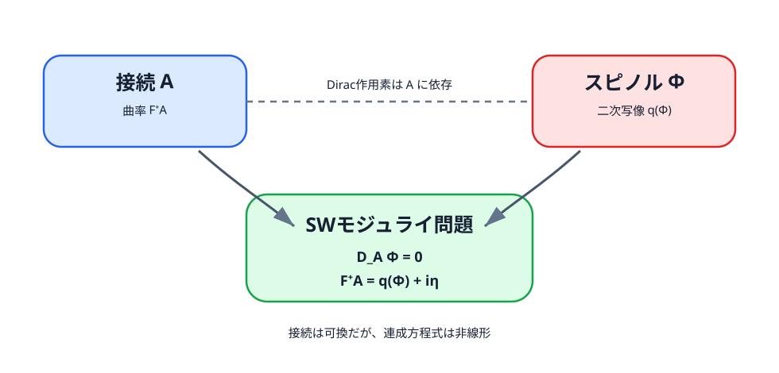

<!-- contract: contracts/16-seiberg-witten-equations.json -->

# 方程式と摂動

$\mathrm{Spin}^c$ 構造 $\mathfrak s$ を固定し、行列式線束 $L$ の接続 $A$ と正スピノル $\Phi$ を未知量とする。第15章の規約に従い、$F_A^+$ と $q(\Phi)$ はどちらも $i\Lambda^2_+$ の切断である。実自己双対2形式 $\eta$ を摂動として

$$
\begin{cases}
D_A\Phi=0,\\
F_A^+=q(\Phi)+i\eta
\end{cases}
$$

をSeiberg--Witten方程式とする。係数は $q$ の規格化に吸収されるため、文献間で式を比較するときは、Clifford同一視、$i$ の位置、二次写像の係数を同時に確認する。[@witten1994; @morgan1996]

{#fig-sw-equations fig-alt="左に接続 A、右にスピノル Phiを置き、下にD_A Phi equals zeroとF_A plus equals q(Phi) plus 摂動項を示す図"}

$\Phi=0$ の解は可約であり、第二式は $F_A^+=i\eta$ となる。一般的な摂動と $b_2^+>0$ の条件を用いて可約を避けるのが、滑らかなモジュライを作る基本方針である。

# 線形化と期待次元

第15章で $A$ を行列式線束の接続と固定したので、$u=e^{tf}$ を $t=0$ で微分した無限小ゲージ変換は

$$
f\longmapsto(-2df,f\Phi),\qquad f\in\Omega^0(i\mathbb R)
$$

である。方程式の線形化とゲージ固定を合わせた作用素は、0階項を除けば

$$
\Omega^1(i\mathbb R)\oplus\Gamma(W^+)
\longrightarrow
\Omega^0(i\mathbb R)\oplus\Omega^2_+(i\mathbb R)\oplus\Gamma(W^-)
$$

となる。係数2と $\Phi$ を含む項は主記号を変えず、主記号は $d^*\oplus d^+$ とDirac作用素の直和なので楕円的である。指数定理から実期待次元

$$
d(\mathfrak s)=\frac{c_1(L)^2-(2\chi(X)+3\sigma(X))}{4}
$$

を得る。

この式も実際の次元を無条件には与えない。正則摂動で余核を消し、可約を避けたときに滑らかな多様体の次元になる。

# 期待次元の代入例

式だけでは、$d(\mathfrak s)$ が何を測っているか見えにくい。そこで $\mathbb{CP}^2$ で形式的に代入してみる。$\chi(\mathbb{CP}^2)=3$、$\sigma(\mathbb{CP}^2)=1$ なので

$$
2\chi+3\sigma=2\cdot3+3\cdot1=9.
$$

前章の通り、許される $c_1(L)$ は $(2m+1)h$ の形である。従って

$$
c_1(L)^2=(2m+1)^2
$$

であり、

$$
d(\mathfrak s_m)=\frac{(2m+1)^2-9}{4}.
$$

$m=1$ または $m=-2$ なら $(2m+1)^2=9$ で、期待次元は0になる。$m=0$ なら $d=-2$ であり、一般的には解が存在しない方向を示す。ここで得た数は、ただちに不変量の値ではない。向き、正則性、可約回避、部屋の問題を処理して初めて、点を符号付きに数える段階へ進める。

この計算例は、SW理論がなぜ計算可能に見えるかも示している。Donaldson多項式では非可換ASDモジュライと$\mu$-挿入を扱う必要があった。一方、SW側ではまず $\mathrm{Spin}^c$ 構造ごとの期待次元を、特性類と $\chi,\sigma$ から直接読める。ただし、方程式が簡単になったわけではなく、計算の入口が明瞭になったというのが正確である。

# Weitzenböck公式からコンパクト性評価を得る

Dirac作用素には

$$
D_A^*D_A\Phi
=\nabla_A^*\nabla_A\Phi+\frac{s}{4}\Phi+\frac12\rho(F_A^+)\Phi
$$

というWeitzenböck公式がある。係数 $1/2$ は、$A$ を行列式線束の接続とする第15章の規約に対応する。曲率方程式を代入すると $|\Phi|^4$ の正項が現れるが、ここでは積分恒等式と最大値原理に使う点ごとの恒等式を分けて扱う。

# 積分恒等式と点ごとの評価を分ける

まず閉多様体上で $D_A\Phi=0$ と $\Phi$ の $L^2$ 内積を取り、部分積分すると

$$
0=\int_X\left(
|\nabla_A\Phi|^2+\frac{s}{4}|\Phi|^2
+\frac12\langle\rho(F_A^+)\Phi,\Phi\rangle
\right)d\mathrm{vol}
$$

を得る。第15章の規約では $\rho(q(\Phi))=(\Phi\Phi^*)_0$ であり、階数2なので

$$
(\Phi\Phi^*)_0\Phi=\frac12|\Phi|^2\Phi.
$$

従って未摂動なら

$$
0=\int_X\left(
|\nabla_A\Phi|^2+\frac{s}{4}|\Phi|^2+\frac14|\Phi|^4
\right)d\mathrm{vol}.
$$

摂動がある場合は $\frac12\langle\rho(i\eta)\Phi,\Phi\rangle$ が加わり、Youngの不等式で四次項へ吸収できる。

$L^\infty$ 評価には別に点ごとのBochner恒等式を使う。$|\Phi|^2$ が最大になる点で $\langle\nabla_A^*\nabla_A\Phi,\Phi\rangle$ を $|\Phi|^2$ のラプラシアンと $|\nabla_A\Phi|^2$ に分け、その点で得られる二次不等式を解くと

$$
\|\Phi\|_{L^\infty}^2
\le C\bigl(\|s_-\|_{L^\infty}+\|\eta\|_{L^\infty}\bigr),
\qquad s_-=\max\{-s,0\},
$$

となる。$C$ は規格化にのみ依存する。積分後に $|\nabla_A\Phi|^2$ が現れる理由と、最大値点で上界が出る理由を同じ等式として書いてはならない。

ASD理論ではエネルギー上界だけでは尺度の崩壊を防げなかった。SW理論では、このスピノル上界がコンパクト性証明の第一段階になる。曲率の自己双対部分は第二式で抑えられ、$[F_A/(2\pi i)]=c_1(L)$ が曲率の調和2形式成分を固定する。

基準接続 $A_0$ を固定し $A=A_0+\alpha$ と書く。Coulomb条件 $d^*\alpha=0$ と曲率方程式から、楕円評価は $\alpha$ の調和成分以外を制御する。ただし調和1形式成分は $c_1(L)$ や摂動だけでは固定されない。ゲージ変換で割ると、その自由度は正規化に応じた格子を法とする

$$
H^1(X;\mathbb R)/H^1(X;\mathbb Z)
$$

型のコンパクトなトーラスになる。本書の係数2の規約では格子に $2\pi$ の定数が付くが、コンパクト性という結論は同じである。このトーラスの基本領域から代表を選び、スピノル上界、曲率方程式、Coulombゲージ、楕円評価を組み合わせて収束部分列を得る。Weitzenböck公式だけが単独でコンパクト性を作るのではない。

# 継続例：K3で一つのSW経路を最後まで追う

K3曲面では $\chi=24$、$\sigma=-16$、$b_1=0$、$b_2^+=3$ で、正準類は $K=0$ である。ほとんど複素構造が与える正準Spin$^c$ 構造 $\mathfrak s_0$ は $c_1(\det W^+)=-K=0$ を持つので

$$
d(\mathfrak s_0)=\frac{0-(2\cdot24+3(-16))}{4}=0.
$$

$b_2^+=3>1$ だから壁を避けられ、一般的な摂動で可約解を除いて0次元の向き付きモジュライ空間を得る。上の評価と調和1形式トーラスの処理によりこの空間はコンパクトであり、点の符号付き個数が計量と摂動に依らない整数になる。第18章で引用するTaubesの定理は、この整数が $\pm1$、特に非零であることを与える。従ってK3では

```text
c1=0 → 期待次元0 → 正則化 → コンパクト性
→ 符号付き個数 → Taubesにより非零 → 曲面・連結和への制約
```

という一本の経路を追える。値の非零性は本章の解析だけからは出ず、シンプレクティック幾何という追加入力を使う。

# 可約を避ける条件

$\Phi=0$ なら、方程式は $F_A^+=i\eta$ になる。左辺のコホモロジー類は $2\pi i\,c_1(L)$ の自己双対調和成分と結びついている。したがって可約が存在する条件は、摂動 $\eta$ と $c_1(L)^+$ が特定の関係を満たすこととして表れる。

$b_2^+>0$ なら、一般的な自己双対摂動でこの条件を避けられる。$b_2^+=1$ では避け方が部屋に依存し、壁越えが現れる。これはDonaldson理論の壁と同じ構造を持つが、SWでは$\mathrm{Spin}^c$ 構造ごとの壁として見える。

# 不変量

$d(\mathfrak s)=0$ で向きを選ぶと、正則モジュライの点を符号付きで数え

$$
SW_X(\mathfrak s)\in\mathbb Z
$$

を得る。$b_2^+>1$ では計量と一般的な摂動に依存しない。$b_2^+=1$ では部屋を指定する。正次元の場合はコホモロジー類を挿入する拡張が必要である。

次章では「SWはDonaldsonより簡単」という言い方を分解する。コンパクト性と計算が簡潔になる面はあるが、非線形な連成、横断性、向き、壁越えは残る。

::: {.callout-note title="節内演習：Seiberg--Witten期待次元"}
$K3$ 曲面では $\chi=24$、$\sigma=-16$ である。$c_1(L)=0$ の $\mathrm{Spin}^c$ 構造について、期待次元
$$
d(\mathfrak s)=\frac{c_1(L)^2-(2\chi+3\sigma)}4
$$
を計算せよ。

**解答。** まず
$$
2\chi+3\sigma=2\cdot24+3\cdot(-16)=48-48=0
$$
であり、$c_1(L)^2=0$ だから
$$
d(\mathfrak s)=\frac{0-0}{4}=0.
$$
正則性と向きを確保できれば、この構造の不変量は点の符号付き個数として定義される。
:::
