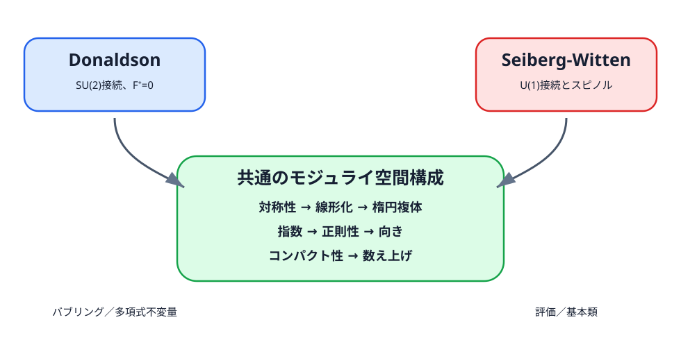

<!-- contract: contracts/17-donaldson-vs-sw.json -->

# 同じ九段階を二度通す

Donaldson理論とSeiberg--Witten理論は、異なる方程式から同じ滑らかな4多様体へ不変量を返す。比較の単位は結論だけでなく、モジュライ構成の各段階である。

{#fig-donaldson-sw fig-alt="左にASD接続、右にU(1)接続とスピノルを置き、中央に線形化、指数、コンパクト化、数え上げの共通段階を示す比較図"}

| 段階 | Donaldson | Seiberg--Witten |
|---|---|---|
| 未知量 | 非可換接続 $A$ | $U(1)$ 接続 $A$ とスピノル $\Phi$ |
| 方程式 | $F_A^+=0$ | $D_A\Phi=0$, $F_A^+=q(\Phi)+i\eta$ |
| 非線形性 | $A\wedge A$ | $A$ と $\Phi$ の連成、$q(\Phi)$ |
| コンパクト性 | バブリングを理想インスタントンで回収 | Weitzenböck評価と可換ゲージ固定 |
| 出力 | 多項式・交点形式制約 | $\mathrm{Spin}^c$ 構造ごとの整数 |

# 「可換だから簡単」の限界

$U(1)$ 曲率は $F_A=dA$ であり、接続単独なら線形である。しかしDirac作用素は $A$ に依存し、曲率方程式は $q(\Phi)$ を含む。従ってSW方程式全体は非線形である。さらに可約、向き、壁越え、貼り合わせは消えない。

簡潔になるのは主にコンパクト性である。スピノルの四次項が先験的評価を与え、ASD接続のような任意小尺度の非可換インスタントンを固定 $\mathfrak s$ 内で追跡する必要がない。この差が計算可能性を大きく変える。

# 何が同じで、何が違うか

二つの理論の差を「Donaldsonは難しく、SWは簡単」とだけ言うと、肝心な構造を見失う。同じなのは、どちらも次を必要とすることである。

1. ゲージ対称性を割る。
2. 線形化を楕円Fredholm問題として扱う。
3. 一般的な補助データで正則性を得る。
4. 向きを選び、0次元または正次元モジュライを数える。
5. 1パラメータ モジュライで補助データへの依存を消す。

違うのは、コンパクト性の壊れ方と計算可能性である。Donaldson理論では、非可換接続の尺度が0へ落ちるバブリングをコンパクト化に入れなければならない。SW理論では、Weitzenböck 評価がスピノルを抑え、可換接続のゲージ固定と組み合わせてコンパクト性を得る。

つまりSW理論はモジュライ機械を捨てた理論ではない。同じ機械の中で、最も重かったコンパクト性部分を別の解析構造で軽くした理論である。

# 比較は「難易度」ではなく「失敗の形」で見る

二つの理論を比較するとき、方程式の見た目だけを見ると誤解する。Donaldson側では未知量は接続だけだが、構造群が非可換である。曲率には $A\wedge A$ が入り、尺度が縮むインスタントンsが現れる。失敗の典型はバブリングであり、コンパクト化には失われた位相数を記録する層が必要になる。

SW側では構造群は $U(1)$ で可換だが、スピノルが加わる。失敗の典型は「方程式が線形になる」ことではなく、可約、壁、向き、貼り合わせ、そしてSpin-c構造ごとの情報の読み替えである。Weitzenböck 評価によりコンパクト性は扱いやすくなるが、モジュライ問題の全てが自動でららかになるわけではない。

したがって、正しい比較は次のようになる。

| 問い | Donaldson側 | SW側 |
|---|---|---|
| コンパクト性の難所 | 非可換 バブリング | スピノル評価で大幅に制御 |
| 計算の入口 | ASDモジュライと$\mu$-挿入 | Spin-c構造と期待次元 |
| 消滅現象 | 連結和や正次元計算で繊細 | 連結和でSW基本類が消えやすい |
| 幾何への出力 | polynomial、対角化制約 | SW基本類、adjunction、シンプレクティック制約 |

この表は優劣ではない。どの失敗をどう管理するかの違いである。

# 両不変量は常に同じか

Wittenは物理的双対性から、simple typeなどの条件下でDonaldson seriesをSW基本類から表す公式を予想した。[@witten1994] これは任意の4多様体について無条件に二つの不変量が同じ、という定理ではない。成立が証明されている範囲、仮定、正規化を区別する必要がある。

本書で厳密に使うのは、それぞれが微分同相不変量を与える枠組みと、特定の幾何でSW不変量が非消滅するという結果である。両理論の完全な同値を前提にはしない。

# simple typeという言葉の位置

Donaldson seriesとSW基本類を比較する公式では、しばしばsimple typeという仮定が現れる。これはDonaldson不変量の高次成分が特定の形に整理される、という条件である。本書ではこの理論を完全展開しないが、重要なのは「SW不変量が常にDonaldson不変量を置き換える」という雑な主張をしないことである。

実用上は、SW不変量は多くの幾何的問題で計算しやすく、SW基本類の配置から強い結論を返す。一方、Donaldson理論は歴史的にも論理的にも、滑らかな構造が交点形式だけでは見えないことを最初に示した深い機械である。二つは競合する要約ではなく、同じ4次元現象を異なる方程式で読む二つの窓である。

# 連結和と基本類

連結和でSW不変量がどう振る舞うかは、理論の強さと盲点を同時に示す。ここでは使う版を明確にしておく。

::: {.callout-note title="連結和消滅の標準形"}
$Y,Z$ を閉・連結・向き付きの滑らかな4次元多様体とし、$b_2^+(Y)>0$ かつ $b_2^+(Z)>0$ とする。$X=Y\# Z$ なら $b_2^+(X)>1$ であり、通常のSW不変量は任意の $\mathrm{Spin}^c$ 構造に対して0になる。この命題は両因子の正部分が非自明という仮定を必要とする。片方が負定値の場合や、$b_2^+=1$ の部屋付き不変量へはそのまま適用しない。[@morgan1996]
:::

従って、ある $X$ に非零SW不変量があれば、$X$ は両側が $b_2^+>0$ を持つ連結和には分解できない。この結論は「消えるから役に立たない」のではなく、消滅定理自体が幾何への情報を返すということである。たとえばシンプレクティック 4多様体でTaubesによりSW不変量が非零になる場合、その非零性は連結和分解への制約を与える。

ただし、同じ消滅は識別能力の限界にもなる。二つの候補を連結和で加工した結果、もともと違っていたSW基本類が消えてしまえば、SW不変量では区別できない。第14章で述べたように、位相的に候補を作る操作と滑らかな不変量を保持する操作は別々に管理する必要がある。

K3曲面でこの定理を使うと結論まで追える。K3はシンプレクティックで $b_2^+=3$、第18章のTaubesの定理により $c_1=0$ のSW不変量が非零である。もし

$$
K3\cong Y\# Z,\qquad b_2^+(Y)>0,\quad b_2^+(Z)>0
$$

と分解できれば、連結和消滅定理は全SW不変量を0にするので矛盾する。従ってK3は、両側が正の $b_2^+$ を持つ非自明な連結和には分解できない。非零性という解析的出力が、具体的な分解不能性へ戻る例である。

# SW基本類をどう読むか

SW不変量が非零になる $\mathrm{Spin}^c$ 構造の $c_1(L)$ をSW基本類と呼ぶ。SW基本類の集合は、単なる数のリストではなく、$H^2(X;\mathbb Z)$ の中の配置である。微分同相写像はコホモロジーに作用するので、比較すべきなのは「同じ名前の類の値」ではなく、微分同相写像が誘導しうる格子同型の下でSW基本類の配置が一致するかである。

この点はDonaldson多項式でも同じである。不変量はホモロジー類の挿入に依存するため、二つの多様体を比較するときは、同相写像または候補となる格子同型がホモロジーをどう対応させるかを追跡する。値が一つ違う、というだけでなく、全ての許される対応の下で一致しないことを示して初めて微分同相でないことの証明になる。

# 幾何へ戻す

ここまで不変量は滑らかな構造を区別する観測量だった。最終章では向きを逆転し、非零のSW不変量から埋め込み曲面の種数やシンプレクティック構造へ具体的制約を返す。解析的解が、もとの幾何にどの情報を強制するかを見る。

::: {.callout-note title="節内演習：連結和とSW不変量の消滅"}
$X=Y\# Z$ で $b_2^+(Y)=b_2^+(Z)=1$ とする。$b_2^+(X)$ を求め、標準的な連結和消滅定理の仮定の下で $SW_X$ がどうなるか述べよ。

**解答。** 交点形式は直交和になるので、正の固有値の個数も加法的である。したがって
$$
b_2^+(X)=b_2^+(Y)+b_2^+(Z)=1+1=2.
$$
両側が $b_2^+>0$ を持つ非自明な連結和なので、消滅定理により全ての $\mathrm{Spin}^c$ 構造について $SW_X=0$ となる。単に $b_2^+(X)=2$ だからではなく、正部分を持つ二つの成分への連結和分解が入力である。
:::
