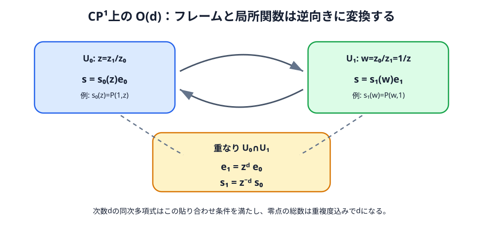
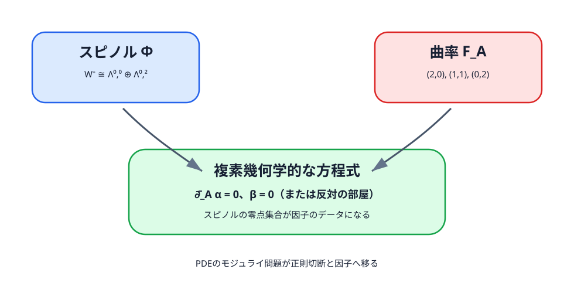
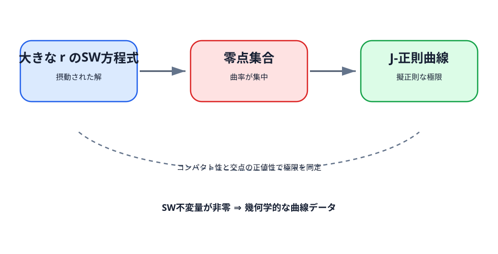
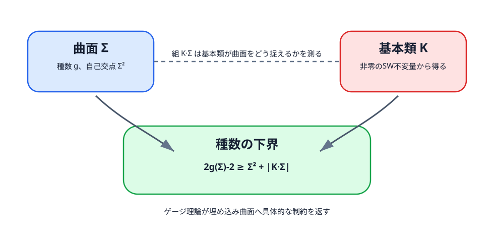

<!-- contract: contracts/18-kahler-symplectic.json -->

# 90度回転を各接空間へ置く

$\mathbb R^2$ の90度回転

$$
J=\begin{pmatrix}0&-1\\1&0\end{pmatrix},\qquad J^2=-I
$$

は、実平面を複素直線と見るための $i$ 倍であった。実多様体 $X$ の各接空間に滑らかに $J_x:T_xX\to T_xX$ を選び、$J_x^2=-I$ を満たすとき、$J$ を概複素構造という。これは各接空間を複素ベクトル空間にするが、複素座標が実際に貼り合わさるとは限らない。複素座標が存在するための追加条件が可積分性である。

# $(p,q)$ 型と $\bar\partial$

余接空間を複素化すると、$J$ の固有値 $i,-i$ に従って

$$
T^*X\otimes\mathbb C=\Lambda^{1,0}\oplus\Lambda^{0,1}
$$

と分かれる。外積を取れば

$$
\Lambda^kT^*X\otimes\mathbb C
=\bigoplus_{p+q=k}\Lambda^{p,q}
$$

を得る。平面で $z=x+iy$ と書けば

$$
dz=dx+i\,dy,\qquad d\bar z=dx-i\,dy,
$$

で、関数 $f$ に対して

$$
df=\partial f+\bar\partial f,
\qquad
\bar\partial f=\frac12\left(\frac{\partial f}{\partial x}
+i\frac{\partial f}{\partial y}\right)d\bar z.
$$

$\bar\partial f=0$ はCauchy--Riemann方程式であり、$f$ が正則であることを表す。一般の概複素多様体でも形式を型に射影できるが、$\bar\partial^2=0$ と正則座標を同時に使うには $J$ の可積分性が必要である。

# シンプレクティック形式、適合性、Kähler構造

2形式 $\omega$ が閉じていて $d\omega=0$、かつ各点で非退化、すなわち $\omega(v,w)=0$ が全ての $w$ で成り立つなら $v=0$、という条件を満たすとき、$\omega$ をシンプレクティック形式という。概複素構造 $J$ が $\omega$ と適合するとは

$$
\omega(Jv,Jw)=\omega(v,w),
\qquad
g(v,w)=\omega(v,Jw)
$$

で定まる $g$ が正定値対称形式になることをいう。$J$ が可積分で、$\omega$ が閉じ、両者が適合するとき $(X,J,\omega,g)$ はKähler多様体である。従って包含関係は

```text
Kähler = 可積分な複素構造 + 閉じた適合2形式
シンプレクティック + 適合概複素構造 では、Jは可積分とは限らない
```

となる。

# $\mathbb{CP}^1$ と $\mathbb{CP}^2$ で用語を具体化する

$\mathbb{CP}^1$ のアフィン座標 $z$ ではFubini--Study形式を、正の定数倍を除いて

$$
\omega_{FS}=\frac{i\,dz\wedge d\bar z}{(1+|z|^2)^2}
$$

と書ける。これは閉じた正の $(1,1)$ 形式で、標準複素構造と合わせて $\mathbb{CP}^1$ を実次元2のKähler多様体にする。

$\mathbb{CP}^2$ では、次数 $d$ の同次多項式 $P(z_0,z_1,z_2)$ は線束 $\mathcal O(d)$ の正則切断を定める。その零点集合

$$
C=\{[z_0:z_1:z_2]\in\mathbb{CP}^2:P(z_0,z_1,z_2)=0\}
$$

は、勾配が同時に消えないなら滑らかな複素曲線である。正則切断の零点を重複度付きで記録したものが因子である。例えば $P=z_0$ は射影直線 $\mathbb{CP}^1\subset\mathbb{CP}^2$ を与える。

概複素4次元多様体 $(X,J)$ では、Riemann面 $(\Sigma,j)$ からの写像 $u$ が

$$
du\circ j=J\circ du
$$

を満たすとき擬正則曲線という。$J$ が可積分なら通常の正則曲線であるが、Taubes理論では可積分性を仮定せず、この方程式を満たす曲線を用いる。ここまでで、正則切断、因子、擬正則曲線がSW方程式の極限に現れる意味を準備できた。

# $\mathcal O(1)$ と $\mathcal O(d)$ を貼り合わせで作る

$\mathcal O(d)$ を既知の名前として使わないため、まず $\mathbb{CP}^1$ で線束を作る。二つのチャート

$$
U_0=\{[z_0:z_1]:z_0\ne0\},\quad
U_1=\{[z_0:z_1]:z_1\ne0\}
$$

を取り、座標を $z=z_1/z_0$、$w=z_0/z_1=1/z$ とする。局所フレームを $e_0,e_1$ と書き、本書では $\mathcal O(1)$ を重なり $z\ne0$ 上で

$$
e_1=z\,e_0
$$

により貼り合わせた線束として扱う。これは繊維座標で書けば $s=s_0e_0=s_1e_1$ なので $s_0=z\,s_1$、すなわち $s_1=z^{-1}s_0$ である。$\mathcal O(d)$ では

$$
e_1=z^d e_0
$$

とし、同じ切断を表す局所関数は

$$
s_1(w)=z^{-d}s_0(z)
$$

を満たす。ここで逆べきが出るのは、遷移関数がフレームを貼り合わせる式であり、局所関数はその逆で変換するからである。

同次多項式との対応もこの式から出る。次数 $d$ の同次多項式 $P(z_0,z_1)$ に対し、$U_0$ では

$$
s_0(z)=P(1,z)
$$

と書き、$U_1$ では

$$
s_1(w)=P(w,1)
$$

と書く。$w=1/z$ を代入すると

$$
P(w,1)=P(1/z,1)=z^{-d}P(1,z)
$$

であり、上の条件 $s_1=z^{-d}s_0$ と一致する。例えば $d=1$ で $P=z_0$ なら $s_0=1$、$s_1=w$ なので零点は $U_1$ の $w=0$、すなわち $[0:1]$ である。$P=z_1$ なら $s_0=z$、$s_1=1$ なので零点は $[1:0]$ である。$d=2$ の $P=z_0z_1$ なら $s_0=z$、$s_1=w$ となり、二つの点に一回ずつ零点を持つ。

{#fig-od-line-bundle-charts fig-alt="CP1の二つのチャートU0とU1で、フレームの貼り合わせと切断の局所関数の変換が逆になることを示す図"}

$\mathbb{CP}^1$ では、零でない次数 $d$ の同次多項式は重複度込みで $d$ 個の零点を持つ。点のホモロジー類 $[\mathrm{pt}]\in H_0(\mathbb{CP}^1;\mathbb Z)$ のPoincaré双対を $u=\operatorname{PD}[\mathrm{pt}]\in H^2(\mathbb{CP}^1;\mathbb Z)$ と書けば、

$$
c_1(\mathcal O(d))=d\,u
$$

である。略して $d[\mathrm{pt}]$ と言うこともあるが、$c_1$ 自体はコホモロジー類である。$\mathbb{CP}^2$ では同じ考えにより、次数 $d$ の滑らかな曲線は超平面類 $H$ の $d$ 倍

$$
[C]=dH
$$

を表す。従って、二つの次数 $d,e$ の曲線は一般位置で $de$ 点に交わる。これは $H^2=1$ から

$$
(dH)\cdot(eH)=de
$$

と計算する交点数と一致する。

# Kähler面では方程式が分解する

Kähler面では正スピノル束が型分解を持ち、適切な $\mathrm{Spin}^c$ 構造で

$$
W^+\cong \Lambda^{0,0}\oplus\Lambda^{0,2}
$$

と書ける。スピノルを $(\alpha,\beta)$ と表すとDirac方程式は $\bar\partial_A$ と $\bar\partial_A^*$ の組へ分かれ、曲率方程式も型 $(1,1)$ と $(0,2)$ の条件へ分解する。摂動の符号に応じて一方の成分が消え、残る方が正則切断として解釈される。

ただし、この表示は任意の $\mathrm{Spin}^c$ 構造にそのまま当てはまるわけではない。概複素構造から来る正準 $\mathrm{Spin}^c$ 構造では上の形になるが、線束 $E$ でひねった構造では

$$
W^+\cong(\Lambda^{0,0}\oplus\Lambda^{0,2})\otimes E
$$

となる。行列式線束も $K^{-1}$ から $K^{-1}\otimes E^2$ へ変わる。したがって「Kähler面では $W^+=\Lambda^{0,0}\oplus\Lambda^{0,2}$」という短縮は、正準構造またはひねりを明記した文脈でだけ正しい。

この具体化により、抽象的なスピノル解と因子・線束の複素幾何が接続する。解析から得たモジュライが、既知の正則データで計算可能になる。

# Kähler還元の意味

Kähler面でSW方程式が扱いやすくなるのは、単に複素記法が使えるからではない。Dirac作用素が

$$
\sqrt2(\bar\partial_A+\bar\partial_A^*)
$$

の形に分解し、曲率も型分解

$$
F_A=F_A^{2,0}+F_A^{1,1}+F_A^{0,2}
$$

を持つからである。摂動をKähler form方向に取ると、方程式はしばしば

$$
\bar\partial_A\alpha=0,\quad \beta=0
$$

またはその反対側へ還元される。するとスピノルの片方の成分は正則切断として読め、その零点集合が因子を作る。

ここで抽象的なPDEモジュライが、複素幾何の線形系や因子へ翻訳される。SW理論が強力なのは、不変量が存在するだけでなく、特別な幾何では計算可能な対象へ降りるからである。

{#fig-kahler-reduction fig-alt="スピノルの型分解と曲率の型分解が、複素幾何の方程式へ矢印で接続される図"}

# 小さな計算例：複素曲線の随伴公式

代数曲面内の滑らかな複素曲線 $C$ では、古典的な随伴公式

$$
2g(C)-2=C\cdot C+K_X\cdot C
$$

が成り立つ。SW理論の随伴不等式は、複素曲線に限らない滑らかに埋め込まれた曲面へ、これに似た下界を与える。複素曲線では等号が出る場合があり、SW不変量による下界が既知の複素幾何の値と一致する。

例えば $\mathbb{CP}^2$ の次数 $d$ の滑らかな複素曲線を考える。超平面類を $H$ とすれば $[C]=dH$、$C\cdot C=d^2$ である。さらにEuler列

$$
0\longrightarrow \mathcal O
\longrightarrow \mathcal O(1)^{\oplus3}
\longrightarrow T\mathbb{CP}^2
\longrightarrow0
$$

を使う。これは $\mathbb{CP}^2$ 上の正則ベクトル束の完全列で、中央の三つの $\mathcal O(1)$ は同次座標 $z_0,z_1,z_2$ の三方向に対応し、右端の $T\mathbb{CP}^2$ は複素接束である。完全列

$$
0\to E'\to E\to E''\to0
$$

では全Chern類が $c(E)=c(E')c(E'')$ を満たす（Whitney積公式）。ここで $c(\mathcal O)=1$、$c(\mathcal O(1))=1+H$ なので

$$
c(T\mathbb{CP}^2)=c(\mathcal O(1)^{\oplus3})=(1+H)^3.
$$

従って一次の部分を取ると $c_1(T\mathbb{CP}^2)=3H$ が分かる。正準束は最高次の正則余接束 $K_{\mathbb{CP}^2}=\Lambda^{2,0}T^*\mathbb{CP}^2$ なので、第一Chern類は接束のものに符号を反転して

$$
K_{\mathbb{CP}^2}=c_1(\Lambda^{2,0}T^*\mathbb{CP}^2)=-3H
$$

である。従って

$$
2g(C)-2=d^2-3d,
\quad
g(C)=\frac{(d-1)(d-2)}2.
$$

低次数で読むと、直線 $d=1$ と円錐曲線 $d=2$ は $g=0$、滑らかな三次曲線 $d=3$ は $g=1$、四次曲線 $d=4$ は $g=3$ になる。式だけでなく、曲線の次数、自己交点、正準類の三つが同時に種数を決めている点を見ておく。

この計算はSW不変量を使ったものではない。しかし、随伴不等式を読む基準になる。ゲージ理論は、複素曲線で見慣れた種数制約を、より一般の滑らかな曲面へ拡張する役割を持つ。

# Taubesの反転：解から曲線へ

閉シンプレクティック4次元多様体 $(X,\omega)$ は、適合する概複素構造 $J$ を通じて正準類

$$
K_X=-c_1(TX,J)=c_1(K_J)
$$

を持つ。ここで $K_J=\Lambda^{2,0}T^*X$ は正準線束である。$J$ が定める正準Spin$^c$ 構造 $\mathfrak s_J$ では

$$
W^+=\Lambda^{0,0}\oplus\Lambda^{0,2},\qquad
\det W^+=K_J^{-1},\qquad
c_1(\det W^+)=-K_X.
$$

従って「正準Spin$^c$ 構造の第一Chern類」を $K_X$ と呼ぶのは符号誤りである。共役Spin$^c$ 構造は $c_1=K_X$ を持ち、$b_2^+>1$ では共役対称性により $\pm K_X$ の両方を基本類として扱うことが多い。Taubesの $SW\Rightarrow Gr$ は、適切なSW解の大摂動極限から擬正則曲線を取り出し、SW不変量とGromov不変量を結ぶ。[@taubes1996]

::: {.callout-important title="Taubesの定理（引用定理、深度D）"}
$b_2^+(X)>1$ の閉・連結シンプレクティック4次元多様体 $(X,\omega)$ では、$J$ が定める正準Spin$^c$ 構造 $\mathfrak s_J$、すなわち $c_1(\det W^+)=-K_X$ の構造に対するSW不変量は $\pm1$ である。共役構造は $c_1=K_X$ を持ち、その不変量も符号を除いて非零である。より一般に、非零SW不変量を持つ類から、適切な大摂動極限を通じてシンプレクティック面積が正の擬正則曲線データが得られる。$b_2^+=1$ ではシンプレクティック形式が選ぶTaubesの部屋を指定する必要がある。本書では主に $b_2^+>1$ の版を使い、解析的極限の完全証明は引用する。
:::

# 証明アーキテクチャ：SW解から曲線を取り出す

Taubesの証明を引用定理として使う場合でも、何が起きているかの輪郭は必要である。大きな摂動パラメータ $r$ を入れたSW方程式を考えると、スピノルの一成分は多くの場所で大きくなり、その零点近くに曲率が集中する。零点集合を適切に拡大して見ると、概複素構造に対する擬正則曲線が現れる。

論理の骨格は次のように読める。

1. $c_1(\det W^+)=-K_X$ の正準 $\mathrm{Spin}^c$ 構造に対して、大摂動SW方程式を置く。
2. Weitzenböck型評価でスピノルの大きさと曲率集中を制御する。
3. スピノルの零点集合に沿ってエネルギーが集中することを示す。
4. 極限として擬正則曲線、またはカレントを得る。
5. コンパクト性と擬正則曲線の交点正値性により、Gromov不変量とSW不変量を対応させる。

ここでいうカレントとは、滑らかな曲線そのものではなく、微分形式を積分して数を返す一般化された曲線である。例えば滑らかな曲線 $C$ は2形式 $\eta$ に対して

$$
\eta\longmapsto \int_C\eta
$$

という線形汎関数を定める。曲線列がしわを作ったり重複度を持って極限へ向かったりすると、集合としてはきれいに収束しなくても、この「形式を積分する作用」は極限を持つことがある。その極限をカレントとして扱う。Taubesの解析では、まずこの弱い意味で極限を得て、さらに正則性と単調性を使って擬正則曲線として読める構造を取り出す。

難所は、零点集合がただの測度論的な集合ではなく、擬正則曲線として十分な構造を持つことを示す点である。本書ではこの解析を証明しないが、Taubesの結果が「SW非零なら曲線がある」という幾何的出力を返すことを明示して使う。

{#fig-taubes-limit fig-alt="大摂動Seiberg-Witten解から、スピノルの零点集合と曲率集中を経て擬正則曲線へ至る図"}

# 随伴不等式

$SW_X(\mathfrak s)\ne0$ とし、対応する基本類を $k=c_1(L)$ とする。本書で使う版を固定する。$X$ を閉・連結・向き付きの滑らかな4次元多様体で $b_2^+(X)>1$ とし、$\Sigma\subset X$ を滑らかに埋め込まれた連結閉曲面とする。さらに $[\Sigma]$ は非ねじれ、$g(\Sigma)>0$、$\Sigma\cdot\Sigma\ge0$ と仮定する。このとき

$$
2g(\Sigma)-2\ge \Sigma\cdot\Sigma+
|k\cdot[\Sigma]|
$$

という随伴不等式が成り立つ。自己交点が負の場合、球面の場合、$[\Sigma]$ がねじれの場合はこの命題の適用外であり、別の版を無断で代用しない。左辺は種数、右辺はホモロジー類と基本類だけで書かれるため、同じホモロジー類を表す滑らかな曲面の最小種数に下界を与える。[@kronheimerMrowka1994; @morgan1996]

入力は非零SW不変量であり、不等式そのものが基本類の存在を作るわけではない。また $b_2^+=1$ では部屋を指定した別の命題が必要になる。

# 継続例：K3で定理から幾何へ戻る

K3曲面は $K_X=0$、$b_2^+=3$ の閉シンプレクティック4次元多様体である。第16章で見た $c_1=0$ の正準Spin$^c$ 構造は期待次元0を持ち、Taubesの定理によりSW不変量が $\pm1$ である。従って $k=0$ は基本類である。

自己交点 $2n\ge0$ の非ねじれ類を、種数 $g>0$ の連結な滑らかな埋め込み曲面 $\Sigma$ が表すなら、随伴不等式は

$$
2g-2\ge 2n+|0\cdot[\Sigma]|=2n,
\qquad g\ge n+1
$$

を与える。一方、その類が正則曲線で表される場合、$K_X=0$ の随伴公式は $2g-2=\Sigma^2=2n$ を与え、下界は等号になる。ここでは

```text
K3の正準Spin^c構造 → SW≠0 → 基本類0
→ 随伴不等式 → 最小種数の下界 → 正則曲線で達成
```

という具体経路が閉じている。

{#fig-adjunction fig-alt="曲面シグマとSW基本類Kから、2gマイナス2はシグマの自己交点とKとのペアリングの絶対値以上、という不等式へ矢印が向かう図"}

複素曲線では随伴公式が等号を与える場合があり、解析的不変量の下界が代数幾何の値と一致する。ここでゲージ理論は滑らかな構造の識別器から、埋め込み問題の定量的道具へ変わる。

# 随伴不等式の読み方

この不等式は、曲面の種数をホモロジー類だけから完全に決めるものではない。しかし、ある類を低い種数で表せるかどうかに強い制約を与える。例えば $\Sigma\cdot\Sigma$ が大きく、SW基本類とのペアリングも大きければ、右辺が大きくなり、低種数代表は排除される。

Donaldson理論が交点形式の整数格子へ制約を返したのに対し、SW理論はSW基本類を通じて埋め込み曲面の最小種数へ制約を返す。この違いが、後期4次元トポロジーでSW理論が急速に使われた理由の一つである。

# 正のスカラー曲率への障害

$X$ を閉・向き付きで $b_2^+(X)>1$ とし、あるSpin$^c$ 構造のSW不変量が非零とする。もし正のスカラー曲率を持つ計量が存在すれば、小さい一般的摂動に対するWeitzenböck評価は既約解を排除する。$b_2^+>1$ では不変量は計量と一般的摂動に依らないので、非零性と矛盾する。従ってこの仮定の下で $X$ は正のスカラー曲率を持つ計量を許さない。$b_2^+=1$ では部屋依存があるため、この文をそのまま適用しない。

# 中心問題への回答

楕円型ゲージ方程式の解空間が滑らかな構造を検出できる理由は、一つの奇跡ではなく連鎖である。

1. 4次元では曲率2形式が自己双対に分かれ、位相数がエネルギー下限になる。
2. ゲージ対称性を含む線形化が楕円複体を作り、指数が有限次元の期待次元を与える。
3. 正則性、向き、コンパクト化を加えると、解空間から変形不変な数を取れる。
4. 構成は接続、Dirac作用素、摂動、向きなどの滑らかなデータに依存する。微分同相写像ではこれらを引き戻せるため不変量が保存される。一方、同相写像だけで保存されるとは限らず、実際に同相だがSW不変量やDonaldson不変量で区別される例が存在する。
5. 非零・消滅・SW基本類の配置が、交点形式、滑らかな構造、曲面、シンプレクティック幾何へ制約を返す。

FreedmanとDonaldsonの衝突から始まった問いは、Taubesによって再び幾何へ戻った。4次元ゲージ理論は、位相と解析の間に補助構造を置く理論ではない。両者が同じ次数で出会う4次元において、解析的コンパクト性の壊れ方まで含めて位相情報へ翻訳する機械である。

::: {.callout-note title="節内演習：随伴不等式から種数を読む"}
SW基本類 $K$ を持つ4多様体に、自己交点 $[\Sigma]^2=6$、$|K\cdot[\Sigma]|=2$ の連結な埋め込み曲面 $\Sigma$ があるとする。随伴不等式
$$
2g(\Sigma)-2\ge [\Sigma]^2+|K\cdot[\Sigma]|
$$
から種数の下限を求めよ。

**解答。** 右辺は $6+2=8$ なので
$$
2g(\Sigma)-2\ge8
\quad\Longrightarrow\quad 2g(\Sigma)\ge10
\quad\Longrightarrow\quad g(\Sigma)\ge5.
$$
したがって、このホモロジー類を種数4以下の滑らかな曲面で表すことはできない。
:::
