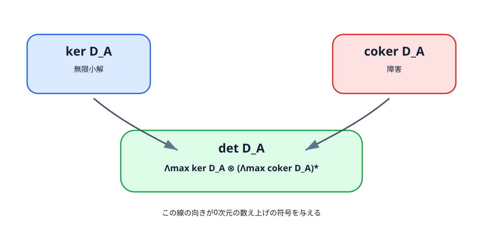
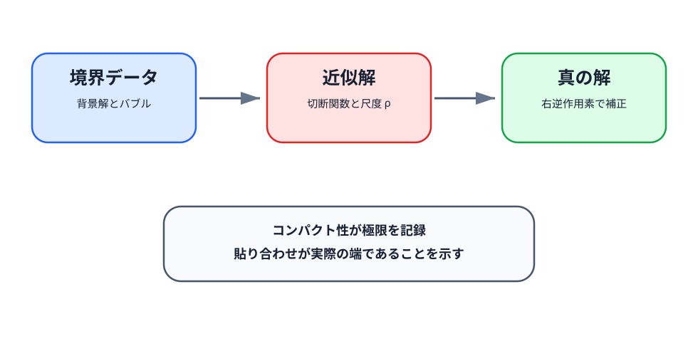

# Sobolev 指数の選び方

4次元で接続のゲージ作用をBanach Lie群作用として扱うには、通常 $k>2$ を選び $L_k^2\hookrightarrow C^0$ を使う。積写像が連続になる範囲を確認し、$\mathcal A_k=A_0+L_k^2\Omega^1$ と $\mathcal G_{k+1}=L_{k+1}^2(X,G)$ を組み合わせる。微分で一階失うため、ゲージ群側を一階高く取る。

なぜ $k>2$ が自然かを、4次元のSobolev埋め込みで見る。一般に $L^2_k$ は $k-2>0$ のとき連続関数へ埋め込まれる。ゲージ変換 $g$ を接続へ作用させる式

$$
g(A)=g^{-1}Ag+g^{-1}dg
$$

では、$g$ 自身の積、逆元、微分、そして $A$ との積が同時に出る。$g\in L^2_{k+1}$、$A-A_0\in L^2_k$ としておくと、$dg\in L^2_k$ で接続のSobolev次数と揃う。これは「群を一階高く取る」という慣習の理由である。

# Sobolev乗法で何を制御するか

ASD方程式を $A+a$ で展開すると

$$
F_{A+a}^+=F_A^+ + d_A^+a + (a\wedge a)^+
$$

となる。Banach空間で陰関数定理を使うには、写像

$$
a\longmapsto d_A^+a+(a\wedge a)^+
$$

が必要な回数だけ微分可能でなければならない。ここで問題になるのは二次項である。4次元で $k>2$ とすると、$L^2_k$ は代数になり、概略

$$
\|uv\|_{L^2_k}\le C\|u\|_{L^2_k}\|v\|_{L^2_k}
$$

の形の評価が使える。接続の曲率では一階微分が出るため、実際には対象ごとに $L^2_k\to L^2_{k-1}$ の写像として評価する。本文で「Sobolev乗法で非線形項を制御する」と言うとき、少なくともこの積写像の連続性と滑らかさを含んでいる。

# Coulombゲージの楕円系

局所スライスで $d_A^*a=0$ を課すと、ASD方程式は

$$
d_A^+a=-(a\wedge a)^+
$$

と組み合わさり、

$$
D_Aa=(d_A^*a,d_A^+a)
$$

という楕円作用素が主部になる。楕円評価は局所的に

$$
\|a\|_{L^2_k(U')}
\le C\bigl(\|D_Aa\|_{L^2_{k-1}(U)}+\|a\|_{L^2(U)}\bigr)
$$

という形を持つ。$U'\Subset U$ とするのは、cutoff関数を使う内部評価で境界効果を避けるためである。閉多様体全体では有限個のchartとpartition of unityで貼り合わせる。

この評価の読み方は単純である。$D_Aa$ が一階微分を制御し、残った有限次元核方向だけが $\|a\|_{L^2}$ として残る。したがって、方程式を満たす列に一様上界があれば、高いSobolevノルムの制御へ進める。

# 三つのコンパクト性を区別する

- Rellichコンパクト性: 有界なSobolev列から低い次数で強収束する部分列を取る。
- 楕円型コンパクト性: 方程式とゲージ条件から高階評価を得て収束を改善する。
- Uhlenbeck コンパクト性: 曲率集中点を除き、列ごとに異なるゲージを選んで収束させる。

三つ目は最初の二つに小エネルギー・ゲージ定理とエネルギー量子化を加えた非線形な結論である。

# Fredholm作用素の実用的な判定

閉多様体上の楕円作用素

$$
D:\Gamma(E)\to\Gamma(F)
$$

をSobolev空間

$$
D:L^2_k(E)\to L^2_{k-r}(F)
$$

として見ると、$D$ はFredholm作用素になる。ここで $r$ は作用素の階数である。Fredholm性とは、核と余核が有限次元で、像が閉であることをいう。

Donaldson理論で重要なのは、Fredholm指数

$$
\operatorname{ind}D=\dim\ker D-\dim\operatorname{coker}D
$$

が摂動で安定であることだ。計量や接続を連続的に動かしても、楕円性が失われない限り指数は変わらない。この安定性により、解析的に定義された差が特性類で計算される位相量へ変換される。Atiyah--Singer 指数定理はこの最後の変換を与える。[@atiyahSinger1968]

# 陰関数定理の入力

非線形写像 $F:E\to Y$ の零点集合を調べるとき、$DF_0$ が全射で分裂する核を持てば、零点集合は局所的に $\ker DF_0$ を接空間とするBanach部分多様体になる。全射でないときは余核へ射影した有限次元Kuranishi写像が残る。

有限次元の陰関数定理と違い、Banach空間では核が補空間を持つことを明示する必要がある。楕円Fredholm作用素では核が有限次元なので、閉補空間を取れる。全射性がない場合、余核も有限次元なので、方程式を「解ける無限次元方向」と「残る有限次元障害方向」へ分けられる。これがKuranishi模型の解析的な背景である。

# Sard--Smaleの役割

パラメータを含む普遍方程式が横断的なら、パラメータ空間への射影の正則値に対して個々のモジュライが正則になる。結論を使う前に、写像のFredholm性、必要な微分可能性、可分性、可約の除外を確認する。

通常のSardの定理は有限次元の滑らかな写像に対し、臨界値の集合が小さいことを述べる。モジュライ問題では、計量空間や摂動空間が無限次元なので、そのままでは使えない。Sard--Smaleの定理は、Fredholm写像に対して正則値が残留集合をなす、という形でこの役割を担う。[@smale1965]

ここで残留集合とは、可算個のopen dense集合の共通部分である。測度の概念ではなく、Baire categoryの意味で「一般的」と言っている。本文で一般的 metricを使うたびに、実際には次を確認している。

1. 普遍モジュライがBanach多様体として定義できる。
2. 普遍切断が横断的である。
3. パラメータ空間への射影がFredholmである。
4. 可約やコンパクト性 failureが別に制御されている。

# 行列式線束と向き

0次元モジュライを符号付きで数えるには、各点に $+1$ または $-1$ を付けなければならない。この符号は、有限次元多様体なら接空間の向きから来る。ASDモジュライでは接空間が直接与えられるのではなく、Fredholm作用素

$$
D_A=d_A^*\oplus d_A^+
$$

の核と余核から局所模型を作る。そこで向きは行列式線束

$$
\det D_A
=\Lambda^{\max}\ker D_A\otimes
\left(\Lambda^{\max}\operatorname{coker}D_A\right)^*
$$

の向きとして定義される。正則な既約解では余核が消え、$\ker D_A$ がモジュライの接空間になるので、この定義は通常の向きと一致する。

なぜ行列式線束を使うのか。モジュライ全体で $A$ を動かすと、核と余核の次元は特異点近くで跳ぶことがある。しかしFredholm族の行列式線束は、適切に扱えば連続な線束として振る舞う。したがって、向き問題は「各点で接空間に向きを付ける」問題ではなく、「Fredholm族の行列式線束を向き付ける」問題として定式化される。

Donaldson理論では、単連結などの仮定のもとでホモロジー向きを選ぶと、ASDモジュライの向きが誘導される。本文で「向きを選んで符号付き数え上げを取る」と言うとき、背後ではこの行列式線束の向き付けが行われている。

{#fig-orientation-line fig-alt="核と余核から行列式線束を作り、その向きで符号を決める図"}

# 貼り合わせは何を逆にする操作か

コンパクト化でbubbleやbroken configurationが現れると、モジュライの境界や端を理解する必要がある。貼り合わせは、その境界データから実際の近似解を作り、さらに真の解へ補正する操作である。

典型的な流れは次の通りである。

1. 既知の解 $A_0$ と、標準的なbubble解 $I_\rho$ を用意する。
2. cutoff関数で二つを貼り合わせ、近似解 $A_{\mathrm{app}}$ を作る。
3. 誤差 $F_{A_{\mathrm{app}}}^+$ を評価する。
4. 線形化作用素の右逆を使い、補正項 $a$ を解く。
5. contraction mappingまたは陰関数定理で真の解 $A_{\mathrm{app}}+a$ を得る。

この手順は「絵として貼る」だけではない。誤差が十分小さいこと、右逆のnormが制御されること、障害がないか有限次元方程式として管理されることが必要である。貼り合わせ定理は、コンパクト化の端が本当にモジュライの端として現れることを保証する役割を持つ。

Donaldson対角化定理や多項式不変量の深い証明で貼り合わせが必要になるのは、境界層を数え上げや交点計算と結びつけるためである。本書では貼り合わせ解析を完全証明しないが、端の構造を使う主張では、常に「近似解から真の解へ戻す解析」が背後にある。

{#fig-gluing fig-alt="境界データから近似解を作り、右逆による補正で真の解へ補正する図"}

# SW接続のゲージ固定と調和成分

本文では $A$ を $L=\det W^+$ の接続とする。このとき $u:X\to S^1$ の作用とその無限小作用は

$$
(A,\Phi)\longmapsto(A-2u^{-1}du,u\Phi),
\qquad
f\longmapsto(-2df,f\Phi)
$$

である。係数2は $u$ がスピノルに重み1、行列式に重み2で作用することから来る。接続変数を半分に正規化する文献の係数1と混ぜない。

基準接続 $A_0$ に対して $A=A_0+\alpha$ と書き、$d^*\alpha=0$ を課す。作用素

$$
d^*\oplus d^+:\Omega^1(i\mathbb R)
\longrightarrow\Omega^0(i\mathbb R)\oplus\Omega^2_+(i\mathbb R)
$$

の楕円評価は、$\alpha$ の調和1形式成分を除く部分を制御する。固定された $c_1(L)$ は曲率 $F_A$ のde Rhamコホモロジー類を固定するが、接続差 $\alpha$ の調和1形式成分までは固定しない。この成分をゲージ変換で割ると

$$
H^1(X;\mathbb R)/H^1(X;\mathbb Z)
$$

型のコンパクトなトーラスになる。格子に付く $2\pi$ や2の係数は接続規約に依存する。したがってSWコンパクト性では、調和成分が消えると仮定するのではなく、このトーラスの基本領域から代表を選ぶ。

# Weitzenböck公式の二つの使い方

行列式接続の規約では

$$
D_A^*D_A=\nabla_A^*\nabla_A+\frac{s}{4}
+\frac12\rho(F_A^+).
$$

$D_A\Phi=0$ と $\Phi$ の内積を閉多様体上で積分すると、部分積分により $\|\nabla_A\Phi\|_{L^2}^2$ が現れる。これは積分恒等式である。一方、最大値原理では

$$
\langle\nabla_A^*\nabla_A\Phi,\Phi\rangle
$$

を $|\Phi|^2$ のラプラシアンと $|\nabla_A\Phi|^2$ に分解し、$|\Phi|^2$ の最大点で点ごとの不等式を使う。$\langle\nabla_A^*\nabla_A\Phi,\Phi\rangle=|\nabla_A\Phi|^2$ は点ごとには成り立たない。本文第16章の $L^2$ 評価と $L^\infty$ 評価は、この二つを別々に用いている。

# 特性類の最小整理

本文では $c_2(P)$、$p_1(\operatorname{ad}P)$、$w_2$、$c_1(L)$ が現れる。ここで役割だけを整理する。

| 記号 | 使う場所 | 役割 |
|---|---|---|
| $c_2(P)$ | $SU(2)$ Donaldson理論 | 位相数やASDモジュライの指数に入る |
| $p_1(\operatorname{ad}P)$ | $SO(3)$ 束 | 指数公式やDonaldson不変量の型を決める |
| $w_2(TX)$ | Spin / Spin-c の存在条件 | spin構造の障害、Spin-c合同条件の右辺 |
| $c_1(L)$ | SW理論 | Spin^c構造の行列式線束、期待次元、SW基本類 |

重要なのは、これらが単なるラベルではなく、モジュライ問題の入力を固定することである。Donaldson側では束の特性類がASDモジュライの位相数と次元を決める。SW側では $\mathrm{Spin}^c$ 構造、特に行列式線束の $c_1(L)$ が方程式の添字になる。

例えばSW 期待次元

$$
d(\mathfrak s)=\frac{c_1(L)^2-(2\chi+3\sigma)}{4}
$$

では、$c_1(L)^2$ は交点形式で計算する。ここで第2章の交点形式と、第15--16章のSpin^c構造がつながる。

# Spin^c構造の実用チェック

$\mathrm{Spin}^c$ 構造を使うとき、本文では次を確認する。

1. 行列式線束 $L$ の $c_1(L)$ が
   $$
   c_1(L)\equiv w_2(TX)\pmod2
   $$
   を満たす。
2. $c_1(L)^2$ を交点形式で計算する。
3. $d(\mathfrak s)$ が0か正か負かを確認する。
4. 可約や壁越えが問題になるかを $b_2^+$ と摂動で確認する。
5. 非零不変量が得られた場合、その $c_1(L)$ をSW基本類として幾何的制約へ使う。

このチェックリストにより、SW理論の記号を「スピノルが出てくる別理論」としてではなく、Donaldson理論と同じモジュライのライフサイクルの別入力として読める。

# 読者のための最小チェックリスト

解析の道具を使う箇所で、次の問いに答えられれば本文の論理を追える。

| 問い | 見るべき場所 |
|---|---|
| なぜBanach空間で扱えるか | Sobolev完備化と乗法評価 |
| なぜ有限次元になるか | 楕円性、Fredholm性、Rellichコンパクト性 |
| なぜ弱解が滑らかか | Coulombゲージ、楕円正則性、bootstrapping |
| なぜ一般的に滑らかか | 普遍モジュライ、Sard--Smale |
| なぜ数え上げが不変か | コンパクト化、向き、cobordism |

この付録は完全な関数解析の教科書ではない。しかし本文で引用定理として借りる解析結果が、どの仮定からどの結論を返しているかを追跡するための地図である。
