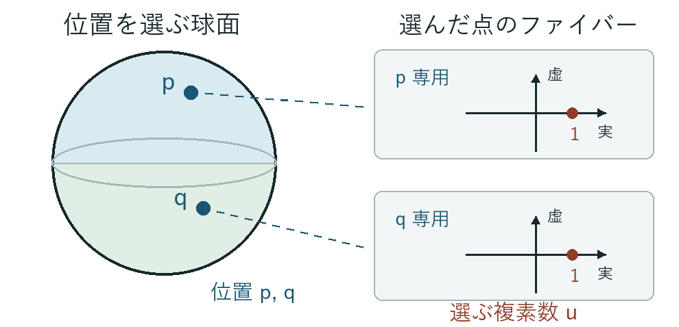
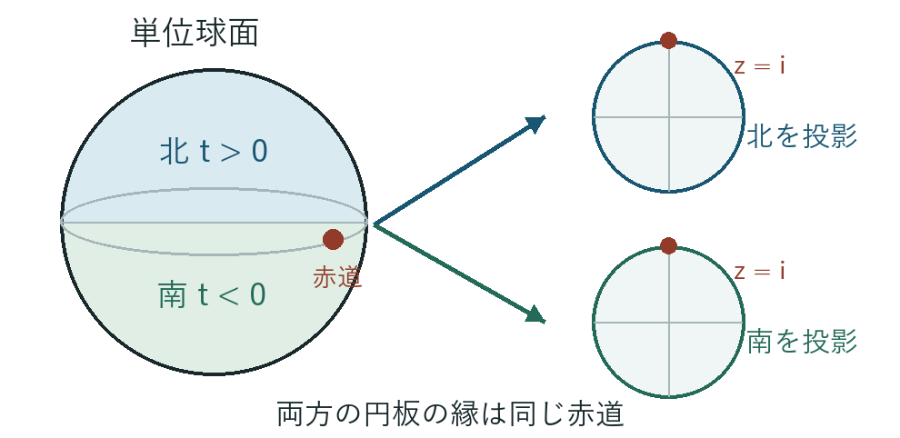
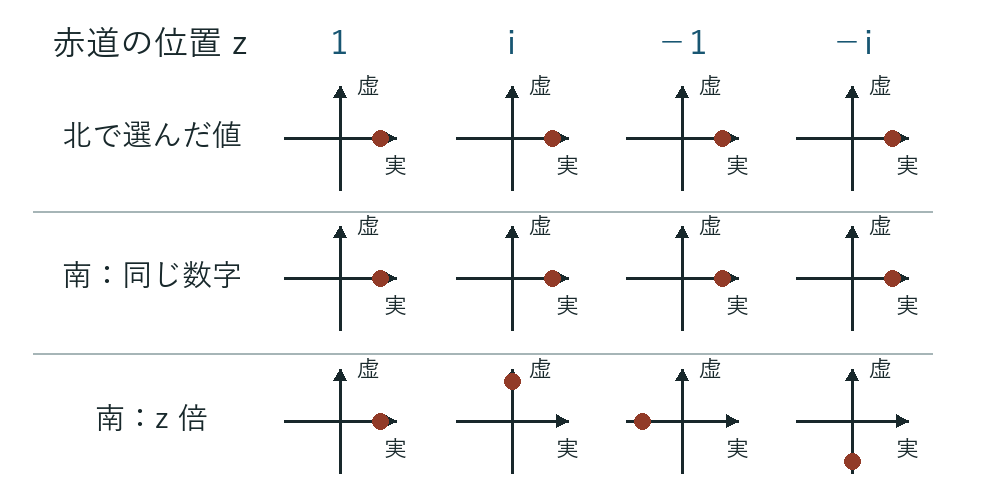
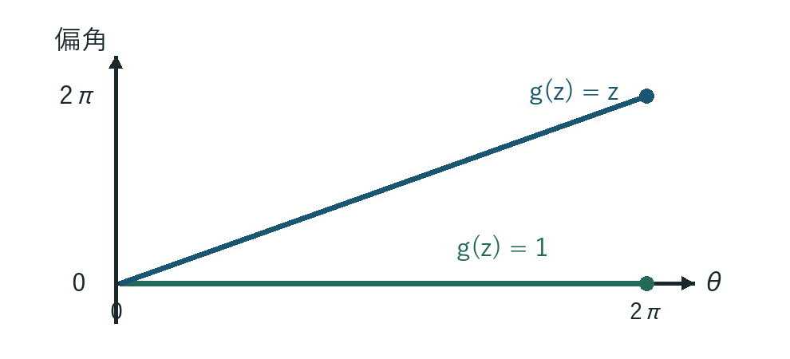
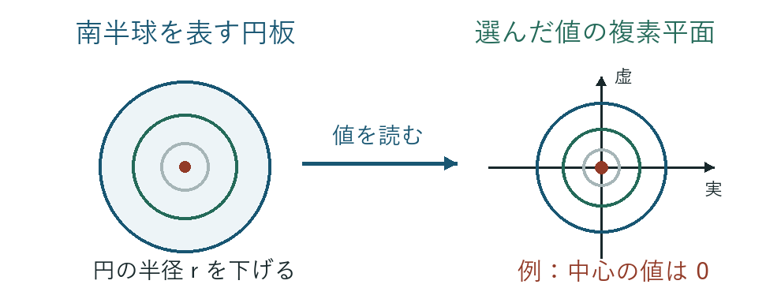

::: {.ku-chapter}
**章の導入**　球面上の一点を選ぶと、その点専用の複素数の平面を一枚使えると考える。赤道上の同じ点に北側と南側からたどり着いたとき、二枚の平面のどの点を同じものとみなすかを決める。
:::

## 球面の点と、その点で選ぶ値

**導入。** まず、球面上の位置と、そこで選ぶ値を紙の上で別々に描く。

たとえば球面上の温度を考えると、位置 $p$ を決めてから、その場所の温度を実数で一つ答える。この章の値には実数が二つあり、$u=a+ib$ とまとめる。各位置 $p$ で取り得る値の全体は、実軸と虚軸を持つ複素平面一枚である。

@fig-00-fibers では球面上の二点 $p,q$ を選び、それぞれが持つ平面を右に別々に描いた。$p$ で $u=1$ を選ぶことと、$q$ で $u=1$ を選ぶことは、数字は同じでも場所が違う。位置と値を組にして $(p,1)$、$(q,1)$ と書く。青い点線は、右のどの平面が左のどの点に属するかを示す。

{#fig-00-fibers width="96%"}

::: {.ku-definition}
**定義｜底・ファイバー・全空間**

位置 $p$ が動く球面を**底空間**、特定の $p$ に属する値の空間を**ファイバー**という。ファイバーは各点に一枚ずつある。ある領域 $U$ で全部の平面に共通の座標の付け方を選べば、その領域で扱う全データは直積 $U\times\mathbb C$、すなわち位置と値の組 $(p,u)$ で表せる。球面全体のファイバーを後述の規則でつないだものを**全空間**という。
:::

例えば領域内で値を連続に選ぶとは、同じ領域の座標で、位置 $p$ の連続関数 $u(p)$ を一つ指定することである。値の候補を与える各平面は点ごとに別々にある。近い点での値を比べるには、領域の中でその共通の座標を使う。図は、球面を底とする全空間から、固有の場所を持つ二枚の値の平面を抜き出したものである。

::: {.ku-summary}
**まとめ**　$p$ は球面での位置、$u$ はその位置に属する平面上の点である。直積表示は、各点別のファイバーに同じ形式の座標を与える。
:::

## 北と南に分け、赤道で同じ値を表す

**導入。** 一点の値を北側と南側のどちらからでも記述できる赤道に注目する。

単位球面の点を $p=(x,y,t)$ と書く。$t\geq0$ の点の集合を閉北半球 $H_N$、$t\leq0$ を閉南半球 $H_S$ とする。両方に属する $t=0$ の円が赤道である。赤道では球面の方程式 $x^2+y^2+t^2=1$ が $x^2+y^2=1$ になる。その円周を真上から見て、$z=x+iy=\cos\theta+i\sin\theta=e^{i\theta}$ と書く。$z$ は**赤道上の位置に付けた名前**である。

@fig-00-disks の右側は、上半分と下半分の表面をそれぞれ真上から円板へ投影した図である。各半球を一枚だけ取れば、円板の $(x,y)$ から高さは $t=\pm\sqrt{1-x^2-y^2}$ と一意に戻せる。したがって半球は、赤道を縁に持つ閉円板として扱える。本章で「半球の内部」と呼ぶのは、球面のうち赤道を除いた $t>0$ または $t<0$ の部分である。投影した円板では $x^2+y^2<1$ に対応する。

{#fig-00-disks width="92%"}

北と南で独立に、位置と値の座標を $(p,u_N)$、$(p,u_S)$ とする。赤道の一点 $p$ では北にも南にも一枚ずつ平面がある。この二枚は作業用の複製である。同じ $p$ に属する二枚の間だけで、北の値 $u_N$ を南の値 $u_S$ へ対応させる。例えば $z=i$ となる赤道上の点で、$u_N=1$ と $u_S=i$ を同じベクトルと決められる。この対応では、式の左右で底の位置 $p$ を固定している。

@fig-00-identification は、北で値 $1$ を選んだとき、南で読む座標が貼り合わせの規則と赤道上の位置によってどう変わるかを示す。関数 $s_N,s_S$ は、それぞれの半球の位置 $p$ を入力し、そこで選んだ複素数を返す。赤道で同じ値を選んだことになる規則を、二通り比べる。

$$
\begin{array}{ll}
\text{同じ数字で対応させる} & s_S(p)=s_N(p),\\[2pt]
\text{赤道の位置で決まる回転を使う} & s_S(p)=z\,s_N(p).
\end{array}
$$ {#eq-00-two-gluings}

{#fig-00-identification width="94%"}

これで、球面の全点で値を一つずつ連続に選ぶ、という問いを正確に言える。各半球で連続な関数を作り、赤道では @eq-00-two-gluings のうち選んだ規則に従わせる。こうしてつながった選択を**切断**と呼ぶ。加えて、どのファイバーでも値 $0$ を選ばずに済むかを調べたい。第一の規則なら、北も南も定数 $1$ で済む。第二の規則では北を定数 $1$ とすると、南の円板の縁で $1,i,-1,-i$ と一周する値を指定される。南の円板上で、この縁の指定を保ちながら全域で $0$ を避けられるだろうか。

::: {.ku-summary}
**まとめ**　底の赤道上の位置 $p$ を固定したまま、北と南の値の座標を読み替える。次の節では、南の円板の縁で一周する値が、縁を除く部分でどんな制約を生むかを見る。
:::

## 偏角を一周の前後で比べる

**導入。** 南の円板の中で同心円を縮める。各円を一周したとき、選んだ複素数の向きが何周するか比べる。

原点を避ける複素数の閉じた曲線を、出発点から連続した偏角で読む。終点の偏角は始点と $2\pi$ の整数倍だけ違う。この差を $2\pi$ で割った整数を**巻き数**という。

@fig-00-phase の横軸は赤道の位置、縦軸は切れ目を作らずに読んだ偏角である。$g(z)$ はその場所で北の値に掛ける複素数で、北の値を $1$ とすれば南の値も $g(z)$ になる。赤道上では両方の曲線が同じ値から出発し、同じ値で終わる。それでも終点の高さは異なる。

{#fig-00-phase width="76%"}

@fig-00-contraction では、左の円板上で半径 $r$ の円を一周し、そこで選んだ値を右の一枚の複素平面へ順番に写している。ここで右は、南の各ファイバーで読んだ座標の数字を、比較のために集めて描いた平面である。円板の位置が $re^{i\theta}$ なら、右に描く点は $s_S(re^{i\theta})$ になる。図の具体例は $s_S(a)=a$ とした場合であり、縁の指定を満たす代わりに中心で値が $0$ になる。

{#fig-00-contraction width="91%"}

値が全域で連続なら、$r$ を $1$ から $0$ に下げるにつれて、右の閉曲線も連続に変形する。値が常に非零であれば、右の曲線はその間ずっと原点を避けるので、巻き数は変わらない。$r=0$ では、どの $\theta$ も同じ中心点を指し、値は一定の $s_S(0)$ になる。その巻き数は0である。したがって全域で非零な値を選べたなら、縁での巻き数も0になる。前節のように南の縁で $s_S=z$ を要求すると巻き数は1だから、中心まで延ばす途中のどこかで $0$ を通る。

北を一定にしたことが失敗の原因だろうか。北側も選び直して、二つの境界を同じ向きに読む。 @eq-00-two-gluings の第二式では、複素数を掛けると偏角が足されるから

$$
w(s_S)-w(s_N)=w(z)=1.
$$ {#eq-00-obstruction}

::: {.ku-worked}
**計算を追う｜北と南の巻き数を引き算する**

具体的に北側の針を $s_N(e^{i\theta})=e^{-2i\theta}$ としてみる。赤道で $z$ を掛けると南側は一回転ぶんだけ逆回りが減る。

$$
\begin{aligned}
s_S(e^{i\theta})&=e^{i\theta}e^{-2i\theta}=e^{-i\theta},\\
w(s_S)-w(s_N)&=(-1)-(-2)=1.
\end{aligned}
$$

ここでは両側に回転があり、どちらもそれぞれの円板に零点なしでは延ばせない。北側の回転を何回に替えても差は1である。延長の条件は「各側で0」なので、二つを同時に満たす選び方がない。
:::

一方、両側がそれぞれゼロを避けて円板まで延びるなら、左辺は $0-0$ である。 @eq-00-obstruction によって、第二の貼り方ではどんな選び方にも零点が必要だと分かる。これが本書で繰り返す最初の型である。**局所座標で可能な操作を列挙し、その操作を何度行っても消えない量を測る。**

::: {.ku-summary}
**まとめ**　角度の始点と終点の差を $2\pi$ で割れば、座標を忘れても残る一周の回数が出る。
:::

## 三つの到達点

**導入。** 貼り方、束の差、方程式の指数を、何を入力して何を出すかで結び付ける。

1. **貼り合わせの記録を作る。** 何点でゼロになるかだけでは、零点の移動や合流を追いきれない。そこで、巻き数を座標の選び方と独立な整数にする。第1〜3章では、局所で可逆な行列とその外積から、Bott周期性まで進む。
2. **物差しが失う情報を計算する。** 束を足したり引いたりして、階数が同じ二つの束を比べる。第4〜5章では、Chern指標が有理化で消す差を $\mathbb RP^5$ の整数関係で測る。
3. **貼り合わせから方程式の欠損を数える。** 第6章では球面に戻り、方程式の解の自由度と、右辺に課される独立な条件との差を求める。同じ整数を、微分の最高次部分を使った位相側の計算からも出す。

@fig-00-reading-paths を参照。図の左列は出発点、中央列はそこで使う操作、右列は取り出す量である。境界でどの同型を使ったかが三例を結ぶ。

{#fig-00-reading-paths width="82%"}

::: {.ku-summary}
**まとめ**　境界の回転を見つけ、余分な方向を加えて比較し、最後に可解性の差へ送る。
:::

## 本書を式からたどる

**導入。** 式がどの章で定義され、どの章で使い直されるかを先に押さえる。

前半では、定義が現れる前に具体例で何を比較できないかを確かめる。次いで、式を追って一般の条件を一つずつ導く。第7章には使った規約と参照先をまとめた。式番号を参照している箇所は、その式の和・積・向きを前の段階に戻って読める。

後半では、同じ三つの計算を別の方法から検証する。セルの完全列と拡大を区別し、射影束とAdams演算を使って整数の環を調べる。Toeplitz作用素と射影空間上の指数では、解析的な計算とK理論の計算をさらに具体化する。後半の節にはその場で使う入力と仮定を記したので、前半を通読したあと目的の章へ飛ぶこともできる。

::: {.ku-summary}
**まとめ**　最初の束の計算は、後半の行列・作用素・曲率で別の形を取る。
:::

## 最初の手計算

**導入。** ここから各ファイバーを $\mathbb C^2$ とする。そこでは一つの値が二つの複素成分を持つ。成分を別々に回してから、その組全体を比べる。

@eq-00-two-gluings の $z$ を $z^m$ に替え、北と南の境界巻き数の差を出してほしい。右辺は $m$ になる。従って全体でゼロを避けられるには $m=0$ が必要で、$m=0$ なら両側で $1$ が使える。

次に二つの回転 $z,z^{-1}$ を、一つの複素数に順番に掛ける。その積は $1$ である。一方、値が $(u_1,u_2)$ の二成分からなり、第一成分を $z$ 倍、第二成分を $z^{-1}$ 倍する場合は、一つのファイバーの中で次の行列が作用する。

$$
\begin{pmatrix}z&0\\0&z^{-1}\end{pmatrix}.
$$ {#eq-00-two-directions}

@eq-00-two-directions で両側の座標を混ぜることを許したら、今度も回転を消せるだろうか。答えは第1章で、円板に沿って変形する具体的な行列から求める。

::: {.ku-summary}
**まとめ**　行列式の回転は相殺する。第1章で、座標を混ぜて実際に貼り目を消す。
:::

::: {.ku-chapter}
**章のまとめ**　境界での一回転を整数で記録した。第1章では、同じ整数になる貼り方が本当に同じ線束を与えるかを調べる。
:::
