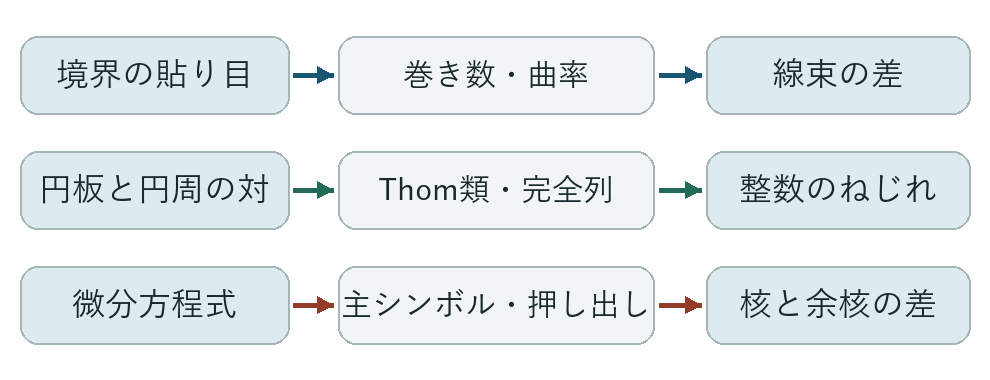

::: {.ku-chapter}
**章の導入**　北半球と南半球に同じ複素平面を載せる。赤道を越えるときの係数だけを変え、その小さな変更が球面全体でどんな差になるかを追う。
:::

北半球と南半球の各点に、複素数を一つ入れる座標を置く。赤道の位置を $z=e^{i\theta}$ とし、北の係数を $s_N$、南の係数を $s_S$ と書く。二つの貼り方を比べたい。

$$
\begin{array}{ll}
\text{一定の貼り方}&s_S=s_N,\\[2pt]
\text{一回転する貼り方}&s_S=z\,s_N .
\end{array}
$$ {#eq-00-two-gluings}

どちらも半球の内部だけを見れば、どの点でも同じ一次元の空間である。それでは、球面の全ての点で値を連続に選び、さらに一つもゼロにしないで済むだろうか。

第一の貼り方では両側で $1$ を選べる。第二の貼り方で北を $1$ にすると、南の境界は一回転する。南でこの値を内部まで延ばす際に、ゼロを避けられるかを調べる。

## 偏角を一周の前後で比べる

**導入。** 赤道を一歩ずつ進み、係数が指す針の角度を巻き戻さずに記録する。

原点を避ける複素数の閉じた曲線を、出発点から連続した偏角で読む。終点の偏角は始点と $2\pi$ の整数倍だけ違う。この差を $2\pi$ で割った整数を**巻き数**という。

@fig-00-phase の横軸は赤道の位置、縦軸は切れ目を作らずに読んだ偏角である。赤道上では両方の曲線が同じ値から出発し、同じ値で終わる。それでも終点の高さは異なる。

{#fig-00-phase width="76%"}

円板全体でゼロを避けて選んだ値なら、境界の円を同心円に沿って中心へ縮められる。途中の閉曲線は原点を通らないので巻き数は一定に保たれる。最後は一点で巻き数0。したがって円板から得られる境界の巻き数は0である。

北を一定にしたことが失敗の原因だろうか。北側も選び直して、二つの境界を同じ向きに読む。 @eq-00-two-gluings の第二式では、複素数を掛けると偏角が足されるから

$$
w(s_S)-w(s_N)=w(z)=1.
$$ {#eq-00-obstruction}

::: {.ku-worked}
**計算を追う｜針の角速度を一周だけ足す**

具体的に北側の針を $s_N(e^{i\theta})=e^{-2i\theta}$ としてみる。赤道で $z$ を掛けると南側は一回転ぶんだけ逆回りが減る。

$$
\begin{aligned}
s_S(e^{i\theta})&=e^{i\theta}e^{-2i\theta}=e^{-i\theta},\\
w(s_S)-w(s_N)&=(-1)-(-2)=1.
\end{aligned}
$$

ここでは両側に回転があり、どちらもそれぞれの円板に零点なしでは延ばせない。北側の回転を何回に替えても差は1である。延長の条件は「各側で0」なので、二つを同時に満たす選び方がない。
:::

一方、両側がそれぞれゼロを避けて円板まで延びるなら、左辺は $0-0$ である。 @eq-00-obstruction によって、第二の貼り方ではどんな選び方にも零点が必要だと分かる。これが本書で繰り返す最初の型である。**局所座標で可能な操作を列挙し、その操作を何度行っても消えない量を測る。**

::: {.ku-summary}
**まとめ**　角度の始点と終点の差を $2\pi$ で割れば、座標を忘れても残る一周の回数が出る。
:::

## 三つの到達点

**導入。** 貼り方、束の差、方程式の指数を、何を入力して何を出すかで結び付ける。

1. **貼り合わせの記録を作る。** 何点でゼロになるかだけでは、零点の移動や合流を追いきれない。そこで、巻き数を座標の選び方と独立な整数にする。第1〜3章では、局所で可逆な行列とその外積から、Bott周期性まで進む。
2. **物差しが失う情報を計算する。** 束を足したり引いたりして、階数が同じ二つの束を比べる。第4〜5章では、Chern指標が有理化で消す差を $\mathbb RP^5$ の整数関係で測る。
3. **貼り合わせから方程式の欠損を数える。** 第6章では球面に戻り、方程式の解の自由度と、右辺に課される独立な条件との差を求める。同じ整数を、微分の最高次部分を使った位相側の計算からも出す。

@fig-00-reading-paths を参照。図の左列は出発点、中央列はそこで使う操作、右列は取り出す量である。境界でどの同型を使ったかが三例を結ぶ。

{#fig-00-reading-paths width="82%"}

::: {.ku-summary}
**まとめ**　境界の回転を見つけ、余分な方向を加えて比較し、最後に可解性の差へ送る。
:::

## 本書を式からたどる

**導入。** 式がどの章で定義され、どの章で使い直されるかを先に押さえる。

前半では、定義が現れる前に具体例で何を比較できないかを確かめる。次いで、式を追って一般の条件を一つずつ導く。第7章には使った規約と参照先をまとめた。式番号を参照している箇所は、その式の和・積・向きを前の段階に戻って読める。

後半では、同じ三つの計算を別の方法から検証する。セルの完全列と拡大を区別し、射影束とAdams演算を使って整数の環を調べる。Toeplitz作用素と射影空間上の指数では、解析的な計算とK理論の計算をさらに具体化する。後半の節にはその場で使う入力と仮定を記したので、前半を通読したあと目的の章へ飛ぶこともできる。

::: {.ku-summary}
**まとめ**　最初の束の計算は、後半の行列・作用素・曲率で別の形を取る。
:::

## 最初の手計算

**導入。** 逆向きに回る二つの座標を同じ行列に入れ、回転を足すことの意味を試す。

@eq-00-two-gluings の $z$ を $z^m$ に替え、北と南の境界巻き数の差を出してほしい。右辺は $m$ になる。従って全体でゼロを避けられるには $m=0$ が必要で、$m=0$ なら両側で $1$ が使える。

次に二つの回転 $z,z^{-1}$ を、同じ座標に順番に掛ける。その積は $1$ である。別々の二座標に掛ける場合は、対角行列を得る。

$$
\begin{pmatrix}z&0\\0&z^{-1}\end{pmatrix}.
$$ {#eq-00-two-directions}

@eq-00-two-directions で両側の座標を混ぜることを許したら、今度も回転を消せるだろうか。答えは第1章で、円板に沿って変形する具体的な行列から求める。

::: {.ku-summary}
**まとめ**　行列式の回転は相殺する。第1章で、座標を混ぜて実際に貼り目を消す。
:::

::: {.ku-chapter}
**章のまとめ**　境界での一回転を整数で記録した。第1章では、同じ整数になる貼り方が本当に同じ線束を与えるかを調べる。
:::
