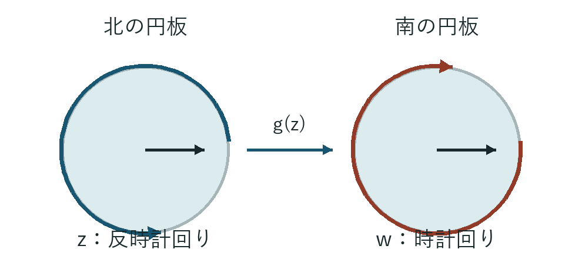
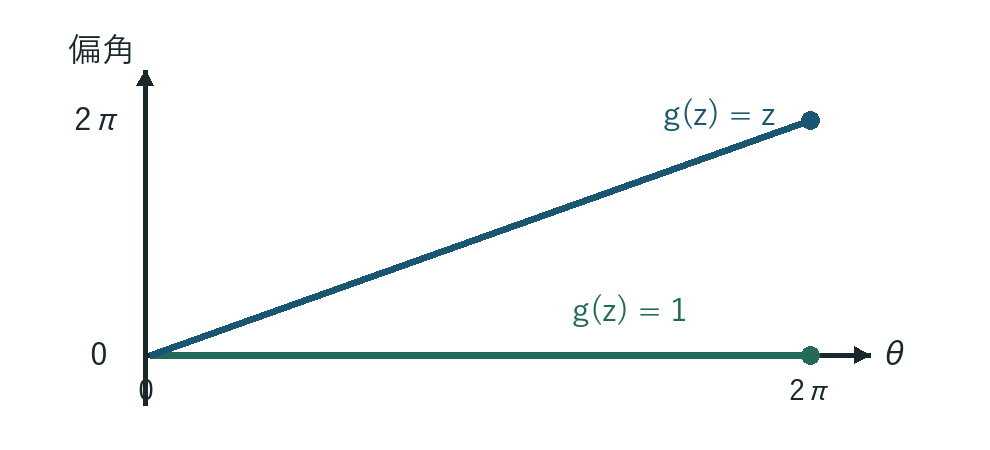
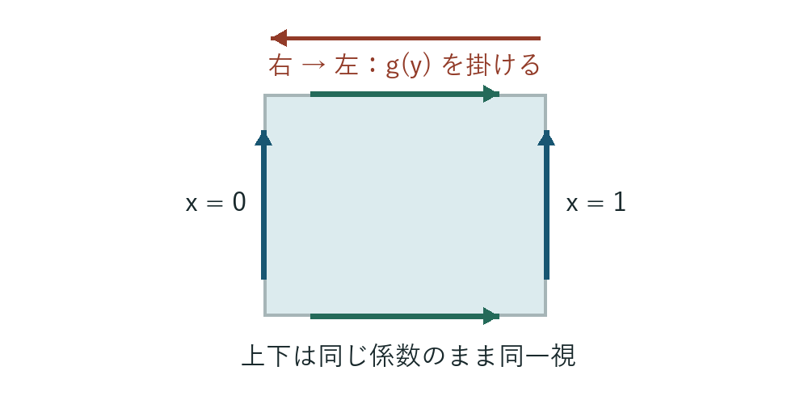

::: {.ku-chapter}
**章の導入**　序章の赤道では、同じファイバーの値を北と南で別の数字で読んだ。この章では、赤道での換算表が違う二つの束を見せられたとき、半球ごとに数の読み方を変えて互いに一致させられるかを問う。巻き数は、その変更をしても保存される整数である。
:::

## 半球でできる操作と、球面全体でできる操作

**導入。** 片方の円板で選んだ座標が、もう片方へどの条件で延びるかを考える。

例えば、同じ赤道の点 $z=i$ で北の値 $1$ を南の値 $i$ と同一視する規則を取る。南半球全体で数字を $-i$ 倍して読むと、その点に限って南の値も $1$ と表示される。しかし同じ変更を赤道上の $z=1$ に使えば、もともと $1$ だった南の表示が $-i$ に変わる。全ての赤道の点で表示を一致させたいとき、半球全域で許される座標変更にはどんな制約があるだろうか。

**複素ベクトル束** $\pi:E\to X$ では、点 $x$ を固定して、そこへ写る全ての元の集合 $E_x=\pi^{-1}(x)$ を取る。この集合が複素ベクトル空間である。ある点の近傍 $U$ で束が $U\times\mathbb C^r$ と同一視でき、同一視は各 $E_x$ で線形同型になる。この同一視を局所自明化、$E_x$ をファイバー、$r$ を階数と呼ぶ。$r=1$ が線束である。

局所自明化 $\varphi_U$ は、$E|_U$ の元を $U\times\mathbb C^r$ の組へ送る。つまり、ファイバーの元 $v$ を位置 $x$ と数字の組 $(a_1,\ldots,a_r)$ に換算する。例えば階数1なら、数字が $1$ となるベクトル $e_U(x)$ を各点で選べば、実際の値は $v=a_1e_U(x)$ と戻せる。階数 $r$ では標準基底一つずつを同じように戻す。こうして各点で連続に変わる基底の組を**フレーム**と呼ぶ。一つ一つの $e_U(x)$ はその点のファイバーに属する。

$U,V$ の重なりで $U$ の座標 $v$ を $V$ の座標へ移す行列を $g_{VU}$ と書く。同じ点で二度換算するなら

$$
g_{WV}g_{VU}=g_{WU}.
$$ {#eq-01-orig-01}

例えば三つの領域が重なる一点 $x$ で、$U$ の係数を $V$ では $2$ 倍、$V$ の係数を $W$ では $i$ 倍して読むとする。最初の係数が $a$ なら途中が $2a$、最後が $2ia$。直接 $U$ から $W$ へ読む規則も $2i$ 倍になる。式の積の順番は、同じ位置の同じ値をどのフレームで読み直すかを表す。

逆に、この規則を満たす可逆行列があれば、局所の直積を同値関係 $(x,v)$ と $(x,g_{VU}(x)v)$ で貼れる。各チャートの直積表示が残るから、できた空間は束になる。

赤道をまたぐ小さい帯でも、貼り合わせた値に一つの座標を付けられる。赤道の貼り合わせが $g(z)$ の場合、赤道近くの位置 $p=(x,y,t)$ では $z=(x+iy)/\sqrt{x^2+y^2}$ を使う。北にいるときは $u_N$、南にいるときは $g(z)^{-1}u_S$ を帯の値の座標と決める。赤道では二つが一致する。この帯の共通の表示が、別々の半球から貼っても赤道で局所自明化できる理由である。

束の**切断**は各 $x$ に $E_x$ のベクトルを連続に一つ選ぶ操作で、式では $\pi\circ s=\mathrm{id}_X$。局所関数が重なりで $s_V=g_{VU}s_U$ を満たすことが連続な選択の条件になる。線束なら、ゼロを避ける切断 $s$ があれば $(x,a)\mapsto as(x)$ が大域的な自明化を与える。階数 $r$ なら、各点で独立な切断が $r$ 本必要になる。

::: {.ku-summary}
**まとめ**　問題は円板の内部から、赤道上の座標変換の一周へ移った。
:::

## 巻き数を定義して、座標の変更に使う

**導入。** 赤道に沿って途切れない実数の偏角を選ぶ。

::: {.ku-definition}
**定義｜巻き数**

原点を避ける閉曲線について、絶対値を1にそろえてから偏角を実数として連続に追う。終点と始点の偏角の差を $2\pi$ で割った整数を巻き数という。角度は一周しても $0$ に戻さず、たとえば $2\pi$ の次は $2\pi$ を超える数で読む。
:::

原点を避ける曲線 $g(e^{i\theta})$ を絶対値で割り、単位円へ移す。区間 $[0,2\pi]$ 上ではその値を $e^{i\phi(\theta)}$ と表す連続な実数値 $\phi$ が取れる。短い弧で偏角の枝を選び、隣の区間の枝を $2\pi$ の整数倍だけずらして繋ぐ。端点は円上で同じ値だから

$$
w(g)=\frac{\phi(2\pi)-\phi(0)}{2\pi}
$$ {#eq-01-orig-02}

は整数になる。別の持ち上げは区間全体で一定の整数倍だけ異なり、この差には影響しない。積の偏角は和なので $w(gh)=w(g)+w(h)$。曲線が滑らかなら $w(g)=\frac{1}{2\pi i}\int g^{-1}dg$ と書ける。絶対値の微分の寄与は一周で消える。

::: {.ku-worked}
**計算を追う｜半径と回転を別々に微分する**

滑らかな係数を $g(\theta)=r(\theta)e^{i\phi(\theta)}$ と書く。積を微分してから $g$ で割ると、半径だけの項と角度だけの項に分かれる。

$$
\begin{aligned}
g^{-1}dg
 &=r^{-1}e^{-i\phi}\bigl(e^{i\phi}dr+ir e^{i\phi}d\phi\bigr)\\
 &=d(\log r)+i\,d\phi,\\
\frac{1}{2\pi i}\int g^{-1}dg
 &=\frac{\log r(2\pi)-\log r(0)}{2\pi i}
   +\frac{\phi(2\pi)-\phi(0)}{2\pi}.
\end{aligned}
$$

半径は閉曲線の両端で同じ値なので第1項が消える。偏角の持ち上げは実数値で、終点が始点から何周ずれたかが第2項に残る。第13章で曲率を境界積分へ戻したときにも、この右辺が現れる。
:::

二つの曲線が十分近ければ、商は $1$ の近くの半平面に入り、偏角が一周の間に元へ戻る。従って巻き数は連続な変形の途中で局所一定、ゆえに一定である。逆に巻き数 $m$ が与えられると、$\phi(\theta)-m\theta$ は周期的で、これと $\log|g|$ を同時にゼロへ縮めれば $g$ は $e^{im\theta}$ へ変形できる。

赤道の向きを決める。序章の球面上の点 $(x,y,t)$ を使うと、北の閉半球には $z=(x+iy)/(1+t)$、南には $w=(x-iy)/(1-t)$ という複素座標を取れる。分母は各半球で正であり、どちらも極が原点、赤道が絶対値1になる。赤道での $z$ は序章の $x+iy$ に一致し、南では $w=\bar z=1/z$ となる。北の正の境界方向として、$z=1,i,-1,-i$ の順に進む向きを採用する。貼り合わせ $g$ は**北から南への座標変換**である。両半球で新しい座標を $v'_N=a_Nv_N$、$v'_S=a_Sv_S$ とすると

$$
g'=a_S g a_N^{-1}.
$$ {#eq-01-orig-03}

$a_N,a_S$ はどちらも円板上でゼロを避けるから、同じ赤道方向に読んでも巻き数はともに $0$。よって $w(g')=w(g)$ である。例えば赤道上の $a_S=e^{-i\theta}$ は $g=z$ を打ち消すが、その $a_S$ は南半球全体の座標変更として使えない。

北の $z$ を反時計回りに進めると、南の座標 $w=1/z$ は時計回りに進む。 @fig-01-charts で対応を確認できる。

{#fig-01-charts width="76%"}

円周の値を実数の偏角に持ち上げると、同じ始点と終点でも一周の差が見える。 @fig-01-phase で対応を確認できる。

{#fig-01-phase width="76%"}

::: {.ku-summary}
**まとめ**　偏角の増分は整数周であり、円板全体に延びる変更を掛けても変わらない。
:::

## 線束を整数から復元する

**導入。** 整数が不変であることと、整数だけで同型が決まることを順に示す。

$g$ と $h$ の巻き数が等しければ、$h/g$ は巻き数 $0$ である。曲線全体に一価の連続対数 $\ell$ が取れるので、南の円板に半径 $r$ を入れ、$a_S(re^{i\theta})=\exp(r\ell(e^{i\theta}))$ と置けば中心でも連続になる。ここでは円板の境界を赤道の同じパラメータで読んでいる。北では $a_N=1$ とすれば $g'=h$ になる。線束の同型類は整数で分類され、$m=0$ が自明束に当たる。

この整数は、境界での値を固定して切断のゼロを数える方法でも得られる。北では $1$ を選ぶ。南に延ばした切断に孤立零点があれば、小円で測った局所巻き数の和は南の境界巻き数である。

実際、零点の小円板を抜いた領域で $s^{-1}ds$ は閉形式なので、Stokesの公式で境界積分の和がゼロになる。向きに注意すると南の正の境界は赤道の逆方向である。

従って和は $-w(g)$ になる。連続な貼り方の計算は、滑らかな $z^m$ に取り替えて行える。

この符号を具体的に確かめよう。$\mathbb CP^1$ は $\mathbb C^2$ の原点を通る複素直線全体で、点を $[Z_0:Z_1]$ と書く。$Z_0\ne0$ では $z=Z_1/Z_0$、$Z_1\ne0$ では $w=1/z$。二つの単位円板を繋ぐと球面になる。各直線そのものをファイバーにした $L=\mathcal O(-1)$ を**トートロジー線束**と呼ぶ。北のフレーム $(1,z)$ は南のフレーム $(w,1)$ の $z$ 倍だから、同じベクトルの南座標は北座標の $z$ 倍。南で $s_S=\bar w$ と延ばすと赤道で $z$ になり、南の中心で局所巻き数 $-1$ の零点が一つできる。

::: {.ku-summary}
**まとめ**　係数は同じ巻き数の $z^m$ へ連続変形でき、どの整数も貼り方から生じる。
:::

## 第一Chern数 {#chern-number}

**導入。** 赤道での係数と、球面の向きで測る数の符号をそろえる。

::: {.ku-column}
**コラム｜どちらから貼り目を読んだか**

赤道を北の正の境界として歩く向きは、南を左手に見て歩く向きと反対である。他方、座標変換を逆向きに読むと $g$ は $g^{-1}$ になり、積分の符号がもう一度変わる。例を比較するときは「曲線の向き」と「変換の向き」の二つをまず記録する。
:::

閉じた向き付き曲面上で、線束の零点を符号付きで数える量は**第一Chern数**である。より一般の底空間にも引き戻しで移る二次の整係数コホモロジー類 $c_1$ があり、曲面全体で評価した数がこの整数になる。コホモロジーの計算と、高階数の $c_i$ は第4章で導入する。ここでは線束の $c_1$ が向き付き実2次元束のEuler類であり、その評価は切断の零点指数の和になるという規格化を用いる。球面では整数の評価だけで類が決まる。

$$
\int_{S^2}c_1(L_g)=-w(g).
$$ {#eq-01-orig-04}

同じ赤道を同じ向きに読みながら、座標変換を南から北へ変えれば式の右辺の符号が反転する。束そのものの第一Chern数は、座標表記を変えても一定である。

一般の球面束でも、貼り合わせ行列の**行列式**を使えば線束の問題に還元できる。これは各点で基底の外積を取る行列式線束である。行列式の巻き数が階数 $r$ の束を分類することは、第3章で証明する。序章の $\operatorname{diag}(z,z^{-1})$ は行列式が $1$ で、実際に $SU(2)$ の中で

$$
\begin{pmatrix}
 r z&-\sqrt{1-r^2}\\
 \sqrt{1-r^2}&r\bar z
\end{pmatrix},
\qquad 0\le r\le1
$$ {#eq-01-orig-05}

と変形すれば、$r=0$ で定数行列になる。各列の長さは $1$、内積は $0$、行列式は $r^2+(1-r^2)=1$。この式は円板上の可逆行列を与えるので、貼り方を自明にできる。

::: {.ku-summary}
**まとめ**　北で読んだ回転から、南側での境界の向きを反映して第一Chern数を得る。
:::

## 候補の物差しを三つの貼り方で試す

**導入。** 一定の貼り方、一回転、逆回転の直和を並べ、候補量を試す。

赤道に $1,z,z^{-1}$ を置く。まず複素数の**大きさ**を比較すると、どれも恒等的に $1$。次に絶対巻き数で比較すると、$0,1,1$ になる。これなら消せる貼り方と消せない貼り方は区別できる。だが、$z$ と $z^{-1}$ を重ねた場合と $z$ を二度重ねた場合を比較すると、前者の結果は $1$、後者の結果は $z^2$ である。どちらも入力の絶対巻き数は二つとも $1$ なのに、結果の巻き数は $0$ と $2$ に分かれる。積に対して答えを足すには、方向も保存しなければならない。

角度そのものを測るという案では、$1$ の位相を $0$ と読むか $2\pi$ と読むかが決まらない。区間全体で連続な枝を選んで始点から終点までの**差**を取れば、枝を変えても両端が同じだけ動く。$i$ を一周ずっと掛ける座標変更は角度に $\pi/2$ を足すが、角度差には影響しない。角度差を $2\pi$ で割る定義は、このように座標の自由度を取り除いている。

**計算。** $g(z)=z^2(z+a)$ を単位円で読む。$|a|>1$ なら、$sz+a$ は $0\le s\le1$ で決してゼロにならない。

従って第二因子の巻き数は定数 $a$ の $0$、全体は $2$。$|a|<1$ なら逆に $z+sa$ として $z$ へ変形できるため全体は $3$。$|a|=1$ では赤道上の $z=-a$ で貼り合わせが可逆でなく、そもそもこの式では線束を作れない。巻き数が飛ぶ点では、使える貼り合わせという仮定が壊れた。

この例は、第3章で可逆行列の一次式を、固有値が単位円の内側か外側かで分ける計算のスカラー版になっている。$a$ を複素数から行列に変えたときも、境界の円と固有値が出会わない限り、回る成分を連続に追うことができる。

::: {.ku-summary}
**まとめ**　行列式は直和で回転を足す。二成分の回転が相殺する場合は座標の混合を調べる。
:::

## 切断の零点は、位置と総数を別々に考える

**導入。** 切断を少し動かしたとき、各零点と零点の指数の総和を比べる。

$m>0$ として、北の係数を $1$、南を $\bar w^m$ とすれば、赤道での条件を満たす。南の原点以外でゼロにならず、原点を一周すると $\bar w^m$ の偏角は負方向に $m$ 回進む。零点は一つでも指数は $-m$ である。$m<0$ のときは南で $w^{-m}$ を使えばよく、指数はやはり $-m$ になる。北の係数を定数に決めたこの切断では、貼り方の情報が南の一つの零点に集中している。

零点を実際に分離してみる。$m=2$ なら、南の原点に近い小円板の中で $\bar w^2-\varepsilon^2$ を使い、その外で $\bar w^2$ に戻す。具体的には、$|w|\le r$ で $1$、$|w|\ge 2r$ で $0$ になる滑らかな関数 $\chi$ を選び、$\bar w^2-\varepsilon^2\chi(w)$ とする。$0<\varepsilon<r<1/2$ なら $|w|>r$ では第一項の絶対値が第二項より大きいので、零点は $w=\varepsilon$ と $w=-\varepsilon$ だけ。どちらも複素共役に非零の複素数を掛ける線形項を持つので、局所指数は $-1$。境界での値が同じだから合計は $-2$ のままである。

実数値関数なら零点の周りの正負を考えるが、ここでは複素数値なので、小円全体の向きを追う。超過した局所指数は別の位置で反対の局所指数と相殺し得る。例えば $\bar w^2-\varepsilon^2$ の二点は同符号なので相殺しない。球面全体の第一Chern数が制約するのは、零点の位置でもその個数でもなく、この符号付きの和である。

**局所的な延長の別解。** $g(z)=z^m e^{\ell(z)}$ と書けるなら、延長を考える際に $e^{\ell}$ の部分だけ先に南のフレームに吸収できる。たとえば $g(z)=z^2(2+z)$ では $2+z$ が円板上でゼロにならないから、$a_S(w)=(2+\bar w)^{-1}$ と選ぶと赤道で余分な因子が消える。具体的な式を見たとき、零点を持たない部分と、巻き数を受け持つ部分を切り分けられる。

::: {.ku-summary}
**まとめ**　零点の位置は動くが、赤道から決まる符号付き総数は保存される。
:::

## トートロジー線束に内積を入れて確かめる

**導入。** 射影直線の各点に、その点が表す直線を載せ、局所の単位ベクトルを計算する。

$\mathbb CP^1$ の点が直線 $\ell$ を表すとき、$L_\ell$ はその $\ell$ である。各直線には $\mathbb C^2$ の標準Hermite計量が制限される。ベクトル $(1,z)$ を正規化すると北の単位フレームになる。南の $(w,1)$ も正規化すると、重なりで北の単位フレームは南の単位フレームの $z/|z|$ 倍である。長さの変化を除いても残る位相が、第1章の赤道の $z$ である。

定ベクトル $e_0=(1,0)$ を各 $\ell$ へ直交射影すれば、$L$ の大域的切断が得られる。北のフレームでは係数が $(1+|z|^2)^{-1}$、南では $\bar w/(1+|w|^2)$。従ってゼロ点は南の $w=0$ だけで指数は $-1$。先の人工的な切断と同じ値が、直交射影という全空間で自然な操作でも得られた。

今度は同じ $e_0$ を使って二つの束を比べる。$e_0$ 方向の**線形成分を読む**写像は、$\ell$ 上の線形汎関数だから $L^*$ の切断になる。南のフレーム $(w,1)$ の第1成分を読むと係数は $w$。その零点は同じ場所だが局所指数は $+1$ になる。射影する場合に出た $\bar w$ と、線形成分を読む場合に出た $w$ が、双対の符号を区別している。

::: {.ku-summary}
**まとめ**　北・南の単位フレームの関係から、トートロジー線束のChern数 $-1$ が出る。
:::

## 一回転を測る補助計算　接続と曲率

**導入。** フレームを回したとき微分に加わる項を、接続の変換式で追う。

零点を選ばず、局所での微分の仕方から同じ整数を出すこともできる。単位フレームで係数 $s$ の微分を $ds+A s$ と補正する。$A$ は虚数値の1形式で、$s_S=g s_N$ なら $ds_S$ は $dg$ の分だけ余計に動く。一致するには

$$
A_N=A_S+g^{-1}dg
$$ {#eq-01-orig-06}

であればよい。これが線束のユニタリ接続の座標変換則である。線束なので曲率は局所的に $F=dA$。$d(g^{-1}dg)=0$ だから、二つの半球の曲率は重なりで一致する。

符号はStokesの公式で点検できる。北の境界を正に読み、南は逆に読む。そこで

$$
\int_{S^2}F=\int_{S^1}(A_N-A_S)
           =2\pi i\,w(g).
$$ {#eq-01-orig-07}

$\frac{i}{2\pi}F$ の積分は $-w(g)$ で、第1章の第一Chern数と一致する。ここでは球面での積分だけを照合した。この計算が示すのは、ゼロ点に付いた離散的な符号の和と、接続の曲率を分布させて積分する操作が、赤道の同じ差分を読んでいることである。

例えば貼り合わせが $z$ の場合、北の座標 $z=re^{i\theta}$ で $A_N=i\,a(r)d\theta$ とし、$a(r)$ は中心近くで $0$、赤道付近で $1$ とする。南で $A_S=0$ とすれば、帯状の重なりで変換則を満たす。曲率は $i a'(r)dr\wedge d\theta$。全積分は $2\pi i(a(1)-a(0))=2\pi i$。$a$ の立ち上がる場所を動かしても積分は同じである。局所零点を動かしてもその合計が変わらなかったことと対応する。

::: {.ku-summary}
**まとめ**　曲率を積分して境界の接続の差に戻すと、巻き数と同じ整数になる。
:::

## 底の地図を変えると、巻き数はどう動くか

**導入。** 基底を別の曲面から写したとき、同じ貼り目を何回通るかを調べる。

連続写像 $f:Y\to X$ と、$X$ 上の束 $E$ を考える。$Y$ の一点 $y$ を選び、まず $f(y)$ へ移動する。そこに元々あるファイバー $E_{f(y)}$ を参照し、その複製を $y$ の値の空間とする。引き戻しの全空間は組 $(y,v)$ のうち $v\in E_{f(y)}$ のものを集めた集合である。二つの点が同じ $f(y)$ に写る場合にも、組の最初の成分 $y$ が両者を区別する。球面を $\mathbb CP^1$ と見て、$f_d(z)=z^d$ を考える。正の整数 $d$ に対して $0$ は $0$ に、$\infty$ は $\infty$ に写る。$|z|\le1$ は北の円板に、$|z|\ge1$ は南の円板に移るから、もとの遷移 $g(z)=z$ に $z^d$ を代入すればよい。引き戻した $L$ の第一Chern数は $-d$ になる。$d$ 回まわる底の写像が、係数の回転も $d$ 回へ増やした。

対して複素共役で $f(z)=\bar z$ とすれば、赤道の進む向きも反転するので引き戻しの貼り方は $\bar z$。第一Chern数は $+1$ になる。これは座標変換の書き方を逆にすることとは違う。底の点が別の点に写るため、向きを固定した球面上で実際に別の束を得ている。分類によって、この引き戻しは $L^*$ と同型である。

### 同じ局所束から異なる大域束を作れた理由

円板を二枚、赤道の上で貼るとき、境界上での同型だけから本当に局所直積が得られるか。赤道の短い弧の上の薄い帯を考え、境界上の $g$ を法線方向へ一定に延ばす。北の座標をそのまま使い、南の座標には $g^{-1}$ を掛けて北の座標に揃えれば、この帯で連続な座標を作れる。赤道にない点は各円板の内部の直積座標で覆える。座標が揃わないのは帯をそれぞれ作れるかという問題ではなく、その帯の座標を両側の円板全体に一つずつ延ばせるかという問題である。

局所計算の範囲を狭くすると、一回転はどこでも角度の連続な枝で書ける。一周の途中をいくつかの短い弧に分け、そこで選んだ枝の値を隣に渡す。次の枝との差は $2\pi$ の整数倍。積み重ねて最初の弧に戻ったときに残った整数が巻き数である。局所的に枝を取れることと、最後に同じ枝へ戻ることは別々の条件である。

### 一点の近くに回転を集める

$g(z)=z$ と同じ巻き数を持つ貼り方を、赤道の大部分では $1$ になるように作れる。$0\le\theta\le2\pi$ で滑らかな非減少関数 $\phi$ を取り、短い一つの区間だけで $0$ から $2\pi$ まで増えるようにする。$g_{\mathrm{loc}}(e^{i\theta})=e^{i\phi(\theta)}$ はその区間以外では $1$。$g_{\mathrm{loc}}/z$ の偏角 $\phi(\theta)-\theta$ は両端で一致するから、円板上の座標変更に延ばせる。回転がどの弧に集まっているかは同型類を変えない。一回転を観測するために必要なのは、弧ごとに値を採ることに加えて、弧どうしを一周に沿って比較することである。

::: {.ku-summary}
**まとめ**　引き戻しは係数を写像と合成し、球面では次数に応じてChern数を掛ける。
:::

## 球面をトーラスへ替えても、境界積分は使える

**導入。** 正方形の向かい合う辺を貼れば、球面と違う曲面で同じ考えを試せる。

球面では赤道の一周が第一Chern数を決めた。しかし球面のように二枚の円板へ分けられない曲面では、どの境界を比較するのだろうか。正方形の向かい合う辺を同一視したトーラスで、全ての辺の対応を一つずつ追う。

正方形を $(x,y)\in[0,1]^2$ として、向きは $dx\wedge dy$。上下の辺の係数は同じとする。左右の辺では、右の係数を左へ運ぶ時だけ $g(y)=e^{2\pi i m y}$ を掛ける。従って切断の係数は

$$
s(x,0)=s(x,1),\qquad
s(0,y)=e^{2\pi i m y}\,s(1,y).
$$ {#eq-01-torus-gluing}

@fig-01-torus を参照。

{#fig-01-torus width="76%"}

四隅でもこの貼り方は整合する。$g(0)=g(1)=1$ だからである。左右の違いを見ずに上下だけを調べれば、どの $m$ でも同じに見える。

正方形内部に滑らかな切断を取り、境界には零点がなく内部に孤立零点だけがあるとする。零点を囲む小円板を取り除き、$s^{-1}ds$ を残りの領域で積分する。閉形式だから外側の境界積分は、零点を囲む正向きの小円の積分の和に等しい。

上下は向きが逆で、 @eq-01-torus-gluing の第一式から寄与が相殺する。一方、右の辺は上向き、左は下向きに読む。従って、

$$
\begin{aligned}
\frac{1}{2\pi i}\int_{\partial[0,1]^2}s^{-1}ds
 &=\frac{1}{2\pi i}\int_0^1
       \bigl(s(1,y)^{-1}\partial_y s(1,y)
       -s(0,y)^{-1}\partial_y s(0,y)\bigr)\,dy\\
 &=-\frac{1}{2\pi i}\int_0^1 g^{-1}g'\,dy=-m .
\end{aligned}
$$ {#eq-01-torus-boundary}

二辺の向きを別々に指定したため、同一視の向きを取り違えずに済む。 @eq-01-torus-boundary は、全ての閉じた曲面を同じ一つのループで分類せよという主張ではない。このトーラスの切り開き方と貼り合わせでは、相殺しない辺の差がちょうど一つの整数になったという計算である。

### 零点の位置と局所指数を直接求める

境界付近で0または1に一定になり、内部で0から1へ滑らかに増加する関数 $\eta(x)$ を取る。$\eta(a)=1/2$ となる点 $a$ で $\eta'(a)>0$ とする。次の式は @eq-01-torus-gluing を満たす。

$$
s(x,y)=(1-\eta(x))e^{2\pi i m y}+\eta(x).
$$ {#eq-01-torus-section}

$m\ne0$ なら、二つの項の絶対値が等しく、さらに位相が反対になる点だけが零点である。だから $x=a$、$e^{2\pi i m y}=-1$。$0\le y<1$ にそのような点は $|m|$ 個ある。

一つの零点で微分を取ると、$x$ 方向は $2\eta'(a)$、$y$ 方向は $-\pi i m$ になる。複素係数を実二次元のベクトルとして書けば、微分の行列式の符号は $-\operatorname{sgn}(m)$。従って $|m|$ 個の局所指数の和は $-m$ である。実際の切断を @eq-01-torus-section で作っても、境界だけで求めた @eq-01-torus-boundary と一致する。

### 接続の計算を辺で照合する

同じ例に局所接続1形式

$$
A=2\pi i m\, x\,dy
$$

を置く。右の係数から左へ $g$ を掛けるので、左の接続は右の接続から $g^{-1}dg$ を引いたもの。右辺で $A=2\pi i m\,dy$、左辺で $A=0$ となるため、この条件を満たす。上下でも係数と微分の規則が一致する。従って曲率は

$$
F=2\pi i m\,dx\wedge dy,\qquad
\frac{i}{2\pi}\int_{T^2} F=-m .
$$ {#eq-01-torus-curvature}

トーラスに非自明な線束を置くと、紙面の正方形上では曲率を定数に分布させられる。零点を数える式と、局所で定数の曲率を積分する式が同じ整数を返すのは、辺のずれを通して同一の貼り合わせを読んでいるからである。

::: {.ku-summary}
**まとめ**　上下の項を消し、残る辺の差を積分すればトーラスでもChern数が出る。
:::

## 第一Chern類が二次で現れる理由

**導入。** CW分割に沿ってフレームを延ばし、初めて障害が現れる場所を探す。

一次元のセルだけからなるグラフでは、複素線束を全て自明化できる。各頂点で非零フレームを一つ選び、各辺の端のフレームを補間する。$\mathbb C^\times$ は弧状連結だから延長が可能である。初めて障害が生じるのは、閉じた境界を持つ2セルの内部へ延長するところである。

2セル $e$ の特性写像で束を円板に引き戻し、円板上のフレームを一つ選ぶ。1骨格で既に選んだ非零フレームを、この円板の境界上で複素係数 $f_e$ として読む。境界巻き数 $w(f_e)$ を各向き付き2セルへ割り当てる。円板内のフレームを変更しても、その変更の境界巻き数はゼロなので、この値は動かない。

一方、1骨格で選んだフレームを変更すると、差は $\mathbb C^\times$ 値の関数になる。頂点での値を揃えた後、辺ごとの余分な回転を整数1コチェイン $a$ として記録できる。辺の寄与を2セルの貼り合わせに沿って足すと、障害の変更はそのセル差分 $\delta a$ である。従って2次の測定は個々のセルの整数そのものではなく、整数コチェインを差分で割った類になる。

この観察は、CW複体の複素線束が第一Chern類で分類される一般定理の低次元の中身である。より高いセルでも $\mathbb C^\times\simeq S^1$ の高次ホモトピー群はゼロなので、新しい延長障害は生じない。3セル上で二次の障害の差分がゼロになることも、境界の球面で一つの束から生じたことに対応する。第4章では、コチェインの差分とその商をより一般の次数で定義する。

### どの整数が座標の取り方から来たのか

球面を北と南の円板に切る場合、北で $1$ を選んで南へ移すと境界係数は $g(z)$。ただし南の2セルの正の境界は北で選んだ赤道の向きと逆である。すると2セルに置く障害は $w(g)$ でなく $-w(g)$。先に定義した第一Chern数と一致する。

トーラスの @eq-01-torus-boundary では、一つの2セルに寄与するのは四辺の交代した向きである。境界の各辺で局所のフレームを取り直すと、辺の値は変わる。しかし同一視される二辺から入る余分な回転は、向きが逆なので差分として相殺される。球面とトーラスで同じ負号が出たのは、貼り合わせの計算で「右から左」または「北から南」を決め、境界の正向きと整合させた結果である。

### 小さい曲面の比較

| 底 | ゼロを避けたフレームを作る段階 | 切断の障害の例 |
|---|---|---|
| 区間 | 一端の基底を連続に延ばす | なし |
| 円周 | 二端の複素係数を経路でつなぐ | 複素線束ではなし |
| 球面 | 一周の境界を円板内へ延ばす | $g=z^m$ で $-m$ |
| トーラス | 対辺を貼った境界を2セルへ延ばす | @eq-01-torus-gluing で $-m$ |

: 複素線束で障害が現れる次元とその具体的な貼り合わせ。 {#tbl-01-obstructions}

テンソル積では $L\otimes L^*$ が自明になる。直和では $L\oplus L^*$ がこの球面の例で階数 $2$ の自明束になる。二つの操作で同じように回転が消えたが、得られる階数は異なる。次章では、何を足し算にして、どの意味で「引く」ことができるかを決める。

::: {.ku-summary}
**まとめ**　辺での選択の自由は境界上で相殺し、二次セルの整数が二次コホモロジー類を作る。
:::

::: {.ku-chapter}
**章のまとめ**　貼り目は巻き数で分類でき、零点や曲率でも同じ整数を向き付きで回収できる。次章は、余分な自明方向を加えながら束どうしの差を取る。
:::
