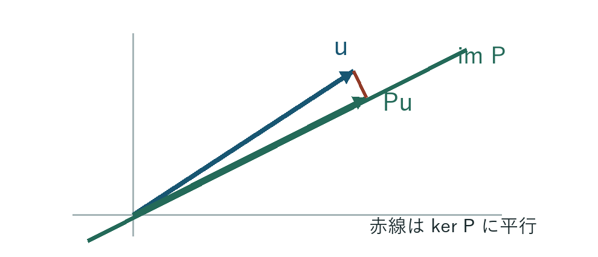

::: {.ku-chapter}
**章の導入**　局所座標についていた情報を、直和で足し引きできる形に変える。自明束を足す意味と、境界で選ぶ同型を記録する意味を、円板上で切り分ける。
:::

## 和と積で、消えるものが違う

**導入。** 直和で足す場合とテンソル積で掛ける場合を、線束で見比べる。

球面で $L\otimes L^*$ と $L\oplus L^*$ はどちらも自明になる。前者のファイバーは一次元、後者は二次元である。「消えた」という言葉が揃っていても、同じ計算として扱うと階数が合わなくなる。

二つの束 $E,F$ の**直和**では、ファイバーで組 $(u,v)$ を取る。貼り合わせはブロック対角行列 $\operatorname{diag}(g_E,g_F)$ で、階数は $r+s$ である。**テンソル積**では二つのファイバーのテンソル積を取り、基底の組を $r s$ 個作る。貼り合わせは $g_E\otimes g_F$ になる。線束に限ると積の貼り方は二つの複素数の積で、双対 $L^*$ の貼り方は逆数。$L\otimes L^*$ の自明化は線形汎関数をベクトルに作用させる評価で与えられる。

以下では $\mathbf1$ を自明線束、$\mathbf1^a$ をその $a$ 本の直和とする。$E\otimes\mathbf1\cong E$ なので $\mathbf1$ は積の単位だが、直和で何も増やさないのは階数 $0$ の束である。直和が加法、テンソル積が乗法を与えることは、ファイバーごとの分配則から分かる。

**練習。** $E=L\oplus L^*$ とする。$E\otimes L$ と $E\oplus L$ の階数と第一Chern数を求めよ。前者は $L^2\oplus\mathbf1$ だから階数 $2$ で第一Chern数 $-2$。後者は階数 $3$ で行列式が $L$ だから $-1$。テンソル積では、同じ $L$ が両方の座標に効いている。

::: {.ku-summary}
**まとめ**　テンソル積で逆になる線束と、直和で相殺されるK類には別の規則がある。
:::

## 階数を揃えたまま比較する

**導入。** 各点の次元をそろえ、座標の貼り方の違いを差として残す。

対象としての線束には「負の線束」が存在しない。$L$ を引く操作が欲しい理由は、たとえば $L$ と自明線束の差を、共通の余分な座標を追加した前後で同じ差として扱うためである。階数の差だけを記録すると $L$ と $\mathbf1$ の差は $0$ になるが、第1章の巻き数は両者の間に差を検出した。

この問題を点だけの空間で試す。束は単なる $\mathbb C^a$ で、二つ組 $(a,b)$ は「$a-b$」を表す。$(3,1)$ と $(5,3)$ は、交差して足すと $3+3=5+1$ となる。同じことを束に使いたい。ただし直和には一般に相殺を仮定できないので、比較に共通の束をさらに足すことを許す。

コンパクトな有限CW複体 $X$ に対し、束の対 $(E,F)$ を次の関係で同一視する。

$$
(E,F)\equiv(E',F')
$$ {#eq-02-orig-01}

とは、ある束 $G$ について

$$
E\oplus F'\oplus G
\cong E'\oplus F\oplus G
$$ {#eq-02-orig-02}

となることである。この同値類を $[E]-[F]$ と書く。直和で成分ごとに足すと群になり、逆元は $(F,E)$、零元は $(0,0)$ である。これが複素K理論の $KU^0(X)$ である。

推移律を確認する。二つの同値式を加え、中央に出てくる $E'\oplus F'$ を共通の追加分にまとめれば最初と最後を比較できる。加法と同値関係が両立するのは、同じ束を等式の左右へ直和しても同型が保たれるためである。$[E]-[F]$ の積は分配則で展開する。

$$
\begin{aligned}
([E]-[F])([A]-[B])&\\
={}[E\otimes A]+[F\otimes B]&\\
-[E\otimes B]-[F\otimes A].&
\end{aligned}
$$ {#eq-02-orig-03}

$[E]\mapsto$ 階数のような直和加法的な量は、一意にこの群の準同型へ延長する。実際、対の同値式にその量を適用すると、共通の項が消え、差が一致する。これがGrothendieck群の普遍性である。

::: {.ku-summary}
**まとめ**　同じ階数の差も自明とは限らず、足した後の同型で比較する。
:::

## 自明束だけを足せばよい理由

**導入。** 一般の補助束を使った同型を、自明方向だけを足した同型へ直す。

有限CW複体は、球や円板での計算を有限回の貼り合わせで組み立てられる空間である。CW複体では、閉円板をその境界から既にある空間へ貼る操作を繰り返す。球面は一点に $2$ 次元円板の境界を潰して貼れば作れる。本書の有限CW複体はコンパクトで、有限個の局所座標とそれに従属する**一の分割**が使える。一の分割とは、各座標域の外ではゼロになる非負の連続関数 $\rho_j$ で総和が $1$ になるものをいう。

束 $G$ の各局所座標を $\rho_j$ 倍し、全てを縦に並べて、一つの大きな自明束への写像とする。各点で少なくとも一つの $\rho_j$ が正なのでファイバーごとに単射である。局所で独立な列を並べた行列を $M$ とすると像への直交射影は $M(M^*M)^{-1}M^*$。この射影は連続で、像の直交補も束になる。

従って補束 $G^\perp$ を足すと $G\oplus G^\perp$ は自明である。

対の同値式の両辺にこの補束を足せば、共通の $G$ を自明束へ置き換えられる。従って $[E]=[F]$ は、同じ本数の自明線束を両者に加えると同型になることと同値である。$[L]=1$ が球面で成り立つと仮定すれば、安定化した束の行列式を取って $L\simeq\mathbf1$ を得る。$L$ の回転は自明座標をいくつ追加しても消えない。

以後何度も使う事実がもう一つある。コンパクトな底 $X$ 上で、$X\times[0,1]$ 上の束を両端に制限すると同型になる。今の埋め込みを区間全体に作り、射影 $P(x,t)$ を考える。$t,t'$ が十分近いと $\|P(x,t)-P(x,t')\|<1$ が一様に成り立つ。そのとき $P(x,t')$ を $P(x,t)$ の像に制限すると単射である。逆向きにも単射だから次元が等しく同型になる。区間を有限分割して同型を合成すればよい。

これで、変形収縮する円板上の束が自明になることや、連続に変形した貼り合わせが同じ束を与えることが説明できる。

::: {.ku-summary}
**まとめ**　補束を加えると補助束を自明化でき、安定同値を同じ条件で比較できる。
:::

## 行列の射影として、同じ束を別の方法で作る

**導入。** 束を行列の像として見れば、座標変化を連続な行列で追える。

束 $G$ が自明束の部分束になったとき、その直交射影 $P(x)$ は $P^2=P=P^*$ を満たす。逆に、この等式を満たす連続な行列族があれば、像の次元は $\operatorname{tr}P(x)$ なので整数値の連続関数になる。各点で像の基底を作る独立な列を選べば、その近くでも独立だから局所フレームになる。つまり射影の像から束を作ることができる。

球面の場合、$L$ の直線を北で $(1,z)$ と書けば、その射影は

$$
P(z)=\frac1{1+|z|^2}
\begin{pmatrix}1&\bar z\\z&|z|^2\end{pmatrix}.
$$ {#eq-02-orig-04}

$z$ が無限大へ向かうと $P(z)$ は第2座標への射影になる。南のフレームから計算した射影とも重なりで一致する。射影は行列の値として大域的に書けるのに、像の基底は大域的に一つ選べない。行列を大域的に書けたことだけで自明化ができたと判断すると、ここで誤る。

$P$ を定数射影と同じランクのまま連続変形できたなら、その像は区間の上の束になる。第2章の射影の距離を使う議論から、両端では同じ束を得る。だが $L$ の第一Chern数は $-1$ で、定数射影の像は $0$。従って同じランクでも、その間を射影のまま繋げない。直和で単位射影を足す操作が、自明座標の追加になる。後の族の計算では、行列 $P$ の大域的な定義を使って、像の束だけを選択的に動かす。

ベクトルを像の方向と核の方向に分ける。射影の行列が連続なら、像の基底を近傍ごとに選べる。 @fig-02-projection で対応を確認できる。

{#fig-02-projection width="76%"}

::: {.ku-summary}
**まとめ**　連続な射影の像が局所フレームを与え、補射影の像が補束を与える。
:::

## 全部の束が差を与えるとはどういうことか

**導入。** 足し算だけの集合から、差が一貫した群を作る。

有限CW複体の上で $[E]-[F]$ を与えられたら、$F$ の補束 $G$ を取って

$$
[E]-[F]=[E\oplus G]-[\mathbf1^a]
$$ {#eq-02-orig-05}

と書ける。従って引く側はいつでも自明束にできる。特に連結な底で階数ゼロの類なら、$E\oplus G$ の階数が $a$ である。縮約群の元は、実際の束を一つ選び、階数を基点で差し引く形で作れる。

この表現は一意ではない。$L$ と階数 $1$ の自明束の差は、$L\oplus\mathbf1$ と階数 $2$ の自明束の差でもある。表現の階数の最小値を求める問題と、差の群で二つが等しいかを判定する問題は区別する。後者では共通の自明束が足せるため、相対類や積の計算に向いた形へ表現を選び直せる。

円周の相対類に見つかった一回転をこの表現に直すと、円板上の両束は自明なのに潰した球面上では $[L]-1$ になる。分類したい空間が $X$ なのか $X/A$ なのかで、同じ「自明束を引く」という文の意味が変わる。相対群で基点になるのは $A$ を潰した点で、そこで引かれる階数は境界同型を使って揃えられた階数である。

::: {.ku-summary}
**まとめ**　安定化した等式で差を比較すると、Grothendieck群で加法と逆元が定まる。
:::

## 点での情報を差し引く

**導入。** 一点に制限して繊維の次元だけを取り出し、差し引く。

点 $x_0$ を決め、束をそこへ制限すると階数が出る。階数 $r$ に自明束 $\mathbf1^r$ を対応させれば、この写像には右逆がある。階数が $0$ の仮想束の部分を**縮約K群**と呼ぶ。

$$
\begin{aligned}
r&:KU^0(X)\longrightarrow KU^0(\{x_0\}),\\
\widetilde{KU}^0(X)&=\ker r.
\end{aligned}
$$ {#eq-02-orig-06}

連結な底ではどの点でも階数は同じで、$KU^0(X)=\mathbb Z\oplus\widetilde{KU}^0(X)$ となる。非連結なとき、縮約群は選んだ基点の階数だけを消す。一点での群は次元の差なので $\mathbb Z$、縮約群は $0$ である。基点付き二点空間 $S^0$ では、もう一つの点での階数が残るので $\widetilde{KU}^0(S^0)=\mathbb Z$ になる。

一般の連続写像 $f:Y\to X$ に対して $f^*E$ の $y$ 上のファイバーを $E_{f(y)}$ とすれば、束を $Y$ へ引き戻せる。座標変換にも $f$ を代入するだけでよい。引き戻しは和、積、階数を保ち、同じホモトピーで結んだ写像は同じK群の写像を与える。

::: {.ku-summary}
**まとめ**　階数を零にした核が縮約群であり、残るのは貼り方の差である。
:::

## 円板の境界には差がある

**導入。** 円板上で両方の束が自明でも、境界の同型を回せる。

::: {.ku-definition}
**定義｜相対K類の三つ組**

対 $(X,A)$ 上の三つ組は、$X$ 上の二つの複素束 $E,F$ と、$A$ 上で $E|_A$ から $F|_A$ への同型 $\alpha$ から成る。二束と同型を一緒に動かし、自明な差を加えて同一視する。図で描くなら、内側の二枚の束と、縁だけで二枚を結ぶ橋を一つ置く。
:::

円板上の二つの自明線束を比べる。通常の群では差が $0$ である。ところが境界に「最初の束から二番目の束へ $z$ を掛けて対応させる」という条件を記録すると、$z$ は円板上の可逆写像へ延長できない。束の対だけでは、この差を記述できなかった。

対 $(X,A)$ に対し、$A$ 上で $E$ から $F$ への同型 $\alpha$ を含む三つ組 $(E,F,\alpha)$ を考える。直和で足し、境界同型のホモトピーや、$X$ 全体へ同型が延びる三つ組の追加を許す。有限CW対ではこの相対群に、境界を一点へ潰した空間を使う表示がある。

$$
KU^0(X,A)=\widetilde{KU}^0(X/A).
$$ {#eq-02-orig-07}

$A$ が空なら基点を別に付ける。$X/A$ で $A$ の点は一つに同定する。三つ組から商での束を作るには、$F$ に補束 $G$ を足し、$E$ にも同じ $G$ を足す。$F\oplus G$ の自明化と $\alpha\oplus1$ によって $E\oplus G$ は $A$ 上で自明化される。この自明化でファイバーを揃えて $A$ を潰し、得た束から同じ階数の自明束を引く。

この操作の局所的な要点は、$A$ で選んだ基底を近傍へ延長できることにある。大きな自明束に埋め込んで座標関数を延長し、束への射影をかける。独立性は開条件なので近傍でもフレームになる。逆に、商での階数ゼロの類は、基点のファイバーにフレームを選んで引き戻せば三つ組で表せる。フレームを変える定数行列は自明束全体へ延ばせる。補束の選び直しは共通の直和を足して比較できる。

円板の境界を潰した球面は、もう一つの円板を貼り、その円板全体を一点へ縮めても得られる。補助円板の束を $F$ とし、$E$ の円板を北とすると、三つ組 $(\mathbf1,\mathbf1,z)$ の差は球面で $[L]-1$ になる。$z$ の代わりに $\bar z$ を使うと逆元になる。数としての符号は第1章の規約によって、前者の $c_1$ の評価が $-1$、後者が $+1$ となる。

::: {.ku-summary}
**まとめ**　相対類は境界に沿う同型まで入力に取り、商空間の貼り合わせに移せる。
:::

## 完全列で、制限と持ち上げを対応させる

**導入。** 相対類から境界の記録を忘れる写像を考え、その像を求める。

相対類の境界同型を忘れると、絶対群の差に戻る。しかもその差は $A$ に制限すれば $0$ になる。逆に $A$ に制限して $0$ になる差は、共通の自明束を加えれば境界で同型が取れ、相対類から来る。これを

$$
KU^0(X,A)\longrightarrow
KU^0(X)\longrightarrow KU^0(A)
$$ {#eq-02-orig-08}

が中央で**完全**であると言う。完全とは、出ていく写像の核が、入ってくる写像の像と一致することを意味する。例えば $D^2$ から $S^1$ に制限すると自明線束が自明線束へ移り、階数に関しては何も失わない。円板の境界での一回転は、相対群から絶対群に移ると消える。この相対類をどこから取り戻すかは、次章で円錐を使って調べる。

::: {.ku-summary}
**まとめ**　絶対類が部分空間で零になるとき、境界同型を選んで相対類に持ち上げられる。
:::

## 境界を貼り替える練習

**導入。** 赤道で $z$ と $\bar z$ を掛ける二例を、相対類として足す。

$X=D^2$, $A=S^1$ とする。二枚の自明線束を境界で行列 $\operatorname{diag}(z^2,z^{-1})$ によって対応させた相対類を、線束を使って表せ。まず行列式は $z$。第3章の分類を先取りすれば、この二次元の貼り方は $L\oplus\mathbf1$ に相当し、引く側の $\mathbf1^2$ を引いて $[L]-1$ を得る。先取りせずに確かめるには、行列を $\operatorname{diag}(z,1)\operatorname{diag}(z,z^{-1})$ と分け、第1章の変形を第二因子に適用する。最後の定数は半球の座標変更で消える。

::: {.ku-summary}
**まとめ**　二つの境界回転は逆元になり、足したクラスには円板への延長がある。
:::

## 実際に束の差を変形する

**導入。** 選んだ境界同型を変更する際に、どの操作が差を保つかを追う。

球面で $b=[L]-1$ と置く。第1章の直和の計算から $[L^*]-1=-b$。符号を変える操作が「負の線束を作る」ことではなく、別の正の階数の束から同じ自明線束を引くこととして実現した例である。$[L]-[L^*]=2b$ は、階数が同じでもゼロにならない。両者の第一Chern数の差は $-1-(+1)=-2$ なので、どんな自明束を加えても等しくならない。

$b$ に $[L]$ を**掛ける**と $[L^2]-[L]$ である。$b$ を自分に**足す**と $[L\oplus L]-[\mathbf1^2]$ である。それぞれ階数は $0$ でも、第一Chern数は前者が $-1$、後者が $-2$。従って「同じ線束をもう一つ使う」だけでは操作を決定できない。前者では引く側の束まで $L$ でねじっており、後者では両側に別々の座標を足した。

**普遍性を使う練習。** 階数 $r(E)$ と行列式線束の第一Chern数 $c(E)$ の組は、直和で加法的である。従って仮想束の差 $a=[E]-[F]$ に $(r(E)-r(F),c(E)-c(F))$ が対応する。積については、階数 $r,s$ の束をテンソル積にすると行列式が $((\det E)^s)\otimes((\det F)^r)$ になる。これは、片方を単位としてテンソル積した行列の行列式を取ると、同じ行列式がもう片方の階数の数だけ出ることから分かる。よって組の積は $(r,c)(s,d)=(rs,rd+sc)$ である。階数ゼロの二つの差の積では、階数も第一Chern数もゼロになる。第3章でこの観測を球面環の関係 $b^2=0$ に結び付ける。

::: {.ku-summary}
**まとめ**　連続変形と安定化を使えば、見かけの異なる三つ組を同じ相対類として扱える。
:::

## 縮約群の基点と、空間を増やす操作

**導入。** 基点を追加する操作を、実際の直和分解と対応させる。

基点を選んだ空間 $X$ に孤立点を一つ足すと、束の差にはその孤立点での整数が加わる。離れた成分どうしには貼り合わせがないからである。$X_+$ の基点をその孤立点に取れば、$\widetilde{KU}^0(X_+)$ に残るのは $KU^0(X)$ 全体である。逆に $X$ 内の一点を基点に取った $\widetilde{KU}^0(X)$ には、その成分の階数ゼロの差だけが残る。

球面が二つ一点で合わさる空間 $S^2\vee S^2$ を考える。点で二つの束を同一視するには階数を揃え、点でのフレームを決めればよい。各球面の束の同型をさらに点での座標変更で補正すれば、二つの同型はその点で一致して貼れる。座標補正は、点の小近傍で行列を連続に単位行列まで動かすことで行える。複素可逆行列群が連結なのがここで効く。

従って絶対群は共通の階数と二つの回転を持ち、基点での階数を引くと回転だけが二つ残る。

球面の**積** $S^2\times S^2$ にも、片方の因子を基点にした二つの球面が入る。この制限で二つの巻き数は読める。積ではさらに、各球面でゼロになる二つの差の積を試せる。第3章と第4章で、この積が四次元の情報を持つことを示す。一点で繋ぐ場合と二因子で動く場合の違いは、階数や各球面の巻き数だけを見ている段階では表に出ない。

::: {.ku-summary}
**まとめ**　追加した点から来る成分を区別して、絶対群を縮約群の言葉に戻せる。
:::

## 忘れる写像と、境界データの選び直し

**導入。** 同じ絶対差に対して、境界同型の選択がいくつあるかを調べる。

三つ組 $(E,F,\alpha)$ の和に、逆の同型を持つ $(F,E,\alpha^{-1})$ を足してみよう。境界の写像を $\operatorname{diag}(\alpha,\alpha^{-1})$ と見ると、入れ替えを通して、$E\oplus F$ から $F\oplus E$ への大域的な成分交換へ変形できる。具体的に、$E\oplus F$ の自己同型

$$
R_t=
\begin{pmatrix}
\cos t &-\sin t\,\alpha^{-1}\\
\sin t\,\alpha&\cos t
\end{pmatrix}
$$ {#eq-02-orig-09}

を境界で使う。$R_0=I$、$R_{\pi/2}$ は交換に符号を付けたものだから、$\operatorname{diag}(\alpha,\alpha^{-1})R_{\pi/2}$ は境界での $\alpha$ を含まない。定数符号も大域的同型に入れられる。これで三つ組の逆元が境界の表現でも見える。

同じ二束 $E,F$ に二つの境界同型 $\alpha,\gamma$ を置いたとき、その差を取ると絶対群ではゼロになる。境界には $E$ の自己同型 $\gamma^{-1}\alpha$ が残る。円板の例では $\alpha=z^2,\gamma=z$ とすれば差は一回転。境界同型を選ぶ自由度が、この跡を残す。

$KU^0(X,A)$ の定義を $KU^0(X)$ の制限写像の**核そのもの**とする案では、この違いがつぶれる。$X=D^2,A=S^1$ では制限は階数に関する同型なので核はゼロだが、三つ組で得た相対群は $\mathbb Z$ である。完全性の言い方はこの違いを保つ。相対群の**像**は核になるが、相対群自体には忘れられる部分があり、次章で前の項がそれを供給する。

::: {.ku-summary}
**まとめ**　境界自己同型に由来する差が、完全列の一つ前の項から来る。
:::

## 射影のホモトピーとして安定同値を作る

**導入。** 同型な束を別の射影行列で表しても、安定化した後には連続に動かせることを示す。

第2章の射影表示では、束を自明束の中の部分空間の族として表した。ここで、抽象的な同型が与えられたとき、射影の行列を実際に連続変形できるかを確認する。

同じ束 $E$ の二つの等長な埋め込み $u:E\to X\times\mathbb C^N$、$v:E\to X\times\mathbb C^M$ を取る。別々の自明束を直和して、この一つの束の埋め込みを

$$
W_\theta(e)=(\cos\theta\,u(e),\sin\theta\,v(e)),
\qquad 0\le\theta\le\pi/2
$$ {#eq-02-embedding-rotation}

と定める。二つの成分は別の直和座標なので、ノルムの二乗を足すと $\|e\|^2$。したがって全ての $\theta$ で等長な埋め込みである。像への直交射影は

$$
W_\theta W_\theta^*=
\begin{pmatrix}
\cos^2\theta\,uu^* &\cos\theta\sin\theta\,uv^*\\
\cos\theta\sin\theta\,vu^* &\sin^2\theta\,vv^*
\end{pmatrix}.
$$ {#eq-02-projection-rotation}

始点は $uu^*$ にゼロ射影を足した行列、終点はゼロ射影に $vv^*$ を足した行列。従って抽象的に同じ束から作った射影は、十分大きな自明束の中でホモトピーでつながる。逆に連続な射影のホモトピーの像は $X\times[0,1]$ 上の束を作り、両端の制限は同型になる。

この構成で足したゼロ射影は、**周囲の自明束の次元**を増やすが、像の階数を増やさない。像そのものに自明束を足すときは、単位射影を直和する必要がある。射影行列を大きくしただけで、安定同値で使う加法の操作を行ったとは限らない。

### 近い射影はどのように同型になるか

同じファイバー内の二つの直交射影 $P,Q$ に $\|P-Q\|<1$ を仮定する。$v\in\operatorname{im}P$ で $Qv=0$ なら $v=(P-Q)v$ であり、ノルム評価から $v=0$。よって $Q$ は $\operatorname{im}P$ から $\operatorname{im}Q$ への単射。同様に $P$ は逆向きの単射であるから、有限階数なら階数が等しく、最初の写像は同型である。

この条件が全ての底点で一様に成り立つなら、同じ式で束の同型が得られる。$P,Q$ の近さを、各点の固有空間を別々に比較するためでなく、全体の連続な同型を一度に作るために用いた。例えば @eq-02-projection-rotation を小さな角度差で刻めば、一連のこの同型を合成できる。

### 近似した行列から射影を回復する

連続なHermite行列 $A(x)$ が射影に近く、$\|A^2-A\|<1/4$ とする。固有値 $\lambda$ は実数であり、$|\lambda^2-\lambda|<1/4$。$\lambda=1/2$ では等号になるから、スペクトルは $1/2$ を避ける。そこで $1/2$ より大きい固有値の固有空間へ射影する。コンパクトな底なら一様な隙間を選べるため、連続な関数近似でこの射影を $A$ の多項式の一様極限として書ける。

実際、スペクトルの合併はコンパクトで二つの閉集合に分かれる。その間で0から1へ連続に移る関数 $h$ を一つ選び、スペクトル上では値が0または1になるようにする。Hermite行列の関数計算を用いると $h(A)^2=h(A)$。$h$ を全体を含む実区間の多項式で一様近似すれば、$h(A)$ は $x$ に連続である。

さらに射影 $P$ に $\|A-P\|<1/2$ で近い場合は、$A_\tau=P+\tau(A-P)$ のスペクトルが $1/2$ を避ける。$P-\frac12 I$ の逆作用素のノルムは2で、Neumann級数によって $A_\tau-\frac12 I$ が可逆であるためである。従って $h(A_\tau)$ の像の束は $P$ の像と同型になる。この考え方は、電子状態の数値計算のように近似的な射影行列から束を抽出するときの基礎になる。

::: {.ku-summary}
**まとめ**　射影の像と核を一緒に回す経路が、束の安定同値を行列の変形に翻訳する。
:::

## 相対データを積にすると可逆性はどうなるか

**導入。** 二つの相対類を掛けるとき、どちらか一方が可逆な場所を調べる。

境界で同型となる二つの三つ組を取る。$X$ 上で $D:E^+\to E^-$、$Y$ 上で $B:F^+\to F^-$ があり、それぞれ $A\subset X$、$C\subset Y$ の上で可逆とする。Hermite計量を入れ、$D,D^*$ を合わせて $S$、$B,B^*$ を合わせて $T$ という奇自己共役写像にする。

第一の偶奇の符号作用素を $\varepsilon$ とすれば、テンソル積の全偶奇に関して

$$
U=S\otimes I+\varepsilon\otimes T
$$ {#eq-02-product-symbol}

は奇自己共役である。$S\varepsilon=-\varepsilon S$ なので混合項は相殺する。従って

$$
U^2=S^2\otimes I+I\otimes T^2.
$$ {#eq-02-positive-square}

::: {.ku-worked}
**計算を追う｜境界が二つあっても可逆になる理由**

偶数・奇数に符号を付ける行列 $\varepsilon$ を挟んでから二乗する。展開時に現れる混合項を並べると、相殺の場所が見える。

$$
\begin{aligned}
U^2
 &=S^2\otimes I
   +(S\varepsilon+\varepsilon S)\otimes T
   +\varepsilon^2\otimes T^2\\
 &=S^2\otimes I+I\otimes T^2.
\end{aligned}
$$

第1の因子の境界にいると $S$ が可逆だから、任意の非零ベクトルに対し第1項の内積が正になる。第2の境界でも $T$ で同じことがいえる。相対積で必要なのは、この二つの領域を合わせた全域で同型が保たれることである。
:::

右辺は半正定値の二項の和である。$x\in A$ なら第一項が正定値、$y\in C$ なら第二項が正定値。ゆえに $A\times Y\cup X\times C$ の全域で $U$ は可逆になる。こうして、相対積の同型が定義される領域を行列の二乗から確認できた。

例えば円板上の二つの可逆性を担う写像が $\bar z,\bar w$ なら、 @eq-02-positive-square は $(|z|^2+|w|^2)I$ になる。従って同時にゼロになる可能性は原点だけである。円板の境界の一回転を二つの座標方向に重ねると、四次元の原点の周りに相対情報が集まる。第5章ではこの計算を任意階数の複素束のファイバーに置く。

### 普通の束の差へ移した積

全偶数成分は $E^+\otimes F^+\oplus E^-\otimes F^-$、全奇数成分は $E^+\otimes F^-\oplus E^-\otimes F^+$ である。境界情報を忘れると、この差は

$$
([E^+]-[E^-])([F^+]-[F^-])
$$

であり、先に定義した環の積と一致する。可逆性をどの領域で要求するか、と偶奇のどちらを正に数えるかが、相対版における分配則を支えている。

::: {.ku-summary}
**まとめ**　合成した作用素の二乗が和になるため、境界の和集合で可逆性が得られる。
:::

## 円板の対と円周の懸垂

**導入。** 円板の境界を一点にし、円周を懸垂する操作と比べる。

$D^2/S^1$ が球面になるのを、極座標で追ってみる。円板の中心を北極へ、境界の全部を南極へ送り、同心円の半径を緯度に対応させる。円板の内部は南極を除く球面と同相になる。相対類は、この商で南極の近くでは階数ゼロの差に自明化が付いたものとして読める。これは境界での同型を捨てない理由のもう一つの説明になる。

円周を基点付きで一回懸垂すると、正方形の四辺を全て一点へ潰した球面になる。したがって円周には、通常の束の差では見えない整数が負の次数に現れる。計算の手順は、境界での回転を円板の相対類に移し、それを球面の差として数えることと同じである。次章ではこの一回の懸垂を完全列へ組み込み、二回懸垂したとき元の群が戻る理由を証明する。

球面では一つの整数でこの差を計算できた。次は球面の各点に、固定されたベクトル空間ではなく別の底 $X$ の束を持たせる。一回転する部分だけを $X$ 上の束として抽出できるだろうか。

::: {.ku-summary}
**まとめ**　相対類を球面の縮約類として読めるので、次章の次数移動を空間の操作で表せる。
:::

::: {.ku-chapter}
**章のまとめ**　束の差を階数から分離し、相対類を境界での同型として扱えるようにした。第3章では球面の一つの差を、任意の空間に外積で掛ける。
:::
