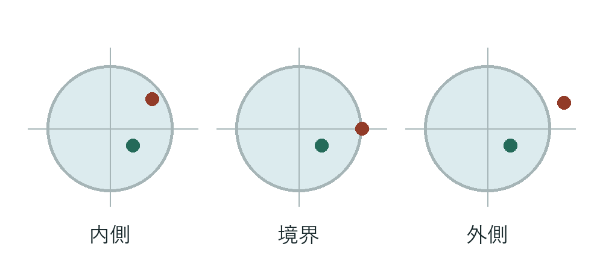

::: {.ku-chapter}
**章の導入**　球面の一回転を掛ければ二つの次数を移動できる。外積がなぜ同型なのかを、貼り合わせを多項式行列に替え、回る部分を取り出す逆算法で確かめる。
:::

## 行列式が十分になる範囲

**導入。** 直線の巻き数を行列式へ広げ、どこまで行列の情報を保持するかを見る。

第1章では $\operatorname{diag}(z,z^{-1})$ を定数へ変形した。一般の可逆行列のループでも、行列式の巻き数が同じなら道筋を繋げることができる。まず極分解で $g=u p$ と書く。$p=(g^*g)^{1/2}$ は正定値、$u$ はユニタリである。$p$ を $(1-t)p+tI$ で $I$ へ縮めれば、可逆行列のまま $g$ は $u$ に変形される。

$d=\det u$ を取り出して $u=\operatorname{diag}(d,1,\ldots,1)v$ と書くと、$v$ は行列式 $1$ のユニタリ行列の群 $SU(r)$ を動く。$SU(2)$ の行列は第一列 $(a,b)$ で決まり、第二列は $(-\bar b,\bar a)$、よって $SU(2)$ は単位球面 $S^3$ である。$r>2$ では第一列を取ると $S^{2r-1}$ へ写り、固定した第一列を持つ残りの選択肢は $SU(r-1)$ である。

この写像は局所的には直積になる。ある第一列の近くで、固定した残りのベクトルをGram–Schmidtで直交化し、最後の列に位相を掛けて行列式を $1$ にすれば、第一列に連続に対応する行列が得られる。**ここで借りる位相の事実**は、局所直積の束で底のループの縮め方を持ち上げられることと、$S^d$ のループは $d\ge2$ なら縮むことである。前者を使うと、$SU(r)$ のループを第一列一定のループまで変形できる。ファイバー $SU(r-1)$ のループは帰納法で縮む。

従って残るのは $d$ の巻き数だけである。

行列式が同じ巻き数の貼り合わせは、極分解とこの変形を通して同じ対角貼り合わせに繋がる。逆向きは行列式線束の不変性による。球面では階数と巻き数が束を分類する。$L$ の貼り合わせを $z$ とし、$b=[L]-1$ と置くと

$$
KU^0(S^2)=\mathbb Z\oplus\mathbb Z b.
$$ {#eq-03-orig-01}

$L^{\otimes 2}\oplus\mathbf1$ と $L\oplus L$ は階数も行列式も一致するから $b^2=0$。縮約環は $\mathbb Z b$ で、その内部の積はゼロである。この結論だけでは、別の底 $X$ で同じ因子を掛けられるかはまだ分からない。

::: {.ku-summary}
**まとめ**　一点のループでは行列式の巻き数が分類する。底が動くと回転部分自体が束になる。
:::

## 積定理の入力と出力 {#product-theorem}

**導入。** 球面方向に平均的な階数と、回転する束の係数のどちらが必要かを押さえる。

::: {.ku-theorem}
**定理｜複素Bott同型**

有限CW複体 $X$ に対し、球面の縮約Bott類 $\beta\in\widetilde{KU}^0(S^2)$ との外積は、相対理論で二回の懸垂を表す同型を与える。証明では、球面方向で回る成分を取り出す逆写像を作る。
:::

$E\to X$ と $F\to S^2$ をそれぞれ積空間に引き戻してテンソル積を取る。これを外積 $E\boxtimes F$ といい、束の差へも分配則で延ばす。取り組む写像は

$$
(a,c)\longmapsto a\boxtimes1+c\boxtimes b
$$ {#eq-03-orig-02}

である。**積定理**は、有限CW複体 $X$ に対してこれが $KU^0(X)\oplus KU^0(X)$ から $KU^0(X\times S^2)$ への同型であると述べる。積の環構造まで書けば、右辺は $KU^0(X)[b]/(b^2)$ になる。

階数や点ごとの巻き数だけを読んで逆写像にする案はどうか。$X=S^2$ とし、$c=[L]-1$ を使うと、$c$ は各点では階数 $0$ だからすべての球面ファイバー上で差が消える。積定理によれば $c\boxtimes b$ は積空間では消えない。必要なのは、回転する部分を点ごとの次元として数える操作に加えて、その部分が $X$ 上でどのように動くかを束として読む操作である。

::: {.ku-summary}
**まとめ**　二つの係数から全体が復元できれば、第二の係数がBott同型の逆になる。
:::

## 二枚の円板から Laurent 多項式へ

**導入。** 連続な貼り合わせを有限個のべきに近似して、行列の計算へ移る。

$X\times S^2$ 上の束を各半球へ制限すると、第2章のホモトピー不変性によりどちらも $X$ からの引き戻しである。赤道の $z=1$ で二つの束を同一視し、一つの束 $E$ に揃える。貼り合わせを $f(x,z)$ と書けば、これは $E_x$ の可逆自己写像であり $f(x,1)=1$ に規格化できる。この貼り合わせの束を $[E,f]$ と書く。この節の角括弧は、添字に $f$ があれば貼った束を指す。

規格化した $f$ が束の同型によってどう変わるかも確認する。二つの半球で座標変更 $a_N,a_S$ があれば、境界で $f'=a_S f a_N^{-1}$。各半球は境界の指定点 $1$ に向けて線形に縮められるため、両方の境界座標変更を指定点での値に縮められる。$f'(1)=f(1)=1$ だからその値は一致する。

従って束 $E$ の同一視をこの共通の自己同型で変更すれば、貼り合わせはホモトピーだけ変わる。逆にホモトピーから積区間上の束を貼り、第2章を適用すれば同型を得る。

円周上の連続関数を $z$ と $z^{-1}$ の有限和で近似する。具体的にはFejér核

$$
F_N(\theta)=\frac1N
\left|\sum_{j=0}^{N-1}e^{ij\theta}\right|^2
$$ {#eq-03-orig-03}

を $d\theta/(2\pi)$ で畳み込む。展開すれば有限Fourier和で、核は非負、積分は $1$。$\theta=0$ の任意の近傍の外では、等比数列の公式から上界が $C/N$ になる。一様連続性を使えば近傍内の誤差を任意に小さくでき、外の誤差は核の質量とともに消える。$x$ もコンパクトなので一様に近似できる。束の自己準同型でも、$x$ を固定して同じ空間 $\operatorname{End}(E_x)$ の中で積分するため、この議論は変わらない。

可逆な $f$ を近似した $p$ について $\|f^{-1}(p-f)\|<1$ が一様に成り立てば、直線で補間する途中も可逆である。従って $f$ を Laurent 多項式へ置き換えられる。ホモトピーの近似は $X\times[0,1]$ に同じ議論を使う。端点が元から多項式なら、近似された端点を元の端点へ直線補間で戻し、多項式のホモトピーにする。全区間で次数の上限を一つに取れる。

::: {.ku-summary}
**まとめ**　近似を十分小さく取れば、途中のループも可逆で同じ束を表す。
:::

## 多項式を一次式にする

**導入。** 高いべきの計算を、補助変数を足して一次行列へ変える。

Laurent 多項式を $z^{-m}q(z)$ と書く。$q(z)=a_0+\cdots+a_n z^n$ であり、$z^{-m}$ を掛ける操作は $L^{-m}$ との外積として後から戻せる。$q$ の高次のべきを消すため、変数 $u_0,\ldots,u_n$ を導入する。先頭の $n$ 本の式で $u_j-zu_{j+1}$ を測り、最後の式で $a_nu_0+\cdots+a_0u_n$ を測る。この線形写像の行列を $P_n(q)(z)$ とする。$n=2$ では

$$
P_2(q)(z)=
\begin{pmatrix}
1&-z&0\\
0&1&-z\\
a_2&a_1&a_0
\end{pmatrix}.
$$ {#eq-03-orig-04}

最初の二本をゼロとすれば $u_0=z^2u_2$、$u_1=zu_2$、最後の式は $q(z)u_2$ になる。つまり、単位行列に対応する $n$ 個の余分な座標を付け加えたのである。

行列としては、左から順に $j$ 列の $z$ 倍を $j+1$ 列に加えて上の超対角成分を消す。次に、上の行の適切な左倍を最終行から引けば $\operatorname{diag}(I,\ldots,I,q)$ になる。各操作を $t$ 倍して始めれば可逆な行列を通るホモトピーが得られる。これで $[E,q]$ に $X$ からの $nE$ を足したものが、一次式で貼った束になる。

**手計算。** $q(z)=z^2 I$ の場合、最後の行は $(I,0,0)$。列操作後は $(I,zI,z^2I)$、引き算の後は $(0,0,z^2I)$ になる。球面上の行列式の巻き数は $2\operatorname{rank}E$ のままである。今必要なのは、この巻き数を構成する部分を $X$ 上で連続にまとめることである。

::: {.ku-summary}
**まとめ**　追加ブロックを消去すると元の式が出るので、安定化は貼り方の本質を変えない。
:::

## 一次式を回る部分と回らない部分に分ける

**導入。** 一次行列の固有値を単位円の内外に分け、その違いを貼り目で見る。

一次式 $az+d$ が単位円上で可逆とする。最高次係数 $a$ は、$az+d$ がすべての $z$ で可逆でも可逆とは限らない。$a=0,d=I$ がその例である。そこで $0\le t<1$ に対し、次を用いる。

$$
\begin{aligned}
p_t(z)
&=(1+tz)\left(a\frac{z+t}{1+tz}+d\right)\\
&=(a+td)z+(ta+d).
\end{aligned}
$$ {#eq-03-orig-05}

分数の絶対値は $|z|=1$ のとき $1$ で、前の因子 $1+tz$ はゼロにならない。従ってこれは一次の可逆貼り合わせを保つ変形である。$t$ を $1$ に近づけると最高次係数は $a+d$ に近づく。$a+d$ は $z=1$ での値なので可逆であり、コンパクト性により一つの $t<1$ で全部の $x$ について最高次係数を可逆にできる。片側の座標変更で係数を $I$ にすると、形は $zI+B$ になる。

$B$ の固有値は単位円上にない。単位円の内側に属する一般化固有空間を取り出す射影は

$$
P=\frac{1}{2\pi i}\oint_{|\zeta|=1}
(\zeta I-B)^{-1}\,d\zeta .
$$ {#eq-03-orig-06}

Jordanブロック $\lambda I+N$ に対して逆行列は $(\zeta-\lambda)^{-1}I+(\zeta-\lambda)^{-2}N+\cdots$。積分すると、内側のブロックでは第一項が $I$ を与え、外側では全項が $0$。高次の極の積分も $0$ である。

従って $P^2=P$。可逆行列の逆は連続に変わるので、$P$ は $x$ とともに連続に動く。射影の像を局所で独立な列から作ると、内側 $E_{\mathrm{in}}$ と外側 $E_{\mathrm{out}}$ はともに束である。

内側では $zI+sB$ を $s=1$ から $s=0$ へ動かせば $zI$ になる。固有値の絶対値は $1$ より小さいままである。外側では $s zI+B$ とすれば $B$ に縮み、$B$ は $z$ に依存しない座標変更で消える。一回転する束は $E_{\mathrm{in}}$、残りは $E_{\mathrm{out}}$ である。途中で $t$ を変更しても、十分 $1$ に近い範囲で内側の射影を連続に動かせるため、両端の内側束は同型になる。同様に、可逆な一次式の**族**を一斉に処理するときは、すべてのパラメータに共通の $t$ を選べる。

スペクトルが単位円を通過すると、内側の部分束の階数が変わる。中央では貼り合わせが可逆でなくなる。 @fig-03-spectrum で対応を確認できる。

{#fig-03-spectrum width="76%"}

::: {.ku-summary}
**まとめ**　内側の固有空間が回る部分を、外側が定数側を与える。
:::

## 第一の係数と第二の係数を取り戻す

**導入。** 一点で読める共通成分と、回転ぶんを別々に取り戻す。

$W(q)$ を $P_n(q)$ の内側束とする。$X\times S^2$ から見た束の類は、一次式の分解と安定化を戻して

$$
\begin{aligned}
[E,f]&=[E]\boxtimes L^{-m}\\
     &\quad+[W(q)]\boxtimes (b L^{-m}).
\end{aligned}
$$ {#eq-03-orig-07}

となる。$b^2=0$ から $bL^{-m}=b$、$L^{-m}=1-mb$。よって第1係数は $[E]$、第2係数の候補は $[W(q)]-m[E]$。この時点で全射性が示された。単射性にはこの候補が選択に依存しないことが必要である。式に出る二つの整数 $n,m$ を別々に動かしてみよう。

**最高次数の枠 $n$ を増やす。** $P_{n+1}(q)$ の最初の列は、先頭の $I$ を除くとゼロである。第1列の $z$ 倍を第2列へ加えると、この最初のブロックが分離する。途中も一次式で可逆である。残りは $P_n(q)$、分離した定数ブロックの内側束はゼロ。従って $W(q)$ の類は変わらない。

**負べきを払った回数 $m$ を増やす。** $f=z^{-m-1}(zq)$ と書き直す。$P_{n+1}(zq)$ の最終列には、最後の制約行の $-zI$ だけが現れる。この列の $z^{-1}$ 倍をその一つ前の列へ加えると、その行の $I$ が消える。この操作は、$z^{-1}$ を掛けても変更される項が定数なので、途中も一次式である。行と列の順を揃えると $P_n(q)$ と $-zI$ の直和になる。$-zI$ の内側束は $E$ で、従って $[W(zq)]=[W(q)]+[E]$。$m$ の増加がこの項を相殺する。

**近似や座標を変える。** 十分に近い二つの多項式近似は直線で結べる。一般のホモトピーも $X\times[0,1]$ 上で近似できる。両端で次数の枠を揃えれば、内側束の族が得られ、両端は同型である。束の同型から生じる規格化貼り合わせの変更は、先に証明したように共通の基底束の同一視とホモトピーで処理できる。基底束の同一視は、一次式も内側射影も共役で移すだけである。

**差に延ばす。** 直和する二つの多項式の $m,n$ を揃えると、$P_n$ と射影が直和を保つので第2係数は加法的である。従って束の差へ一意に延びる。定数貼り合わせでは第2係数は $0$。$zI$ では第2係数は $[E]$。よって $a\boxtimes1+c\boxtimes b$ からは係数 $(a,c)$ がそのまま戻り、単射性が確かめられた。

この証明はHatcher『Vector Bundles and K-Theory』第2章の積定理の順序を採り、連続な内側束を積分射影で構成した。

::: {.ku-summary}
**まとめ**　定数成分と固有束の差が元の束を復元する二つの係数になる。
:::

## 積定理の手計算　動く固有空間を読む

**導入。** 固有値を数えるだけの計算を、射影の像が動く具体例へ広げる。

$X=\mathbb CP^1$ とし、$\mathbb C^2$ の自明束にトートロジー線束 $L$ が入っている。その直交射影を $P(x)$ とする。$x$ を表す単位ベクトルを $u$ とすれば $P=uu^*$、$u$ を位相倍しても射影は変わらない。補射影 $Q=I-P$ の像を $L^\perp$ と呼ぶ。$L\oplus L^\perp$ は自明二次元束になる。

ここに $B=2Q$ という自己準同型を置き、球面因子の赤道で $zI+B$ を使う。$P$ の像の固有値は $0$、$Q$ の像の固有値は $2$。従って $zI+B$ の二つの因子は $z$ と $z+2$ で、単位円でどちらもゼロにならない。各点の巻き数は一律に $1$。しかし回る部分を束で読むと、どの点でも同じ直線 $\mathbb Ce_0$ が回るのではなく $L_x$ が回る。

積定理の計算では、$z+2$ を $2$ へ縮め、定数 $2$ を消去する。貼り合わせの類は

$$
[L]\boxtimes[L]+[L^\perp]\boxtimes1.
$$ {#eq-03-orig-08}

::: {.ku-point}
**ポイント｜回る座標の数と、回る部分束**

底の各点ではどちらの貼り方でも行列の固有値を二つに分け、内側の固有値は一つである。ただし回る一次元の像を底の上で追うと、一方は $L$、もう一方は自明線になる。積定理の逆写像に必要なのは、この像を束として記録することである。
:::

第一係数は $[L]+[L^\perp]=2$、第二係数は $[L]$。一定の第一座標だけが回る貼り方 $\operatorname{diag}(z,1)$ では、第一係数は同じ $2$ で第二係数は $1$。二つの差は $b\boxtimes b$ になる。球面因子を一点に絞っても、$X$ の因子を一点に絞ってもこの差は消える。両方が変わるときの情報は、第2係数の**束**に入っている。

### 固有値を横切ると何が起きるか

同じ射影を使って $B_t=tQ$ とし、実数 $t\ge0$ を動かす。$t<1$ では両方の固有値が円の内側にあるので、内側束は $\mathbf1^2$。$t>1$ では内側束は $L$。$t=1$ では $z=-1$ のところで $zI+B_t$ が $Q$ の像をゼロに送る。この変形は全区間で可逆な貼り合わせにはならない。ランクが変わる点では、単に射影の式が扱いにくくなるのでなく、束として貼る条件が壊れている。

定数 $B$ が対角化できないときも、内側の一般化固有空間は使える。例えば行列 $\begin{pmatrix}a&1\\0&a\end{pmatrix}$ について、固有空間は一次元でも、固有値 $|a|<1$ なら内側の射影は二次元全体への $I$ である。固有ベクトルの本数だけを数えると、行列 $zI+B$ の行列式 $(z+a)^2$ の二回転と合わない。積分射影の高次の極が積分で消えるため、固有値の代数的重複度が正しく数えられる。

### 一次式への変換を小さい行列で検算する

$q=a_0+a_1z+a_2z^2$ の行列 $P_2(q)$ に対して、第2列へ第1列の $z$ 倍を加える。このとき最終行は $(a_2,a_1+za_2,a_0)$。次に新しい第2列の $z$ 倍を第3列へ足すと、右下が $q$ になる。左の二成分を上から消して単位ブロックが二つ分離する。係数が行列でも $z$ がスカラーだから順序を変える必要はない。

$zq$ に対しては $P_3(zq)$ の最終列のうち唯一の非零成分は $-zI$。これを $z^{-1}$ 倍して前の列に足すと、最終制約の $I$ が消える。列の交換を含めて残りを並べると、先の $P_2(q)$ と $-zI$ が分離する。列交換そのものは定数行列だから、片側の座標変更である。$[W(zq)]-[W(q)]=[E]$ の符号をこの例で確認できる。

今度は $f=z^{-1}q$ を考える。$q$ の内側束が $W(q)$ と分かったあと、$z^{-1}$ を掛け戻すと、すべての座標に逆向きの一回転を入れる。回る部分と回らない部分の両方に同じ因子が掛かるため、補正は内側の階数だけでなく基底束 $E$ 全体を引く。$f=z^{-1}I$ なら $q=I$、内側束はゼロで答えは $-[E]$。この例を尺度にすれば $m$ を増やしたときに足すか引くかを検算できる。

### 負べきがあっても同じ値になる例

$E$ を任意の底の束として、$f(z)=z^{-2}I$ を $m=2,q=I$ と書けば、第2係数は $-2[E]$。$m=4,q=z^2I$ と選べば、第2係数は $[W(z^2I)]-4[E]$。安定一次化で二度 $-zI$ のブロックが分離するので、$[W(z^2I)]=2[E]$。従って $m=4$ の計算でも $-2[E]$ である。$b^2=0$ から直接 $L^{-2}=1-2b$ と計算した結果にも一致する。

近似誤差の検査も一つ計算しておこう。例えば $f$ がユニタリ値なら $\|f^{-1}\|=1$ なので、$\|p-f\|<1$ で補間が可逆になる。可逆行列の最小特異値が一様に $\delta>0$ なら、誤差 $\|p-f\|<\delta$ で十分。誤差を点ごとに縮められることだけでは、$X$ 全域を一つの次数で扱う根拠がない。コンパクト性は、この誤差の閾値と多項式次数の両方を共通に取るために使われている。

::: {.ku-summary}
**まとめ**　同じ個数でも、回転する部分の像が非自明な束になり得る。
:::

## 積定理を支える一次化の行列を展開する

**導入。** 補助変数の恒等式を実際の行列積で確認する。

高次の $q(z)$ を一次行列に移す箇所では、元の同型類が余計な座標で変わらないことを示す必要がある。ここで $q(z)=a_0+a_1z+\cdots+a_nz^n$ とする。係数 $a_j$ は束 $E$ の自己準同型でもよく、互いに可換とは限らない。

$E^{\oplus(n+1)}$ の入力を $v=(v_1,\ldots,v_{n+1})$ とし、新しい入力座標の最初の $n$ 個を $w_j=v_j-zv_{j+1}$、最後を $w_{n+1}=v_{n+1}$ とする。この変換は上三角で対角が恒等なので、$z$ の全ての値で可逆である。逆は、最後から順に置き戻せば

$$
v_j=w_j+zw_{j+1}+\cdots+z^{n+1-j}w_{n+1}.
$$ {#eq-03-triangular-change}

::: {.ku-worked}
**計算を追う｜最後の座標から代入する**

$n=2$ とする。最後の座標は動かさないので、いちばん下の式を上へ順に代入できる。

$$
\begin{aligned}
v_3 &= w_3,\\
v_2 &= w_2+zv_3=w_2+zw_3,\\
v_1 &= w_1+zv_2=w_1+zw_2+z^2w_3 .
\end{aligned}
$$

たとえば最後の出力が $a_0v_3+a_1v_2+a_2v_1$ なら、$w_3$ の係数だけを集めると $a_0+a_1z+a_2z^2$ になる。他の二つの係数は、先に出力された $w_1,w_2$ の倍数を差し引いて消す。高次の多項式が一次行列の中に隠れていた場所がこの右下のブロックである。
:::

もとの一次行列の出力をこの入力で読むと、最初の $n$ 個は $w_1,\ldots,w_n$。最後の出力だけが

$$
q(z)w_{n+1}+\sum_{j=1}^{n} b_j(z)w_j
$$

の形になる。ここで $b_j(z)$ は $a_i$ と $z$ の有限和である。特に $w_{n+1}$ の係数は、 @eq-03-triangular-change から $a_nz^n+\cdots+a_0$ と正確に等しい。出力の最後から残りの $w_j$ の倍を引けば $\operatorname{diag}(I,\ldots,I,q)$ になる。$z$ はスカラーなので、$a_i$ の間で順序を入れ替える操作は発生しない。

同型類に関して重要なのは、入力と出力の三角変換がどちらも円板上で可逆に延びることである。単に境界で可逆な行列を掛けたのでは、掛けた行列自体の巻き数を付け足すかもしれない。対角が恒等な三角変換は座標変更で消せるため、この場合は余計な回転が入らない。

### 非単純な固有値でも内側の束を作れる

$C(z)=zI+B$ が単位円で可逆とする。$B$ が対角化可能なら、外側と内側に固有ベクトルを分ければよい。しかし近傍で固有値が重なり、固有ベクトルの本数が跳ぶ例では、これを点ごとに行うだけでは束を得られない。

例えば固定の $2\times2$ 行列

$$
B=\begin{pmatrix}\lambda&1\\0&\lambda\end{pmatrix}
$$

を取る。$\lambda$ の固有空間の次元は1だが、$zI+B$ の行列式は $(z+\lambda)^2$ である。$|\lambda|<1$ なら巻き数の寄与は2なので、一つの固有ベクトルだけを回る成分として選んでは合わない。必要なのは一般化固有空間全体である。

$N=B-\lambda I$ は $N^2=0$ であり、

$$
(\zeta I-B)^{-1}
   =\frac{I}{\zeta-\lambda}
     +\frac{N}{(\zeta-\lambda)^2}.
$$ {#eq-03-jordan-resolvent}

輪郭積分では第二項はいつもゼロ。第一項は内側なら $I$、外側ならゼロを与える。従ってRiesz射影は、内側の場合に二次元全体を選ぶ。一般のJordan塊でも、高次の極は積分すると消えるため、各塊の全空間を選ぶ。この計算は、固有値の重複や非対角化の可能性があっても射影が定義できる理由を与える。

### 近似を一つずつ変えられる理由

境界行列 $g$ の逆が全ての点で存在するなら、コンパクト性から $\sup\|g^{-1}\|$ は有限。近似 $g_0,g_1$ をどちらも

$$
\sup\|g_j-g\|< \frac{1}{2\sup\|g^{-1}\|}
$$

で選ぶと、線分 $g_t=(1-t)g_0+tg_1$ も同じ上界を満たす。従って $g^{-1}g_t$ は恒等にノルム1未満で近く、可逆。二つのLaurent近似の間を移っても、境界での可逆性は失われない。有限の次数枠は二つの近似の大きい方を使えばよい。

元の貼り合わせがホモトピーで動く場合は、$X\times S^1\times[0,1]$ 上で同じ一様近似を行う。端点のLaurent多項式を保持する必要があれば、近似の端点と指定した端点を短い直線で補う。こうすれば全体が同じ次数枠を持つLaurent多項式のホモトピーである。Riesz射影は輪郭での逆行列を積分するので、そのホモトピーに沿って連続になる。

従って、点ごとにLaurent係数を選んで並べるだけでは不十分である。全パラメータに共通の可逆性の余裕、共通の有限次数枠、同じ輪郭が揃って初めて、第二の係数を束の類として扱える。

::: {.ku-summary}
**まとめ**　ブロック消去が可逆な基本操作に分解でき、一次化の証明が閉じる。
:::

## 球面を掛けることから、二回ずらすことへ

**導入。** 外積を相対群で読んで、空間の懸垂と次数の移動を結び付ける。

球面の一つの点を指定して制限すると、積定理の式から第2係数がまるごと消える。さらに基点付き空間 $Y$ なら、球面因子だけでなく $\{y_0\}\times S^2$ の上でも消える部分を取りたい。

そこで、積の中の $Y\times\{s_0\}$ と $\{y_0\}\times S^2$ を合わせて一点へ潰す。この商を**スマッシュ積** $Y\wedge S^2$ と呼ぶ。基点を保つ潰し方によって、両因子の基点を通る成分が除かれる。

$Y\wedge S^1$ を縮約懸垂 $\Sigma Y$ と書く。$S^1$ は区間の端点を同一視してできるので、$\Sigma Y$ は $Y\times[0,1]$ の両端と基点の線をまとめて潰す操作である。二回行うと $Y\wedge S^2$ と同じになる。実際、$S^1\wedge S^1$ は正方形の境界を全部潰した球面である。

ここで縮約群の完全列を延ばす。包含 $A\subset X$ に対し、$A$ に円錐を貼った空間は $X/A$ とホモトピー同値になる。これに $X$ の円錐をさらに貼り、直前に貼った円錐を潰すと $\Sigma A$ が得られる。同じ手続きを繰り返した空間列に $KU^0$ を適用すると、矢印が逆を向いた完全列になる。完全性は、円錐へ延びることが制限の自明化に対応する第2章の議論を各段に用いる。各段はCW対なので円錐を潰す操作にホモトピー拡張が使える。

積空間からスマッシュ積への商写像が、二つの座標部分で消える類とスマッシュ積の縮約群を同一視することもこの列で分かる。二つの座標部分の合併を $A=Y\vee S^2$ と書く。$\widetilde{KU}^0(A)$ は二つの縮約群の直和で、積空間から各射影で引き戻せば制限を分裂できる。これは一回懸垂した群でも成り立つ。

そこで完全列の $\widetilde{KU}^0(\Sigma A)\to\widetilde{KU}^0((Y\times S^2)/A)$ はゼロになる。商からの引き戻しが単射になり、像は両方の制限の核である。積定理に戻すと、この部分は $c\boxtimes b$ で $c$ の基点での階数がゼロのものにちょうど当たる。

従って $b$ との外積は

$$
\widetilde{KU}^0(Y)
\xrightarrow{\;\boxtimes b\;}
\widetilde{KU}^0(\Sigma^2Y)
$$ {#eq-03-orig-09}

を同型にする。これが複素Bott周期性である。本書で複素向きを使うときは、$c_1$ の評価が $+1$ の $\beta=[L^*]-1=-b$ を同じ同型の生成元にする。二つの生成元は符号だけ違い、どちらを掛けても同型である。

::: {.ku-summary}
**まとめ**　相対版のBott同型により、二回の懸垂で同じ型の群を得る。
:::

## 次数の読み方

**導入。** 奇・偶の記号を、何回懸垂したかに戻して解釈する。

証明前にも $KU^{-j}(X)=\widetilde{KU}^0(\Sigma^j X_+)$ を $j\ge0$ に対して定義できる。$X_+$ は基点を別に加えた空間である。対では $X_+$ の代わりに $X/A$ を使う。この段階で $-1$ と $+1$ を同じと書く根拠はない。証明後は $2$ ずつの同型を使って正次数にも延長できる。本書では $KU^1=KU^{-1}$ と同一視する。例えば対の完全列の一部は

$$
\begin{aligned}
KU^0(X,A)&\to KU^0(X)\to KU^0(A)\\
         &\to KU^1(X,A)\to KU^1(X).
\end{aligned}
$$ {#eq-03-orig-10}

右へ一つ進む接続写像は次数を $1$ 上げる。円錐列から得る負次数の列をBott同型で並べ替えたものである。

::: {.ku-summary}
**まとめ**　次数の添字の違いは懸垂の回数であり、二つ違えばBott同型で比較できる。
:::

## 完全列で何を追跡しているか

**導入。** 連結写像が、延長できなかった情報をどこへ送るかを追う。

円錐 $CA$ は $A\times[0,1]$ の $A\times\{1\}$ を一点に潰した空間である。空間 $X$ に $A\times\{0\}$ から貼ると、$X$ の外に $A$ を基点へ縮める道が付く。例えば $A=S^1, X=D^2$ では、この円錐も円板だから二枚の円板を貼った球面になる。一方 $X=A$ なら $X\cup_A CA=CA$ は縮められる。次の矢印で $X$ を一点へ潰せば、円錐の底と先が両方潰れた懸垂が得られる。基点を付けて縮約した場合には基点の線も潰す。

$A=S^1,X=D^2$ の場合に完全列を左から三項だけ書くと、次の形である。

$$
\begin{aligned}
\widetilde{KU}^0(\Sigma D^2)
 &\to\widetilde{KU}^0(\Sigma S^1)\\
 &\to KU^0(D^2,S^1)\to\widetilde{KU}^0(D^2).
\end{aligned}
$$ {#eq-03-orig-11}

最初と最後はゼロなので中央の二つは同型。空間側では、貼り足した円板を使ってできた球面から、もとの円板を潰す写像が対応する。商でも球面で、赤道のクラッチングによる一回転がそのまま相対群の生成元になる。ここで「接続写像」と呼ぶ矢印は抽象的な新しい演算ではなく、境界にあった情報をこの潰し方で相対類へ渡す矢印である。

$A$ が一点で $X$ が基点付き球面なら、$X/A=X$ で $\widetilde{KU}^0(\Sigma A)=0$。相対群が縮約群と同じになる。$A$ が $Y\vee S^2$ の場合、懸垂した後も二つの座標射影が使えることが重要である。$\Sigma A=\Sigma Y\vee S^3$ への制限が全射になるのを、各成分からの和として確かめる。$KU^1(A)$ がゼロだから前の矢印が消えるという議論では、一般の $Y$ に適用できない。

### 偶奇の表を列から作る

$\widetilde{KU}^0(S^2)=\mathbb Z$ で、$\widetilde{KU}^1(S^2)=0$。後者は $KU^{-1}$ として $\widetilde{KU}^0(S^3)$ と同じで、Bottを一回使うと $\widetilde{KU}^0(S^1)=0$ に戻る。$\widetilde{KU}^0(S^3)=0$ だが $\widetilde{KU}^1(S^3)=\mathbb Z$。$S^4$ の縮約群の正の生成元は $\beta\boxtimes\beta$ で、$S^2\times S^2$ 上に引き戻せば二因子の差の積になる。この積はそれぞれの因子へ制限すると消えるが、積空間全体へ戻せば消えない。

元の空間が非基点付きの場合には、絶対群の階数を数えるために $X_+$ を使う。例えば $X$ が一点なら $X_+=S^0$ だから $KU^0(X)=\mathbb Z$、$KU^1(X)=0$。同じ点そのものを基点付きとして縮約群を取れば両方ともゼロ。球面の公式と点の公式を書き換える際、この基点の追加は省略できない。

### 貼り合わせの積と、同じ底での積

$S^2$ の中で $b^2=0$ になった理由は、第3章冒頭で二つの階数2の束が同型と確かめたからである。それでも $S^2\times S^2$ 上の $b\boxtimes b$ はゼロではない。両者の関係は対角写像 $\Delta:S^2\to S^2\times S^2$ によって

$$
\Delta^*(b\boxtimes b)=b^2=0
$$ {#eq-03-orig-12}

となること。二つの座標を独立に動かしていた積が、一つの座標に戻すと消える。これは第4章のChern指標の計算とも両立する。二因子の二次のクラスを掛けると四次のクラスになり、二次元の対角球面には四次の測定が入り込む場所がない。

::: {.ku-summary}
**まとめ**　円錐と商の比較が、前章の境界データと次数のずれを接続する。
:::

## 一つの幾何を三つの商で見る

**導入。** 境界をつぶす、基点をつぶす、外積を作る操作の関係を明示する。

$X\times S^2$ から積定理で読み取った二つの係数のうち、第一係数は球面因子が基点の切り口での制限だった。$X\times\{s_0\}$ だけを潰せば第一係数が消え、第二係数は $KU^0(X)$ の任意の元を取れる。この商は $X_+\wedge S^2$ である。ここで $X$ の中から基点を選んでさらに $\{x_0\}\times S^2$ を潰すと、第二係数の階数にもゼロの条件が付く。この二段階を混同すると、絶対群の階数の成分が失われる。

$X=S^2$ で順番に計算しよう。積では二因子の生成元を $b_1,b_2$ とすると、$1,b_1,b_2,b_1b_2$ の四つが加法基底になり、$b_1^2=b_2^2=0$。球面因子が基点の切り口を潰すと、基底は $b_2,b_1b_2$ に減る。さらに残る座標球面を潰すと $b_1b_2$ のみ。最後の商は $S^4$ で、積定理の中で高次の球面の生成元が現れる順番が明示できる。

$X$ が円周の場合も同じ方法が使える。$\widetilde{KU}^0(S^1)=0$ なので $KU^0(S^1\times S^2)$ は $1,b_2$ の二成分。積定理を一回懸垂に適用すれば、奇数側にも二成分が現れる。一つは円周の $KU^1(S^1)$、もう一つはそれと $b_2$ の外積。偶数側だけの環を調べると、円周因子にあった巻き数が出ない。次数を分けた理由を、二つの具体的な商で見ることができる。

### 相対積の定義を、二枚の円板で確かめる

$(X,A)$ と $(Y,B)$ に相対類があるとする。各々を基点付き商に移して外積を取ると、$A\times Y$ または $X\times B$ の上は相対類の台から外れる。この二つの部分をすべて一点へ潰した商が $(X/A)\wedge(Y/B)$ である。二つの円板対を使うと、商は $D^2\times D^2$ の境界全体を潰した $S^4$。第5章で二つのKoszul複体をテンソル積にすると、どちらか一方の境界だけでも相対類を自明にできる。この空間の商と複体の可逆性は同じ条件を表している。

この外積を同じ底での積へ戻す際は、対角写像が相対部分を保つか確認する。例えば対 $(X,A)$ の相対類に $KU^0(X)$ の元を掛けるときは、$A$ 上で前者の境界同型を後者の束にテンソルすればよい。差の表示を選び直しても分配則で同じ答えになる。これはThom類に底の仮想束を掛けるときに使う加群構造である。

球面の縮約群は偶数次元で $\mathbb Z$、奇数次元で $0$。出発点は $\widetilde{KU}^0(S^0)=\mathbb Z$ と $\widetilde{KU}^0(S^1)=0$ である。後者は、円周を区間の両端で貼るときの可逆行列を、複素可逆行列群の連結性で単位行列へ動かせば分かる。$S^{2j}$ の複素向きの生成元は $\beta$ の $j$ 回の外積である。第4章ではこの生成元を、射影空間に一枚ずつ付く偶数次元セルの上で追いかける。

::: {.ku-summary}
**まとめ**　三つの商が表す同じ幾何から、周期性を相対積として繰り返し使える。
:::

::: {.ku-chapter}
**章のまとめ**　回転する固有束と定数成分の二つを分ければ、積定理の逆が書ける。以後はこの操作をBott同型として用い、セル一個の寄与を決める。
:::
