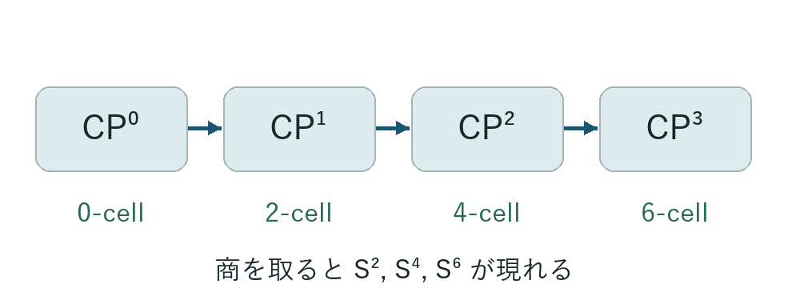

## 球面にあった整数を、どこで測るか

球面では線束の違いを一つの整数で測れた。球面が二つ一点で繋がった空間では、片方に一回転を置く貼り方と、もう片方に一回転を置く貼り方がある。両方の数を足せばどちらも同じになるが、どちらの球面に制限するかで区別できる。整数を一つに集める前に、どこで測った数かを記録したい。

**コホモロジー**は、空間の部分や向きと両立する測定量を保存する。チェインとコチェインの最小の例で記号を定めよう。三角形分割では、向き付きの辺や三角形の形式和をチェインと呼ぶ。境界 $\partial$ は向き付き面を符号付きで足す。三角形 $[012]$ なら $\partial[012]=[12]-[02]+[01]$。頂点でさらに境界を取ると全項が相殺する。したがって $\partial^2=0$ である。

$p$ 次コチェインは、$p$ 次チェインに線形に数を割り当てる。写像 $d$ を $(d\varphi)(c)=\varphi(\partial c)$ と定めると $d^2=0$。$d\varphi=0$ の測定は境界の上で消える。別のコチェインの $d$ である測定は、境界がゼロのチェインの上で消える。そこで

$$
H^p(X;R)=\ker d_p/\operatorname{im}d_{p-1}
$$ {#eq-04-orig-01}

を作る。$R$ はここでは $\mathbb Z$ または $\mathbb Q$ である。一般の空間では三角形を空間への連続写像とする特異コチェインが使え、CW複体ではセルに基づく計算でも同じ群を得る。この一致と、後で使う対の完全列は基礎事実として用いる。

円を一点と一本の閉じた辺で作ると、辺の端は同じ頂点で境界はゼロ。頂点の測定と辺の測定がそれぞれ $H^0(S^1;\mathbb Z)=\mathbb Z$、$H^1(S^1;\mathbb Z)=\mathbb Z$ となる。円板をこの輪に沿って貼れば、辺の測定は円板の境界で値を持つので、閉コチェインの条件を満たさなくなる。セルの貼り方が $d$ に入っている。

コホモロジー類の積は**カップ積**と呼ばれ、$H^p$ と $H^q$ から $H^{p+q}$ を作る。単体の前半と後半に二つの測定を割り当てて掛ける操作から定義できる。微分形式で表せる係数では、積は微分形式の外積に対応する。閉じた向き付き $d$ 次元多様体には向きと両立する基本チェインの類 $[X]$ があり、$H^d$ の類をこの上で評価することを $\int_X$ と書く。積の一方が超過次数なら評価に寄与しない。本書の積分記号は、代表を微分形式に選ぶ場合には通常の積分としても読める。

## 特性類の次数と、線束へ分けて読む方法

第一Chern数を曲面上で測る前の量が $c_1(L)\in H^2(X;\mathbb Z)$ である。絶対値では回る向きが失われるため、零点に局所の符号を付けて測る。双対線束では遷移関数が逆数になるので $c_1(L^*)=-c_1(L)$。二つの線束のテンソル積では $c_1$ を足す。これらは線束を分類する普遍空間 $\mathbb CP^\infty$ での生成元から従う。ここではChern類の存在、その引き戻しに関する自然性、および次の規則を借りる。

階数 $r$ の束には $c_i(E)\in H^{2i}(X;\mathbb Z)$ があり、$i>r$ では $0$。全Chern類 $c(E)=1+c_1(E)+\cdots+c_r(E)$ は

$$
c(E\oplus F)=c(E)c(F)
$$ {#eq-04-orig-02}

を満たす。線束 $L$ では $c(L)=1+c_1(L)$。特に $c_1$ は直和に対して足し算、$c_2$ には交差項が出る。$L_1,L_2$ の第一Chern類を $x,y$ とすれば $c_1(L_1\oplus L_2)=x+y$、$c_2(L_1\oplus L_2)=xy$ である。後者は四次元の測定で、球面上では消える。

平面が一点ごとには二本の線に分かれるのに、その分解が底全体で取れないことがある。そこで**分裂原理**を用いる。束 $E$ の各ファイバーで線を一つ選ぶ空間 $\mathbb P(E)$ を作ると、引き戻した束には選んだ線が部分束として入る。計量で補束を取り、その補束に同じ操作を繰り返す。こうして得る旗束上では、引き戻した $E$ は線束の直和になる。旗束とは、各点で入れ子になった部分空間の列を選ぶ空間である。

この操作を等式の検証に使うには、引き戻しで情報が消えないことが必要である。ここでは通常のコホモロジーの射影束定理を借りる。$\mathbb P(E)\to X$ のファイバーは $\mathbb CP^{r-1}$ で、選んだ線の双対の第一Chern類 $t$ の各べき $1,t,\ldots,t^{r-1}$ がファイバーのコホモロジーの基底になる。射影束定理は、このべきが $H^*(X)$ 上の自由加群の基底にもなり、引き戻しが単射だと述べる。繰り返せば旗束でも単射になる。単射性だけを使うので、元の空間の上で線束に分かれるとは仮定しない。

線束へ分けたときの $x_1,\ldots,x_r$ をChern根と呼ぶ。元の空間で意味を持つのは対称式である。例えば $c_1=\sum x_j$、$c_2=\sum_{i<j}x_ix_j$。以下では計算を分裂後に行い、両辺が元の空間の類であれば単射性で戻す。

## Chern指標を作る

束の差に測定量を対応させたい。全Chern類をそのまま引いてみると、直和の式には $xy$ が現れ、差の作り方と噛み合わない。全Chern類の商 $c(E)/c(F)$ を使えば仮想束にも定義できるが、その場合は直和に対応する演算が積になる。第3章の外積や第6章の指数式には、直和で足せてテンソル積で掛けられる量が欲しい。

線束のテンソル積では第一Chern類を足すから、$f(x+y)=f(x)f(y)$ となる形式級数を選べば積を保てる。$f(0)=1$ と規格化し、一次項を $x$ にすると、$y$ で形式微分して $y=0$ と置くと $f'(x)=f(x)$。係数を比較すると $1/n!$ が順に出てくる。従って自然な候補は指数関数である。

**Chern指標**を

$$
\operatorname{ch}(E)=\sum_{j=1}^r e^{x_j}
$$ {#eq-04-orig-03}

と定義する。有限次元の底では高い次数の項が消えるので有限和になる。各斉次部分は対称式であり、Chern類の有理係数多項式として定義できる。初めの項を

$$
\operatorname{ch}(E)
 =r+c_1+\tfrac12(c_1^2-2c_2)+\cdots
$$ {#eq-04-orig-04}

と書く。$x_i^2$ を足した和は $(\sum x_i)^2-2\sum_{i<j}x_ix_j$ なので係数を確認できる。

直和では根を並べるので $\operatorname{ch}$ を足す。テンソル積では $x_i+y_j$ が根になり、指数関数の積の規則で $\operatorname{ch}$ 同士を掛ける。第2章の普遍性から束の差へ延長できる。球面では $h=c_1(L^*)$ で $h^2=0$、$\int h=1$。

従って $\operatorname{ch}([L]-1)=-h$。階数とChern指標を併用するだけで、球面の全ての差が読める。

**比較の計算。** 球面上で $\mathbf1^2$、$L\oplus\mathbf1$、$L\oplus L^*$ を並べる。全て階数は $2$。第一Chern数はそれぞれ $0,-1,0$。Chern指標は $2,2-h,2$。最後の束が最初の束と同型になることは第1章で直接示した。球面で区別できる物差しを、次に別の底でも同じように試す。

## 射影空間を一枚ずつ作る

$\mathbb CP^n$ は $\mathbb C^{n+1}$ 内の複素直線の空間である。最後の斉次座標がゼロの超平面は $\mathbb CP^{n-1}$、それ以外は最後の座標を $1$ にして $\mathbb C^n$。閉単位球 $D^{2n}\subset\mathbb C^n$ の点 $v$ を

$$
v\longmapsto[v:\sqrt{1-|v|^2}]
$$ {#eq-04-orig-05}

へ送ると、内部はこの座標域へ同相に写り、境界は $\mathbb CP^{n-1}$ へ送られる。従って商 $\mathbb CP^n/\mathbb CP^{n-1}$ は $S^{2n}$。帰納すると、各偶数次元にちょうど一枚ずつセルがある。隣り合う次元の間の差分はゼロで、$H^{2j}(\mathbb CP^n;\mathbb Z)=\mathbb Z$ が $0\le j\le n$ に並ぶ。奇数次元の群はゼロである。

$L$ は各直線そのものを載せる線束、$h=c_1(L^*)$。座標の一つを読む線形汎関数を、各直線へ制限すると $L^*$ の切断になる。その零点が超平面であり、零点の横方向は複素向きを持つ。異なる座標を使った超平面を $j$ 個交差させると $\mathbb CP^{n-j}$。この零点の交差がカップ積による積を与えるというEuler類の規則を使うと、$h^j$ は標準の $\mathbb CP^j$ 上で $1$ を取る。実際、そこで一般位置の $j$ 個の超平面を交差させると、正の符号を持つ一点になる。よって

$$
H^*(\mathbb CP^n;\mathbb Z)
 =\mathbb Z[h]/(h^{n+1}).
$$ {#eq-04-orig-06}

複素射影空間は偶数次元セルを一枚ずつ加えて作る。商に潰したときの球面が相対K群の生成元を与える。 @fig-04-skeleton で対応を確認できる。

{#fig-04-skeleton}

## K群の核と環の関係を別々に決める

$\mu=[L]-1$ と置く。同じセル分解に、対のK理論の完全列を適用する。球面の縮約群を第3章で計算したので、$KU^1(\mathbb CP^0)=0$ から帰納的に $KU^1(\mathbb CP^n)=0$。偶数側では次が短完全列になる。

$$
\begin{aligned}
0&\to \widetilde{KU}^0(S^{2n})\\
 &\to KU^0(\mathbb CP^n)\\
 &\to KU^0(\mathbb CP^{n-1})\to0 .
\end{aligned}
$$ {#eq-04-orig-07}

これで新しい核は $\mathbb Z$ と分かる。ただし $\mu^n$ が核の整数生成元なのか、何倍かはこの列だけからはまだ分からない。

まず帰納法で $\mu^n$ は下の $\mathbb CP^{n-1}$ 上でゼロと分かる。$\operatorname{ch}(\mu)=e^{-h}-1$ の最低次数は $-h$ なので、$\operatorname{ch}(\mu^n)=h^n(-1)^n$。

一方、核の生成元は球面の $\beta$ の外積を潰し写像で引き戻したもの。$S^2$ で $\operatorname{ch}(\beta)=h$ なので、外積で $S^{2n}$ の最上次元の評価は $1$。向きに揃えて潰し写像で引き戻すと $h^n$ である。核が無限巡回だと先に完全列で示したから、その中での係数は $(-1)^n$ と決まり、$\mu^n$ 自身も整数生成元になる。

帰納的に $1,\mu,\ldots,\mu^n$ が加法基底になる。積の関係を求めるには、$\mu^{n+1}$ も下でゼロであり、$\operatorname{ch}(\mu^{n+1})=0$ だから、先の無限巡回の核の中でゼロと分かる。従って

$$
KU^0(\mathbb CP^n)=\mathbb Z[\mu]/(\mu^{n+1}),
\qquad KU^1(\mathbb CP^n)=0.
$$ {#eq-04-orig-08}

低次の例 $\mathbb CP^2$ では、$\operatorname{ch}(\mu)=-h+\tfrac12h^2$、$\operatorname{ch}(\mu^2)=h^2$。この計算は「最上次を有理数で測る」ことを使うが、整数の格子の大きさは球面の生成元が $1$ を取ることから決めた。

## 球面の積で、第一Chern類の次に何が見えるか

$X=S^2\times S^2$ とし、$h_1,h_2$ をそれぞれ第一因子、第二因子の $h$ の引き戻しとする。$h_1^2=h_2^2=0$ だが $h_1h_2$ は二つの向きの積の上で $1$ を取る。例えば第1因子の一点を通る面と第2因子の一点を通る面は、一点で横断的に交わる。従って $H^4(X;\mathbb Z)$ で $h_1h_2$ は生成元である。

二つのトートロジー線束の引き戻しを $L_1,L_2$ とする。次の二つの階数2の束を比べよう。

$$
E=L_1\oplus L_2,\qquad
F=(L_1\otimes L_2)\oplus\mathbf1 .
$$ {#eq-04-orig-09}

どちらも第一Chern類は $-h_1-h_2$。しかし $c_2(E)=h_1h_2$、$c_2(F)=0$。第3章では球面上で階数と行列式が束を分類したが、ここでは同じ行列式でも四次の測定が差を残す。$[F]-[E]=([L_1]-1)([L_2]-1)$ であり、これは第3章の $b\boxtimes b$ に当たる。

Chern指標でも照合する。$\operatorname{ch}(E)=2-h_1-h_2$。$\operatorname{ch}(F)=1+\exp(-h_1-h_2)$ だから、二次の指数級数の項から $h_1h_2$ が一つ出る。よって $\operatorname{ch}([F]-[E])=h_1h_2$。第一Chern類の計算には出なかった積が、Chern指標の四次成分では見えている。球面の第一Chern数から、次の次数へ進む必要が出た具体例である。

### 同じ束から数を取り出す練習

$E=L_1\oplus L_2$ を、対角球面と二つの座標球面のそれぞれへ制限せよ。対角では $L\oplus L$ なので第一Chern数 $-2$、一方の座標球面では $L\oplus\mathbf1$ なので $-1$。四次の $h_1h_2$ はどの球面でもゼロになる。これらの制限だけで比較すると $E$ と $F$ は区別できない。$S^2\times S^2$ の全体でしか取れない測定量を保存しておく理由である。

次に $E^*$ を考える。二本のChern根は $h_1,h_2$ になるので $c_1$ は符号が反転し、$c_2$ は同じ。$E\oplus E^*$ の第一Chern類はゼロ、第二Chern類は

$$
2h_1h_2-(h_1+h_2)^2=0.
$$ {#eq-04-orig-10}

実際に $L_1\oplus L_1^*$ と $L_2\oplus L_2^*$ のそれぞれが、球面での自明束の引き戻しなので、全体も自明束である。Chern類での相殺と束の直接の計算が一致する。

## 仮想束の全Chern類を割ってみる

$X=\mathbb CP^2$ とし、$\mu=[L]-1$ を用いる。$c(\mu)=1-h$ で、$-\mu$ では $c(-\mu)=(1-h)^{-1}=1+h+h^2$。仮想束の第二Chern類は、正の階数を持つ線束の「階数を超えた類はゼロ」という規則をそのまま使うと誤る。仮想束では差を商にしたため、逆数の展開で高次の項が出た。

$\mu^2=[L^2]-2[L]+1$ では

$$
c(\mu^2)=\frac{1-2h}{(1-h)^2}=1-h^2 .
$$ {#eq-04-orig-11}

分母は $1-2h+h^2$、$h^3=0$ として展開するとこの答えになる。第一Chern類はゼロで第二Chern類は $-h^2$。従って $\operatorname{ch}(\mu^2)$ の四次成分 $-c_2$ は $h^2$ で、指数関数を掛けて出した値と一致する。束の差と積を使って作った元に、全Chern類とChern指標が別の演算で対応していることを確認できる。

## CP² の整数格子を手で読む

一つの元を $a+b\mu+c\mu^2$ として、Chern指標で $(r,x,y)$、つまり $r+xh+yh^2$ と測る。

$$
r=a,\qquad x=-b,\qquad y=b/2+c .
$$ {#eq-04-orig-12}

例えば $1-h$ だけを希望しても $x=-1$ に対して $b=1$、$y=0$ に対して $c=-1/2$ となるので、整数のK群からは来ない。有理化したK群からは来る。$1-h+h^2/2$ なら $c=0$ で $[L]$ に当たる。この差は、ねじれがなくてもChern指標で見える整数格子が普通の整係数コホモロジーの格子と一致しないことを示す。ねじれが「核に入る」という問題と、格子の「像が違う」という問題を分けて考える。

### 逆数と負のべきを切り捨てる

$[L]=1+\mu$ は線束なので環で可逆。$\mu^3=0$ により $[L]^{-1}=1-\mu+\mu^2$ になる。実際、積を取れば残るのは $1+\mu^3=1$ である。また

$$
[L]^{-2}=1-2\mu+3\mu^2 .
$$ {#eq-04-orig-13}

従って $1-[L]^{-2}=2\mu-3\mu^2$。次章でこの元が円板束から円周束へ渡る際に現れる。その生成するイデアルを考えるとき、$2\mu+\mu^2$ との違いは単元倍なので、整数係数の関係は同じである。両方の係数が偶数とは限らないことが、位数4の計算で重要になる。

### CP³ まで一段増やす

$\mathbb CP^3$ では加法基底に $\mu^3$ を一つ追加し、$\mu^4=0$。Chern指標は

$$
\begin{aligned}
\operatorname{ch}(\mu)&=-h+\tfrac12h^2-\tfrac16h^3,\\
\operatorname{ch}(\mu^2)&=h^2-h^3,\\
\operatorname{ch}(\mu^3)&=-h^3.
\end{aligned}
$$ {#eq-04-orig-14}

まず $\mathbb CP^2$ に制限して $a,b,c$ を決め、残った最上次の $h^3$ の係数から $\mu^3$ の整数倍を読む。途中の分数は、最上次の核を決定した後で補正される。第4章の帰納法は、このように下の次元で決めた係数を保ちながら、一つずつ最上次を足す手続きである。

## 有理化で消えるものを予測する

一般の有限CW複体ではChern指標が

$$
KU^0(X)\otimes\mathbb Q
 \cong \bigoplus_j H^{2j}(X;\mathbb Q)
$$ {#eq-04-orig-15}

を与える。奇数側は懸垂とコホモロジーの次数の一つずれを使う。証明はセルを付ける帰納法である。相対群のChern指標は商空間上の縮約指標として定め、懸垂で奇数側にも定める。接続写像は円錐と商の写像から得られるので可換になる。Bottで二回ずらすとき $\operatorname{ch}(\beta)$ は普通のコホモロジーの懸垂の生成元であり、二つの周期化が整合する。各相対項は球面の直和で、偶数球面で最上次が $1$、奇数球面は一回懸垂して同じ計算になる。二つの完全列を比較して短い図式追跡をすると、空間全体の中央の写像も同型になる。

## 有理同型の図式を手で追う

セルを付ける完全列で、左から相対項、全体、既存の部分が並ぶ。全体の偶数群を示すには、そのすぐ右にある相対の奇数群と、左にある既存部分の奇数群も使う。偶数群だけを三つ並べて比較するのは、$\mathbb CP^n$ のように奇数項が消える場合に限って十分である。一般のセル付けではどちらの接続写像も残す。

例えば $X$ が一点に $S^1$ のセルを足した円周なら、$KU^0$ に階数以外は増えない。$KU^1$ には一回懸垂することで球面の生成元が現れる。普通のコホモロジーでも $H^1(S^1)$ に閉じた辺の測定が残る。懸垂で $H^2(S^2)$ へ送れば同じ規格化で $1$ になる。相対の球面でのChern指標が同型という主張には、この奇数側の計算も入っている。

係数を $\mathbb Q$ に移すと完全性が保たれる理由は、分母を共通にできるからである。例えば有理化した写像で $a/d$ が核に入れば、元の群の像 $f(a)$ はある非零整数倍でゼロになる。すると $m a/(m d)$ と書き直すことで、分子を元の核の元にできる。元の核は左からの像なので、分数も左から来る。これにより整数の完全列で行った持ち上げの議論を有理係数でも使える。

セルの数を増やす手順では、有限性が二か所で効く。Chern指標の級数が次数で打ち切られ、セルを付ける帰納法も有限回で済む。有限CW複体の範囲であれば、$KU^0$ は長完全列に沿って有限生成群になる。その有理化で消えるものは正確にねじれ部分であり、Chern指標の核もそれに一致する。

## 整係数のねじれが有理化で消える仕組みを、小さい鎖で見る

ここで一度、群の計算だけを取り出す。円周に円板を貼るとき、境界が円周を $d$ 回まわるようにする。頂点が一つ、1セルと2セルが一つずつあるので、セルのチェイン複体で2セルから1セルへの境界は $d$ 倍、1セルから頂点への境界はゼロである。コチェインの向きにすると、1次から2次への $d$ 倍になる。

$d=2$ なら、2次コチェインはすべて閉じているが、1次コチェインの差分として出るのは偶数だけ。従って $H^2$ は $\mathbb Z/2$ になる。代表として $1$ と $-1$ は同じ類、$2$ はゼロ。係数を $\mathbb Q$ に移せば、1次コチェインに $1/2$ を選んで差分を取れるので、2次の $1$ さえもゼロになる。ここでは同じ貼り方で、係数を変えただけで計算の答えが変わった。

$d=0$ なら境界写像がゼロなので、$H^2$ は $\mathbb Z$、有理化しても $\mathbb Q$ が残る。$d=1$ なら初めから差分で全てが得られる。Chern指標である値がゼロだと分かったとき、整数の元がすでにゼロだったのか、$d=2$ のようにねじれが消えたのかは、追加の整数計算が必要になる。次章で円周束の完全列の矢印を明示するのはこのためである。

## 一つのChern数へ潰す前に、どの面で測ったかを残す

二つの球面の積 $X=S^2\times S^2$ で、$L_1,L_2$ を各因子のトートロジー線束の引き戻しとする。$M=L_1^{\otimes a}\otimes L_2^{\otimes b}$ の第一Chern類は $-a h_1-b h_2$。この二成分を第一因子、第二因子の座標球面へ制限すると別々に測れる。

しかし対角球面だけに制限すれば、$h_1,h_2$ はどちらも同じ $h$ になる。従って値は $-(a+b)$。例えば $(a,b)=(1,0)$ と $(0,1)$ は対角球面で区別できない。逆に二つの座標球面で同じ階数と第一Chern数を持っても、第4章で比較した階数2の束のように、四次の情報が違う場合がある。

次の式は、対角へ戻したことで何が起きたかを明示する。

$$
(h_1h_2)|_{\Delta S^2}=h^2=0,
\qquad
\int_X h_1h_2=1.
$$ {#eq-04-diagonal-obstruction}

積がゼロかどうかの答えは、比較する部分空間を指定しないと決まらない。 @eq-04-diagonal-obstruction では、一つずつの座標の測定値を組み合わせて初めて四次の情報が現れた。

## 次数6から第三Chern類を復元する

Chern指標の次数6成分は、第三Chern類を直接与えるわけではない。根を $x_i$ として $p_j=\sum_i x_i^j$ と書くと、根の多項式から $p_2=c_1^2-2c_2$ を得る。同じ計算をもう一段進めると、各根は自身を含む積 $\prod_i(t-x_i)$ を零にするから、Newtonの恒等式により次を得る。

$$
6\operatorname{ch}_3=p_3=c_1p_2-c_2p_1+3c_3
=c_1^3-3c_1c_2+3c_3.
$$ {#eq-04-newton-degree-six}

この恒等式は仮想束にも使える。引く束の各根 $y_j$ を使えば、全Chern類の生成級数は $\prod_i(1+x_i t)\prod_j(1+y_jt)^{-1}$ である。その対数微分の $t^{k-1}$ の係数は $(-1)^{k-1}(\sum_i x_i^k-\sum_j y_j^k)$ になる。したがって形式的級数の係数比較だけで同じNewtonの恒等式が従う。

例えば $\mathbb CP^3$ 上で $a=\mu^2+\mu^3$ を取る。$\mu^2$ の指標は $h^2-h^3$、$\mu^3$ の指標は $-h^3$ なので、$a$ の第一Chern類は零、第二Chern類は $-h^2$ である。その条件下では @eq-04-newton-degree-six は $c_3=2\operatorname{ch}_3$ になる。

$$
\operatorname{ch}(a)=h^2-2h^3,\qquad
(c_1,c_2,c_3)(a)=(0,-h^2,-4h^3).
$$ {#eq-04-virtual-third}

一方、$a'=\mu^2-\mu^3$ へ替えると次数6の二項が相殺する。両者は $\mathbb CP^2$ 上では一致し、$\mathbb CP^3$ では $c_3$ が異なる。$\mathbb CP^3$ に対する最上次Chern指標の整合条件は第18章で指数の整数性から再計算する。

### 次の章で、同じ測り方の係数を変える

$\mathbb CP^2$ では $h^2$ は無限位数なので、$h^2$ を有理化しても残る。一方このあと扱う実射影5空間では、対応する四次元の類は位数2になる。もし同じ式を有理係数に送れば、その四次の類もゼロになる。従って二段階を区別する必要がある。まず空間を変えたことでどの整数関係が生まれたか。次いで、その関係を持つ元を有理化すると何が消えるか。第5章の完全列は最初の段階を担当する。

有理数係数のベクトル空間では $m v=0$ と $m\ne0$ から $v=0$ が従う。したがって整数のK群の元で、有限回足してゼロになるものは全てChern指標で消える。このような元を**ねじれ**と呼ぶ。射影空間の今回の計算は自由群なので、そこで消える非零元はない。次章では $\mathbb CP^2$ の上に載る円周を全て集め、新しい空間を作る。

そこでは $\mu$ が消えずに位数 $4$ になる。
