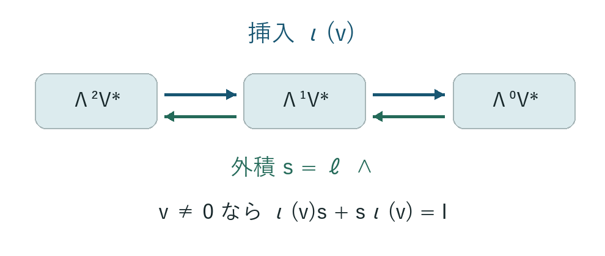
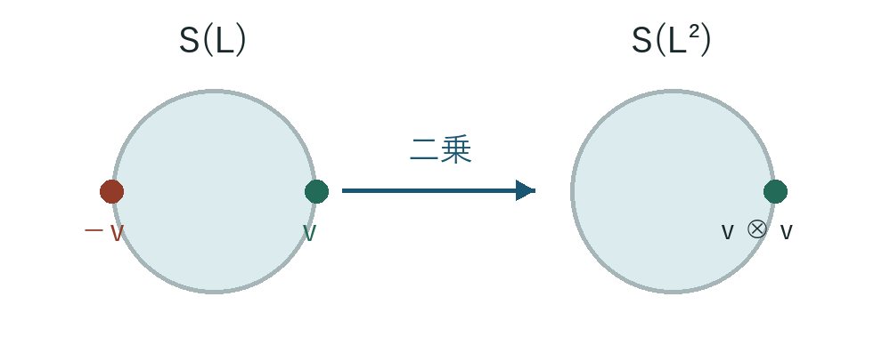

::: {.ku-chapter}
**章の導入**　繊維の各円板に同じ局所模型を置き、中心にだけ障害が残るようにする。その操作をKoszul複体で組み立て、円周束のK類を整数の関係から求める。
:::

## 円板の中心を、束の全ての点に置く

**導入。** 底の各点に複素ベクトル空間を置き、中心だけで式が退化する模型を考える。

第2章では、一枚の円板の境界での回転が、円板全体の束の差には見えないことを確認した。底 $X$ の各点に円板が載っていて、その円板の座標自体も貼り合わされるとしよう。一つの円板に置いた回転の計算を、座標が変わっても矛盾なく全体に置くにはどうしたらよいか。

複素束 $V\to X$ にHermite計量を選び、ファイバーごとのノルムが $1$ 以下の部分を $D(V)$、ちょうど $1$ の部分を $S(V)$ と書く。商 $D(V)/S(V)$ は、全ての境界を一点へ潰した**Thom空間**である。$X$ がコンパクトなら、$V$ の全空間の一点コンパクト化とも一致する。例えば各ファイバーの内部へ $v\mapsto v/(1+|v|)$ で写すと、どこまでも遠い点は境界の一点へ近づく。$KU^0_c(V)=KU^0(D(V),S(V))$ で、添字 $c$ はコンパクト台を表す。ここでは相対類が、中心から離れたところで二束が同型になるという情報を持つ。

全空間を単に $X$ まで縮めて $KU^0(V)$ だけを見ても、ファイバーの中心の周りに置いた貼り方が消える。$X$ が一点、$V=\mathbb C$ とすれば、絶対群では階数しか残らないが、相対群は $\widetilde{KU}^0(S^2)=\mathbb Z$ である。欲しいのはこの一つの生成元を自然に各点に置く方法である。

::: {.ku-summary}
**まとめ**　円板の内部で残る差を、球面境界で可逆なデータとして記録する。
:::

## Koszul複体を手で作る

**導入。** ベクトルを外積に挿入し、中心以外で逆写像を探す。

$\pi:V\to X$ を射影とする。点 $v\in V_x$ の上のファイバーに $\Lambda^j V_x^*$ を置く。外積代数 $\Lambda^j V_x^*$ は、$j$ 個のベクトルに対し交代的で多重線形な複素値関数の空間である。$v$ を最初の引数へ挿入する作用 $\iota_v$ を使うと

$$
\Lambda^j V_x^*
 \xrightarrow{\;\iota_v\;}
\Lambda^{j-1}V_x^*
$$ {#eq-05-orig-01}

になる。二度挿入すると同じベクトルが二つ入るので $\iota_v^2=0$。こうして得る有限の列を**Koszul複体**と呼ぶ。$v=0$ では全ての矢印がゼロである。

$v\ne0$ なら $\ell(v)=1$ を満たす線形汎関数 $\ell$ を選べる。$\ell\wedge(-)$ を $s$ と置くと、交代性と展開の規則から

$$
\iota_v s+s\iota_v=1.
$$ {#eq-05-orig-02}

従って $\iota_v\omega=0$ なら $\omega=\iota_v(s\omega)$。各次数で核が一つ上の像に一致する。この式は、ファイバーの座標の選び直しと両立する。例えば計量を用いて、$v^\flat(u)=\langle u,v\rangle$ を $u$ に複素線形とする約束にすれば $\ell=v^\flat/|v|^2$ が使える。

偶数次数と奇数次数をそれぞれまとめ $E^+=\pi^*\Lambda^{\mathrm{ev}}V^*$、$E^-=\pi^*\Lambda^{\mathrm{odd}}V^*$ とする。$D_v=\iota_v+\iota_v^*$ はパリティを変える。ここで $\iota_v^*$ は $v^\flat$ を外積する作用なので

$$
D_v^2=|v|^2 I .
$$ {#eq-05-orig-03}

この二乗を求めるには、同じ作用を二度掛ける二項はゼロで、交差する二項だけが残ることを使う。$v\ne0$ で $D_v$ は可逆、逆は $|v|^{-2}D_v$ である。境界で $D_v:E^+\to E^-$ を同型にした三つ組が $u_K(V)\in KU^0_c(V)$ を与える。これを**複素K理論のThom類**と呼ぶ。

階数 $1$ のファイバーでは、偶数側は $\mathbb C$、奇数側はその双対。座標 $v=z$ で偶数から奇数へ渡る成分は、挿入の随伴なので $\bar z$ を掛ける。第2章の北から南への三つ組の規約で、$\bar z$ は $\beta$ に対応する。$z$ を使うと符号が反転する。階数 $2$ で $V$ が二本の線の直和なら、偶数側は $1$ と二つの双対線のテンソル積、奇数側は双対線二本の直和である。行列が何に作用しているかは、これだけで次数まで追える。

挿入を右向き、外積を左向きに描いた。二通りの往復の和が恒等写像になる。 @fig-05-koszul で対応を確認できる。

{#fig-05-koszul width="76%"}

::: {.ku-summary}
**まとめ**　挿入と外積の反交換子から可逆性が従い、境界の相対類ができる。
:::

## 零切断に戻すと何が残るか

**導入。** 中心へ戻ると微分が零になるとき、仮想束に何が残るかを見る。

零切断 $s:X\to V$ は $x$ をゼロベクトルに送る写像である。そこへ相対類を制限すると、境界同型の情報がなくなり、偶数側と奇数側の差が残る。従って

$$
\begin{aligned}
s^*u_K(V)&=\lambda_{-1}(V^*)\\
         &:=\sum_j(-1)^j[\Lambda^jV^*].
\end{aligned}
$$ {#eq-05-orig-04}

線束 $V$ では $1-[V^*]$。たとえば自明線束ならこの絶対類はゼロだが、ファイバー上の相対類は依然として生成元である。零切断への制限と相対類そのものを混同すると、ここでBott元まで消してしまう。

直和のThom類は二つのThom類の積になる。外積代数の同型 $\Lambda^*(V\oplus W)^*\cong\Lambda^*V^*\otimes\Lambda^*W^*$ のもとで、$D_{(v,w)}$ は第1成分の $D_v$ と、第1成分の偶奇符号を伴う第2成分の $D_w$ の和になる。符号があるので交差項が相殺し、二乗は $|v|^2+|w|^2$。相対積は二つの複体をテンソル積にしたものなので、この同型は境界の可逆性も保つ。特に $\mathbb C^r$ の上では $r$ 個のBott元の外積を得る。計量を変えると正定値計量を結ぶ線形補間があり、同じ相対類になる。

::: {.ku-summary}
**まとめ**　偶数と奇数の外積べきの差がK理論のEuler類になる。
:::

## Thom同型をセルに沿って証明する

**導入。** 各セルでは束が自明になるので、そこで知られているBott同型から始める。

::: {.ku-theorem}
**定理｜複素束のThom同型**

有限CW複体 $X$ 上の複素束 $V$ では、零切断から繊維の方向へ引き戻してKoszul類を掛けると、$KU^j(X)$ と $KU^j(D(V),S(V))$ が同型になる。右辺には円板の境界での自明化が含まれる。その情報を忘れると、右辺を作ったときの同型を保持できない。
:::

計算したThom類による積を

$$
T_V(a)=\pi^*a\cdot u_K(V)
$$ {#eq-05-orig-05}

と定める。結論は、有限CW複体 $X$ 上の複素束に対して $T_V:KU^i(X)\to KU^i_c(V)$ が同型となること。ファイバー方向の実次元は $2r$ である。次数を整数で表す規約では複素向きの積は $2r$ のずれを持ち、ここではBottの周期でそれを同じ偶奇の次数へ戻している。

$X$ の低次元セルをまとめた部分を $A$ とし、次に $d$ 次元セルを付ける。相対項においては、底の $A$ と円板束の境界を潰した商を使う。特徴写像 $D^d\to X$ に束を引き戻すと円板上なので自明であり、その境界の上のデータは $A$ とともに潰れる。従って一つのセルの寄与は

$$
\frac{D^d\times D^{2r}}
 {(\partial D^d\times D^{2r})\cup(D^d\times S^{2r-1})}
 \cong S^d\wedge S^{2r}.
$$ {#eq-05-orig-06}

セルが複数あれば、各商を一点で合わせた空間になる。この商の上で $T_V$ は $\beta$ の $r$ 回の外積であり、第3章で同型と分かった。

底の対 $(X,A)$ の完全列と、円板束の対を使った完全列を比較する。後者は、まず $S(V)$ を潰し、その商で $A$ 上のThom空間を部分空間に取った対の列である。引き戻しとThom類の積はこれらの制限に両立し、円錐で作る接続写像とも両立する。実際、接続写像のために懸垂する因子と、相対積の $\beta$ の因子は別の座標であり、Thom類は偶数次数なので交換に符号は出ない。

完全列から同型を渡す操作を確認する。中央の元で、写した後にゼロになるものを取る。右隣が単射なら、その元は右への像がゼロなので左隣から持ち上がる。左隣での像が下段でさらに左から来ることを使い、左の二つの同型で元の持ち上げを修正するとゼロにできる。これが中央の単射性。

一方、下段中央の元を取り、右への像を上段右へ戻す。右のさらに隣でゼロになるため上段中央から持ち上がる。残った差は下段左から来るので、左の全射性でその差を埋められる。これが中央の全射性である。

一点からの出発では相対項と同じファイバーの計算になり、セルを付けるたびに相対項と既存の部分が同型なので、完全列で同型が全体に伝わる。これは足したセルごとのBott計算をつなぐ証明である。$V$ 全体の自明化を求める過程は出てこない。

::: {.ku-summary}
**まとめ**　相対完全列でセルの計算をつなぐと、底全体のThom同型が従う。
:::

## RP⁵ はどの円周束か

**導入。** 射影空間上の円周で、ベクトルを二乗すると何点が同じになるか数える。

$L=\mathcal O(-1)$ を $\mathbb CP^2$ 上のトートロジー線束とする。$S(L)$ の点は、直線 $\ell$ とその中の単位ベクトル $v$ の組。$\ell=\mathbb Cv$ で復元できるので $S(L)=S^5$。各ファイバーで $v\mapsto v\otimes v$ と写すと、$S(L^{\otimes2})$ へ写る。円周上の二乗写像なので、像は全体で、同じ像に行くのは $v,-v$ の二点である。従って

$$
S(L^{\otimes2})=S^5/\{\pm1\}\cong\mathbb RP^5 .
$$ {#eq-05-orig-07}

右端は $\mathbb R^6$ の原点を通る実直線の空間である。ここで使う束 $V=L^{\otimes2}$ は、$\mathbb CP^2$ 上で第一Chern類が $-2h$ の複素線束である。

一つの繊維における二対一写像。$v$ と $-v$ は同じ $v\otimes v$ に写る。 @fig-05-cover で対応を確認できる。

{#fig-05-cover width="76%"}

::: {.ku-summary}
**まとめ**　符号が反対の二点が一致し、円周束の全空間が実射影空間になる。
:::

## 円周束の完全列から、四つで消える元を読む {#rp5-calculation}

**導入。** 円板から円周へ制限する前に、零切断での掛け算を行列化する。

::: {.ku-worked}
**計算を追う｜$2\mu$ は消えるのか**

$[L]=1+\mu$ と置く。$L^{\otimes2}$ のEuler因子は単元倍を除いて $1-[L]^2$ なので、関係は $2\mu+\mu^2=0$ になる。これに $\mu$ を掛け、$\mu^3=0$ を使う。

$$
\begin{aligned}
(1+\mu)^2-1 &= 2\mu+\mu^2,\\
\mu(2\mu+\mu^2)&=2\mu^2+\mu^3=2\mu^2,\\
\mu^2&=-2\mu,\qquad 4\mu=0 .
\end{aligned}
$$

この段階では位数が4を割ることだけ分かった。関係行列の行列式の絶対値は4であり、商の縮約部分は $\mu$ 一個で生成される。ここで初めて二倍は非零といえる。第8章では $\mu^2$ を別の層としていったん取り出し、同じ関係で二層をつなぎ直す。
:::

$D(V)$ はファイバーの半径をゼロにすれば底へ変形収縮する。対 $(D(V),S(V))$ の完全列の最初の三項をThom同型で書き直すと

$$
\begin{aligned}
KU^0(X)&\xrightarrow{\;\lambda_{-1}(V^*)\;} KU^0(X)\\
       &\longrightarrow KU^0(S(V)).
\end{aligned}
$$ {#eq-05-orig-08}

最初の矢印はThom類を掛けてから境界同型を忘れ、零切断へ戻すため、$\lambda_{-1}(V^*)$ を掛ける写像になる。次の相対項 $KU^1(D(V),S(V))$ はThom同型で $KU^1(X)=0$ なので、制限は全射である。

$X=\mathbb CP^2$ の環は $\mathbb Z[\mu]/(\mu^3)$ で $[L]=1+\mu$。掛ける元は $1-[L]^{-2}$。これに単元 $-[L]^2$ を掛けると $1-[L]^2$ になるので、どちらの生成するイデアルでも同じ商になる。$[L]^2-1=2\mu+\mu^2$ だから

$$
KU^0(\mathbb RP^5)
 =\mathbb Z[\mu]/(\mu^3,\,2\mu+\mu^2).
$$ {#eq-05-orig-09}

商の中でも、引き戻した $\mu$ を同じ記号で書く。$\mu^2=-2\mu$ を $\mu$ 倍すると $0=-2\mu^2=4\mu$ となる。これだけでは位数が $4$ を割るとしか分からない。

位数を詰めるため、縮約部分を基底 $(\mu,\mu^2)$ の整数格子から作る。関係の列ベクトルは $(2,1)$ と $(0,2)$。これは $2\mu+\mu^2$ と、その $\mu$ 倍 $2\mu^2$ である。任意の剰余類は $\mu^2=-2\mu$ によって $\mu$ の倍数へ書き換えられる。もし $(a,0)=b(2,1)+c(0,2)$ なら、$a=2b$、$b+2c=0$、従って $a=-4c$。ゆえに $a=1,2$ では関係にならず、$\mu$ の位数は正確に $4$。加法群は $\mathbb Z\oplus\mathbb Z/4$ である。

同じ完全列の続きから $KU^1(\mathbb RP^5)$ は、$\mathbb CP^2$ の環における $2\mu+\mu^2$ 倍の核である。$a+b\mu+c\mu^2$ を掛けると $2a\mu+(a+2b)\mu^2$。整数係数では $a=b=0$ が必要十分で、核は $\mathbb Z\mu^2$。よって $KU^1(\mathbb RP^5)\cong\mathbb Z$。偶数側のねじれと、奇数側に残る自由な一成分は同じ完全列に現れる。

::: {.ku-summary}
**まとめ**　生成元の二倍が次の生成元に移り、その次で消えるため位数は4になる。
:::

## 同じ元を三つの物差しで測る

**導入。** 同じ有限位数の元に、第一・第二Chern類とChern指標をそれぞれ適用する。

普通の整係数コホモロジーにも、複素向きを持つ線束のThom同型がある。この場合の零切断への制限はEuler類 $c_1(V)$。円板束と円周束の完全列に入れると、偶数側では $-2h$ を掛けた像で割る。底の奇数群はゼロなので $H^2(\mathbb RP^5;\mathbb Z)=\mathbb Z/2$、$H^4(\mathbb RP^5;\mathbb Z)=\mathbb Z/2$ になり、それぞれ $h,h^2$ の引き戻しで生成される。層を一つずつ見ると位数 $2$ が二つである。K群では $\langle\mu^2\rangle\subset\langle\mu\rangle$ としてそれらに対応する二層があるが、$\mu^2=-2\mu$ により一つの位数 $4$ の群になっている。

$\mu$ の階数は $0$。第一Chern類は $-h$ の引き戻しなので非零だが、$2\mu$ の第一Chern類はゼロになる。全Chern類を仮想束へは商で延長すると、$c(2\mu)=(1-h)^2=1+h^2$。ここでは第一Chern類がゼロでも第二Chern類が残る。Chern指標は有理係数のため、$\operatorname{ch}(\mu)=\operatorname{ch}(2\mu)=0$。階数、第一Chern類、K群がどの同じ差にどんな答えを返したかを比べると、整数と有理数の選択が計算の結論を変えている。

::: {.ku-summary}
**まとめ**　整数Chern類には残る情報があり、有理指標は有限位数の部分を送らない。
:::

## Koszul の二次元モデルで可逆性を検算する

**導入。** 二次元の繊維では外積代数の次数が三つなので、作用を行列で書ける。

$V=\mathbb C^2$ の一つのファイバーを取り、双対の基底を $e^1,e^2$ とする。$v=(z_1,z_2)$ の挿入は $e^j$ を $z_j$ に送り、$e^1\wedge e^2$ を $z_1 e^2-z_2 e^1$ に送る。もう一度挿入すれば $z_1z_2-z_2z_1=0$。随伴の外積では $\bar z_1 e^1+\bar z_2 e^2$ を掛ける。偶数基底 $(1,e^1\wedge e^2)$、奇数基底 $(e^1,e^2)$ での行列は

$$
D_v^+=
\begin{pmatrix}
\bar z_1&-z_2\\
\bar z_2&z_1
\end{pmatrix}.
$$ {#eq-05-orig-10}

行列式は $|z_1|^2+|z_2|^2$。球面 $S^3$ に制限すると二列は直交し、行列式は $1$ である。$SU(2)$ という同じ群が第3章に現れたが、今回は球面 $S^3$ 全体が遷移の変数である。円周上の $SU(2)$ のループが縮む事実をここへ適用すると、境界次元を取り違える。

この三つ組は、二つの一次元Koszul複体のテンソル積でも作れる。第一因子が奇数次数のときに第二因子の矢印へ負号を付けると、二回連続して作用させた項が相殺する。実際に上の行列で $-z_2$ が出るのは、$e^2$ を通す順序が $e^1\wedge e^2$ の順序と反対になるためである。ランク1では見えなかった符号が、ランク2の時点で必要になる。

### なぜノルムだけで貼らないか

境界上の写像として $|v|I$ を使えば、中心から離れると可逆になる。しかし自明な二束でこれを使うと、境界では定数 $I$ に変形でき、相対類はゼロになる。$V=\mathbb C$ なら $v^\flat=\bar z$ の方も境界のノルムは $1$ だが、巻き数が $-1$。可逆性だけでは、Thom同型を与える**生成元**かどうかは判定できない。Koszulの奇偶と複素共役が、実際のファイバーの生成元を指定している。

::: {.ku-summary}
**まとめ**　行列の二乗は長さの二乗になり、原点の外での逆が明示できる。
:::

## Euler類に落とした計算と、Thom同型を分ける

**導入。** 零切断に制限した結果と、境界付きの空間全体に置く類の役割を整理する。

$V$ を $\mathbb CP^1$ 上の $L$ とする。零切断上で $u_K(L)$ は $1-[L]^{-1}=\mu$ で、$\mu^2=0$。従って零切断への制限は $a+b\mu\mapsto a\mu$、特に $\mu$ を掛けて作った相対類は零切断では消える。一方Thom同型のもとでは、その相対類自体はゼロにならない。零切断の引き戻しと円板束から境界への制限が、完全列の別々の情報を読んでいると分かる。

$S(L)$ の点は単位ベクトル一つで決まり、$\mathbb CP^1$ 上では $S(L)=S^3$。先の掛け算の余核は $\mathbb Z$、核は $\mathbb Z\mu$。よって $KU^0(S^3)=\mathbb Z$、$KU^1(S^3)=\mathbb Z$。第3章の球面の計算と一致する。ここでThom類の符号を反転すると最初の矢印の符号は変わるが、核と像の部分群は同じ。円周束の群だけを検算しても、Thom元の正の規格化は判別できない。

### 円周束の上で線束の二乗を自明化する

$S(V)$ の各点は、$x\in X$ と単位ベクトル $v\in V_x$ の組である。引き戻した $V$ の上で、各 $(x,v)$ に $v$ 自身を選ぶとゼロを避ける切断になる。従って $V$ が線束なら引き戻した線束は自明。$V=L^2$ の場合は $[L]^2-1=0$ が得られる。完全列を使った計算は、このすぐに見える関係に加え、整数の環に他の独立な関係がないことを保証する。

元の $L$ に対しては二乗根 $v$ の選択が必要である。$L^{\otimes2}$ の単位ベクトルには符号の異なる二つの根があり、そのどちらかを大域的かつ連続に選ぶことはできない。もし選べれば $S^5$ から $\mathbb RP^5$ への二重被覆は二つの大域切断に分かれ、被覆空間が非連結になる。

しかし $S^5$ は連結である。これは実単位ベクトルの選択に関する観察で、複素線束そのものの非自明性と位数4は、先のK理論で確かめた。

::: {.ku-summary}
**まとめ**　Euler類は制限の像を決める。元のThom類は空間の外への延長を担う。
:::

## 比較計算　同じ二乗写像を RP³ と RP⁷ で試す

**導入。** 底の射影空間の次元だけを動かし、同じ二乗を試す。

底を $\mathbb CP^1$ にすれば、$S(L^2)=\mathbb RP^3$ で $\mu^2=0$ が既に成り立つ。円周束から来る関係は $2\mu+\mu^2=0$、従って縮約群は $\mathbb Z/2$。一つ下の次元では、$\mu^2$ はそもそも現れないので、二回足した元を残す仕組みがない。$\mathbb RP^5$ で増えたセルは、その二回分を受け止める。

底を逆に $\mathbb CP^3$ にすれば $\mathbb RP^7$ になり、環は $\mathbb Z[\mu]/(\mu^4,2\mu+\mu^2)$。関係から $\mu^2=-2\mu$、$\mu^3=4\mu$、$\mu^4=-8\mu=0$。ここでもこれだけでは位数の上限しか分からない。縮約加群の基底 $(\mu,\mu^2,\mu^3)$ では関係が $(2,1,0),(0,2,1),(0,0,2)$。もし $a\mu$ が関係なら、最後の座標から真ん中へ順に代入すると $8$ が $a$ を割る。ゆえに位数は $8$ である。

これを任意の $n\ge1$ で確認する。$\mathbb RP^{2n+1}$ では $\mu^{n+1}=0$ と $\mu^2=-2\mu$ があり、よって $2^n\mu=0$。逆向きには、縮約加群から $\mathbb Z/2^n$ へ $\mu^j\mapsto(-2)^{j-1}$ と送る。$2\mu^j+\mu^{j+1}$ は全部ゼロに写り、最後の $2\mu^n$ もゼロに写る。$\mu$ は $1$ へ写るので位数は少なくとも $2^n$。

これで円周の二乗写像が同じでも、底の次元によってねじれの位数が変わる理由が分かる。

### ねじれの層を測り直す

$\mathbb RP^7$ で $4\mu=\mu^3$ は位数2の非零元である。線束の全Chern類を使うと、$c(4\mu)=(1-h)^4$。正次数では係数 $-4,6,-4$ がすべて偶数であり、$h,h^2,h^3$ はどれも位数2のため $c(4\mu)=1$。$\mathbb RP^5$ の $2\mu$ は $c_2$ で検出できたが、次の例では全Chern類でも区別できない。位数を確定したのはChern類の一覧ではなく、環の積とK群の完全列である。

::: {.ku-summary}
**まとめ**　セルを増やすと二倍の鎖が一段伸び、最高位数も増える。
:::

## 別の円周の貼り方を計算する　三乗の場合

**導入。** 二乗に替えて三乗を使うと、整数関係の係数が変わる。

$S(L^3)$ は $S^5$ を、三乗して $1$ になる複素数の作用で割った空間である。二乗の場合と同じ完全列で、縮約群の関係は $3\mu+3\mu^2=0$ と $3\mu^2=0$。前者から後者を引けば $3\mu=0$。従って縮約群は $\mathbb Z/3\oplus\mathbb Z/3$。二乗では $2\mu+\mu^2$ に奇数係数があったため、二層を独立に消すことができなかった。三乗では中間の係数が $3$ の倍数であり、同じ次元でも加法群は二つに分かれる。

いずれの例でも階数1を加える部分は共通の $\mathbb Z$。どちらの縮約部分も有理Chern指標の値はゼロである。二つの群がどちらも有理化で消えることから、位数や分裂の有無を逆算することはできない。どの係数をもつ関係が完全列から来たかが決め手である。

::: {.ku-summary}
**まとめ**　同じ位数の積でも不変因子が変わり、群の直和分解には関係全部が必要になる。
:::

## 第5章の計算を手順から組み立て直す

**導入。** 円周束を同定するところから商群を得るまでの手順を再確認する。

$V=L^2$ を使う前に、一般の $L^q$ を底 $\mathbb CP^2$ 上で調べる。ここで $q$ は正の整数。Thom同型が置き換えるのは $KU^0(D(V),S(V))$ の項であり、絶対群の $KU^0(D(V))$ は変形収縮で底に戻る。両方とも $\mathbb Z[\mu]/(\mu^3)$ と書けるが、同じ群に見えることから最初の矢印を恒等にしてはいけない。零切断が比較しているのは、境界同型付きのThom類から境界を忘れた後の束の差である。

単元倍を使うと、その矢印は $q\mu+\binom q2\mu^2$ 倍で計算できる。階数の列はゼロ。縮約部分に残る二つの関係は $(q,\binom q2)$ と $(0,q)$。$q$ が奇数なら $\binom q2$ は $q$ の倍数なので、後者の整数倍で前者の第2座標を消せる。この場合の縮約群は $\mathbb Z/q$ が二つ。$q$ が偶数なら $\binom q2$ を $q$ で割った余りは $q/2$。$q=2$ ではこれが $1$ になり、二つの層を連結した。

$q=4$ で実際に計算しよう。関係は $4\mu+6\mu^2=0$、$4\mu^2=0$。列操作で前者を $4\mu+2\mu^2$ に替える。$(\mu,\mu^2)$ の格子で $x=2\mu+\mu^2$、$y=\mu$ と置くと、変換の行列式は $\pm1$ なので整数基底である。関係は $2x=0$、$4x-8y=0$ になる。最初の関係の二倍を後者から引けば $8y=0$。従って縮約群は $\mathbb Z/2\oplus\mathbb Z/8$。元の関係行列の行列式の絶対値 $16$ は群の大きさに一致するが、それだけから現れる位数の内訳は決まらない。

この計算は、$q=2$ の非分裂を目で追う検算にもなる。$q$ と同じ係数が二層に現れても、中間の係数で加法群の構造が変わる。円周束の台空間を替えずに繊維の貼り方だけを変えたため、差がどの係数から生じたかを比較できる。

::: {.ku-summary}
**まとめ**　Thom同型、制限での掛け算、整数行列の三段で同じ答えを作れる。
:::

## Thom類のChern指標にTodd類が現れる

**導入。** 同じ繊維の向きをK理論と通常コホモロジーの両方で測る。

第6章では、K群で押し出す操作をコホモロジーで計算したい。その間に入る補正を、線束で先に求める。普通のコホモロジーのThom類を $u_H(V)$ とする。これはファイバー上で向きに対応する最上次数の生成元で、零切断への制限はEuler類。通常のThom同型は、$u_H(V)$ との積で底のコホモロジーと全空間のコンパクト台コホモロジーを同一視する。この同型を借りる。線束の $x=c_1(V)$ に対して

$$
s^*\operatorname{ch}(u_K(V))=1-e^{-x},
\qquad s^*u_H(V)=x.
$$ {#eq-05-orig-11}

従って補正候補は $(1-e^{-x})/x$。一般の底で $x$ を消去できるとは限らないので、線束を分類する $\mathbb CP^\infty$ の普遍線束で係数を決める。次数ごとに十分高い $\mathbb CP^N$ を使えば $x$ 倍の係数を読める。自然性により任意の線束で同じ級数が得られる。

直和ではThom類が積になり、分裂原理で根ごとの式を掛けられる。**Todd類**を $\operatorname{Td}(V)=\prod_j x_j/(1-e^{-x_j})$ と書くと、結果は

$$
\operatorname{ch}(u_K(V))
 =u_H(V)\operatorname{Td}(V)^{-1}.
$$ {#eq-05-orig-12}

逆数なのは、零切断への制限が $1-[V^*]$ だったからである。$x/(1-e^{-x})=1+x/2+\cdots$。第6章の曲面では一次の補正だけ使う。

::: {.ku-summary}
**まとめ**　零切断への制限を比較すると、その比がTodd類の逆になる。
:::

## Todd の最初の項を計算する

**導入。** 指数関数の分母を低次数から割り戻し、積分に残る係数を出す。

形式変数 $x$ について $1-e^{-x}=x-x^2/2+x^3/6-\cdots$。先に $x$ で割り、その定数項 $1$ を使って逆数を求める。$x^2$ まで確かめると

$$
\frac{x}{1-e^{-x}}
    =1+\frac{x}{2}+\frac{x^2}{12}+\cdots .
$$ {#eq-05-orig-13}

::: {.ku-worked}
**計算を追う｜逆数の係数を下から決める**

逆数を $1+a x+b x^2+O(x^3)$ と置く。積の零次は1なので、一次と二次だけを零にすればよい。

$$
\begin{aligned}
(1-\tfrac12 x+\tfrac16 x^2)(1+ax+bx^2)
 &=1+(a-\tfrac12)x+(b-\tfrac12a+\tfrac16)x^2+O(x^3),\\
a&=\tfrac12,\qquad
b=\tfrac12 a-\tfrac16=\tfrac14-\tfrac16=\tfrac1{12}.
\end{aligned}
$$

先に一次を合わせ、その値を二次へ入れる。第11章でこの因子を三乗するとき、二次係数には「一因子の二次」と「二因子の一次」が別々に寄与する。
:::

実際、$1-x/2+x^2/6$ に右辺を掛けると一次の係数 $-1/2+1/2$ がゼロ、二次の係数は $1/6-1/4+1/12=0$。Todd類を逆数と書いたのは、この掛け算でThomの指標の補正を取り消すためである。

階数2の束にChern根 $x,y$ を使うと、四次項は $(x^2+y^2)/12+xy/4=(c_1^2+c_2)/12$。従って底が実四次元以下なら

$$
\operatorname{Td}(V)
 =1+\tfrac12 c_1(V)+\tfrac1{12}(c_1(V)^2+c_2(V)).
$$ {#eq-05-orig-14}

自明束の根は $0$ で一因子が $1$ になる。複素束 $V$ と $W$ が足し合わせて自明なら、Todd類の積は $1$。第6章では、接束の複素化と法束の複素化を合わせることで、この関係から必要な逆数を読み取る。

### 線束の双対を取り違えると

線束 $V$ の零切断への制限が仮に $1-[V]$ だった場合、Chern指標は $1-e^x$、$x$ で割った定数項は $-1$ になる。すると標準の普通のThom類と比較したファイバー積分でも $-1$ が出る。これは $z$ と $\bar z$ の回転方向の違いに対応する。さらに $x$ に依存する部分も変わるので、最後の符号だけを直すことで同じ証明にはならない。Thom類の模型、零切断への制限、コホモロジー上の補正を一緒に揃える必要がある。

::: {.ku-summary}
**まとめ**　曲線では一次までで足り、その係数が次章の球面の指数に入る。
:::

## 複素線を一つ追加してThom空間を描く

**導入。** Thom空間を射影束の商として描き、相対群の別の入口を作る。

円板の境界を一点へ潰す方法では、境界の円や球の具体的な形は消える。別の表示では、この無限遠を射影空間の部分束として残した後で潰す。これにより、第9章の射影束の計算からThom同型を点検できる。

複素束 $V$ に自明線束を一本足し、射影束 $\mathbb P(V\oplus\mathbf1)$ を取る。点は $(v,z)$ の張る直線を表す。$z\ne0$ なら $z=1$ に規格化して $v/z$ と同一視できる。これが全空間 $V$ の座標。$z=0$ の部分は $\mathbb P(V)$ であり、ちょうどこの座標の無限遠に当たる。コンパクトな底上で、

$$
V\cong\mathbb P(V\oplus\mathbf1)\setminus\mathbb P(V),
\qquad
\operatorname{Th}(V)\cong
 \mathbb P(V\oplus\mathbf1)/\mathbb P(V).
$$ {#eq-05-projective-compactification}

この商の基点は、円板モデルで境界全体を潰した基点に一致する。例えば $V=\mathbb C$ なら $\mathbb P(V\oplus\mathbf1)=\mathbb CP^1$、無限遠 $\mathbb P(V)$ は一点。第2章の円板の商を、別の座標で表示したものである。

### どの多項式が無限遠で消えるか

ここからは第9章の射影束定理を使う。$\mathbb P(V\oplus\mathbf1)$ 上の線束を $L$、階数 $r=\operatorname{rank}V$ とする。絶対K群は、底のK群上で $1,[L],\ldots,[L]^r$ を基底に持つ。無限遠 $\mathbb P(V)$ の対応する基底は次数 $r-1$ まで。制限は同じ線束の各べきを送るので、両方の偶奇で全射である。従って @eq-05-projective-compactification の相対群は、無限遠への制限の核と同一視できる。

無限遠上では $L$ が $V$ に含まれるため、$L\otimes V^*$ には自明線束の商がある。その交代外積はゼロになる。従って多項式

$$
P_V([L])=\sum_{j=0}^r(-1)^j[\Lambda^j V^*][L]^j
$$ {#eq-05-relative-polynomial}

は制限の核に属する。最高次係数 $(-1)^r[\det V^*]$ は単元だから、制限の核の任意の元からこの多項式の適切な底係数倍を引けば、次数 $r$ の項を消せる。残りは次数 $r-1$ 以下であり、無限遠の基底の独立性からゼロである。したがって核は $P_V([L])$ を一つの基底として持つ。

### Koszul類はその多項式に一致する

射影束上で、$L$ のベクトルを $V\oplus\mathbf1$ に入れ、$V$ へ射影する。この写像は $V\otimes L^*$ の切断である。無限遠では $L$ の $V$ への包含そのものなので非零。一方、$z=1$ のチャートで $L$ を $(v,1)$ で自明化すれば、切断の値はちょうど $v$。したがってこの切断のKoszul類は、$V$ の上では第5章で作ったThom類である。

絶対K群へ送ると $\lambda_{-1}((V\otimes L^*)^*)$、すなわち @eq-05-relative-polynomial となる。制限の核を一つの自由な基底として生成することが分かっているから、Thom類を掛ける写像が同型になるという別の証明を得る。元の証明ではセルの相対項でBott元を使い、こちらでは射影束の全体の基底を使った。

### 二本の線の直和で無限遠を計算する

$V=A\oplus B$、$a=[A], b=[B], t=[L]$ とする。 @eq-05-relative-polynomial は

$$
P_V(t)=(1-a^{-1}t)(1-b^{-1}t).
$$

射影束 $\mathbb P(V\oplus\mathbf1)$ 上では $(1-t)P_V(t)=0$。無限遠へ制限すると $P_V(t)=0$。零切断では $t=1$ であるから、そこでの値は

$$
P_V(1)=(1-a^{-1})(1-b^{-1}).
$$

円板のモデルで零切断に制限した $\lambda_{-1}(V^*)$ と一致する。この三つの式は、全体の関係、境界で消える相対類、零切断の値の順に異なる場所を記録している。場所を指定せずに $P_V(t)=0$ を全体で使うと、Thom類自体まで消えてしまう。

ここまでで、中心の外で可逆な線形写像を相対類にする方法と、その類をコホモロジーで積分する準備が揃った。次章では、微分作用素の最高次部分が、周波数のゼロを除けばちょうどその形になる。

::: {.ku-summary}
**まとめ**　射影束での環の関係からも、Thom類による自由な一因子が見える。
:::

::: {.ku-chapter}
**章のまとめ**　Thom類は繊維の向きを伝え、円周束では零切断への制限が整数関係を与える。指数を積分へ移すときはTodd類で測り方の違いを補う。
:::
