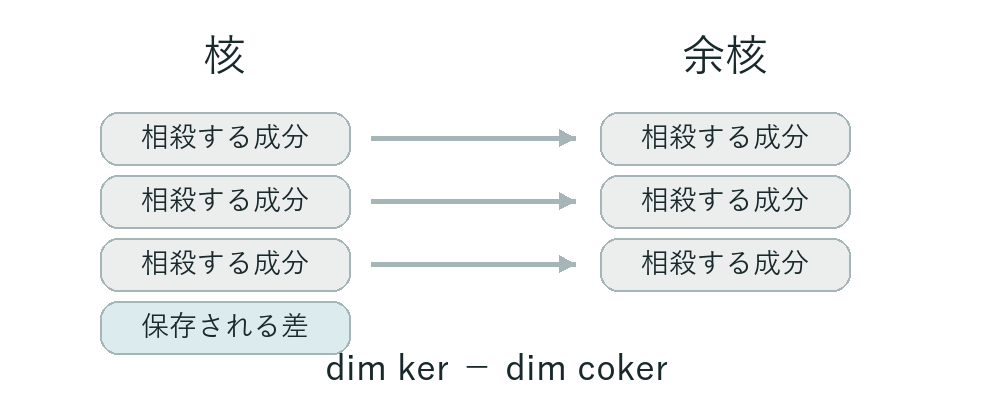
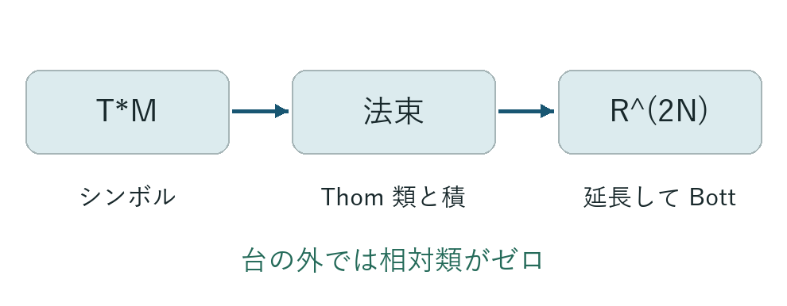
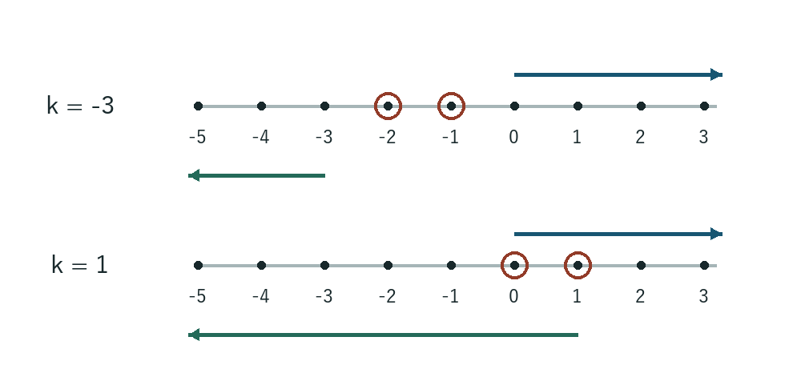

## 解が何通りあるかと、右辺をいくつ制限するか

$A:\mathbb C^3\to\mathbb C^2$ を $A(u,v,w)=(u,0)$ とする。$A x=f$ が解けるには $f$ の第2成分がゼロであることが必要で、そのとき自由に選べる変数は二つ。ここには二種類の数が出ている。核は解の自由度を与え、**余核** $\operatorname{coker}A=\mathbb C^2/\operatorname{im}A$ は右辺で消し切れない成分を与える。

$A$ を $A_\varepsilon(u,v,w)=(u,\varepsilon v)$ と変える。$\varepsilon\ne0$ なら自由度も右辺の条件も一つずつ減るので、核の次元だけを追うと跳びがある。しかし差

$$
\operatorname{ind}A
 =\dim\ker A-\dim\operatorname{coker}A
$$ {#eq-06-orig-01}

は、どちらの場合にも $1$。有限次元の一般の写像でも、階数を $\rho$ と書けば差は $(\dim E-\rho)-(\dim F-\rho)=\dim E-\dim F$ になる。ここから無限次元でも、二つの有限な欠損を差し引くという候補が得られる。

核と余核から同数の成分が増減しても、残る差は同じである。 @fig-06-balance で対応を確認できる。

{#fig-06-balance}

## 無限次元で差が定義できる条件

二つのHilbert空間の間の有界線形写像が**Fredholm**であるとは、核が有限次元、像が閉じており、余核が有限次元であることをいう。余核の次元は像の直交補の次元と等しい。両方の空間の次元をそのまま引く方法は使えないが、Fredholm作用素なら同じ式で指数を定義できる。

指数が小さい変形で保存される理由を、長方形行列へ戻して確認する。定義域を $\ker D$ とその直交補 $P$ に、値域を $\operatorname{im}D$ とその直交補 $C$ に分ける。$P\to \operatorname{im}D$ のブロックは有界逆を持つ。これは像が閉じていてHilbert空間になり、有界逆写像定理を使えるからである。小さい摂動で、そのブロックはNeumann級数により可逆のまま。可逆ブロックを行と列の操作で消去していくと、残るのは有限次元写像 $\ker D\to C$ である。有限次元の計算と同じく、その階数が両方の欠損に同じだけ効く。したがって指数は変わらない。連続な変形ではこの議論を区間全体へつなげられる。

具体的に、二乗可算列の空間で右シフト $(x_0,x_1,\ldots)\mapsto(0,x_0,x_1,\ldots)$ を考える。核はゼロで、像は先頭座標がゼロの閉部分空間。指数は $-1$。左シフトは全射で、核が先頭の一成分だから指数 $+1$。定義域と値域が同じ無限次元空間でも、指数はゼロに決まらない。

## 微分の最高次だけを読んで可逆性を試す

閉多様体とは、ここではコンパクトで境界のない滑らかな多様体である。$M$ 上の複素束 $E,F$ の切断の間の微分作用素 $D$ を考える。局所座標で微分の総次数を数え、最高次数が $m$ だとする。$e^{it\langle x,\xi\rangle}$ のような振動へ微分を作用させると、各 $\partial_{x_j}$ は $it\xi_j$ を出す。$t$ を大きくしたとき最も速く増える $t^m$ の係数が**主シンボル**である。多重添字 $\alpha$ は各座標で微分する回数を並べたもので、$|\alpha|$ はその合計である。

$$
\sigma_m(D)(x,\xi)
 =\sum_{|\alpha|=m}a_\alpha(x)(i\xi)^\alpha .
$$ {#eq-06-orig-02}

係数やフレームを微分して生じる項は次数が下がる。そのため最高次数だけを取ると、$\xi$ を余接ベクトルと読むことで座標を変えても同じ写像 $E_x\to F_x$ が得られる。余接ベクトルとは接ベクトルに実数を割り当てる実線形汎関数、ここでは位相関数の微分である。

$\xi\ne0$ のすべてについてシンボルが可逆になる $D$ を**楕円作用素**と呼ぶ。周期的な二変数関数の $\partial_x$ では、$\xi=(0,1)$ でシンボルがゼロになる。$x$ に依存しない関数をすべて核に含むので、核は無限次元である。一方、円周の $\partial_\theta$ では、$\xi\ne0$ なら $i\xi$ は可逆。Fourier級数で見ると核は定数、右辺の定数項だけは微分から得られず、指数は $0$ になる。

**ここで借りる解析の定理。** 閉多様体上の滑らかな楕円微分作用素は、Sobolev空間の間の写像 $H^s(E)\to H^{s-m}(F)$ としてFredholmである。Sobolev空間は、局所のFourier変換で周波数に応じた重みを掛け、有限なノルムを持つ切断を集めた空間である。整数で非負の次数では、対応する次数までの弱微分が二乗可積分であることに当たる。楕円正則性により、核と随伴の核は滑らかで、指数計算で滑らかな切断とSobolev空間の間を行き来できる。解析の証明では、シンボルの逆数を高周波で使って近似逆を作る。閉多様体では余分な項がコンパクト作用素になるが、その構成自体は本書では行わない。

最高次を固定して低次の項を変えると、直線補間で全て楕円のままになるので、指数は同じである。円周で $\partial_\theta+a$ を考えると、各Fourierモードで $in+a$ を掛ける。$a=0$ では核と余核はともに $1$、実数 $a\ne0$ ではともに $0$。シンボルが保存する量がどちらか、ここでも確かめられる。

## Fredholm性の一例を高周波から作る

平坦なトーラスを $x,y$ がそれぞれ $2\pi$ 周期の平面として作る。$D=\partial_x+i\partial_y$ はFourierモード $e^{i(ax+by)}$ で $ia-b$ を掛ける。ゼロモード以外では絶対値 $\sqrt{a^2+b^2}$ で、逆数によって失われた微分一回分の正則性を取り戻せる。

$H^1$ のノルムの二乗はFourier係数 $u_{ab}$ に対し $\sum (1+a^2+b^2)|u_{ab}|^2$。右辺 $f$ が $L^2$ で定数項ゼロなら、$u_{ab}=f_{ab}/(ia-b)$ と置ける。非零モードで $(1+a^2+b^2)/(a^2+b^2)\le2$ だから $u\in H^1$。よって像は定数項ゼロの閉部分空間で、余核が一次元、核も定数で一次元である。複素係数自体は各モードで回るが、全体の指数は $0$ である。

$G$ をこの割り算を行い定数項をゼロに送る作用素とすれば、$GD$ と $DG$ はそれぞれ恒等から定数射影を引いたものになる。逆写像を持てない定数部分だけが有限次元で残る。このように完全な逆を求める代わりに、小さな誤差を許して作る逆を**パラメトリックス**と呼ぶ。一般の楕円作用素では、定数射影の代わりにコンパクトな誤差を得る方法を用いる。

コンパクトな誤差が自然に出る理由を同じトーラスで見る。$H^1\to L^2$ の包含を、高周波を切り捨てる有限階数作用素で近似する。$a^2+b^2>R^2$ の部分の $L^2$ ノルムは、$H^1$ ノルムの $1/\sqrt{1+R^2}$ 倍以下。

従って包含は有限階数作用素の作用素ノルムでの極限であり、コンパクト作用素になる。滑らかな係数の掛け算は $L^2$ 上で有界なので、$H^1\to L^2$ の低次項はこの包含を通してコンパクトになる。主シンボルを固定したときに低次項が高周波の割り算を壊さないことを、具体的に見た例である。

## 像が閉じていないと、条件の数をどう誤るか

線形作用素の核が有限で、随伴の核が有限であることだけでは、第6章のFredholm性には足りない。具体的に二乗可算列に

$$
A(x_1,x_2,x_3,\ldots)
  =(x_1,x_2/2,x_3/3,\ldots)
$$ {#eq-06-nonclosed-range}

を作用させる。核はゼロ、作用素は自己共役なので随伴の核もゼロ。有限列は全て像に入るため、像は稠密である。

しかし $y=(1,1/2,1/3,\ldots)$ は二乗可算なのに、逆像として必要な列 $(1,1,1,\ldots)$ は二乗可算でない。従って $y$ は像に入らない。有限の切断 $y^{(N)}$ は像にあり $y$ へ収束するので、像は閉じていない。随伴の核で読める「連続な条件」がゼロなのに、方程式は全ての右辺について解けるわけではない。

この例の失敗は高い添字に移ると逆の倍率 $j$ が増大することである。これに対し、楕円作用素の最高次部分では、ノルムを適切なSobolev次数で比較することによって、高周波を一様に逆に送る評価が得られる。その評価にコンパクトな誤差だけが残れば、像の閉性を示せる。

### 有限のブロックを厳密に取り出す

Fredholm作用素 $D:H_0\to H_1$ で $H_0=P\oplus K$、$H_1=R\oplus C$ とする。$K=\ker D$、$R=\operatorname{im}D$、$P,C$ はそれぞれ直交補。したがって $D|_P:P\to R$ は有界な逆を持つ。小さい摂動 $S$ をこの分解で

$$
S=\begin{pmatrix}a&b\\c&e\end{pmatrix}
$$

と書く。$a$ が $D|_P$ に十分近ければ可逆である。両側から可逆な三角行列を掛けると、

$$
\begin{pmatrix}I&0\\-ca^{-1}&I\end{pmatrix}
\begin{pmatrix}a&b\\c&e\end{pmatrix}
\begin{pmatrix}I&-a^{-1}b\\0&I\end{pmatrix}
=
\begin{pmatrix}a&0\\0&e-ca^{-1}b\end{pmatrix}.
$$ {#eq-06-schur}

従って核と余核の次元を調べるには右下の有限次元写像 $K\to C$ だけを見ればよい。可逆な左上のブロックは両方に寄与しない。同じ階数が核からも余核からも引かれるため、差は常に $\dim K-\dim C$。一段落の変形不変性を使う際には、無限次元の部分をこの可逆ブロックで消せるという仮定が含まれている。

### トーラスの低次項をこの規準で見る

平坦なトーラス上で $D_0=\partial_x+i\partial_y$ とし、$V(x,y)$ を滑らかな係数の掛け算とする。$D_0:H^1\to L^2$ に $V$ を足しても、$V$ の部分は $H^1\to L^2$ のコンパクトな包含を通るためコンパクトである。

実際、周波数の長さが $R$ 以下の射影を $P_R$ とすれば、

$$
\|V(I-P_R)u\|_{L^2}
 \le \|V\|_{\infty}(1+R^2)^{-1/2}\|u\|_{H^1}.
$$ {#eq-06-compact-tail}

$VP_R$ は有限階数であり、 @eq-06-compact-tail によってノルムで $V$ へ近づく。従って $D_0$ のコンパクトな誤差を許した逆 $B$ があれば、$(D_0+tV)B$ と $B(D_0+tV)$ は全ての $t$ で恒等からコンパクトな誤差だけ異なる。第10章で証明する判定から全区間でFredholmであり、 @eq-06-schur を局所的に使って指数は一定である。

この議論は係数が小さいと仮定して最後の値まで一回で変形するのではない。全区間でFredholm性を確かめ、そのうえで各点の近くの有限ブロックに @eq-06-schur を適用する。どの段階の仮定がどの結論に使われたかを分けておくと、高周波の評価だけで核の次元まで保存されると誤解せずに済む。

## 二つの作用素を合成すると指数はどうなるか

Fredholm写像 $D:E\to F$、$A:F\to G$ を合成した $AD$ がFredholmであることを仮定する。実際には二つがFredholmであれば合成もFredholmである。例えばコンパクトな誤差を許す逆をそれぞれ取れば、逆順に合成して $AD$ の逆をその意味で得る。

核と余核は次の有限次元の列を作る。

$$
\begin{aligned}
0\to\ker D\to\ker(AD)\to\ker A\\
\to\operatorname{coker}D
\to\operatorname{coker}(AD)\\
\to\operatorname{coker}A\to0 .
\end{aligned}
$$ {#eq-06-orig-03}

中央で $\ker(AD)$ の元 $v$ は $Dv$ に送る。$\ker A$ の元 $w$ は $F/\operatorname{im}D$ での類に送る。その類がゼロなら $w=Dv$ と書け、$ADv=0$ なので前から来る。次の矢印は $[w]\mapsto[Aw]$。もし $Aw=ADv$ なら $w-Dv\in\ker A$ なので、$[w]$ は前から来たことになる。残りの完全性も、像で割る操作から従う。

有限次元の完全列の次元の交代和はゼロである。各項を前の像と次の像の次元の和に分けると、中間の像が二度ずつ逆符号で出る。上の列で計算すると $\operatorname{ind}(AD)=\operatorname{ind}A+\operatorname{ind}D$。右シフトと左シフトの合成では、一方の指数が $-1$、もう一方が $+1$ なので合成の指数は $0$。

実際、一方の順では恒等、他方の順では先頭成分を落とす射影で、どちらも指数はゼロである。

相対K群側で同じ規則を読むと、$E\to F$ と $F\to G$ の境界同型を合成した $E\to G$ が二つの相対類の和を表す。境界で二つの同型を対角に置き、中央の $F$ を交換する行列の変形によって、成分を $E\to G$ と恒等な $F\to F$ へ移せるためである。次数の和が実際の最高次になる楕円微分作用素の合成では、主シンボルは二つのシンボルの積になる。したがって解析側の指数の加法は、位相側の三つ組でも同じ形を持つ。

## 主シンボルを三つ組として読む

$T^*M$ は実余接束、$\pi:T^*M\to M$ は射影である。各 $(x,\xi)$ に $\pi^*E$ と $\pi^*F$ が載り、その間を $\sigma_m(D)$ で対応させる。零切断の外では可逆なので、単位円板束と単位球面束を使って

$$
[\sigma(D)]\in KU^0_c(T^*M)
$$ {#eq-06-orig-04}

を得る。$\xi$ の正の倍率が変わると $m$ 乗の正の数が掛かるため、球面束での同型のホモトピー類は計量の選択に依存しない。零切断は $M$ がコンパクトなのでコンパクトである。これが相対類をコンパクト台で扱える理由である。

束の差 $[E]-[F]$ だけという候補も試せる。点を底とした円板の例では、二つの束がどちらも自明でも、境界で $z$ を掛けるか $1$ を掛けるかで相対類が異なった。シンボルを記録する理由は、可逆性が成立する場所で**どのように**二つの束を同一視したかを残すためである。

## 押し出しは、どこで整数を作るか

第2章の束の引き戻しは、空間の写像と逆向きに進んだ。今度は $T^*M$ の相対類を、空間を包む大きなユークリッド空間へ運ぶ。空間の写像と同じ向きに進むこの操作を**押し出し**という。

滑らかな埋め込み $j:M\hookrightarrow\mathbb R^N$ を選ぶ。計量で接空間と法空間を分け、余接ベクトルは法方向でゼロとすることで $T^*M$ を $T^*\mathbb R^N$ に埋め込む。法束を $\nu$ とすれば、この埋め込みの法方向は底方向と共変数方向に一つずつ $\nu$ があり、計量を通して $\nu\oplus\nu$ を複素束 $\nu\otimes\mathbb C$ とみなせる。より正確には、この同定は $T^*M$ への引き戻しで、計量からの分解で得られる。埋め込みの近傍は法束の近傍に同一視できる。この近傍同定と埋め込みの存在を微分位相の基礎事項として用いる。

操作を三つに分ける。

1. シンボルの類を法方向へ引き戻し、法束の複素Thom類を掛ける。底が非コンパクトでも、もとの類のコンパクトな台の上の相対積としてこの操作を行える。
2. 管状近傍に移し、外をゼロで延長する。コンパクト台のK群では、開集合からのこの写像は補集合を基点に潰す写像で定まる。貼り合わせの表現では、台の外側は可逆同型で比較が終わっている。
3. $KU^0_c(\mathbb R^{2N})$ をBott周期性で $\mathbb Z$ と同一視し、複素Bott元 $\beta$ の $N$ 回の外積の係数を読む。

この整数が位相的指数である。$T^*\mathbb R^N$ では底と共変数を一座標ずつ組にして $(x_j,\xi_j)$ を複素平面とする。それに従って法方向も向き付ける。Bott元は第5章のThom類と同じ規格化で、複素平面上でChern指標の最上次の積分が $1$ になる。位相的指数は補助選択に依存しない。この事実、及び**Atiyah–Singer指数定理**の解析的な本体を借りる。定理は閉多様体上の複素楕円作用素について、Fredholm指数とこの押し出しで得る整数が一致すると述べる。指数の変形不変性だけからはこの一致は出ない。

シンボルを法方向へ移し、Thom類と掛け、ユークリッド空間でBott係数を読む。 @fig-06-push で対応を確認できる。

{#fig-06-push}

### 支持を動かす操作と、空間全体の束を動かす操作

位相的な押し出しのゼロ延長を、開円板 $U\subset\mathbb R^2$ で考える。$U$ 上のコンパクト台の類は、$U$ の境界の手前で二つの束がすでに同型になっているように表せる。その同型がある部分を基点に送れば、$U$ の外に新しい非自明な束の情報を入れずに、全平面の相対類へ移せる。たとえば $U$ の中心に一次元Koszulの三つ組を置けば、延長後のBott係数は $1$。中心を別の点に移しても、コンパクトな経路に沿って台を移せるため、クラスは同じままである。

逆に、$U$ にある束をそのまま値がゼロの束に貼り替えると、境界をまたいで階数が跳び、真のベクトル束にならない。コンパクト台を持つのは束そのものではなく、二束の差と境界での同型である。この説明は $T^*M$ をユークリッド空間の中へ移す場合にも同じで、管状近傍の外でクラスがゼロという意味を与える。

コホモロジーでは、中心に積分値 $1$ を持つ台の小さな二次形式を置くと、同じゼロ延長で積分値 $1$ が保たれる。Bott係数を最上次の積分で読む検算は、相対類の台と、この形式の台を同じ向きで扱うことに依存している。

## Todd補正を押し出しに適用する

$\operatorname{ch}$ を取り、コホモロジーの押し出しを使って前節を計算する。法束のThom類の指標が第5章により $u_H/\operatorname{Td}(\nu\otimes\mathbb C)$ になる。普通のThom類をファイバーで積分すれば $1$、外へのゼロ延長は全体の積分を保つ。従ってBott係数は、元のシンボルの指標に $\operatorname{Td}(\nu\otimes\mathbb C)^{-1}$ を掛け、$T^*M$ 上で積分して得られる。

$TM\oplus\nu$ は自明束で、複素化しても自明。Todd類は直和で積なので逆Todd類は $\operatorname{Td}(TM\otimes\mathbb C)$ に等しくなる。$\pi^*$ は底の類を余接束へ運ぶ。

$$
\begin{aligned}
\operatorname{ind}_{\mathrm{top}}(D)
 &=\int_{T^*M}\operatorname{ch}([\sigma(D)])\\
 &\quad\cdot\pi^*\operatorname{Td}(TM\otimes\mathbb C).
\end{aligned}
$$ {#eq-06-orig-05}

積分は、$T^*M$ 上の最上次のコンパクト台コホモロジー類の評価である。向きは底座標と余接座標を一組ずつ並べた向きとする。埋め込みでこの並べ方と法方向の複素向きが両立する。二次元の底では並べ順の符号が一度反転するので、後の曲面上の計算ではファイバーの複素構造も確認する。

## 球面を複素曲線として見る

$\mathbb CP^1$ の二つの座標を $z$ と $w=1/z$ とする。各座標域は複素平面で、切替が正則である。そのような座標系を持つ実二次元多様体を**複素曲線**と呼ぶ。$\mathcal O(k)$ は $L^*$ の $k$ 乗で、負のべきは双対で読む。正則フレームの係数には

$$
s_S(1/z)=z^{-k}s_N(z)
$$ {#eq-06-orig-06}

が成立する。$k=-1$ なら第1章の北から南への変換 $z$ に戻る。

局所の滑らかな関数 $f$ に

$$
\bar\partial f=
 \tfrac12(\partial_x+i\partial_y)f\,d\bar z
$$ {#eq-06-orig-07}

を対応させる。$z=x+iy$ であり、$(0,1)$ 型の微分形式は $d\bar z$ を局所基底とする。$w=1/z$ は正則なので、連鎖律で $\bar\partial$ は座標変換と両立する。束のフレームの変換も正則だから、$\bar\partial_{\mathcal O(k)}$ を $\mathcal O(k)$ の滑らかな切断から $\mathcal O(k)$ 値の $(0,1)$ 形式への作用素として定められる。

その主シンボルは $\tfrac12(i\xi_x-\xi_y)d\bar z$ を掛ける。$\xi\ne0$ で複素数の部分はゼロでなく、両側ともファイバーは複素一次元なので楕円である。核は局所係数が正則な切断、余核はすべての $(0,1)$ 形式を $\bar\partial$ で出るものによって割った空間。曲線には $(0,2)$ 形式がないので、ここでの余核はDolbeaultコホモロジー $H^{0,1}_{\bar\partial}$ に等しい。これは、局所的に解があったとしても大域的な一つの解に貼れるかを測る。

## 解析側の核を、二つのチャートで求める

核の元の北座標を $s_N(z)=\sum_{n\ge0}a_nz^n$ とする。正則なのでTaylor展開が全平面で成立する。南では $s_S(w)=w^k s_N(1/w)$ だから、北の項 $a_nz^n$ は南で $a_nw^{k-n}$ になる。$w=0$ で正則である条件は $n\le k$。$k\ge0$ なら $1,z,\ldots,z^k$ が基底で、$k<0$ なら核はゼロ。特に $k=0$ では定数が一つ、$k=-2$ では一つもない。

## 解析側の余核を、重なりのLaurent係数で求める

滑らかな $(0,1)$ 形式 $\omega$ が与えられたとする。北と南で $\bar\partial u_N=\omega_N$、$\bar\partial u_S=\omega_S$ を別々に解けることを使う。複素平面上での解の構成は次節に示す。重なりで北の係数に揃えると

$$
g(z)=u_N(z)-z^k u_S(1/z)
$$ {#eq-06-orig-08}

は $\bar\partial g=0$ を満たすので $\mathbb C^\times$ 上で正則。$u_N,u_S$ はそれぞれ整関数を加えても解のままである。従って正則な重なり関数を、次の形の関数によって割った類が決まる。

$$
a(z)-z^k b(1/z).
$$ {#eq-06-orig-09}

ここで $a,b$ は整関数である。この類がゼロなら、整関数で補正して局所解が一致するので大域解を得る。逆に大域解があれば、もとの局所解との差は整関数で、重なり関数の類はゼロである。

重なり関数の任意の類が形式から来ることも確認する。二つのチャートに従属する滑らかな一の分割 $\rho_N+\rho_S=1$ を取り、北で $\rho_Sg$、南で $-z^{-k}\rho_N g$ を局所係数とする。チャートの重なり以外ではゼロ延長できる。北へ座標を揃えた差は $g$。$g$ が正則だから、これらの $\bar\partial$ を取った結果は重なりで一致し、大域的な $\omega$ になる。その余核類から元の $g$ が戻る。

さて $g=\sum_{n\in\mathbb Z}a_nz^n$ をLaurent展開する。北の整関数で消えるのは $n\ge0$、南の整関数で $z^k b(1/z)$ として消えるのは $n\le k$。どちらの級数も対応する側の全平面で収束する。これはLaurent展開の正べき部分が全 $z$、負べきに対応する級数が全 $w$ で収束するためである。二つの範囲の間に残るのは

$$
k<n<0
$$ {#eq-06-orig-10}

の整数だけ。よって余核の次元は $\max(-k-1,0)$ である。$k=0$ なら穴がなく、$k=-2$ なら $z^{-1}$ 一項が残る。大域的な解を作るにはこの係数がゼロでなければならない。

矢印は各チャートから補正できる指数。上段の空隙は余核、下段の重複は核に対応する。 @fig-06-laurent で対応を確認できる。

{#fig-06-laurent}

## 余核の元を一つ、積分で検出する

$k=-2$ のとき、余核に残る $z^{-1}$ を、微分形式の積分として直接検出できる。まず $\mathcal O(-2)$ を正則余接線束 $K_M$ と同一視する。北で $dz$、南で $-dw$ をフレームに取ると、$w=1/z$ から $dz=z^2(-dw)$。従って北から南への変換は $z^2$ で、$\mathcal O(-2)$ のものと一致する。

$K_M$ 値の $(0,1)$ 形式は、局所で $a\,d\bar z\otimes dz$ と書く。これを $a\,d\bar z\wedge dz$ に送ると、複素数値の二次形式になる。同じ規則で切断 $f\,dz$ を1形式とみなせば、$\bar\partial(f\,dz)$ は $d(f\,dz)$ に送られる。$z$ 微分の項は $dz\wedge dz=0$ になる。従って大域解から得られた右辺は、Stokesの公式で二次形式の積分がゼロになる。

先の余核の構成で $g(z)=z^{-1}$ とする。$c_N=\rho_Sg\,dz$ と $c_S$ を局所解として作ったので、重なりで $c_N-c_S=dz/z$。対応する二次形式 $\omega$ は半球ごとに $d c_N$、$d c_S$ と書ける。北の円板の正方向に赤道を読むと、

$$
\int_M \omega=\int_{|z|=1}(c_N-c_S)=2\pi i.
$$ {#eq-06-orig-11}

従ってこの右辺は大域的な $\bar\partial$ の像に入らない。しかも余核は一次元だったので、積分のゼロ条件は必要十分である。単に右辺の集合の次元を数えるところから進んで、どの右辺に解があるかを一つの条件で書けた。

### 一般の $k$ で残った係数を対にする

$k\le -2$ とし、$m=-k-2$ とすると、$\mathcal O(m)$ の核は $1,z,\dots,z^m$ を北座標に持つ。$K_M\cong\mathcal O(-2)$ なので、正則切断 $p$ を $\mathcal O(k)$ 値の右辺に掛けると $K_M$ 値になる。$\omega=\bar\partial u$ なら $p\omega=\bar\partial(pu)$。従って $\int_M p\omega$ は余核の上の線形汎関数になる。

局所解の差 $g$ を用いると、この積分を $2\pi i$ で割った値は $p(z)g(z)$ の $z^{-1}$ の係数である。$p=z^j$ とすると、$g$ の $z^{-j-1}$ の係数を読む。$j=0,\dots,-k-2$ で、消せなかった係数 $k<n<0$ を一つずつ全て取り出す。特に $k=-4$ では $z^{-1},z^{-2},z^{-3}$ の三つを、$1,z,z^2$ との積で順に検出する。これは球面上で余核と別の正則切断の空間が双対になる具体例である。

$k=0$ なら組にする線束は $\mathcal O(-2)$ で、正則切断はない。従って積分で課す条件もなく、余核がゼロであることと一致する。欠損を与える係数に気づかず核だけを計算すると、$k$ の負方向で起きている変化を見落とす。

## 高次の極を持つ右辺を作って、可解性を判定する

$\mathcal O(-3)$ の値を取る $(0,1)$ 形式を想定する。北と南の局所解を作り、北へ換算した差が

$$
g(z)=e^z+2z^{-1}-3z^{-2}+z^{-4}
$$ {#eq-06-orig-12}

だったとする。$e^z$ は北で整関数だから北の解の補正で消せる。$z^{-4}$ は貼り合わせの式で $z^{-3}b(1/z)$ と書ける。実際 $b(w)=w$。南の解の補正の符号を選んでこの項を消せば、重なりには $2z^{-1}-3z^{-2}$ だけが残る。$-3<n<0$ の二つの指数に対応しており、どちらも余核の基底である。右辺を積分で検査するときは $p=1,z$ を使い、$2\pi i$ で規格化した値は $2,-3$。

従ってこの右辺は解けない。

この例では $k$ を $-2$ に変えると、同じ形のLaurent関数でも $-2$ のべきは南の補正で消せるようになる。$k=-1$ まで進めば $-1$ のべきも消える。別の $k$ で同じ $g$ を使うとは、同じ右辺の束を比較することではなく、一の分割でそれぞれの貼り合わせに合う右辺を作ることを指す。決定的な情報は、許される南の補正にどのべきが入るかである。

### 可解な右辺でも解の一意性は別に決まる

$k=1$ の場合、任意のLaurent関数が北と南の整関数で消せる。負のべきはすべて南側に任せられるので、余核はゼロである。一方、$z^0$ と $z^1$ は北にも南にも割り当てられる。補正の分け方を変えると、その二つの成分が大域的な正則切断として残る。従ってどの右辺も解けるが、解は一意ではない。

一般の $k$ について、北側の範囲 $n\ge0$ と南側の範囲 $n\le k$ の間に穴があれば余核、重なりがあれば核になる。この二つの範囲を紙に書き、$k=-3,-1,1$ と順に動かせば、指数が $-2,0,2$ と変化するのを確認できる。Todd項を入れた $\int(1+kh)(1+h)$ の計算もそれぞれ同じ整数を与える。

## 補足　平面上の局所方程式を解く

コンパクト台の滑らかな $f$ について、Cauchy–Greenの公式は $\bar\partial u=f\,d\bar z$ の解を

$$
u(z)=\frac1\pi\int_{\mathbb C}
       \frac{f(\zeta)}{z-\zeta}\,dA(\zeta)
$$ {#eq-06-orig-13}

と与える。$dA$ は平面の面積要素である。規格化は、原点を避けると $\bar\partial(1/z)=0$ で、原点を小円で囲むとCauchyの積分の境界項が残り、分布として $\bar\partial(1/(\pi z))$ が原点の単位質量になることによる。局所の特異性 $1/|z|$ は面積で可積分。積分を畳み込みと見て微分を $f$ の側に移せば、滑らかな解になる。

一般の滑らかな $f$ は、円板の外へ次々と移るコンパクト台を持つ $f_j$ の局所有限和に分ける。例えば $f_j$ の台を半径 $j-1$ より外に取れるように、一の分割で円板と環状領域へ切り分ける。各 $f_j$ の解 $u_j$ は台より内側の円板で正則。十分大きい $j$ に対し、その円板より少し小さい $|z|\le j-2$ の上で、Taylor多項式 $p_j$ を引いて $u_j-p_j$ とその $j$ 階までの微分を $2^{-j}$ 以下にできる。

従って $\sum (u_j-p_j)$ は任意のコンパクト集合上で全ての階の微分まで収束する。多項式を引いても $\bar\partial$ は変わらず、和は全平面で $f$ の解になる。北と南の正則フレームがあれば、束の係数について同じ操作を使える。

## 位相側　DolbeaultシンボルをThom類として積分する

曲線 $M=\mathbb CP^1$ の実余接束を複素線束 $V=T^{*(1,0)}M$ と同一視する。実共変ベクトル $\xi$ をその $(1,0)$ 部分 $\xi^{1,0}$ へ送る同一視である。座標ではこの成分が $(\xi_x-i\xi_y)dz/2$。計量で $V^*$ を $(0,1)$ 形式の線に同一視でき、随伴挿入の係数は $\xi^{1,0}$ の複素共役である。正の計量係数と定数位相 $i$ は可逆なまま $1$ へ変形できるので、第5章の三つ組により

$$
[\sigma(\bar\partial_{\mathcal O(k)})]
 =\pi^*[\mathcal O(k)]\,u_K(V).
$$ {#eq-06-orig-14}

符号を向きでも確認する。$M$ の座標 $(x,y)$ を複素向きに取り、実余接座標を $(\xi_x,\xi_y)$ とする。ファイバーの複素座標 $\xi_x-i\xi_y$ はその実順序から向きが反転する。

一方、底と対にした順序 $(x,\xi_x,y,\xi_y)$ も連結した順序 $(x,y,\xi_x,\xi_y)$ から一回の交換で向きが反転する。

従って底の複素向きと $V$ のファイバー向きを合わせた向きは、押し出しの積分に使った向きと一致する。

接束の複素化は $T^{1,0}M$ とその共役の直和で、共役は計量により $V$ と同型。従って $\operatorname{Td}(TM\otimes\mathbb C)$ は $\operatorname{Td}(T^{1,0}M)\operatorname{Td}(V)$ である。第5章の式からChern指標に現れる $\operatorname{Td}(V)^{-1}$ がこれを一つ相殺し、普通のThom類をファイバーで積分すると

$$
\begin{aligned}
\operatorname{ind}_{\mathrm{top}}
 (\bar\partial_{\mathcal O(k)})
 &=\int_M \operatorname{ch}(\mathcal O(k))\\
 &\quad\cdot\operatorname{Td}(T^{1,0}M).
\end{aligned}
$$ {#eq-06-orig-15}

この式は、曲線の上に戻った位相側の計算であり、ここへ至るまで核や余核の次元は用いていない。

## 同じ球面上で二つの答えを照合する {#cp1-index}

$h=c_1(\mathcal O(1))$ とすると $\int_M h=1$。$w=1/z$ から接ベクトルの北座標から南座標への変換は $-z^{-2}$。第1章の式で $c_1(T^{1,0}M)$ の積分は $2$、したがって $c_1(T^{1,0}M)=2h$。$h^2=0$ なので $\operatorname{Td}(T^{1,0}M)=1+h$、$\operatorname{ch}(\mathcal O(k))=1+kh$。最上次数を取ると

$$
\int_M (1+kh)(1+h)=k+1.
$$ {#eq-06-orig-16}

$k=0$ の解析側は核 $1$、余核 $0$ で指数 $1$。位相側は $h$ を積分して $1$。$k=-2$ の解析側は核 $0$、余核 $1$ で指数 $-1$。位相側は $-h$ を積分して $-1$。この後者の計算では、解の自由度だけを数えると $0$ で、右辺の制約が指数の符号を決めている。

## 最上次の積分が整数になるまでを、別の入力で試す

$\mathbb CP^1$ 上の線束だけでなく、その直和を係数にできる。$E=\mathcal O(2)\oplus\mathcal O(-4)$ を取る。解析側では一方の核が3次元、他方の余核が3次元なので指数は $0$。位相側では階数が $2$、第一Chern類が $-2h$。$\operatorname{ch}(E)(1+h)$ の二次成分は $(2-2)h=0$ である。この束と $\mathcal O(-1)\oplus\mathcal O(-1)$ は位相的には同じ階数と同じ第一Chern数を持つ。後者のDolbeault作用素では核と余核が両方ゼロである。両者の指数は同じでも、正則切断と右辺の条件が同じになる必要はない。

この違いは滑らかな束として同一視してからも見える。共通の滑らかな $E$ に二つのDolbeault作用素を移すと、主シンボルはどちらも $\xi^{0,1}$ の外積に恒等作用を掛けたものになる。差は零次項である。従って補間の途中でも楕円で指数は一定だが、核と余核の次元はその間に変わる。これは序盤の長方形行列と同じ現象が、貼り合わせを持つ無限次元の方程式で現れた例である。

### 接束と係数束の寄与を分ける

曲面上で $E$ のChern指標は $r+c_1(E)$、Todd類の二次成分は $c_1(T^{1,0}M)/2$。その積の二次成分を読むと、第一Chern数に階数と接束から来る補正が加わる。$\mathbb CP^1$ では補正は $r$。平坦な複素トーラスでは接束が定数ベクトルによって自明化され、係数が自明線束なら両方ともゼロになる。Fourier計算で核と余核がそれぞれ一次元だった例に対応する。

球面でも接束の項を落とすと $k=0$ の指数を $0$ と誤り、$k=-2$ の指数を $-2$ と誤る。解析側の補正は、核の数え上げではTaylor展開で $n=0$ の項を含むこととして、余核では $k$ 番と $0$ 番を共に除いた間の項を数えることとして現れた。位相側では、この補正を接束の第一Chern類から読んでいる。

一般の整数 $k$ でも、解析側は $\max(k+1,0)-\max(-k-1,0)=k+1$。差の式で定数項 $1$ を与えたのは接束のTodd類で、$k$ を与えたのは未知量の線束の貼り合わせである。序章の「貼り方を変えると定数の選択が妨げられる」という問いは、ここで「貼り方を変えると右辺のどの係数が残るか」という問いへ広がった。その二つを差し引いた数が、相対シンボルを押し出す操作によって回収された。
