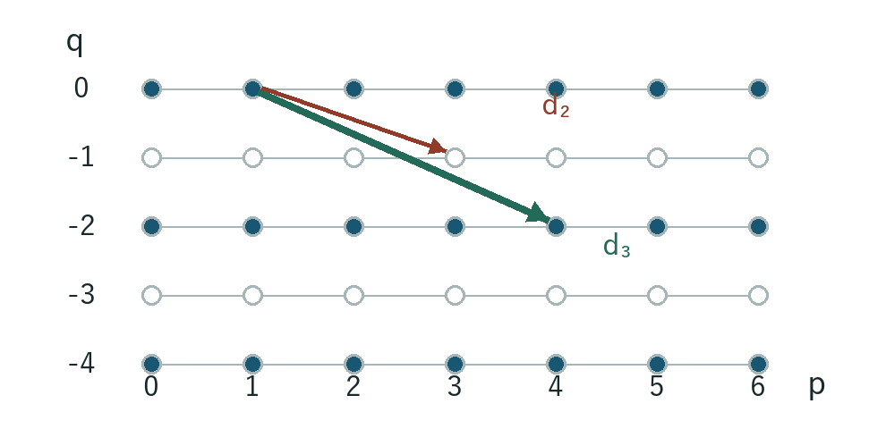
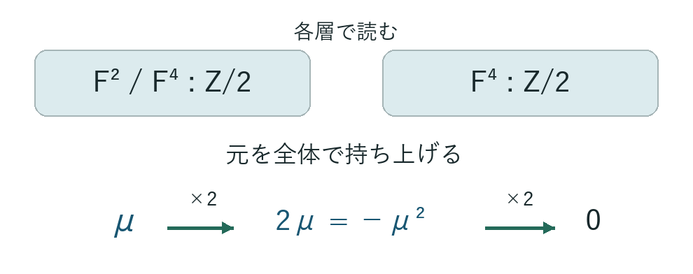

::: {.ku-chapter}
**章の導入**　実射影空間を面の次元ごとに切って見ると、位数2の層が二つ出る。層を重ね直すとどうして位数4になるのかを、骨格への制限と積から調べる。
:::

## 二つの位数2から位数4が出る

**導入。** 層を一つずつ読んだ答えと、全体を足したときの答えを分ける。

第5章の実射影空間の計算には、一見矛盾する二つの答えがあった。セルごとに見ると、二つの次数に $\mathbb Z/2$ が一つずつある。一方、空間全体で束の差を取ると、ねじれ部分は $\mathbb Z/4$ である。この章では、セルごとの答えが全体のどの部分を取り出していたのかを明示する。

まず抽象的な加群で同じ違いを再現しよう。$A=\langle a\mid 4a=0\rangle$ と $B=\langle b,c\mid 2b=2c=0\rangle$ はどちらも四元の群である。$A$ に $\langle 2a\rangle$、$B$ に $\langle c\rangle$ という部分群を指定すれば、部分群も商群も $\mathbb Z/2$ になる。しかし $A$ の商の生成元をどのように持ち上げても、その元を二倍すると $2a$ になる。

$$
\begin{aligned}
2(a+2ua)&=2a,\\
2(b+uc)&=0 .
\end{aligned}
$$ {#eq-08-extension-test}

したがって、持ち上げた元の二倍を測ると二群を区別できる。 @eq-08-extension-test の最初の行では、持ち上げの選択を変えても答えは動かない。これが拡大を解くときに使う量である。一般には部分群 $C$ と商 $\mathbb Z/m$ が与えられたとき、生成元の持ち上げ $a$ に対する $ma$ を $C/mC$ に記録する。$a+c$ に替えると差が $mc$ であることが、その理由である。

### 濾過は何を忘れるか

有限CW複体 $X$ の $p$ 次元骨格を $X^p$ とする。$X^{-1}$ は空集合とする。自然な降順の部分群を次で定める。

$$
F^p KU^n(X)=
\ker\!\bigl(KU^n(X)\longrightarrow KU^n(X^{p-1})\bigr).
$$ {#eq-08-filtration}

@eq-08-filtration の意味は、$p-1$ 次元以下の範囲ではゼロに見えることである。下の範囲でゼロという条件が強くなるほど群は小さくなる。各層 $F^p/F^{p+1}$ には、$p$ 次元で最初に見えた情報だけが残る。

たとえば $\mathbb CP^3$ の偶数K群では $\mu=[L]-1$ が $F^2$ にある。$\mu^2$ は $\mathbb CP^1$ に制限するとゼロで、$F^4$ にある。$\mu^3$ は $\mathbb CP^2$ に制限してゼロなので $F^6$ にある。これ以外の係数が隠れていないことは、第4章の整数基底から分かる。よって次の表が得られる。

| 骨格を通過した直後 | 制限の核 | 新しく読める係数 |
|---|---|---|
| $X^0=\mathbb CP^0$ | $F^1=\langle\mu,\mu^2,\mu^3\rangle$ | 定数項 |
| $X^2=\mathbb CP^1$ | $F^3=\langle\mu^2,\mu^3\rangle$ | $\mu$ の係数 |
| $X^4=\mathbb CP^2$ | $F^5=\langle\mu^3\rangle$ | $\mu^2$ の係数 |
| $X^6=X$ | $F^7=0$ | $\mu^3$ の係数 |

: 複素射影3空間の濾過。奇数次の新しいセルはない。 {#tbl-08-cp3}

@tbl-08-cp3 では、整数係数の基底を先に持っていたため、各層だけでなく、全体でどの元を選べばよいかも分かった。しかし一般の空間では、セルごとの係数のうち一部は次のセルを貼ったときに消える。そこを検査する仕組みが要る。

::: {.ku-summary}
**まとめ**　位数2の層が二つあっても、全体が位数2の元二個で生成されるとは限らない。
:::

## 三つ組の完全列から最初の微分を作る

**導入。** 隣り合う骨格の商と、三段を含む完全列を並べる。

$X^{p-1}\subset X^p\subset X$ の三つを取る。$X^{p-1}$ を潰した中で、$X^p/X^{p-1}$ を部分空間として見る。対の完全列により、次の三項が繰り返される。

$$
\begin{aligned}
KU^n(X,X^p)&\xrightarrow{i} KU^n(X,X^{p-1})\\
&\xrightarrow{j} KU^n(X^p,X^{p-1})\\
&\xrightarrow{k} KU^{n+1}(X,X^p).
\end{aligned}
$$ {#eq-08-triple}

ここで $i$ は潰す範囲を狭めることで作用し、$j$ は $p$ 骨格へ制限する。接続写像 $k$ は、その相対データを全体へ延ばせない障害を次の次数に移す。 @eq-08-triple を異なる $p,n$ で全部並べると、同じ型の三角形が組み合わさる。

添字を $n=p+q$ と書き、二つの種類の項に名前を付ける。

$$
\begin{aligned}
D_1^{p,q}&=KU^{p+q}(X,X^{p-1}),\\
E_1^{p,q}&=KU^{p+q}(X^p,X^{p-1}).
\end{aligned}
$$ {#eq-08-first-page}

::: {.ku-worked}
**計算を追う｜一枚のセルを取ると係数群になる**

$p$ 次のセルを一枚だけ考え、その境界を一点につぶす。残る空間は $D^p/S^{p-1}=S^p$ である。従ってそのセルが第一の表の $(p,q)$ に出す値は

$$
KU^{p+q}(D^p,S^{p-1})
 =\widetilde{KU}^{p+q}(S^p)
 =KU^q(*).
$$

初めの等号は境界をつぶした結果、次の等号は球面方向に $p$ 回懸垂した分を次数から引いた結果である。複数のセルがあればこの値を各セルに置く。その後で初めて、セルがどう付いたかを微分 $d_1$ で読む。
:::

接続 $k$ で $E_1^{p,q}$ から $D_1^{p+1,q}$ に移り、その $j$ を取る。すなわち $d_1=jk$ である。$kj=0$ なので $d_1^2=0$。したがって核を像で割り、次の段を作れる。

$$
E_2^{p,q}=
\frac{\ker(d_1:E_1^{p,q}\to E_1^{p+1,q})}
{\operatorname{im}(d_1:E_1^{p-1,q}\to E_1^{p,q})}.
$$ {#eq-08-e2-quotient}

さらに $d_1$ がゼロになるだけで $k$ がゼロとは限らない。 @eq-08-triple の完全性によれば、$jk(e)=0$ なら $k(e)$ は一つ上の $D$ から来る。その持ち上げをもう一度 $j$ で測ると、二段上の骨格に現れる値が得られる。ただし持ち上げの違いは $d_1$ の像になるため、値を @eq-08-e2-quotient の商で読む必要がある。

### 二次微分を代表元で追う

$e\in E_1^{p,q}$ が $d_1e=0$ を満たすとする。$D_1^{p+2,q-1}$ から $D_1^{p+1,q}$ への $i$ を用いて、$i(x)=k(e)$ となる $x$ を取る。すると $d_2[e]=[j(x)]$ と定められる。これがよく定義されることを順に確かめる。

1. $x$ の選び方を変えると差は $\ker i=\operatorname{im}k$ に入る。したがって $j(x)$ の差は $jk$ の像である。
2. $e$ に $d_1a=jka$ を加えても、$kj=0$ だから $k(e)$ は変わらない。
3. $j(x)$ 自身は $kj=0$ により $d_1$ で閉じている。

$b=d_2[e]$ にさらに $d_2$ をかけると、代表として $j(x)$ を使える。$k(j(x))=0$ であり、今度は持ち上げに $0$ を選べる。従って $d_2^2=0$ になる。

一般の段は、$D$ を $i$ の像に替え、$E$ を $jk$ のコホモロジーに替える操作を反復して定義する。この操作を**完全対の導出**という。三角形を導出するごとに $D$ が保持する情報は、一段遠い部分への持ち上げを要求するようになる。従って微分の添字は次の通りである。

$$
d_r:E_r^{p,q}\longrightarrow E_r^{p+r,q-r+1},
\qquad E_{r+1}=H(E_r,d_r).
$$ {#eq-08-differential}

ここでは $p$ がセル次元、$q$ が係数群の次数、$p+q$ が全体の次数である。 @eq-08-differential で全体の次数が1上がることは、元の完全列の接続写像が1上げていたことに対応する。添字を取り違えると、後述の偶奇による消滅判定が変わる。

::: {.ku-summary}
**まとめ**　制限と境界を続けた写像が、最初の段での整合条件を測る。
:::

## 最初の面はセルコチェインである

**導入。** セルの境界係数とK理論の最初の表を照合する。

::: {.ku-point}
**ポイント｜矢印が消えた後も、一段残る**

微分は今の表から次の表へ進むときに、どの元が残るかを決める。表が動かなくなっても、残った層を元の群に組み直す作業がある。その違いは、実射影空間で「各層の元は二倍で消える」と「全体の元は二倍で別の層へ移る」とを区別すると見える。
:::

$X^p/X^{p-1}$ は $p$ セルの数だけの $S^p$ の楔和である。各セルに向きを選べば、懸垂同型により @eq-08-first-page の $E_1$ は次の形になる。

$$
E_1^{p,q}\cong
\bigoplus_{\text{$p$ セル }e} KU^q(*).
$$ {#eq-08-cell-coeff}

$d_1$ は、隣接するセルへの貼り合わせの次数を成分に持つ。理由を一成分で見る。$(p+1)$ セルの貼り合わせ写像を $X^p$ に入れ、$X^{p-1}$ を潰し、指定した $p$ セルの球面に射影する。こうしてできる $S^p\to S^p$ の写像が、指定した二成分の間の接続写像を与える。次数 $a$ の球面写像は縮約された任意のコホモロジー理論のこの項に $a$ 倍で作用する。球面を小球へ分割して各局所次数を足す表示と、楔和での加法を用いればよい。

従って @eq-08-e2-quotient は通常のセルコチェインの核と像であり、

$$
E_2^{p,q}=H^p(X;KU^q(*)),\qquad
KU^q(*)=
\begin{cases}
\mathbb Z & q\text{ が偶数},\\
0 & q\text{ が奇数}.
\end{cases}
$$ {#eq-08-ahss}

を得る。これが複素K理論の**Atiyah–Hirzebruchスペクトル系列**である。ここで「系列」とは一つの完全列を指すのではなく、 @eq-08-differential のような微分付きの表が段階的に導出されることを指す。

@fig-08-spectral には、$q=0,-2,-4$ の三行を描いた。$d_2$ は奇数の行へ着くため、この表では最初からゼロになる。$d_3$ は $p$ を3増やし、$q$ を2下げる。矢印が存在し得ることと、実際の微分が非零であることは別の問題である。

{#fig-08-spectral width="76%"}

### 終段の層を全体から取り出す

有限次元 $d$ の空間では $E_r^{p,q}$ が非零になり得る $p$ は $0\le p\le d$ であり、十分大きい $r$ では矢印が存在しない。終段の項を $E_\infty^{p,q}$ と書く。この段には、次への延長を何段でも通過した相対類と、より下の骨格から出る全ての曖昧さを割ったものが残る。

より具体的には、$E_1^{p,q}$ における永久サイクルは、$KU^{p+q}(X,X^{p-1})$ の $j$ による像である。相対データがすべての後続セルを越えて延びる条件が、持ち上げの全段で微分がゼロという条件だからである。

同じ相対データから絶対群へ移ると、その像は @eq-08-filtration の $F^p$ になる。絶対類が一つ上の $F^{p+1}$ にも属する条件は、$p$ 骨格への制限がゼロであること。このとき相対制限 $j$ の差は、$X^{p-1}$ 側のデータを境界写像で付け替えたものになる。これは導出で割った境界に当たる。従って

$$
E_\infty^{p,q}\cong
F^p KU^{p+q}(X)/F^{p+1}KU^{p+q}(X).
$$ {#eq-08-convergence}

となる。 @eq-08-convergence の右辺は一つの部分群を別の部分群で割ったもの。元の群そのものを得るためには、初めの @eq-08-extension-test と同じ種類の拡大を別に解く必要がある。

### 積をどこで使うか

複素K理論は積を持つ。セル近似した対角写像 $X\to X\times X$ を使うと、$p+q-1$ 次元骨格は、積側の $X^{p-1}\times X$ と $X\times X^{q-1}$ の和集合へ送られる。したがって第3章の相対外積を使えば

$$
F^p KU^a(X)\cdot F^q KU^b(X)
 \subset F^{p+q} KU^{a+b}(X)
$$ {#eq-08-filtered-product}

が分かる。これは、最初に見える次数が積で加算されるという規則である。最初の面における積は通常のカップ積と係数環の積になる。接続写像には次数に応じた Leibniz 則がある。以下の例では単位と係数から来る元が永久サイクルであるという部分を使う。

::: {.ku-summary}
**まとめ**　第一の微分で割ると、通常コホモロジーを係数群付きで得る。
:::

## 偶数セルだけの空間を計算する

**導入。** 奇数次元セルのないとき、矢印の行き先を一つずつ確かめる。

$X$ が偶数次元のセルだけから成るとする。すると @eq-08-ahss の非零候補は $p,q$ がともに偶数の位置に限られる。$r$ が偶数なら $q-r+1$ が奇数、$r$ が奇数なら $p+r$ が奇数なので、どの $d_r$ もゼロになる。よって $E_\infty=E_2$。

さらに各層は自由アーベル群である。$0\to A\to B\to\mathbb Z^s\to0$ が完全なら、$\mathbb Z^s$ の基底を $B$ に持ち上げて線形に延ばせば分裂が得られる。このため加法群は各層の自由群の直和になる。分裂の作り方には選択があるので、積の表まで決まるわけではない。

$\mathbb CP^2$ の場合、各偶数次に $\mathbb Z$ が1つずつあり、$KU^0$ は階数3、$KU^1=0$。しかし群だけ見れば、$S^2\vee S^4$ に基点の階数を加えた場合も同じである。後者の二次の元の積はゼロで、前者では $\mu^2$ が非零。 @eq-08-filtered-product は積の行先を指定し、第4章で行った生成元の評価が係数を決めた。

::: {.ku-summary}
**まとめ**　微分は消え、各層が自由なら加法群の分裂まで確認できる。
:::

## 実射影空間の拡大を特定する

**導入。** 実射影空間で最下段の生成元を持ち上げ、二倍してみる。

::: {.ku-column}
**コラム｜二つの層と二つの独立な元**

$\mathbb Z/4$ の元を $0,1,2,3$ と書く。偶数だけを先に取り出すと $\{0,2\}$ は二元、残りを偶数との差で同一視しても二元が見える。ただし上の層の元1を二倍すると、消えずに下の層の元2になる。この「二倍が次の層を作る」ことを、実射影空間では $\mu^2=-2\mu$ が表す。
:::

$\mathbb RP^{2n+1}$ は各次元に一枚ずつセルを持つ。$p$ セルの貼り合わせを一つ下の球面へ射影すると、反対側の二つの半球からの寄与が $1+(-1)^p$ になる。従って整数セルの境界は偶数次元で2倍、奇数次元で0である。コチェインに向きを変えると、正の偶数 $2,4,\ldots,2n$ 次で $\mathbb Z/2$、最上次 $2n+1$ で $\mathbb Z$、他の正の次では0となる。

@eq-08-ahss の微分について、偶数の $r$ は係数次数からゼロになる。奇数の $r$ は偶数列から奇数列へ進む。ねじれを持つ偶数列の行先に非零の候補があるのは最上次の自由群だけだが、ねじれ群から自由群への準同型はゼロである。0列から来る元は点からの引き戻しであるから、全段で延長される。以上より、この例で系列は崩壊する。最上次の項からの出る微分は次元からゼロ。

しかし各次数に置かれた $\mathbb Z/2$ を直和にする根拠は得られない。第5章で相対Thom類を用いて得た関係をもう一度使う。

$$
\mu^2=-2\mu,\qquad
\mu^{j}=(-2)^{j-1}\mu\quad(1\le j\le n).
$$ {#eq-08-rp-lifts}

$\mu$ は $F^2$ の元であり、その最初の層は引き戻した $-h$ で生成される。$\mu^j$ は $F^{2j}$ に入り、第5章の円周束完全列により絶対群で正確に位数 $2^{n-j+1}$ を持つ。従って $F^{2j}$ の各層の生成元を、このような互いに二倍でつながる元から選べる。

@fig-08-extension は $\mathbb RP^5$ の場合の二つの見方を対照する。上段の箱は段階の商だけであり、下段の鎖は実際のK群の持ち上げである。$\mu^2=-2\mu$ が層の間の連結を与える。

{#fig-08-extension width="76%"}

### 同じセル階数で微分が変わる例

円周に2セルを、次数 $m$ の写像で一枚貼る。$m=0$ と $m=3$ でセルの数は同じである。しかし @eq-08-cell-coeff の微分は、1列から2列へそれぞれ0と3倍になる。

$$
\begin{array}{c|cc}
 &KU^0_{\mathrm{red}}& KU^1\\
m=0 & \mathbb Z & \mathbb Z\\
m=3 & \mathbb Z/3 &0
\end{array}
$$ {#eq-08-moore-groups}

この結果はスペクトル系列を使わずにも検算できる。貼り合わせの余ファイバー列 $S^1\xrightarrow{m}S^1\to X\to S^2$ を縮約K群に適用すると、$\mathbb Z\xrightarrow{m}\mathbb Z$ の余核が偶数側、核が奇数側に出る。 @eq-08-moore-groups の表は、同じ線形代数を別の順番で行った結果である。

::: {.ku-summary}
**まとめ**　二倍が次の層を生成し、そこで初めて消える関係が位数4を決める。
:::

## 有理係数の線形代数に移してよい範囲

**導入。** 整数のねじれを捨てると、どの段が通常コホモロジーで置き換わるか見る。

第4章のChern指標は、全体のK群を有理コホモロジーの偶奇の直和に同型にした。この同型は骨格制限と両立する。従って有理化した濾過では、どのコホモロジー次数で最初に情報が現れるかをChern指標の成分で直接読むことができる。

有理化したスペクトル系列では、この同型によって終段の総次元が最初のコホモロジーの総次元と一致する。有限の $p$ 範囲で2周期を用いて偶奇二行にまとめて考えれば、一つでも非零の微分があると次元の合計はその階数の二倍だけ減る。したがって有理化した後の高次微分はゼロである。

逆に、整数の微分がゼロだと決めるには、ねじれの行先や自然性などの追加の情報が必要である。さらに整数の微分がすべてゼロでも、 @eq-08-rp-lifts のような拡大を見落とすことはできない。この二段階を区別することが、この道具を使う際の最重要点である。

::: {.ku-summary}
**まとめ**　有理係数ではChern指標で比較できる。整数拡大の答えには別の計算が要る。
:::

## 演習と解答

**導入。** 微分で消えるものと、拡大で結び付くものを例で区別する。

### 1　写像錐の階数とねじれ

$S^2$ に3セルを次数 $6$ で付けた空間を $Y$ とする。$\widetilde{KU}^0(Y)$ と $KU^1(Y)$ を求めよ。また $X$ を上の2次元の付加空間として $m=6$ の場合と比較せよ。

**解答。** $Y$ は $X$ の縮約懸垂とホモトピー同値である。したがって偶奇が入れ替わる。直接には、$E_1^{2,0}\to E_1^{3,0}$ が6倍であるから、2列に核は残らず、3列に $\mathbb Z/6$ が残る。全次数は3で奇数なので、

$$
\widetilde{KU}^0(Y)=0,\qquad KU^1(Y)=\mathbb Z/6.
$$

$X$ ではねじれは2列にあり、偶数側に現れる。セルの数ではなく、セルの次元と貼り合わせの次数を指定しなければならない。

### 2　環の関係を一つの積から復元する

$KU^0(\mathbb CP^3)$ で、$u=[\mathcal O(1)]-1$ を使って $\mu$ を表し、$\mu^2$ と $u^2$ の違いを $F^6$ の元として求めよ。

**解答。** $(1+\mu)(1+u)=1$ であり $\mu^4=0$ だから、

$$
u=-\mu+\mu^2-\mu^3,\qquad
u^2=\mu^2-2\mu^3.
$$

従って差 $u^2-\mu^2=-2\mu^3$ は $F^6$ にある。$F^4/F^6$ の層には同じ元を与える。整数係数の層で見える生成元が一致しても、高い濾過で違う場合を直接確認した。

### 3　長完全列から相対群を逆算する

$A=\mathbb CP^1\subset X=\mathbb CP^3$ とする。相対群の偶数側を絶対群の中に表せ。さらに積を相対積として同時に計算せよ。

**解答。** $A$ の奇数群はゼロだから、相対偶数群から絶対偶数群への写像は単射である。像は $\langle\mu^2,\mu^3\rangle$。この中の二元の積はすべて $\mu^4$ の倍数なのでゼロである。一方、絶対群の $\mu$ を相対元 $\mu^2$ に掛けると $\mu^3$ が残る。相対群の内部積がゼロでも、環からの加群作用がゼロとは限らない。

::: {.ku-summary}
**まとめ**　到達した層に加えて、全体の元の積と位数まで確かめられる。
:::

::: {.ku-chapter}
**章のまとめ**　スペクトル系列で各層が、積と整数の関係で層のつながりが分かる。次章はより多くの束で環と演算を計算する。
:::
