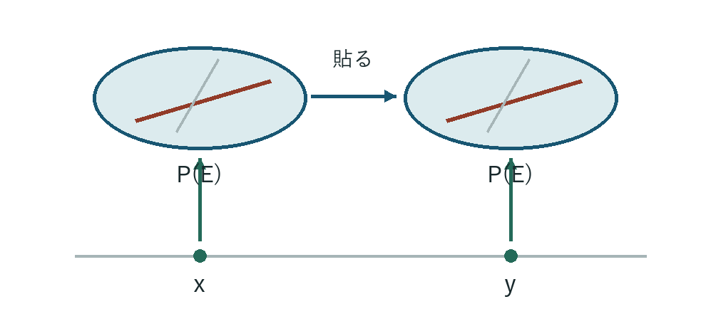

::: {.ku-chapter}
**章の導入**　各点で直線を選ぶ空間を作ると、底の束が動いても射影空間の計算を使える。そこから外積べきとAdams演算を、線束での操作に帰着させる。
:::

## 自明な射影空間を、動くファイバーにする

**導入。** 各繊維の直線を集め、どの大域的クラスが繊維の基底を延ばすか探す。

$\mathbb CP^{r-1}$ を複素 $r$ 次元空間内の直線全体と見る。固定された $\mathbb C^r$ を束 $E\to X$ のファイバーに替えると、各 $x$ の上に直線の空間が載る。得られた射影束を $\pi:\mathbb P(E)\to X$ と書く。$\mathbb P(E)$ の点 $(x,\ell)$ の上には、選ばれた直線 $\ell$ 自身が載る。これをトートロジー線束 $L$ とする。

各ファイバーでは $1,L,\ldots,L^{r-1}$ がK群の整数基底である。第4章では $\mu=L-1$ のべきを使ったが、基底変換は二項係数を成分に持つ三角行列で、対角成分は1だからである。問うべきなのは、ファイバーで得た基底を底のK理論上の基底として張り合わせられるかである。

@fig-09-projective の上段では二つの底点のファイバーの間で基底が連続に変わる。下段では一本のファイバーに絞り、$L$ の各べきがその空間で別々の係数として読める。

{#fig-09-projective width="76%"}

### 射影束定理の加法部分

有限CW複体上の階数 $r$ の複素束に対して、写像

$$
\begin{aligned}
\Phi:\ \bigoplus_{j=0}^{r-1}KU^i(X)&\longrightarrow KU^i(\mathbb P(E)),\\
(a_0,\ldots,a_{r-1})&\longmapsto\sum_{j=0}^{r-1}\pi^*(a_j)[L]^j
\end{aligned}
$$ {#eq-09-projective-map}

は両方の偶奇の次数 $i$ で同型である。

証明は、相対空間の計算とセルの帰納法に分ける。$X$ が一点なら第4章の射影空間の計算である。次に $X$ の下の骨格を $A$ とし、次元 $d$ のセルを付ける。セルの閉円板に束を引き戻せば自明化できる。従って相対項の商は、各 $d$ セルについて $S^d\wedge(\mathbb CP^{r-1})_+$ となる。

この商の縮約K群は $\mathbb CP^{r-1}$ のK群を $d$ だけ次数移動したもの。対応する底の相対項は $S^d$ の縮約群であり、同じ次数移動で点の群になる。$L$ のべきを掛ける写像は、この局所表示では球面方向の懸垂類と射影空間方向の基底の外積である。

従って @eq-09-projective-map の相対版は同型である。相対項、全体、旧骨格を両方の偶奇で並べた完全列を比較する。旧骨格は帰納法で同型であり、周りの写像も同型だから、中央の全体の項も同型になる。第5章のThom同型の証明と同じ形式だが、ここでファイバーが与えるのは一つの生成元でなく $r$ 個の基底である。

具体的な例として、$E=\mathbf1^2$ とすると $\mathbb P(E)=X\times S^2$ であり、 @eq-09-projective-map の右辺は $a_0+a_1[L]$。$[L]=1+b$ と書けば $(a_0+a_1)+a_1b$ になる。第3章のBott積定理と同じ群の分解を、異なる基底で書いている。

::: {.ku-summary}
**まとめ**　トートロジー線束のべきが、射影束のK群の自由基底を与える。
:::

## 環の関係はどこから来るか

**導入。** トートロジー線を底の束から引き、外積の次数が尽きる条件を書く。

加法基底が分かっても、$[L]^r$ を低いべきに直す式が無ければ積が計算できない。この式は直線の**包含**の双対から出る。$\pi^*E$ の中に $L$ が入るので、その双対を $L$ でテンソルすると

$$
\pi^*E^*\otimes L\longrightarrow L^*\otimes L\cong\mathbf1
$$ {#eq-09-tautological-quotient}

という全射を得る。Hermite計量を使ってこの全射を分裂させる。従って左の束の一成分として、自明線束が直和に入る。

外積代数の交代和 $\lambda_{-1}$ は直和を積へ移す。自明線束の $\lambda_{-1}$ は $1-1=0$。よって @eq-09-tautological-quotient から

$$
\sum_{j=0}^r(-1)^j[\pi^*\Lambda^jE^*][L]^j=0
$$ {#eq-09-projective-relation}

となる。最高次の係数は符号付きの行列式線束なので環の単元である。そこで多項式の割り算により任意の多項式を $r$ 未満の次数にできる。 @eq-09-projective-map の基底の独立性によれば、これ以外の関係は存在しない。

### 階数2の具体計算

$E=\mathbf1\oplus M$ とする。$t=[L]$、$a=[M]$ と書けば、 @eq-09-projective-relation は $(1-t)(1-a^{-1}t)=0$ になる。単元 $a$ を掛け直すと

$$
(t-1)(t-a)=0,\qquad
t^2=(1+a)t-a .
$$ {#eq-09-rank-two}

例えば $X=\mathbb CP^1$、$M=\mathcal O(-1)$ とする。$a=1+\mu$ かつ $\mu^2=0$。$v=t-1$ へ移すと、

$$
v^2=\mu v,\qquad \mu^2=0.
$$

$KU^0(\mathbb P(E))$ は $\{1,\mu,v,\mu v\}$ を加法基底に持つ。従って $v^2\ne0$ である一方、$v^3=\mu^2v=0$。全てのファイバーでは $v^2=0$ になるので、局所的な積だけを見ていると全体にある $\mu v$ を落とすことになる。

また $\mathbf1$ と $M$ の二つの直和成分を選ぶと、$\pi$ の二つの切断が得られる。切断上の $t$ はそれぞれ $1$、$a$ になるため、関係の左辺は両方でゼロ。この事実は関係を点検するのに使えるが、二つの制限が関係を決定するわけではない。上の例で $v^2$ は両切断に制限してゼロでも、全体では非零だからである。

::: {.ku-summary}
**まとめ**　外積べきの関係が基底に積を入れ、環の表示を決める。
:::

## 分裂原理をK理論で使う

**導入。** 束を旗の空間へ引き戻し、線束の商に分ける。

$E$ の射影束を取ると、引き戻しには自明とは限らない線束 $L$ が入る。計量を選び、その直交補に再度射影束を作る。これを繰り返すと、最終的な旗束 $f:\operatorname{Fl}(E)\to X$ で

$$
f^*E=L_1\oplus\cdots\oplus L_r
$$ {#eq-09-flag-split}

となる。ここで重要なのは、 @eq-09-projective-map の先頭の係数が $\pi^*$ そのものであり、それが単射であること。従って反復した $f^*$ も単射である。線束に分解した上で計算し、等式を元の空間へ戻せる。

二つの束 $E,F$ を同時に分けたいなら、まず $E$ の旗束を作り、そこで引き戻した $F$ の旗束を作ればよい。各段で引き戻しが単射なので、二束にまたがる関係にも分裂原理が使える。単に各点で固有ベクトルを選ぶ方法と違い、全体のK群の情報が失われない。

### 外積の生成関数

一つの束 $E$ に対し、外積べきの列を形式変数 $t$ でまとめる。

$$
\lambda_t(E)=\sum_{j=0}^{r}[\Lambda^jE]t^j,\qquad
\lambda_t(E\oplus F)=\lambda_t(E)\lambda_t(F).
$$ {#eq-09-lambda}

右の等式は、各次数で $\Lambda^n(E\oplus F)$ を $\Lambda^aE\otimes\Lambda^bF$ の直和に分けることによる。定数項は1なので、$KU^0(X)[[t]]$ で逆数が存在する。従って仮想束には

$$
\lambda_t([E]-[F]) =
\lambda_t(E)/\lambda_t(F)
$$ {#eq-09-lambda-virtual}

と定められる。共通の束を足しても分子と分母に同じ因子が現れるため、この式は第2章の安定同値と両立する。仮想束では有限次数で打ち切れるとは限らない。例えば $-\mathbf1$ の生成関数は $(1+t)^{-1}$ で、すべての次数に交互符号の係数を持つ。

### Adams演算をNewtonの式で作る

束が線束に分かれているとき、各線束を $m$ 乗へ送って足す操作を作りたい。$L_i$ をただ順に並べて $[L_i]^m$ を足す式は最初から元の底で定義されていない。しかし外積べきから同じ値を整数係数で計算できる。

形式級数の式で $\psi^m(x)$ を定める。

$$
-t\,\frac{d}{dt}\lambda_{-t}(x)\cdot
        \lambda_{-t}(x)^{-1}
    =\sum_{m\ge1}\psi^m(x)t^m.
$$ {#eq-09-adams}

線束 $L$ の場合、左辺は $t[L]/(1-t[L])$。従って $\psi^m([L])=[L]^m$ になる。直和の場合、 @eq-09-lambda の積の微分によって二つの和に分かれる。仮想束の場合も同様であり、$\psi^m$ は加法的になる。

例えば $e_j=\lambda^j(x)$ と書いて形式級数を三次まで掛けると、

$$
\begin{aligned}
\psi^1(x)&=e_1,\\
\psi^2(x)&=e_1^2-2e_2,\\
\psi^3(x)&=e_1^3-3e_1e_2+3e_3
\end{aligned}
$$ {#eq-09-newton}

になる。これらがNewton多項式であり、一つずつの根のべき和を基本対称式で書き直したもの。演算を作る段階で $1/m$ による割り算は発生しない。整数のねじれ部分にも作用を定められるのは、このためである。

二つの束を同時に分裂させると、テンソル積は $L_i\otimes M_j$ の直和になる。$m$ 乗はテンソル積に関して分配するので、$\psi^m$ は積を保つ。分裂原理の単射性を使えば、この等式を元の空間へ戻せる。同様に $\psi^m\psi^n=\psi^{mn}$ である。

::: {.ku-summary}
**まとめ**　引き戻しが単射なので、線束の計算から元の底での恒等式が従う。
:::

## 次数と演算から、整数の情報を読む

**導入。** 線束のテンソルべきを、仮想束全体へ延ばす方法を調べる。

Chern指標の $2j$ 次成分を $\operatorname{ch}_j$ と書く。線束の $\operatorname{ch}([L]^m)$ は $\exp(mc_1(L))$。その $2j$ 次成分は、$\operatorname{ch}_j([L])$ の $m^j$ 倍である。分裂原理と加法性から、

$$
\operatorname{ch}_j(\psi^m x)
=m^j\operatorname{ch}_j(x)
$$ {#eq-09-adams-weight}

を得る。従って Chern 指標を媒介にすると、$\psi^m$ は有理係数では次数ごとに異なる重みを持つ。例えば $\mathbb CP^2$ の二次成分は $\psi^2$ で2倍になり、四次成分は4倍になる。

一方、整数係数ではこれらの固有方向の直和がそのまま基底になるわけではない。$\mu=L-1$ とすると、

$$
\psi^m(\mu)= (1+\mu)^m-1.
$$ {#eq-09-adams-mu}

$\mathbb CP^2$ で $m=2$ とすれば $2\mu+\mu^2$。さらに $\psi^2(\mu^2)=4\mu^2$。基底 $(\mu,\mu^2)$ での行列には対角の2、4に加えて、非対角成分1がある。固有値2の元を $a\mu+b\mu^2$ として探すと $a+4b=2b$、すなわち $a=-2b$ になる。この方向を先頭係数1の整数元で選ぶことはできない。

| 底と元 | $\psi^2$ | $\psi^3$ |
|---|---|---|
| $S^2$ の $\mu$ | $2\mu$ | $3\mu$ |
| $\mathbb CP^2$ の $\mu$ | $2\mu+\mu^2$ | $3\mu+3\mu^2$ |
| $\mathbb CP^2$ の $\mu^2$ | $4\mu^2$ | $9\mu^2$ |
| $\mathbb RP^5$ の $\mu$ | $0$ | $\mu$ |

: 同じ線束のべきから来る演算を三つの底で比較する。 {#tbl-09-adams}

@tbl-09-adams の最後の行は、実射影空間に引き戻した $L$ が $L^2=1$ を満たすことから出る。$\psi^2(\mu)=0$、$\psi^3(\mu)=L^3-1=L-1$。有理Chern指標ではこの行の $\mu$ 自体が見えない。ここで $\psi^2$ がゼロになる理由は、演算を有理化したことではなく、線束の二乗が自明になることにある。

::: {.ku-summary}
**まとめ**　Newtonの関係でAdams演算が決まり、整数のねじれにも作用する。
:::

## Thom類への作用

**導入。** Thom類にAdams演算をかけ、線束のEuler因子を比べる。

複素束 $V\to X$ のThom類を $u_V$ とする。Thom同型により、$\psi^m(u_V)$ は一意に $\pi^*\rho^m(V)\,u_V$ と書ける。$\rho^m(V)$ は $\psi^m$ がThom類にどう作用したかを補正する底のクラスである。

線束の場合、零切断に引き戻して @eq-09-adams を適用すると、

$$
\begin{aligned}
s^*\psi^m(u_L)&=1-[L]^{-m},\\
s^*(\rho^m(L)u_L)&=\rho^m(L)(1-[L]^{-1}).
\end{aligned}
$$ {#eq-09-thom-restriction}

$1-[L]^{-1}$ を一般の環で消去してはいけない。例えば $L$ が自明ならこの因子は0である。そこで普遍線束を使い、その有限次元近似の環 $\mathbb Z[\mu]/(\mu^{N+1})$ で計算する。零切断の式が決めない最高次の係数は、より大きい $N$ で計算してから制限すれば決まる。従って @eq-09-thom-restriction と等比数列の式から

$$
\rho^m(L)=1+[L]^{-1}+\cdots+[L]^{-(m-1)}
$$ {#eq-09-cannibalistic}

::: {.ku-worked}
**計算を追う｜二つの隣り合う和を引く**

$t=[L]^{-1}$ とする。補正因子の候補を $1+t+\cdots+t^{m-1}$ として、消去する前の積に戻す。

$$
\begin{aligned}
(1-t)(1+t+\cdots+t^{m-1})
 &=(1+t+\cdots+t^{m-1})-(t+t^2+\cdots+t^m)\\
 &=1-t^m .
\end{aligned}
$$

途中の次数は二つの和に一回ずつ現れる。これは候補が関係を満たす計算であり、候補の一意性には直前の普遍線束の議論が必要である。自明線束に戻すと $t=1$ なので補正は $m$ になり、零で割らずに値を読める。
:::

を得る。具体的には、任意の有限CW複体からの分類写像がある有限段へ入るので、その段の結果を引き戻す。ここでは係数ごとに消去を正当化している。

束の直和に関してThom類が積になることと、$\psi^m$ が積を保つことから $\rho^m(V\oplus W)=\rho^m(V)\rho^m(W)$。従って各線束への分裂で @eq-09-cannibalistic を掛ければ一般の場合も決まる。点上の複素一平面では $\rho^m=m$ で、$\psi^m(\beta)=m\beta$ とも一致する。

Chern指標でこの補正を読むと、線束の根を $x$ として、

$$
\operatorname{ch}(\rho^m(L))
=\frac{1-e^{-mx}}{1-e^{-x}} .
$$

ここで分数は両辺の共通の $x$ を形式級数の中で除いた表記である。$x=0$ での定数項は $m$。Todd級数に現れた $1-e^{-x}$ と同じ因子が、ここでは「べきに送る」操作の前後を比較している。

::: {.ku-summary}
**まとめ**　等比和の補正因子が現れ、分裂原理で多次元の繊維へ拡張できる。
:::

## 演習と解答

**導入。** 整数部分とねじれの例で、同じ演算が何を区別するか検算する。

### 1　関係の係数を束から読んで戻す

$X=\mathbb CP^1$、$E=\mathcal O(-2)\oplus\mathcal O(1)$ とする。$L$ を $\mathbb P(E)$ 上の線束、$v=[L]-1$、$\mu=[\mathcal O(-1)]-1$ とする。$v^2$ と $v^3$ を計算せよ。

**解答。** 底では $\mu^2=0$ なので、二つの線束のクラスは $1+2\mu$、$1-\mu$。関係は $(v-2\mu)(v+\mu)=0$ である。従って $v^2=\mu v$、さらに $v^3=\mu^2v=0$。 @eq-09-rank-two の例と積の関係が一致したが、その理由は今回も二つの第一Chern類の和が同じだからである。二つの切断における $v$ の値は今回 $2\mu$ と $-\mu$ であり、切断ごとの情報は異なる。

### 2　仮想束の二次外積

$\mathbb CP^2$ で $x=[L]-1$ とする。$\lambda^2(x)$ を計算し、 @eq-09-newton の第二式から $\psi^2(x)$ を復元せよ。

**解答。** $(1+[L]t)/(1+t)$ を展開すると、$t^2$ の係数は $1-[L]=-\mu$。よって $\psi^2(\mu)=\mu^2+2\mu$。この計算で $\lambda^2(x)=0$ と置くと、仮想束を実際の線束と誤って扱ったことになる。

### 3　有理固有基底を作る

$\mathbb CP^3$ 上で、$\psi^2$ に対してそれぞれ固有値 $2,4,8$ を持つ有理基底を一つ求めよ。

**解答。** $x=\log(1+\mu)=\mu-\mu^2/2+\mu^3/3$ とする。この対数は $\mu^4=0$ のため有限式である。 @eq-09-adams-mu によれば $\psi^2(x)=\log((1+\mu)^2)=2x$。積を保つので $x^2=\mu^2-\mu^3$ は固有値4、$x^3=\mu^3$ は固有値8を持つ。三角形の基底変換の対角が1なので確かに有理基底になる。

::: {.ku-summary}
**まとめ**　Chern指標に移す計算と、整数環内で直接行う計算を使い分けられる。
:::

## 原典とこの章で使った主張

**導入。** 射影束定理の仮定と、演算の定義に使った事実を確かめる。

射影束上のトートロジー線束とBott周期性を結びつける古典的な議論は Atiyah と Bott の論文にある。本章では第3章で周期性を確立してから、底のセル濾過で射影束定理を証明した。 [On the periodicity theorem for complex vector bundles](https://webhomes.maths.ed.ac.uk/~v1ranick/papers/atiyahbott.pdf)

Adams演算と分裂原理は Hatcher 第2章 §3。複素K理論の射影空間の環と Thom 類の関係も前後の節で確認できる。 [Vector Bundles and K-Theory](https://pi.math.cornell.edu/~hatcher/VBKT/VB.pdf)

::: {.ku-summary}
**まとめ**　基底、分裂、演算の三つの主張をそれぞれ原典で引ける。
:::

::: {.ku-chapter}
**章のまとめ**　射影束による分裂が、多変数の束の演算を線束のべきに還元する。その方法でThom類に現れる補正を決めた。
:::
