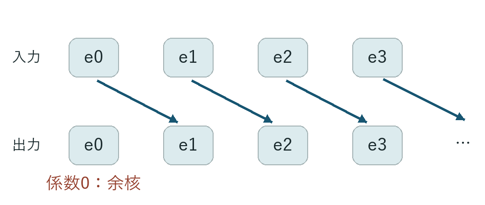

## 正の周波数だけを残す操作

第6章では球面上の微分作用素から指数を作った。ここでは円周上の可逆行列を出発点とし、境界の巻き数をHilbert空間上の作用素の指数へ送る。例にするのは、負の周波数を捨てると逆を持てなくなる作用素である。

円周で $z(e^{i\theta})=e^{i\theta}$ とし、測度を $d\theta/(2\pi)$ に規格化する。$L^2(S^1)$ の正規直交基底は $e_n=z^n$、$n\in\mathbb Z$ である。非負の周波数の閉包を Hardy 空間 $H^2$ と呼び、そこへの直交射影を $P$ とする。

$$
H^2=\overline{\operatorname{span}}\{e_0,e_1,\ldots\},
\qquad
P e_n=
\begin{cases}e_n& n\ge0,\\0& n<0.\end{cases}
$$ {#eq-10-hardy}

有界関数 $a$ を掛ける作用素 $M_a$ を考える。掛けた後で @eq-10-hardy の射影を取ると、Toeplitz作用素が得られる。

$$
T_a=PM_a|_{H^2}:H^2\longrightarrow H^2,\qquad
\|T_a\|\le\|a\|_\infty .
$$ {#eq-10-toeplitz}

圧縮と呼ばれるこの手順により、元の掛け算が可逆でも $T_a$ は可逆とは限らない。$a=z$ では $e_j$ が $e_{j+1}$ に移るため、像から定数が落ちる。逆方向の $a=z^{-1}$ では定数を負の周波数へ送って捨てるので、核に定数が入る。

$$
T_z=S,\qquad T_{z^{-1}}=S^*,\qquad
\begin{aligned}
S^*S&=I,\\
SS^*&=I-P_0 .
\end{aligned}
$$ {#eq-10-shifts}

$P_0$ は定数への階数1の射影である。左逆は本当の逆になる一方、右側の合成では定数一つが回収できない。 @eq-10-shifts の添字を逆にすると指数も逆になるので、以下では $S$ を右シフトとする。

{#fig-10-shift}

## 圧縮と積のずれを局所化する

$T_aT_b$ は、$b$ を掛けた直後にも射影を挟む。$T_{ab}$ は途中で捨てない。この差は次の式で表せる。

$$
T_aT_b-T_{ab}
=-PM_a(I-P)M_b|_{H^2}.
$$ {#eq-10-defect}

ここで $I-P$ は途中で捨てられた負の周波数だけを通す。そのため $b$ が Laurent 多項式なら、$(I-P)M_b$ の像は有限個の負の周波数に限られる。具体的に $b(z)=\sum_{n=-N}^{M}b_nz^n$ とすると、入力 $e_j$ から負の周波数へ行けるのは $j<N$ のときだけで、負の側の像は $e_{-N},\ldots,e_{-1}$ が張る。よって @eq-10-defect は有限階数である。

$a,b$ が連続な場合は Laurent 多項式で一様近似できる。 @eq-10-toeplitz のノルム評価により、右辺は有限階数作用素の作用素ノルムでの極限になる。従ってずれはコンパクトである。これは成分ごとに同じ議論を行えば、$a,b$ が連続行列値でも成立する。

### 近似がどこに効くか

$b=z^{-k}$、$a=z^k$、$k>0$ のとき、積 $ab=1$ なので @eq-10-defect は @eq-10-shifts を $k$ 回繰り返したものになる。

$$
T_{z^k}T_{z^{-k}}-I=-\sum_{j=0}^{k-1}P_j,\qquad
T_{z^{-k}}T_{z^k}-I=0.
$$ {#eq-10-k-defect}

左の誤差に現れるのは、実際に失われる周波数全体である。例えば $k=3$ では右辺の最初の三係数が自由には選べない。$a,b$ を一般の連続関数に動かせば、誤差の階数が一様に有限とは限らない。それでも任意の精度で有限階数に近づくことが、次のFredholm性には十分である。

## Fredholm性を可逆な記号から出す

$a:S^1\to GL_r(\mathbb C)$ が連続であるとする。逆行列 $a^{-1}$ も連続だから、 @eq-10-defect を二つの順に適用すると、

$$
T_{a^{-1}}T_a=I+K_1,\qquad T_aT_{a^{-1}}=I+K_2
$$ {#eq-10-parametrix}

となり、$K_1,K_2$ はコンパクトである。これがコンパクトな誤差を許した逆、つまりパラメトリックスである。第6章では楕円微分作用素でこの考え方を使った。ここでは @eq-10-defect だけで誤差の性質を確認できた。

Atkinsonの判定の必要な向きを証明しておく。Hilbert空間の間の作用素 $A$ に $BA=I+K$ があるとする。$\ker A$ 上では $K=-I$。無限次元空間の単位球で恒等写像はコンパクトにならないため、$\ker A$ は有限次元である。

さらに $(\ker A)^\perp$ で $A$ が下から有界でないとすると、そこからノルム1の $x_j$ を選び $Ax_j\to0$ とできる。コンパクト性により $Kx_j$ は収束部分列を持つ。$x_j=BAx_j-Kx_j$ だから、その部分列では $x_j$ 自身がノルム1の $x$ へ収束する。すると $Ax=0$ であり、$x\perp\ker A$ に反する。よって $A$ の像は閉じている。

最後に、もう一つの合成 $AB=I+K'$ の随伴を取ると、同じ有限次元性の議論を $\ker A^*$ に適用できる。閉像の余核は $\ker A^*$ と同型だから、$A$ はFredholmとなる。従って @eq-10-parametrix から $T_a$ はFredholmである。

逆にFredholm写像に対しては、核の直交補から像への写像 の有界逆を選び、像の直交補でゼロに延ばせば、両側の誤差が有限階数の $B$ を得る。この二方向を合わせると、コンパクトな誤差を除いた代数で可逆性を判定できる。

### 記号が零になる点で何が起きるか

スカラー連続関数 $a$ が $\zeta\in S^1$ でゼロになるとする。$0<r<1$ に対し、規格化された Hardy の評価ベクトルを

$$
k_{r,\zeta}(z)=
\frac{\sqrt{1-r^2}}{1-r\bar\zeta z}
$$ {#eq-10-kernel}

と置く。幾何級数の係数を二乗して足すとノルム1。各固定周波数の係数は $r\to1$ でゼロに収束する。有限Fourier和が稠密でノルムが有界なので、$k_{r,\zeta}$ は弱くゼロに収束する。

円周上の $|k_{r,\zeta}|^2$ はPoisson核である。$\zeta$ の任意の近傍の外では一様にゼロへ収束し、積分は1である。従って連続な $|a|^2$ について

$$
\|T_ak_{r,\zeta}\|^2
 \le \|a k_{r,\zeta}\|^2
 \longrightarrow |a(\zeta)|^2=0
$$ {#eq-10-approx-null}

となる。もし $T_a$ がFredholmであれば、その有限次元の核への射影は、弱くゼロへ行く列を強くゼロへ送る。核の直交補での下からの評価に @eq-10-approx-null を代入すると、ノルム1が0に近づくという矛盾を得る。

行列の場合も、$a(\zeta)$ の核にノルム1の $v$ を選び、$k_{r,\zeta}v$ を使えば同じ証明になる。従って連続な行列記号の場合、点ごとの可逆性はFredholm性の十分条件であるだけでなく必要条件でもある。

## 円周の巻き数から指数を求める

Fredholm作用素の指数は作用素ノルムでの連続変形に対して一定である。従って $a$ を可逆な記号の中で連続変形すれば、 @eq-10-toeplitz のノルム評価から $T_a$ の指数は変わらない。

第3章では $GL_r(\mathbb C)$ のループを極分解でユニタリ化し、行列式を除いた部分のループを縮めた。この分類を使えば、$a$ は次へ変形できる。

$$
a \simeq \operatorname{diag}(z^m,1,\ldots,1),
\qquad m=w(\det a).
$$ {#eq-10-clutch}

$T_{z^m}$ は、$m\ge0$ なら $S^m$、$m<0$ なら $(S^*)^{-m}$。 @eq-10-k-defect の有限欠損を数えれば

$$
\operatorname{ind}T_a=-w(\det a)
$$ {#eq-10-index}

となる。第1章の規約では、北から南への座標変換を $a$ として球面上に貼った束を $E_a$ とすると、その行列式線束の第一Chern数は $-w(\det a)$。従って @eq-10-index の右辺は、その球面での第一Chern数そのものである。

ここには二つの操作がある。まず可逆行列を円周上で貼り合わせとして読み、球面の束を作る。次に同じ行列を掛け算として読み、負の周波数を除いて作用素を作る。両方の操作で保持された整数が一致している。

| $a$ の例 | 巻き数 | 核次元 | 余核次元 |
|---|---:|---:|---:|
| $1$ | 0 | 0 | 0 |
| $z^2$ | 2 | 0 | 2 |
| $z^{-3}$ | −3 | 3 | 0 |
| $\operatorname{diag}(z^2,z^{-3})$ | −1 | 3 | 2 |

: 対角記号では各成分で欠損を数えられる。巻き数は行列式の値である。 {#tbl-10-shifts}

@tbl-10-shifts の最後の行では核と余核がともに非零である。それにもかかわらず、 @eq-10-clutch によりこの記号は $\operatorname{diag}(z^{-1},1)$ へ変形できる。終点では核が1、余核が0。変形の間に各次元は二つずつ減り、指数1は保存される。

## 多項式記号では可解性を点で調べられる

多項式 $p(z)$ が円周に零点を持たないとする。$p$ は非負のべきだけを持つから $T_p$ は $H^2$ 内での掛け算である。$H^2$ の元は開単位円板で収束するべき級数と見なせる。具体的には Cauchy–Schwarz の不等式から、$f(z)=\sum a_nz^n$ に対して

$$
|f(z)|\le
\frac{\|f\|_{H^2}}{\sqrt{1-|z|^2}}
$$ {#eq-10-evaluation}

となり、内点での評価は連続である。各階の微分の評価も、半径を固定してべき級数を同じように評価すれば連続である。

$p$ の内側の異なる零点を $a_1,\ldots,a_k$、重複度を $m_1,\ldots,m_k$ とする。$p f$ が満たす右辺の条件は

$$
(pf)^{(j)}(a_i)=0
      \quad(1\le i\le k,\ 0\le j<m_i)
$$ {#eq-10-eval-conditions}

である。この条件は独立である。互いに素な多項式 $(z-a_i)^{m_i}$ に対する中国剰余定理を使えば、指定した各Taylor係数を取る多項式を作れる。条件を満たす部分空間の余次元は $\sum m_i$。

一方、掛け算 $p$ の核はゼロである。零点を避ける開部分で $pf=0$ なら $f=0$ であり、正則関数の一致の定理から全体でゼロになる。 @eq-10-index と偏角の原理によれば、$T_p$ の閉像の余次元も $\sum m_i$。従って @eq-10-eval-conditions の条件は必要十分である。指数だけでなく、どの右辺が像に入るかまで特定できた。

### 具体例　重根と外側の零点

$$
p(z)=(z-\tfrac12)^2(z-2).
$$ {#eq-10-polynomial}

内側には二重根 $\tfrac12$、外側には根 $2$ がある。$\operatorname{ind}T_p=-2$。右辺 $f=1$ は明らかに像に入らない。$f(z)=z-\tfrac12$ は値の条件を満たすが、導関数の条件を満たさない。$f(z)=(z-\tfrac12)^2$ は両条件を満たし、解は $1/(z-2)$ である。この解は円板の閉包より外側にしか極を持たないため、$H^2$ に属する。

内側と外側を入れ替える効果も見える。$q_a(z)=z-a$ で $|a|>1$ なら逆数が有界正則であり、$T_{q_a}$ は可逆。$|a|<1$ なら余核が1次元。$|a|=1$ のときには @eq-10-approx-null の列が作れるためFredholm性そのものが壊れる。第3章で固有値が単位円を横切ったところで可逆な貼り合わせが壊れたことと同じ境界である。

### Laurent記号で有限個の係数を重ねる

$a(z)=z^{-2}(z-\tfrac12)^3$ を考える。巻き数は $3-2=1$ だから指数は $-1$。既に $p(z)=(z-\tfrac12)^3$ の掛け算は、$\tfrac12$ で三次までの零点を要求する。

ここで $T_a=S^{*2}T_p$ が厳密に成り立つ理由は、$T_p$ の出力が $H^2$ 内にあり、途中で捨てられる負の周波数がないためである。したがって $T_a f=g$ は、ある $A,B$ について

$$
p(z) f(z)=z^2g(z)+A+Bz
$$ {#eq-10-laurent-solve}

と同値である。右辺で $\tfrac12$ における値と一次微分をゼロにするように、$A,B$ は一意に決まる。二次微分は $A+Bz$ の補正で変更できない。このため残る条件は

$$
(z^2g)''(\tfrac12)=0.
$$

核について $g=0$ とすれば、一次多項式に三重の零点を要求することになるので $A=B=0$、さらに $f=0$。従って余核の次元1、核の次元0が直接出る。 @eq-10-laurent-solve は、負べきで落とした係数を、正べき側の条件を満たすための変数として使う計算である。

## パラメータごとに変わる境界行列

$X$ をコンパクトな底、$P_x$ を $\mathbb C^r$ の連続な直交射影族とし、$Q_x=I-P_x$ とする。円周上で

$$
a_x(z)=Q_x+zP_x
$$ {#eq-10-family-symbol}

と置く。$P_x$ と $Q_x$ が直交するため、逆は $Q_x+z^{-1}P_x$。Toeplitz作用素は $Q_x$ 成分で恒等、$P_x$ 成分で右シフトである。従って各点での核はゼロ、余核は定数Fourierモードの $\operatorname{im}P_x$ に同一視できる。

第7章の族の指数を使うと

$$
\operatorname{Ind}(T_{a_x})=-[\operatorname{im}P]
       \in KU^0(X).
$$ {#eq-10-family-index}

たとえば $X=\mathbb CP^1$ で $P_x$ がトートロジー直線への射影なら、どの点の指数も $-1$ だが、族の指数は $-[L]$。一定の直線で作った族との差は $-(L-1)$ であり、階数の測定だけでは見えない。

同じ @eq-10-family-symbol を第3章の $X\times S^2$ の貼り合わせに使うと、像の部分に球面の一回転が付き、核の部分には付かない。そこでのBott係数は $[\operatorname{im}P]$、 @eq-10-family-index はその負号付きの値である。符号が異なるのは、第3章の係数を負の第一Chern数を持つ $b=[\mathcal O(-1)]-1$ に関して読んでいるためである。複素向きの $\beta=-b$ で係数を読めば両者が一致する。

## 演習と解答

### 1　行列記号で余核と核を同時に作る

$a(z)=\operatorname{diag}(z^3,z^{-2},1)$ とする。各成分での可解条件、解の自由度、指数を求めよ。

**解答。** 第一成分の右辺では定数、$z,z^2$ の係数がゼロでなければならず、解は一意。第二成分は任意の右辺を持ち、核を定数と $z$ が張る。第三成分は恒等。従って余核3、核2、指数 $-1$。行列式は $z$ だから @eq-10-index も $-1$。

### 2　点ごとの可逆性と圧縮後の可逆性

$T_z$ と $T_{1+\frac12 z}$ の違いを説明せよ。

**解答。** どちらも円周で記号は非零だからFredholm。$T_z$ は右シフトで、余核に定数が残る。一方 $1+\frac12 z$ の逆数は円板内部と境界で有界な正則関数であるから、掛け算が $H^2$ 内の逆になる。$\|S/2\|<1$ を使う Neumann 級数でも同じ結論。連続な可逆記号は圧縮で必ず可逆になるという命題への反例は前者である。

### 3　誤差の符号を検算する

$a=z^2,b=z^{-1}$ に対して $T_aT_b-T_{ab}$ を基底で求めよ。

**解答。** $n\ge1$ では $S^*e_n=e_{n-1}$ だから、$S^2S^*e_n=Se_n$。$n=0$ でだけ $S^2S^*e_0=0$、$Se_0=e_1$。従って $T_aT_b-T_{ab}$ は $e_0$ を $-e_1$ へ送る階数1の写像。 @eq-10-defect の右辺でも、途中の $e_{-1}$ が $a=z^2$ によって $e_1$ に戻る項を負号付きで引く。

## 参考

この章の円周の証明は、連続記号の有限Fourier近似、Fredholm指数の連続性および可逆行列ループの分類を組み合わせた。より一般の Toeplitz 指数と擬微分作用素への接続には Melrose の講義の Lecture 29–30 を参照できる。 [Topics in Analysis](https://math.mit.edu/~rbm/Bkly08/Bkly08.html)
