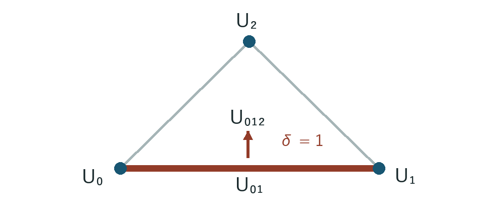
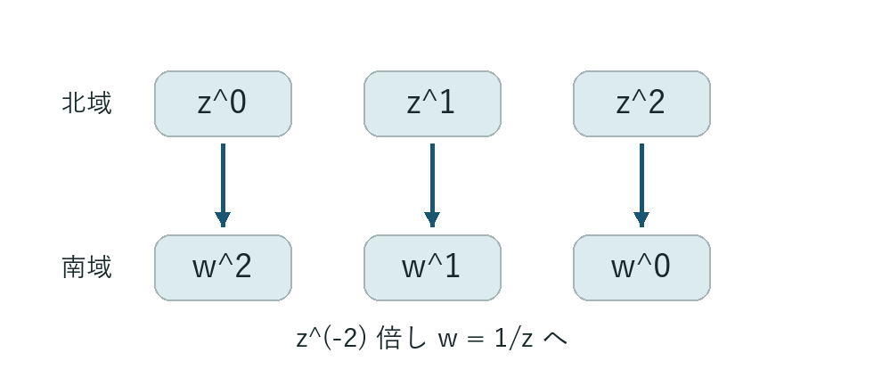

## 指数を各次数に分解する

複素曲線では $\bar\partial$ の核と余核だけを調べればよかった。複素次元 $n$ になると $(0,q)$ 形式は $0\le q\le n$ にわたって存在する。正則束 $E$ の値を取る形式に対し、局所の正則フレームで係数へ $\bar\partial$ を作用させると、長い複体が得られる。

$$
0\to\Omega^{0,0}(E)
  \xrightarrow{\bar\partial}\Omega^{0,1}(E)
  \xrightarrow{\bar\partial}\cdots
  \xrightarrow{\bar\partial}\Omega^{0,n}(E)\to0 .
$$ {#eq-11-dolbeault-complex}

局所の複素座標で $\bar\partial$ を二回行えば、係数の二階微分が交換し、外積の順序で符号が反転する。従って複体になる。この複体の $q$ 次の核を、一つ前からの像で割って $H^{0,q}(X;E)$ と書く。

各次数を別々に数えるのは難しくても、交代和には安定性がある。Hermite計量を選び、偶数次数から奇数次数への作用素 $\bar\partial+\bar\partial^*$ を考える。そのシンボルは、適当な定数位相の選択の下で外積と挿入の和になる。第5章のKoszulモデルと同じ理由で、非零の余接ベクトル上で可逆である。

$$
\operatorname{ind}
 \bigl((\bar\partial+\bar\partial^*)_{\mathrm{ev}}\bigr)
 =\sum_{q=0}^{n}\dim H^{0,q}(X;E)\,(-1)^q.
$$ {#eq-11-euler}

ここで使った解析上の事実は、コンパクトな複素多様体上のDolbeault複体では、各コホモロジー類がHermite計量に関する一意の調和代表を持つこと。$\bar\partial$ と随伴の両方でゼロである調和形式が、偶数側の核と奇数側の余核を与える。従って @eq-11-euler の正負は次数の偶奇で決まる。この交代和を $\chi(X;E)$ と書く。

第6章で $\mathbb CP^1$ について行った位相側の計算は、一般の複素次元でも標準のSpin$^c$ 向きで同じ形を持つ。Hirzebruch–Riemann–Rochを次の形で用いる。

$$
\chi(X;E)
=\int_X\operatorname{ch}(E)\operatorname{Td}(T^{1,0}X).
$$ {#eq-11-hrr}

右辺は $2n$ 次の成分だけを積分する。以下では、各コホモロジー群を求める代数的計算と、 @eq-11-hrr の積分とを独立に実行する。

## 標準アフィン被覆から単項式の問題へ

射影座標を $[Z_0:\cdots:Z_n]$ と書く。$U_i$ を $Z_i\ne0$ の点の開集合とし、$I=\{i_0,\ldots,i_q\}$ に対して $U_I$ を交わりとする。$\mathcal O(k)$ の切断は、斉次次数 $k$ の式として扱える。

ここでは代数的なアフィン被覆で計算する。必要な比較定理は二つである。アフィン開集合上の準連接層の高次コホモロジーは消えるので、この被覆のČech複体が代数的コホモロジーを計算する。さらにSerreのGAGAによれば、複素射影多様体上の代数的ベクトル束について、この群は解析的な層コホモロジーと一致する。Dolbeault分解で後者を @eq-11-dolbeault-complex の群と同一視できる。

局所化した多項式環では、$U_I$ 上で $Z_i$ の負べきが許されるのは $i\in I$ のときに限られる。したがって各斉次Laurent単項式を

$$
Z^\alpha=Z_0^{\alpha_0}\cdots Z_n^{\alpha_n},
\qquad
\sum_{j=0}^n\alpha_j=k
$$ {#eq-11-homogeneous}

とし、負の指数の集合を $N_\alpha=\{j\mid\alpha_j<0\}$ と書けば、$Z^\alpha$ が $U_I$ 上で使える条件は $N_\alpha\subset I$ である。代数的局所化では各元に現れる項は有限個なので、Čech複体を単項式ごとの部分複体の直和に分解してよい。

### 一つの単項式について微分を求める

Čech $q$ コチェインの成分は $q+1$ 個の開集合の共通部分に載る。微分では、$q+2$ 個の添字から一つずつ落とし、制限の交代和を取る。固定した $Z^\alpha$ について、その成分の係数を $c_I$ と書く。$N_\alpha$ を含まない $I$ なら $c_I=0$ とする。

$$
(\delta c)_{\{i_0,\ldots,i_{q+1}\}}
 =\sum_{j=0}^{q+1}((-1)^j)
 c_{\{i_0,\ldots,\widehat{i_j},\ldots,i_{q+1}\}}.
$$ {#eq-11-cech}

単項式部分のコホモロジーは、$N_\alpha$ の大きさではなく、空か全体か中間かで決まる。

- $N_\alpha=\varnothing$ の場合、全ての $I$ が許される。単体の通常のコチェイン複体になり、$q=0$ の定数成分だけが残る。
- $N_\alpha=\{0,\ldots,n\}$ の場合、一番大きい $I$ しか使えない。従って $q=n$ の一成分がそのまま残る。
- それ以外の場合、$N_\alpha$ にない頂点 $j$ を一つ選ぶ。頂点 $j$ を $I$ に追加する操作を使うと複体を縮められる。

最後のケースの符号を確かめよう。順序付きの添字を交代的に扱い、$h$ を次で定める。

$$
(hc)_{i_0,\ldots,i_{q-1}}
      = c_{j,i_0,\ldots,i_{q-1}} .
$$

右辺で重複した添字を含めばゼロとする。$j$ は $N_\alpha$ に属さないので、右辺が非零であるためには左辺の添字が既に $N_\alpha$ を含む必要がある。従って $h$ は単項式部分複体に閉じている。 @eq-11-cech を $j$ を先頭にして展開すると、

$$
\begin{aligned}
(h\delta c)_{i_0,\ldots,i_q}
 &= c_{i_0,\ldots,i_q}
   -\sum_{s=0}^q((-1)^s) c_{j,i_0,\ldots,\widehat{i_s},\ldots,i_q},\\
(\delta h c)_{i_0,\ldots,i_q}
 &= \sum_{s=0}^q((-1)^s) c_{j,i_0,\ldots,\widehat{i_s},\ldots,i_q}.
\end{aligned}
$$ {#eq-11-contract}

よって $\delta h+h\delta=I$。最下位の次数でも、$I$ が空の成分は $N_\alpha\ne\varnothing$ によってもともとゼロである。これで中間の場合には、どの次数にもコホモロジーが残らないことが示された。

### 射影平面で微分を手で見る

$n=2$、$Z^\alpha=Z_0^{-1}Z_1^{-1}Z_2^3$ とする。$N_\alpha=\{0,1\}$ だから、この単項式を使える成分は $U_{01}$ と $U_{012}$ だけである。$q=1$ から $q=2$ への微分は、 @eq-11-cech の最後の項だけが残るので $+1$ 倍。従ってどちらの次数にも残らない。

@fig-11-cech を参照。

{#fig-11-cech}

一方、$Z_0^{-1}Z_1^{-1}Z_2^{-1}$ なら全添字が負であり、$U_{012}$ の成分にしか置けない。遡って打ち消せる成分がないから、$H^{0,2}(\mathbb CP^2;\mathcal O(-3))$ に一つ残る。$n=1$ の場合の「両指数が負」という条件は、第6章で一つの座標だけを使って書いた $k<m<0$ と同じである。

{#fig-11-charts}

## 残った単項式を数える

非負指数だけの単項式は、多重指数 $\alpha_j\ge0$ で総和が $k$ の個数を数えればよい。$k\ge0$ では $k$ 個の記号を $n$ 個の仕切りで $n+1$ 箱に分ける方法の数である。

$$
h^0(\mathbb CP^n;\mathcal O(k))
 =
\begin{cases}
\binom{k+n}{n}&k\ge0,\\[2pt]
0&k<0 .
\end{cases}
$$ {#eq-11-hzero}

全指数が負なら、$\alpha_j=-1-b_j$、$b_j\ge0$ と書く。条件 @eq-11-homogeneous は $\sum b_j=-k-n-1$ になる。同じ数え上げから、

$$
h^n(\mathbb CP^n;\mathcal O(k))
 =
\begin{cases}
\binom{-k-1}{n}&k\le-n-1,\\[2pt]
0&k>-n-1 .
\end{cases}
$$ {#eq-11-htop}

ここでは $n\ge1$ とする。$0<q<n$ の項は全てゼロである。したがって二つの条件の間、$-n\le k\le-1$ ではどの次数にも何も残らない。

| $\mathbb CP^2$ 上の $k$ | $h^0$ | $h^1$ | $h^2$ | $\chi$ |
|---:|---:|---:|---:|---:|
| $2$ | 6 | 0 | 0 | 6 |
| $0$ | 1 | 0 | 0 | 1 |
| $-1$ | 0 | 0 | 0 | 0 |
| $-2$ | 0 | 0 | 0 | 0 |
| $-3$ | 0 | 0 | 1 | 1 |
| $-5$ | 0 | 0 | 6 | 6 |

: 正の側と負の側に残る次数が異なる。射影平面では両方とも偶数なので、交代和の符号は正になる。 {#tbl-11-cp2}

@tbl-11-cp2 の値は、一つの多項式にまとめられる。一般の $n$ でも、

$$
\chi(\mathbb CP^n;\mathcal O(k))
   =\frac{(k+1)(k+2)\cdots(k+n)}{n!}
   =\binom{k+n}{n}
$$ {#eq-11-binomial}

となる。ここで右端の二項記号は、多項式として整数 $k$ 全体に延長したものを指す。$-n\le k\le-1$ では積のどれかがゼロ、$k\le-n-1$ では全因子が負で符号が $(-1)^n$。従って @eq-11-hzero と @eq-11-htop が同じ多項式に合流する。

## 接束のTodd類を別に求める

トートロジー線束を $L=\mathcal O(-1)$ とする。点が直線 $\ell\subset\mathbb C^{n+1}$ を表すなら、近くの直線は $\ell$ から補空間への線形写像のグラフとして書ける。従って接空間は $\operatorname{Hom}(\ell,\mathbb C^{n+1}/\ell)$。

この表示を束として使い、$0\to L\to\mathbf1^{n+1}\to Q\to0$ に $\operatorname{Hom}(L,-)$ を適用する。すると

$$
0\longrightarrow\mathbf1
 \longrightarrow (L^*)^{\oplus(n+1)}
 \longrightarrow T^{1,0}\mathbb CP^n
 \longrightarrow0 .
$$ {#eq-11-euler-sequence}

これは射影空間のEuler完全列である。左の一点分が、斉次座標を同じスカラーで変えても射影点が変わらない方向に当たる。K群では

$$
[T^{1,0}\mathbb CP^n]=(n+1)[L^*]-1 .
$$

従って $h=c_1(L^*)$ とおけば、第5章のTodd乗法性により

$$
\operatorname{Td}(T^{1,0}\mathbb CP^n)
 =\left(\frac{h}{1-e^{-h}}\right)^{n+1}.
$$ {#eq-11-projective-td}

指数の @eq-11-hrr の入力は $e^{kh}$ と @eq-11-projective-td である。$h^n$ の積分が1だから、必要なのは形式級数の $n$ 次係数だけであり、$h^{n+1}$ 以降は捨ててよい。

### 低次元で展開を検算する

$n=2$ では $Q(h)=h/(1-e^{-h})=1+h/2+h^2/12+\cdots$ を使う。三乗の二次係数は、一つの因子から二次を取る場合と、二因子から一次を取る場合の和である。

$$
\begin{aligned}
Q(h)^3&=1+\tfrac32 h+h^2,\\
e^{kh}Q(h)^3&=1+(k+\tfrac32)h
 +\tfrac{(k+1)(k+2)}2 h^2
 \quad\bmod h^3 .
\end{aligned}
$$ {#eq-11-cp2-td}

$n=3$ では $Q(h)$ に三次項がないが、四乗には三次項が出る。三因子の一次の積が $4/8$、一因子の二次と別の一次との積が $12/24$。従って

$$
Q(h)^4=1+2h+\tfrac{11}{6}h^2+h^3
 \quad\bmod h^4 .
$$

これに $e^{kh}$ を掛けて三次の係数を読むと

$$
\frac{k^3}{6}+k^2+\frac{11k}{6}+1
  =\frac{(k+1)(k+2)(k+3)}6 .
$$

@eq-11-binomial の $n=3$ と一致する。特に $k=-4$ で $-1$ になるのは、全負の単項式が一つあり、次数3で現れるためである。

### 任意次元では形式的留数を使う

$n$ が大きいと、$Q(h)^{n+1}$ を展開するより変数変換で係数を読む方が短い。Laurent級数 $F(h)\,dh$ の形式的留数を、$h^{-1}$ の係数と定義する。この定義により、

$$
[h^n]\ e^{kh}Q(h)^{n+1}
=\operatorname{Res}_{h=0}
  \frac{e^{kh}}{(1-e^{-h})^{n+1}}\,dh .
$$ {#eq-11-residue}

変数を $x=1-e^{-h}$ と置く。これは $x=h+O(h^2)$ なので形式的な逆級数が存在する。$dh=dx/(1-x)$、$e^{kh}=(1-x)^{-k}$。従って

$$
\begin{aligned}
\operatorname{Res}_{h=0}
  \frac{e^{kh}}{(1-e^{-h})^{n+1}}\,dh
 &=\operatorname{Res}_{x=0}
    x^{-n-1}(1-x)^{-k-1}\,dx\\
 &=[x^n]\,(1-x)^{-k-1}\\
 &=\binom{k+n}{n}.
\end{aligned}
$$ {#eq-11-residue-transform}

留数が変数変換で不変であることは、単項式 $h^m\,dh$ ごとに確認できる。$m\ne-1$ なら形式的な全微分であり、留数はゼロ。$m=-1$ なら $h=x\,u(x)$、$u(0)=1$ と書いて $dh/h=dx/x+du/u$。第二項には負べきがない。従って変換後も留数は1である。これで @eq-11-residue-transform の計算に解析的な収束条件は不要と分かる。

## 超曲面を切り出すと何が変わるか

$n\ge2$ とし、$Y\subset\mathbb CP^n$ を斉次次数 $d$ の多項式 $f$ の滑らかな零点集合とする。$f$ は $\mathcal O(d)$ の切断と見なされる。超曲面上に制限するには $f$ の倍数を割ればよい。従って層の短完全列

$$
0\to\mathcal O(k-d)\xrightarrow{\cdot f}
  \mathcal O(k)\longrightarrow i_*\mathcal O_Y(k)\to0
$$ {#eq-11-hypersurface}

を得る。第一写像が単射なのは $f$ が局所で零因子ではないためである。長完全列の交代和を取れば、

$$
\chi(Y;\mathcal O_Y(k))
 =\binom{k+n}{n}-\binom{k-d+n}{n}.
$$ {#eq-11-hilbert-difference}

$Y$ の複素次元は $n-1$ なので、右の二つの $n$ 次多項式の最高次項が打ち消し合う。実際、差の最高次係数は $d/(n-1)!$。$Y$ の次数 $d$ が $\int_Y h^{n-1}=d$ に現れることと一致する。

### Todd積分で同じ差を出す

$f$ の微分は $Y$ の法方向で全射となり、法束は $\mathcal O(d)|_Y$ に同型である。従って接束の完全列から

$$
\begin{aligned}
[T^{1,0}Y]
 &=i^*[T^{1,0}\mathbb CP^n]-[\mathcal O_Y(d)],\\
\operatorname{Td}(T^{1,0}Y)
 &=i^*Q(h)^{n+1}/Q(dh).
\end{aligned}
$$ {#eq-11-normal-td}

超曲面の基本類は $\mathbb CP^n$ で $dh$ に双対である。これは横断的な線束の切断の零点集合が第一Chern類を表すことから従う。したがって

$$
\begin{aligned}
\int_Y e^{kh}\operatorname{Td}(T^{1,0}Y)
 &= [h^n]\ e^{kh}Q(h)^{n+1}\,\frac{dh}{Q(dh)}\\
 &= [h^n]\,(e^{kh}-e^{(k-d)h})Q(h)^{n+1}.
\end{aligned}
$$ {#eq-11-hyper-identity}

ここで $dh$ は次数 $d$ と類 $h$ の積であり、微分形式の微分を意味しない。第二行では $x/Q(x)=1-e^{-x}$ を使った。 @eq-11-residue-transform を二回適用すると、 @eq-11-hilbert-difference と一致する。完全列の差は、位相側では法束のTodd補正とEuler類を掛けることによって現れた。

### 平面曲線の種数を求める

$n=2,k=0$ とする。滑らかな連結平面曲線の $\chi(\mathcal O_Y)=1-g$ である。 @eq-11-hilbert-difference により

$$
g=\frac{(d-1)(d-2)}2.
$$ {#eq-11-genus}

$d=1$ の直線は $g=0$、$d=2$ の円錐曲線も $g=0$、$d=3$ の三次曲線は $g=1$。接束の計算では、 @eq-11-normal-td によって $c_1(TY)=(3-d)h$。従って $\int_Y c_1(TY)/2=d(3-d)/2=1-g$ となる。同じ $g$ が高次正則コホモロジーの次数と、接束の局所的なねじれから現れる。

### 四次曲面で二次のTodd成分を読む

$n=3,d=4,k=0$ とする。 @eq-11-hilbert-difference は、$1-\binom{-1}{3}=2$ を与える。ここでは $Y$ の複素次元は2であり、$h^2$ が積分される。

接束の全Chern類はEuler完全列と法完全列から

$$
c(TY)=\frac{(1+h)^4}{1+4h}
      =1+6h^2\quad\bmod h^3 .
$$

従って $c_1(TY)=0$、$\int_Y c_2(TY)=6\cdot4=24$。第5章のToddの二次成分 $(c_1^2+c_2)/12$ を積分すると $24/12=2$ になる。一次のTodd成分は消えていても、二次の成分が指数全体を与える。

## 二つ以上の方程式で切る

滑らかな完全部分交差 $Y$ を、次数 $d_1,\ldots,d_r$ の横断的な方程式で切り出す。法束は $\bigoplus_i\mathcal O(d_i)|_Y$、基本類の双対は $\prod_i d_i h$。この二つを @eq-11-hyper-identity の計算に入れると

$$
\chi(Y;\mathcal O_Y(k))
 =[h^n]\ e^{kh}Q(h)^{n+1}
       \prod_{i=1}^r (1-e^{-d_i h}) .
$$ {#eq-11-complete-intersection}

位相側で出た積を展開すれば、各部分集合 $A\subset\{1,\ldots,r\}$ に対し符号 $(-1)^{|A|}$ と次数 $k-\sum_{i\in A}d_i$ が現れる。代数側では方程式を同時に割るKoszul分解の各外積成分が、同じ部分集合を添字に持つ。積の展開とKoszulの交代和が一致する。

具体的に $\mathbb CP^3$ の二つの二次方程式が滑らかな曲線を切り出すとする。$k=0$ を代入すると、

$$
\chi =
\binom{3}{3}-2\binom{1}{3}+\binom{-1}{3}
 =1-0-1=0 .
$$

一方、法のChern類の一次成分は $2h+2h$、接束側の一次成分は $4h$ なので、$c_1(TY)=0$。曲線のTodd積分は $\tfrac12\int_Y c_1(TY)=0$。一つの三次方程式で切った平面曲線と、二つの二次方程式で切った空間曲線で、種数が同じになる例である。

## 階数とChern類から整数を検算する

$E$ を $\mathbb CP^2$ 上の正則束とし、$c_1(E)=a h$、$c_2(E)=b h^2$、階数を $r$ とする。 @eq-11-cp2-td と第4章のChern指標を掛ける。

$$
\begin{aligned}
\chi(\mathbb CP^2;E)
 &= r+\frac{3a}{2}+\frac{a^2-2b}{2}\\
 &= r+\frac{a(a+3)}2-b .
\end{aligned}
$$ {#eq-11-rank-c1-c2}

分母に2があるが、$a$ が偶数なら $a$ 自体が偶数、$a$ が奇数なら $a+3$ が偶数。従って式は整数になる。$E=T^{1,0}\mathbb CP^2$ の場合は $r=2,a=3,b=3$ であり、指数は8。 @eq-11-euler-sequence を交代和へ送っても $3\chi(\mathcal O(1))-\chi(\mathcal O)=9-1=8$ になる。

ここで $\chi$ が8という情報から、各次数の次元が何かはまだ分からない。ただしEuler完全列と @eq-11-hzero・ @eq-11-htop では高次コホモロジーが消えるから、この例では正則接ベクトル場が8次元とまで言える。交代和の情報と消滅定理の情報を別々に使った。

## 演習と解答

### 1　直積と二変数の数え上げ

$\mathbb CP^1\times\mathbb CP^1$ 上の外積線束 $\mathcal O(a)\boxtimes\mathcal O(b)$ の指数を求めよ。

**解答。** 二つの球面の生成元を $h_1,h_2$ とする。Euler完全列によりTodd類は $(1+h_1)(1+h_2)$。Chern指標は $(1+a h_1)(1+b h_2)$ だから、$h_1h_2$ の係数は $(a+1)(b+1)$。代数側では各方向の被覆で単項式を数え、二つのČech複体のテンソル積を取る。交代和はテンソル積で掛かるので、同じ値を得る。例えば $(a,b)=(-3,1)$ では第一因子の $H^1$ が2次元、第二因子の $H^0$ が2次元、よって全体の指数は $-4$ である。

### 2　平面五次曲線の指数

滑らかな五次曲線 $Y\subset\mathbb CP^2$ について、$\chi(Y;\mathcal O_Y(2))$ を求めよ。

**解答。** @eq-11-hilbert-difference は $\binom42-\binom{-1}{2}=6-1=5$。別計算では $c_1(TY)=-2h$、$\operatorname{Td}(TY)=1-h$ であり、$e^{2h}\operatorname{Td}(TY)=1+h$。$\int_Y h=5$。解の次元を個別に知るには @eq-11-hypersurface の長完全列を使う。そこから $h^0=6,h^1=1$ が出る。

### 3　整数式を接束から確認する

$\mathbb CP^3$ の滑らかな二次曲面で $k=0$ とする。 @eq-11-normal-td を用いる計算と、 @eq-11-hilbert-difference を用いる計算を比較せよ。

**解答。** $c(TY)=(1+h)^4/(1+2h)=1+2h+2h^2$ まで残る。従ってToddの二次成分は $(4+2)h^2/12=h^2/2$。$\int_Y h^2=2$ なので指数1。もう一方は $\binom33-\binom13=1$。分数 $1/2$ の係数は、積分の規格化を含めると整数になる。

## 原典と仮定

射影空間上の斉次局所化によるコホモロジー計算は Serre のFAC、代数的・解析的比較はGAGAを用いた。滑らかな超曲面・完全交差では法束の同定に横断性を使った。指数とTodd積分の一般的一致は、前章までと同様に指数定理から借りた。 [FAC](https://www.college-de-france.fr/sites/default/files/media/document/2023-11/Jean-Pierre%20Serre_Faisceaux%20alg%C3%A9briques%20coh%C3%A9rents.pdf) [GAGA](https://archive.numdam.org/item/AIF_1956__6__1_0/) [Atiyah–Singer III](https://annals.math.princeton.edu/1968/87-3/p07)
