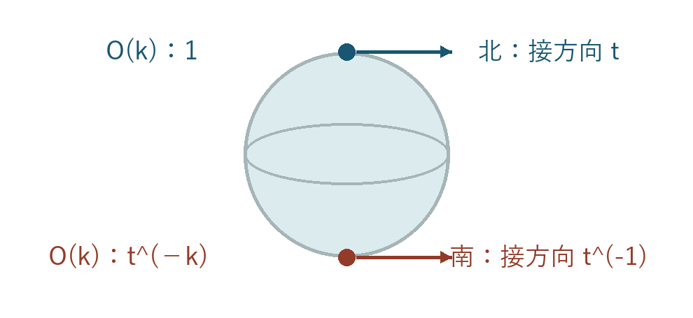

## 一点に群が作用すると何が残るか

普通のK理論で一点の上に束を置くと、階数だけが残った。ここに群 $G$ の作用を入れる。底は一点なので動かないが、ファイバーでは $G$ が線形変換を行う。一点の束は今度は複素表現 $V$ である。

**同変束**とは、底の $G$ 作用を覆う作用を持ち、各 $g\in G$ がファイバー間の線形同型を与える束である。安定同値とテンソル積を、作用と両立する同型だけを使って作れば $KU_G^0(X)$ が得られる。一点の場合は複素表現環であり、

$$
KU_G^0(*)=R(G).
$$ {#eq-14-point}

普通のK群に移す写像は群作用を忘れる。例えば二元群の自明表現と符号表現は、どちらも複素一次元なので忘却後は同じである。一方、同変K群では、非自明な元の固有値 $+1,-1$ が違うので同型ではない。

### 巡回群では文字を一つにまとめられる

$G=C_p$ を位数 $p$ の巡回群とし、生成元が $\zeta=e^{2\pi i/p}$ で作用する一次元表現を $t$ とする。有限群なら計量を平均してユニタリにでき、生成元は対角化できる。その固有値は $\zeta^j$ のいずれか。このためどの表現も $t^0,\ldots,t^{p-1}$ の直和である。

テンソル積では固有値を掛けるので、

$$
R(C_p)=\mathbb Z[t]/(t^p-1).
$$ {#eq-14-representation-ring}

次元を取る写像は $t\mapsto1$。その核を**増大イデアル**と呼び、$I=(t-1)$ と書く。例えば $t-1$ は階数0の差だが、作用は区別できるため非零。この差が球面を割った空間の線束の差へ移る様子を、次に調べる。

## 自由作用では束を商へ降ろせる

$G$ が有限で、$X$ の上に自由に作用するとする。各点の軌道の近傍を、異なる群元が互いに交わらない複製を作るように小さく取れる。このとき、同変束 $E$ の作用で商 $E/G$ を取ると、$X/G$ の近傍ごとの自明化が得られる。

逆に $X/G$ の束を $X$ に引き戻すと、群は底点だけを動かし、元のファイバーは変えないという同変構造を持つ。片方を行ってからもう片方を行うと、各点の同じファイバーに戻るので、

$$
KU_G^i(X)\cong KU^i(X/G)\qquad(i=0,1)
$$ {#eq-14-descent}

となる。奇数側は基点付き懸垂で定義し、同変な基点を除く領域で同じ降下をするか、$X\times[0,1]$ とその端点の相対群で定義すれば確認できる。

この同型には自由性が必要である。たとえば $X=*$ の場合、$X/G$ は一点だが @eq-14-point は表現環になる。一点の上の安定化に使った表現の違いが、軌道空間の普通の束だけには降りない。

## 同変Thom類で球面の商を計算する

$V=\mathbb C^{n+1}$ とし、$C_p$ が全ての座標に同じ $\zeta$ を掛けるとする。原点では全群が点を固定するが、単位球面の上では作用が自由である。商を等重みのレンズ空間 $L_p^{2n+1}$ と書く。

第5章で作ったKoszul複体は、$V$ に不変なHermite計量を入れればそのまま作用と両立する。ここでは複素表現に対する**同変Bott–Thom同型**を借りる。それによれば円板と球面の対のK群は、零切断の一点の表現環のコピーであり、絶対群へ写すとEuler類 $\lambda_{-1}(V^*)$ を掛ける。

今回 $V$ は $t$ を $n+1$ 個足したものだから、

$$
\lambda_{-1}(V^*)=(1-t^{-1})^{n+1}.
$$ {#eq-14-equiv-euler}

円板は原点へ同変に縮められる。点の奇数群はゼロであり、球面上では @eq-14-descent を使える。従って対の完全列は

$$
\begin{aligned}
0&\to KU^1(L_p^{2n+1})\to R(C_p)\\
 &\xrightarrow{(1-t^{-1})^{n+1}}R(C_p)\\
 &\to KU^0(L_p^{2n+1})\to0
\end{aligned}
$$ {#eq-14-equiv-gysin}

となる。したがって

$$
KU^0(L_p^{2n+1})=
\frac{\mathbb Z[t]}{(t^p-1,(t-1)^{n+1})}.
$$ {#eq-14-lens-ring}

@eq-14-lens-ring の分母の第二項では単元 $t$ のべきを捨てた。これは、第5章で複素射影空間上の線束の円周束として計算した環と一致する。二つの見方で、どの線束が $t$ に対応するかは次に確認する。

### 表現がレンズ空間のどの線束へ降りるか

球面と $\mathbb C$ の直積に $t^{-1}$ を作用させる。すなわち $(v,w)\mapsto(\zeta v,\zeta^{-1}w)$。このとき $wv$ は不変であり、$[v]\mapsto\mathbb Cv$ に沿ったトートロジー線束のベクトルを与える。よって $t^{-1}$ が引き戻した $L=\mathcal O(-1)$ に対応する。一方、$t$ は双対 $L^*$ に対応する。

例えば $p=2$ では $t=t^{-1}$ なので違いはない。$p=3$ では $t-1$ と $t^{-1}-1$ は一般には同じ元にならないが、

$$
t^{-1}-1=-t^{-1}(t-1)
$$ {#eq-14-inversion}

により、両者は同じイデアルを生成する。環の表示だけを比較すると単元が消えるが、個々の元のChern類の符号を比較するにはこの式が必要である。

### 奇数側は正則表現が生成する

@eq-14-equiv-gysin の掛け算の核を求める。先に $\mathbb C$ 係数へ移すと、$R(C_p)\otimes\mathbb C$ は $p$ 個の根での評価の直積になる。$1-t^{-1}$ がゼロになるのは $t=1$ の成分だけだから、核はその成分に集中する。

元の整数環で

$$
N_p=1+t+\cdots+t^{p-1}
$$

と置けば、$(1-t)N_p=0$ なので核に入る。$\mathbb C$ 係数での核は $N_p$ が張る一次元。整数環の元は $1,t,\ldots,t^{p-1}$ の整数係数で一意に書けるから、その一次元部分に入る元は $N_p$ の整数倍である。従って

$$
KU^1(L_p^{2n+1})\cong\mathbb Z N_p .
$$ {#eq-14-odd-lens}

$N_p$ は各文字を一回ずつ含む正則表現のクラスである。その階数は $p$ だが、 @eq-14-odd-lens は、正則表現のランクではなく、Euler類による掛け算の核の生成元を記述している。

| 置いた場所 | 同変K理論の項 | そこで読む情報 |
|---|---|---|
| 原点 | $R(C_p)$ | 等方群の表現 |
| 円板 | $R(C_p)$ | 同変変形収縮で原点に等しい |
| 円板と球面の対 | $R(C_p)\,u_V$ | 背景の表現とThom類 |
| 球面 | $KU^*(L_p^{2n+1})$ | 自由作用により普通のK群 |

: 同じ線形作用でも自由性は領域によって異なる。 {#tbl-14-orbits}

## 有限の近似と増大イデアル

@eq-14-lens-ring は $R(C_p)$ を $I^{n+1}$ で割ったものでもある。従って次元を上げると、切り捨てられるイデアルのべきが上がり、区別できる情報が増える。

$$
R(C_p)/I^{n+2}\longrightarrow R(C_p)/I^{n+1}
$$ {#eq-14-level}

は球面の線形包含から来る制限に対応する。なぜなら表現から降りる線束は、球面の次元を下げても同じ表現から降りるためである。逆極限の元は、 @eq-14-level の制限でつながる類の列になる。

ここで現れた逆極限は、$R(C_p)$ の $I$ 進完備化の定義そのものである。一般のコンパクトLie群に対して同様の比較を確立するのがAtiyah–Segalの完備化定理である。本章で証明したのは有限の球面の商における @eq-14-level の表示であり、無限次元の分類空間への移行は完備化定理を使う。 [Equivariant K-theory](https://www.numdam.org/item/10.1007/BF02684593.pdf)

## 指数を整数でなく文字で出す

円周群 $T$ が $\mathbb CP^1$ に $[Z_0:Z_1]\mapsto[Z_0:tZ_1]$ と作用するとする。線束 $\mathcal O(k)$ には、この $\mathbb C^2$ の作用から誘導した同変構造を入れる。Dolbeault作用素は群作用と可換なので、核と余核は $T$ の表現になる。

$k\ge0$ なら、正則切断は斉次多項式であり、作用は引数に逆変換を入れる。従って $Z_0^{k-j}Z_1^j$ の重みは $t^{-j}$ である。よって

$$
\operatorname{Ind}_T(\bar\partial_{\mathcal O(k)})
=1+t^{-1}+\cdots+t^{-k}\qquad (k\ge0).
$$ {#eq-14-equiv-index-positive}

$k=-1$ では両空間ともゼロ。$k=-m\le-2$ なら、第12章の余核の変換で $E=\mathbf1\oplus t$ を用いる。指数は

$$
\operatorname{Ind}_T(\bar\partial_{\mathcal O(-m)})
=-(t+t^2+\cdots+t^{m-1}).
$$ {#eq-14-equiv-index-negative}

$t=1$ を代入すれば普通の指数 $k+1$。$k=-2$ では指数が $-t$ であり、普通の指数 $-1$ だけでは余核が持つ重み $t$ を復元できない。

### 固定点だけから同じ文字を得る

この作用で動かない射影点は $[1:0]$ と $[0:1]$ の二つ。北の座標 $z=Z_1/Z_0$ の重みは $t$、南の $w=Z_0/Z_1$ の重みは $t^{-1}$。係数線束 $\mathcal O(k)$ の固定点の重みは、北で $1$、南で $t^{-k}$ である。

@fig-14-fixed を参照。

{#fig-14-fixed}

同変指数の固定点公式によれば、この場合に足す局所項は、係数の重みを接空間の双対のEuler因子で割ったものである。すなわち、

$$
\frac{1}{1-t^{-1}}+\frac{t^{-k}}{1-t}
  =\frac{1-t^{-(k+1)}}{1-t^{-1}} .
$$ {#eq-14-fixed-formula}

@eq-14-fixed-formula の各項は $t=1$ に極を持つ。しかし和では分子もゼロになり、実際には Laurent 多項式に戻る。$k\ge0$ なら等比級数から @eq-14-equiv-index-positive、$k=-1$ ならゼロ、$k=-m\le-2$ なら負の等比級数で @eq-14-equiv-index-negative が得られる。

例えば $k=2$ の正則切断は階数3。$t=-1$ で文字を評価すれば $1-1+1=1$ であり、普通の次元とは違う。一方、固定点公式でも北の項が $1/2$、南の項が $1/2$。一点の寄与に分数が出ても、全体の文字は表現環の元になる。この例ではLaurent多項式と固定点局所項の一致を代数的に検算した。

## 演習と解答

### 1　自由作用で小さいレンズ空間を作る

$n=1,p=5$ として @eq-14-lens-ring を計算せよ。

**解答。** $u=t-1$ と置くと $u^2=0$ で $(1+u)^5-1=5u$。従って偶数側は $\mathbb Z[u]/(u^2,5u)$、縮約部分は $\mathbb Z/5$。奇数側は @eq-14-odd-lens から $\mathbb Z$ である。ここでは群の作用の $p$ と底の射影空間の複素次元 $n$ の両方が環の関係に入る。

### 2　固定点で双対を使う理由

@eq-14-fixed-formula の北の分母を誤って $1-t$ とし、南も同様に逆にしたとき、$k=0$ と $k=1$ で何が起きるか。

**解答。** $k=0$ では対称性によって和は偶然1になる。しかし $k=1$ では $1/(1-t)+t^{-1}/(1-t^{-1})=0$。正則切断の文字 $1+t^{-1}$ と一致しない。固定点の座標関数は接ベクトルではなく、その双対に重みが付くことを確認する必要がある。

### 3　作用のない係数をひねる

$\mathcal O(k)$ の同変構造全体に文字 $t^a$ を掛ける。普通の指数と同変指数はどう変わるか。

**解答。** 作用素の定義域と値域の両方を同じ表現でテンソルするので、同変指数も $t^a$ 倍。固定点公式の二つの分子も同じ倍数を持つ。一方 $t=1$ を代入すると倍数は1なので、普通の指数は変わらない。底点での係数の貼り方と、群の作用の情報を別々に操作できる例である。

## 原典

同変K理論の自由作用による降下と表現球面の同変Bott–Thom同型は Segal の原論文を用いた。固定点項は一般の同変指数公式から取り、本文の球面では多項式の重みで直接確かめた。 [Segal, Equivariant K-theory](https://www.numdam.org/item/10.1007/BF02684593.pdf) [Atiyah–Singer III](https://annals.math.princeton.edu/1968/87-3/p07)
