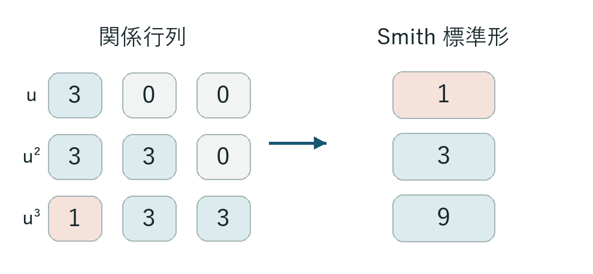

::: {.ku-chapter}
**章の導入**　有限群の位数だけでは、元を何回足すと零になるかは分からない。表現環から出た関係を整数格子のベクトルに直し、どの方向が何歩で同一視されるかを小さい例から計算する。
:::

## 積の関係から整数行列を取り出す

**導入。** 環の多項式の関係を、基底に沿って縦に並べる。

$u,u^2$ まで残る場合は、例えば $4u-3u^2$ を整数平面の点 $(4,-3)$ で表す。関係 $2u+u^2=0$ があれば、$(4,-3)$ と $(2,-4)$ は同じ元になる。差 $(2,1)$ がちょうど一つの関係だからである。列行列には、引いてもよい差を順に書く。

::: {.ku-point}
**ポイント｜列はゼロと同一視する組み合わせ**

行列の一列を基底 $u,u^2,\ldots$ の係数として読むと、その列が表す元が関係で零になる。列を整数倍して足し合わせたものもすべて零になる。K群に残る差は、二つの整数ベクトルの差がこの格子に入るかどうかで決まる。
:::

第14章の等重みレンズ空間 $L_m^{2n+1}$ に対し、$u=t-1$ とする。隣接する底のセルを通過するごとに $u$ のべきが一つ増え、最大で $u^n$ まで残る。式の定数項を取り除いた縮約部分は、次の有限アーベル群である。

$$
\widetilde{KU}^0(L_m^{2n+1})
 \cong (u)\big/\bigl(u^{n+1},(1+u)^m-1\bigr).
$$ {#eq-15-reduced}

ここで $(u)$ は、定数項がゼロの加法部分を表す。分母の二つの多項式も定数項がゼロなので、階数の部分には関係を加えない。$t$ の代わりに第5章の $L$ を使うと $1+u$ が逆数に置き換わるが、同じ環になる。

有限の加法表示を得るために、$\mathbb Z^n$ の第 $i$ 基底を $u^i$ に対応させる。$(1+u)^m-1$ に $u^{j-1}$ を掛け、$u^{n+1}=0$ で打ち切ったものを第 $j$ 列に置く。すると

$$
(A_{m,n})_{ij}=
 \begin{cases}
 \binom{m}{i-j+1}, &i\ge j,\\
 0,&i<j .
 \end{cases}
$$ {#eq-15-relation-matrix}

二項係数は下の添字が $m$ を超えればゼロとする。行列は下三角で、対角成分は $m$。従って関係格子の指数、つまり縮約群の元の個数は

$$
|\det A_{m,n}|=m^n .
$$ {#eq-15-order}

この値だけでは群の構造は決まらない。例えば $m=n=2$ の場合、個数は4。$\mathbb Z/4$ と $(\mathbb Z/2)^2$ のどちらも同じ個数を持つ。第5章で見た中間の係数が、その違いを担う。

::: {.ku-summary}
**まとめ**　次数の打ち切りで有限な下三角行列となり、整数の商を直接計算できる。
:::

## 各小行列式で関係格子を点検する

**導入。** 整数の基本変形をしても変わらない数を、小行列式から集める。

行の操作で変えるのは、全ての元を記録する整数座標の軸である。列の操作で変えるのは、零とみなす差の一覧である。例えば関係 $v_1,v_2$ を $v_1,v_2-v_1$ に替えても、元の $v_2$ は両者の和で戻せる。同じ部分格子を保つので、商の元の区別は変わらない。

整数の行・列操作のうち、二行の交換、符号の変更、一行の整数倍を別の行に加える操作は全て整数逆行列を持つ。列についても同じである。この操作だけで整数行列を

$$
\operatorname{diag}(s_1,\ldots,s_n),
 \qquad s_1\mid s_2\mid\cdots\mid s_n
$$ {#eq-15-smith}

へ変換できる。これがSmith標準形である。$s_i=1$ の項は余核に何も残さない。$s_i>1$ のとき $\mathbb Z/s_i$ が一因子になる。

変換の仕組みを確認する。左上に非零成分を置き、同じ行・列の別の成分をその成分で整数除算する。余りが非零ならそれを左上へ移し、左上の絶対値を下げる。その行と列の余りが全てゼロになれば、倍を引いて他をゼロにできる。

そこで残りの部分行列の成分を調べる。左上で割れない値があれば、その成分の行を一行目に加えると、再び割れない成分を第一行へ持ってこられる。左上の値をさらに小さくできるため、この過程は有限回で止まる。最後には左上が残りの全成分を割る。残りにも同じ処理を帰納的に適用すると、整除条件を持つ @eq-15-smith になる。

### 小行列式の最大公約数

全ての $j$ 次小行列式の最大公約数を $\Delta_j$ とし、$\Delta_0=1$ と置く。行・列操作によって各小行列式はもとの小行列式の整数線形結合になる。逆操作も同じことが言えるので、その生成するイデアルは変わらない。対角形 @eq-15-smith では、$j$ 個の対角成分の積の全てが $s_1\cdots s_j$ で割れ、実際に最初の $j$ 個を選べばその積になる。

$$
\Delta_j=s_1\cdots s_j,\qquad
s_j=\Delta_j/\Delta_{j-1}.
$$ {#eq-15-determinantal}

従って手で行・列操作を途中まで行っても、最終的な値を @eq-15-determinantal で独立に点検できる。以下では小さい行列を三つ計算し、どの小行列式が群を変えるかを見る。

::: {.ku-summary}
**まとめ**　連続する最大公約数の比から巡回因子が一つずつ求まる。
:::

## 三つの行列を比較する

**導入。** 小さい行列では、整数係数の違いを一列ずつ消去して見る。

### $m=2,n=2$ の場合

@eq-15-relation-matrix は

$$
A_{2,2}=\begin{pmatrix}2&0\\1&2\end{pmatrix}.
$$

$\Delta_1=1$ は左下の1による。$\Delta_2=4$ だから $s_1=1,s_2=4$。また関係の第一列は $2u+u^2=0$ であり、第二列は $2u^2=0$。第一の式を使って $u^2$ を消すと $4u=0$。従ってこの場合は $u$ 自身が位数4を持つことまで分かる。

### $m=3,n=2$ の場合

$$
A_{3,2}=\begin{pmatrix}3&0\\3&3\end{pmatrix}.
$$

$\Delta_1=3,\Delta_2=9$ なので、標準形は $(3,3)$。行列の第一列から第二列を引けば $3u=0$、第二列が $3u^2=0$ を与える。従って元の基底の二方向がそれぞれ位数3で独立である。前の行列との違いは、対角成分の値だけでなく、対角の外側の値も $m$ の倍数であることにある。

### $m=3,n=3$ の場合

$$
A_{3,3}=
\begin{pmatrix}3&0&0\\3&3&0\\1&3&3\end{pmatrix}.
$$ {#eq-15-three-three}

::: {.ku-worked}
**計算を追う｜位数を一個ずつ取り出す**

この行列には成分1があるから $\Delta_1=1$。二次小行列式は、例えば左上2行2列では9、左下2行2列では6になる。全ての二次小行列式は3の倍数であり、すでに出た二つの最大公約数は3なので $\Delta_2=3$。行列全体は下三角なので $\Delta_3=3^3=27$。

$$
s_1=\frac{1}{1}=1,\qquad s_2=\frac{3}{1}=3,\qquad
s_3=\frac{27}{3}=9 .
$$

$s_1=1$ はその方向の元が一つの関係で消えたことを表す。残った二方向の位数は3と9である。行列式だけでは、この二方向と位数27の一方向を区別できない。
:::

$\Delta_1=1$。二次小行列式で非零の値は絶対値で6または9であり、例えば下二行と左二列から $9-3=6$ が出る。従って $\Delta_2=3$、$\Delta_3=27$。 @eq-15-determinantal によれば、標準形は $(1,3,9)$。

@fig-15-smith を参照。

{#fig-15-smith width="76%"}

元の生成元の位数も比較しよう。第一列から $u^3=-3u-3u^2$。第二列 $3u^2+3u^3=0$ を代入すると $9u+6u^2=0$。第三列から $9u+9u^2=0$。差を取ると $3u^2=0$、次いで $9u=0$。逆にこれらの関係をもとの三列へ代入すれば全て満たされる。したがって $u$ は位数9、$u^2$ は位数3で、両者は独立な生成方向として取れる。

| $(m,n)$ | $\Delta_1,\Delta_2,\ldots$ | 縮約群 |
|---|---|---|
| $(2,2)$ | $1,4$ | $\mathbb Z/4$ |
| $(3,2)$ | $3,9$ | $(\mathbb Z/3)^2$ |
| $(3,3)$ | $1,3,27$ | $\mathbb Z/3\oplus\mathbb Z/9$ |
| $(4,3)$ | $2,4,64$ | $(\mathbb Z/2)^2\oplus\mathbb Z/16$ |
| $(6,3)$ | $1,3,216$ | $\mathbb Z/3\oplus\mathbb Z/72$ |

: 小行列式による整数拡大の比較。添字 $n$ は関係行列の大きさである。 {#tbl-15-smith}

@tbl-15-smith の最後の二行では、一つの素数だけを見る前に、整数の小行列式の最大公約数を取っている。例えば $(6,3)$ では $\Delta_1=\gcd(6,15,20)=1$、$\Delta_2=\gcd(36,90,105)=3$。$72=8\cdot9$ の一因子は、2一次成分と3一次成分を合わせて表示したものである。

::: {.ku-summary}
**まとめ**　同じ全体の位数でも、次数と係数によって巡回因子の分かれ方が違う。
:::

## 素数の場合は円分整数で全次元を解ける

**導入。** 素数位数では表現の評価先を一つの円分整数環に移す。

$u=t-1$ は位相を一回回す表現 $t$ と、自明な表現1の差である。$t$ を根 $\zeta$ で評価すると、この差は $\zeta-1$ に見える。評価後に使うのは、円分整数環の中で $\zeta-1$ を因子に何回含むかである。これを使うと $u$ のべきで打ち切る関係を、円分整数環の一つのイデアルでまとめて計算できる。

今度は $m=p$ を素数とする。第14章の表現環で $I=(t-1)$ だった。$N_p=1+t+\cdots+t^{p-1}$ とすると $(t-1)N_p=t^p-1$。従って $R(C_p)$ から $I$ への掛け算 $t-1$ の核は $(N_p)$ である。実際、整数多項式で積が $t^p-1$ の倍数なら、整域 $\mathbb Z[t]$ で $t-1$ を消去できる。

$N_p$ は素数 $p$ の円分多項式である。$\zeta=e^{2\pi i/p}$ とすると、評価 $t\mapsto\zeta$ により

$$
I\cong\mathbb Z[\zeta]
$$

と加法群および $R(C_p)$ 加群として同一視できる。ここで $I$ の元 $(t-1)f(t)$ は $f(\zeta)$ に対応する。円分多項式が既約であることは、$t=1+u$ を代入した多項式にEisensteinの判定を適用して確認できる。最高次以外は $p$ で割れ、定数項は $p^2$ で割れない。

この同一視で $I^{n+1}$ は $(\zeta-1)^n$ の倍数に当たる。従って縮約群は

$$
\widetilde{KU}^0(L_p^{2n+1})
 \cong \mathbb Z[\zeta]/(\zeta-1)^n .
$$ {#eq-15-cyclotomic}

これは環としての同型を主張していない。左側は $I$ の商であり、右側への写像では $t-1$ を一個取り除いたため、積にはその因子が一つずれる。加法群を決める目的ではこれで十分である。

### $p$ が何回分の $(1-\zeta)$ を持つか

$\pi=1-\zeta$ と置く。円分多項式を1で評価すると

$$
p=\prod_{j=1}^{p-1}(1-\zeta^j)
 =\pi^{p-1}\prod_{j=1}^{p-1}
        (1+\zeta+\cdots+\zeta^{j-1}).
$$ {#eq-15-p-factorization}

右端の各因子は単元である。実際 $j$ の逆元 $k$ を $p$ を法として取れば $\zeta=(\zeta^j)^k$ であり、

$$
\frac{1-\zeta}{1-\zeta^j}
 =1+\zeta^j+\cdots+(\zeta^j)^{k-1}
$$

も $\mathbb Z[\zeta]$ に属する。従って $p$ 倍することは、 @eq-15-cyclotomic の中で $\pi^{p-1}$ 倍することと単元を除いて同じである。

各商 $(\pi^a)/(\pi^{a+1})$ は $\mathbb F_p$ の加法群である。$\mathbb Z[\zeta]/(\pi)$ では $\zeta=1$、円分多項式の関係が $p=0$ となる。さらに $\pi^a$ を掛ける写像は、整域で消去を使うと $(\pi^a)/(\pi^{a+1})$ への同型を与える。従って群 $M=\mathbb Z[\zeta]/(\pi^n)$ に対し、

$$
|p^r M|=p^{\max(n-r(p-1),0)}.
$$ {#eq-15-power-sizes}

### 位数の列から巡回因子へ戻す

一般に $M=\bigoplus_j\mathbb Z/p^{e_j}$ なら、$|p^{r-1}M|/|p^rM|$ は $e_j\ge r$ を満たす因子一つにつき $p$ を掛けたものになる。従ってこの比だけで各指数の個数を復元できる。

$n=a(p-1)+b$、$0\le b<p-1$ と書く。 @eq-15-power-sizes から、最初の $a$ 段で比は $p^{p-1}$、その次で $p^b$、以後は1である。ゆえに

$$
M\cong
  \bigl((\mathbb Z/p^{a+1})^b\bigr)
  \oplus(\mathbb Z/p^a)^{p-1-b}.
$$ {#eq-15-prime-invariants}

ここでは $p^a=1$ のときその項を捨てる。例えば $p=2$ では $b=0,a=n$ であり、第5章の実射影空間の位数 $2^n$ を再現する。$p=3,n=3$ では $a=b=1$ だから $\mathbb Z/9\oplus\mathbb Z/3$。行列 @eq-15-three-three と同じ値である。

一方 $n<p$ なら、$n=p-1$ を含めて群は $(\mathbb Z/p)^n$ である。行列表示でも、$1\le j\le n<p$ では $\binom pj$ が $p$ の倍数なので、 @eq-15-relation-matrix を $p$ で割った行列は対角1の下三角。逆行列も整数係数である。$n=p$ になると $\binom pp=1$ が初めて入るため、群は $\mathbb Z/p^2$ の因子を持つ。この境目を両方の計算から読める。

::: {.ku-summary}
**まとめ**　一つの素元のべきで割る問題に変わり、全ての次元の不変因子を求められる。
:::

## 合成数の位数を素数ごとに分ける

**導入。** 合成数では、ある素数以外の係数を可逆にして主成分を読む。

$m=\ell^a q$、$\ell$ は素数で $\ell\nmid q$ とする。係数を $\mathbb Z_{(\ell)}$ へ移し、$\ell$ と互いに素な整数を可逆にする。有限群の表示をそこへ移せば、$\ell$ と互いに素な位数の部分は消え、$\ell$ 一次部分が残る。

$t^m-1$ を

$$
t^m-1=(t^{\ell^a}-1)
       \bigl(1+t^{\ell^a}+\cdots+t^{(q-1)\ell^a}\bigr)
$$ {#eq-15-primary-factor}

と分ける。第二因子を $t=1+u$ と書き直すと定数項は $q$ で、残りは $u$ の倍数。$u^{n+1}=0$ の環では、定数項が単元なら等比級数で逆元を作れる。従って $\ell$ 係数での関係イデアルは第一因子だけで決まる。

このため $m$ の $\ell$ 一次成分は、$m=\ell^a$ としたレンズ空間と同じである。特に $m$ が平方因子を持たなければ、すべての素数に @eq-15-prime-invariants を使える。例えば $m=6,n=3$ では、2一次部分 $\mathbb Z/8$、3一次部分 $\mathbb Z/3\oplus\mathbb Z/9$。互いに素な位数8と9を同じ因子に合わせれば $\mathbb Z/3\oplus\mathbb Z/72$ となる。

ただし $m=4$ なら $a=2$ であり、素数の場合の @eq-15-prime-invariants を $p=4$ として使うことはできない。小行列式か、その素数べきに適した整数計算が必要である。 @eq-15-primary-factor は、合成数の問題を素数**べき**まで分解する主張である。

::: {.ku-summary}
**まとめ**　局所環で残る関係を素数ごとに調べ、整数群を組み戻せる。
:::

## Chern類とAdams演算の値を比較する

**導入。** 同じねじれの元を、特性類とAdams演算で別々に測る。

$p=3,n=3$ を例とする。$u=t-1$ の位数は9。第一Chern類は $\mathbb Z/3$ に値を取るので $3u$ では消える。一方 $3u$ は非零で位数3。全Chern類の積の規則では

$$
c(3u)=(1+x)^3=1+x^3
$$

である。ここで $x=c_1(t)$、正次数の $x,x^2,x^3$ はそれぞれ位数3である。これは第5章の普通のコホモロジーの円周束完全列で $3h$ を掛ける版から確認できる。よって第二Chern類も消えるが第三Chern類に差が現れる。

その一方、Adams演算は $t^a$ を作る。$\psi^3(u)=t^3-1=0$。$\psi^2(u)=2u+u^2$ であり $u$ と同じ位数9を持つ。実際 $\psi^2\psi^2=\psi^4$ で、$t^4=t$ だからこの環上では $\psi^2$ は自己同型である。このように、係数の成分へ写す方法とK群の内部で束をべきへ送る方法では、何を保存するかが違う。

### 有理同型が群の大きさを与えない理由

@eq-15-order では群の大きさは $m^n$。しかし行列 @eq-15-relation-matrix を $\mathbb Q$ で見ると行列式が非零なので、行列は可逆であり余核はゼロになる。この段階では $m=2$ でも $m=100$ でも縮約有理群は同じゼロである。Chern指標が失う情報は、行列の幾何的な稠密さではなく、その像が整数格子の中で何倍の間隔を持つかである。

::: {.ku-summary}
**まとめ**　全体の群を計算した後では、各測定で何が残るかを明示できる。
:::

## 演習と解答

**導入。** 位数の積、個別の巡回因子、演算の値を小さい例で検算する。

### 1　$p=5$ の最初の非分裂

$p=5,n=5$ について巡回因子を求めよ。さらに $n=4$ と比較せよ。

**解答。** $n=5=1\cdot4+1$ なので、 @eq-15-prime-invariants によって $\mathbb Z/25\oplus(\mathbb Z/5)^3$。$n=4$ では $b=0$ で $(\mathbb Z/5)^4$。最初の四層は同じ形を持つが、五番目の層は既存の一因子を位数25へ延ばす。群の大きさはそれぞれ $5^5,5^4$。

### 2　全ての素数に分解してから合流させる

$m=15,n=3$ の縮約群を求めよ。

**解答。** 3一次成分は $\mathbb Z/3\oplus\mathbb Z/9$。5一次成分は $n=3<5$ なので $(\mathbb Z/5)^3$。整除順で揃えると $\mathbb Z/5\oplus\mathbb Z/15\oplus\mathbb Z/45$。積の大きさは $5\cdot15\cdot45=15^3$。 @eq-15-order と一致する。

### 3　全ての加法因子が見えても積がある

$\widetilde{KU}^0(L_p^5)$、$p>2$ では二つの $\mathbb Z/p$ 因子がある。この群で $u$ を自分に掛けるとどうなるか。

**解答。** @eq-15-relation-matrix の二つの列は、$u,u^2$ をそれぞれ位数 $p$ とする関係に整数で変換できる。従って $u^2$ はゼロではなく第二因子の生成元である。$u^3=0$。加法群が分裂することから、異なる濾過の積までゼロになるとは結論できない。

::: {.ku-summary}
**まとめ**　関係行列と円分整数の両方を、適用できる範囲で使い直せる。
:::

::: {.ku-chapter}
**章のまとめ**　位数の積に加えて、どの巡回群がいくつ残るかを決めた。次章は実束に戻り、複素化によって失われる差を比べる。
:::
