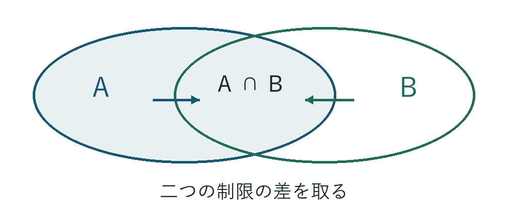

::: {.ku-chapter}
**章の導入**　空間を二片に分けると、各片での束だけでなく重なりでの同型が必要になる。空間の和と積を計算し、ねじれが積の奇数群に現れる理由を見る。
:::

## 束を貼ることと、空間を貼ること

**導入。** 二片の上で同じに見える束の差を、重なりに移して調べる。

第1章では固定された球面の上で、二枚の自明束を貼って新しい束を作った。ここでは空間の方を $X=A\cup B$ と分ける。$A$ と $B$ にそれぞれ束の差が与えられ、交わり $C=A\cap B$ に制限すると同じ類になるとする。それらは $X$ の一つの類から来るだろうか。もし来るなら、どのような自由度で貼り方を変えられるだろうか。

以下では有限CW複体を部分複体の和に分け、包含がコファイブレーションであるとする。この仮定により、相対群を商で表し、写像を連続変形に沿って延長できる。開被覆の場合も、対応するホモトピー押し出しが使える範囲では同じ議論を行える。

::: {.ku-summary}
**まとめ**　制限どうしの差と貼り目の接続が、大域の群を決める。
:::

## Mayer–Vietoris列を相対完全列から読む

**導入。** 和集合と共通部分の商を対応させ、相対完全列を並べる。

$X=A\cup B$ で $A$ を一点に潰すと、$B$ の中で潰したのはちょうど $C$。従って

$$
X/A\cong B/C,\qquad
KU^i(X,A)\cong KU^i(B,C).
$$ {#eq-17-excision}

この同型を**切除**と呼ぶ。関係ない領域を削っても相対データが変わらないことを表す。次に二つの対 $(X,A)$ と $(B,C)$ の完全列を比較する。両方の相対項が @eq-17-excision で同じになるので、絶対項を組み合わせると次の列が得られる。

$$
\begin{aligned}
\cdots\to KU^{i-1}(C)&\xrightarrow{\delta}KU^i(X)\\
 &\xrightarrow{r}KU^i(A)\oplus KU^i(B)\\
 &\xrightarrow{d}KU^i(C)\xrightarrow{\delta}KU^{i+1}(X)\to\cdots .
\end{aligned}
$$ {#eq-17-mv}

$r$ は両側への制限、$d(a,b)=a|_C-b|_C$。$\delta$ は $(B,C)$ の接続写像で相対群へ送り、切除で $(X,A)$ に戻し、最後に絶対群へ送る操作である。接続の全体の符号には列の取り方の規約がある。ここでは $d$ の向きをこの差に固定する。

@fig-17-overlap を参照。

{#fig-17-overlap width="76%"}

### 一箇所の完全性を図式追跡する

$d(a,b)=0$ とする。$(X,A)$ の接続写像で $a$ を送ると、切除の下では $a|_C$ を $(B,C)$ の接続へ送ったものになる。$a|_C=b|_C$ であり、後者は $B$ から来るからその接続はゼロ。従って $a$ は $x_0\in KU^i(X)$ に持ち上がる。

しかし $x_0|_B$ が $b$ に等しいとは限らない。その差 $b-x_0|_B$ を $C$ へ制限するとゼロ。そこで $(B,C)$ の相対類に持ち上げる。 @eq-17-excision で $(X,A)$ の相対類と見なせば、$A$ 側に影響を与えず $B$ 側だけの修正を行える。この修正を $x_0$ に足すと $r(x)=(a,b)$。これで $\ker d=\operatorname{im}r$ のうち非自明な包含が証明された。

### 貼り合わせの曖昧さを戻す

$r(x)=0$ とする。$x|_A=0$ なので $(X,A)$ の相対類 $\widetilde x$ を選び、切除で $(B,C)$ へ移す。$x|_B=0$ という条件は、その相対類を $B$ の絶対群へ送るとゼロになることを意味する。完全性により、$\widetilde x$ は $KU^{i-1}(C)$ の接続から来る。従って $x$ は @eq-17-mv の最初の $\delta$ の像である。両側の制限で見えない差に、交わりの奇数側の情報が現れた。

::: {.ku-summary}
**まとめ**　共通部分の自己同型が連結写像を通って、一つ上の相対データに入る。
:::

## 球面の計算へ戻す

**導入。** 二枚の円板の重なりを円周へ縮め、完全列の矢印を書き出す。

球面を二枚の円板 $A,B$ に分けると、$C=S^1$。円板上の偶数群は階数の $\mathbb Z$、奇数群はゼロ。交わりでは $KU^0(S^1)=\mathbb Z$、$KU^1(S^1)=\mathbb Z$ である。従って @eq-17-mv の断片は

$$
0\to KU^1(S^1)
 \xrightarrow{\delta} KU^0(S^2)
 \xrightarrow{r}\mathbb Z^2
 \xrightarrow{(a,b)\mapsto a-b}\mathbb Z\to 0 .
$$ {#eq-17-sphere-mv}

両円板に制限すると、束からは共通の階数だけが見える。縮約群は $\delta$ の像そのものであり、交わりの巻き数に対応する。ここで $KU^1(S^1)$ の生成元を、懸垂クラッチングで境界 $z$ を与える向きとして選べば、 @eq-17-sphere-mv での像は $[L]-1$。一方、$\beta$ を正の生成元として選べば、その元は境界 $\bar z$ で表される。接続写像の生成元を数として読む際にはこの規約を確認する。

### 円周を二本の弧で作る

円周を二つの閉じた弧 $A,B$ で覆う。共通部分 $C$ は端点二つ。$KU^0(A)\oplus KU^0(B)=\mathbb Z^2$、$KU^0(C)=\mathbb Z^2$。制限の差は $(a,b)\mapsto(a-b,a-b)$ である。よって

$$
KU^0(S^1)\cong\mathbb Z,\qquad
KU^1(S^1)\cong\mathbb Z^2/\mathbb Z(1,1)\cong \mathbb Z .
$$ {#eq-17-circle-mv}

奇数群の生成元は、交わりの二点での階数の**相対的な差**として出た。二点の両方に同じ整数を足しても変わらない。この例では、交わりは1次元の空間ではないのに、長完全列の一つの次数移動により奇数群が現れている。

::: {.ku-summary}
**まとめ**　赤道の回転が球面の縮約群へ送られ、最初の貼り合わせを再現する。
:::

## スマッシュ積の群は直積のどこにあるか

**導入。** 直積で片方の座標だけが基点になる部分をつぶす。

基点付き空間 $X,Y$ において $X\vee Y$ を $X\times Y$ の中に入れる。商は $X\wedge Y$。$X\vee Y$ の縮約K群は二つの縮約群の直和であり、絶対直積の射影で引き戻せば制限の右逆になる。従って両方の偶奇で制限は全射。対の長完全列は短い分裂完全列になり、

$$
\begin{aligned}
\widetilde{KU}^i(X\times Y)
 \cong{}&\widetilde{KU}^i(X)\oplus\widetilde{KU}^i(Y)\\
 &\oplus\widetilde{KU}^i(X\wedge Y)
\end{aligned}
$$ {#eq-17-product-split}

を得る。ここで最後の成分は、二つの座標部分のどちらへ制限してもゼロになる類である。 @eq-17-product-split は加法群の分解であり、積は必ずしも各成分に閉じない。例えば $S^2\times S^2$ では、最初の二成分から一つずつ取った積が最後の成分の生成元になる。

### 一因子が円周の場合

$Y=S^1$ とすると $X\wedge S^1=\Sigma X$。基点を別に足して $X_+$ を使えば、$X\times\{1\}$ への制限が分裂し、

$$
KU^i(X\times S^1)
 \cong KU^i(X)\oplus KU^{i-1}(X)
$$ {#eq-17-circle-product}

となる。第二項の写像は、$KU^1(S^1)$ の生成元 $\alpha$ との外積である。実際、相対群 $KU^i(X\times S^1,X\times\{1\})$ は $X_+\wedge S^1$ の縮約群であり、そこで $\alpha$ との積は懸垂同型を与える。

$T^2=S^1\times S^1$ では、両方の因子の奇数生成元を $\alpha_1,\alpha_2$ とする。$KU^0(T^2)$ は $1$ と $\alpha_1\alpha_2$ で生成され、$KU^1(T^2)$ は $\alpha_1,\alpha_2$ で生成される。$\alpha_i^2$ は円周からの引き戻しであり、円周の縮約偶数群がゼロだから消える。異なる因子の順序を交換すると、二つの懸垂座標を交換するため符号が反転する。よって

$$
\alpha_i^2=0,\qquad
\alpha_1\alpha_2=-\alpha_2\alpha_1.
$$ {#eq-17-odd-sign}

これを繰り返せばトーラス $T^d$ の複素K環は、$d$ 個の奇数生成元の外積代数になる。偶数側と奇数側の階数は $d\ge1$ でともに $2^{d-1}$。例えば $T^3$ の奇数側には三本の基本円周から来る元に加え、$\alpha_1\alpha_2\alpha_3$ がある。基本円周へ個別に制限しても、この三重積は検出できない。

::: {.ku-summary}
**まとめ**　もとからある二方向と、両方を掛けた成分を区別できる。
:::

## ねじれの積ではTorが出る

**導入。** 有限位数の元どうしを掛け、消える関係が残す核を探す。

@eq-17-circle-product がきれいなのは、円周のK群が自由アーベル群だからである。両方にねじれを持つ例では、束の差の外積だけからは出ない項が現れる。

$M_m=S^1\cup_m D^2$ とし、2セルの貼り合わせの次数を $m\ge2$ とする。第8章の余ファイバー列により、$\widetilde{KU}^0(M_m)=\mathbb Z/m$、$\widetilde{KU}^1(M_m)=0$。同じ形の空間 $M_n$ とスマッシュ積を取る。$M_n$ の余ファイバー列を $M_m$ とスマッシュすれば、

$$
\Sigma M_m \xrightarrow{n}\Sigma M_m
 \longrightarrow M_m\wedge M_n
 \longrightarrow \Sigma^2 M_m
$$ {#eq-17-moore-cofiber}

を得る。ここで最初の矢印は懸垂円周の次数 $n$ から来る。K群へ送れば $\mathbb Z/m$ 上の $n$ 倍である。

$\Sigma M_m$ の縮約偶数群は0、縮約奇数群は $\mathbb Z/m$。 @eq-17-moore-cofiber の完全列により、$M_m\wedge M_n$ の偶数側は $n$ 倍の余核、奇数側は核になる。$g=\gcd(m,n)$ とすれば、

$$
\begin{aligned}
\widetilde{KU}^0(M_m\wedge M_n)&\cong\mathbb Z/g,\\
\widetilde{KU}^1(M_m\wedge M_n)&\cong\mathbb Z/g .
\end{aligned}
$$ {#eq-17-moore-product}

::: {.ku-worked}
**計算を追う｜同じ掛け算から偶数と奇数を出す**

$m=6,n=4$ の模型では、$\mathbb Z/6$ の各元を4倍する。$4x=0$ なら $6\mid4x$、すなわち $3\mid x$ なので核は $\{0,3\}$。像は $4\cdot0,4\cdot1,4\cdot2$ が与える $\{0,4,2\}$ で、余核は偶数と奇数の二つの剰余類を持つ。

$$
\ker(4:\mathbb Z/6\to\mathbb Z/6)\cong\mathbb Z/2,\qquad
\operatorname{coker}(4)\cong\mathbb Z/2.
$$

二群の位数は等しいが、左は掛け算で零になった入力、右は出力で到達できない方向である。完全列の位置が違うので、積のK群では別の次数に入る。
:::

偶数側は二つのねじれのテンソル積である。奇数側は、各因子のK群に奇数元がないにもかかわらず現れた。代数では、自由分解 $0\to\mathbb Z\xrightarrow{n}\mathbb Z\to\mathbb Z/n\to0$ に $\mathbb Z/m$ をテンソルしたときの核を $\operatorname{Tor}_1^{\mathbb Z}(\mathbb Z/m,\mathbb Z/n)$ と呼ぶ。 @eq-17-moore-product の奇数側がこの核である。

### 具体的に $m=6,n=4$ を計算する

$\mathbb Z/6$ で4倍を取ると、像は $\{0,2,4\}$、核は $\{0,3\}$。従って偶数側の余核も奇数側の核も $\mathbb Z/2$。 @eq-17-product-split で戻せば、

$$
\begin{aligned}
KU^0(M_6\times M_4)&\cong
 \mathbb Z\oplus\mathbb Z/6\oplus\mathbb Z/4\oplus\mathbb Z/2,\\
KU^1(M_6\times M_4)&\cong\mathbb Z/2 .
\end{aligned}
$$

奇数側の生成元は、$M_6$、$M_4$ のどちらの座標部分へも制限できない。二つを同時に動かしてはじめて存在する項である。

::: {.ku-summary}
**まとめ**　自由分解をテンソルして生じる核がTorとなり、奇数側に入る。
:::

## Künneth短完全列の範囲

**導入。** どの空間でKünneth列を使え、どこに分裂の選択があるか確認する。

有限CW複体について、複素K理論のKünneth定理は、外積によるテンソル項と、次数を一つずらしたTor項の短完全列を与える。ここでは一般定理を借りる。偶奇の添字で書けば、

$$
\begin{aligned}
0 \to \bigoplus_{a+b=i} KU^a(X)\otimes KU^b(Y)
   &\longrightarrow KU^i(X\times Y)\\
   &\longrightarrow
    \bigoplus_{a+b=i+1}
      \operatorname{Tor}_1^{\mathbb Z}(KU^a(X),KU^b(Y))
      \to0 .
\end{aligned}
$$ {#eq-17-kunneth}

和の添字は2を法として読む。テンソル項は自然な外積。短完全列は加法群として分裂するが、一般に自然な分裂や環の分解を与えるわけではない。上のMoore空間では、基点付きの座標部分を使って具体的な分解 @eq-17-product-split を別に用いた。

一方のK群が自由であればTor項は消える。例えば $\mathbb CP^2$ と $T^2$ の積では、偶数側は階数 $3\cdot2=6$、奇数側も階数6。さらに外積が全ての元を与えるので、$\mu^3=0$ と @eq-17-odd-sign を用いて積まで書ける。自由群の場合に外積が十分であったことと、ねじれで現れる不足を比較できる。

::: {.ku-summary}
**まとめ**　テンソル積とTorは自然な項で、全体の直和表示には選択が残る。
:::

## 演習と解答

**導入。** 円周の積と有限位数の例で、偶・奇の配置を手で確認する。

### 1　座標部分には見えない自由成分

$T^4$ で、どの三因子部分トーラスへ制限しても消える非零偶数元を求めよ。

**解答。** $\alpha_1\alpha_2\alpha_3\alpha_4$。どの三因子部分でも残りの $\alpha_i$ がゼロになる。一方、四回の @eq-17-circle-product で最後に現れる自由な一方向であるため、元自体は非零。全体の偶数群の8方向のうち、次数4の成分である。

### 2　互いに素なねじれが出会う場合

$m=5,n=8$ ではスマッシュ積のK群はどうなるか。

**解答。** $\mathbb Z/5$ 上の8倍は可逆。従って @eq-17-moore-product の両方はゼロ。直積では二つの座標部分の $\mathbb Z/5,\mathbb Z/8$ は残るが、両者を同時に使う成分は残らない。

### 3　交わりで一致する二つの階数を追う

二つの球面を一点で合わせた空間 $S^2\vee S^2$ のMayer–Vietoris列を使い、$KU^0$ と $KU^1$ を求めよ。

**解答。** 交わりの奇数群はゼロ。偶数では二つの球面から点への制限の差が全射なので、全体の $KU^0$ はその核である。二つの階数は等しく、一方で二つの縮約成分は独立。従って $\mathbb Z^3$。次の奇数項はゼロである。ここでは直積と異なり、二つの縮約成分の積は両方の座標部分で消え、そのような余分な成分はないのでゼロである。

::: {.ku-summary}
**まとめ**　商、余核、Torの出所を見分ければ、別の積にも計算を移せる。
:::

## 参考

**導入。** 切除とKünnethの適用に使った条件を確認する。

対の長完全列からMayer–Vietoris列を作る議論は、Hatcher の複素K理論の一般化コホモロジーとしての扱いを参照。Künneth定理の一般形は Atiyah のK理論の論文・講義の範囲である。本章のねじれの例は一般定理から逆算せず、 @eq-17-moore-cofiber の余ファイバー列で直接計算した。 [Vector Bundles and K-Theory](https://pi.math.cornell.edu/~hatcher/VBKT/VB.pdf)

::: {.ku-summary}
**まとめ**　軸の商・貼り合わせ・テンソル積の参照先をたどれる。
:::

::: {.ku-chapter}
**章のまとめ**　貼り合わせの差は完全列、積のねじれはTorが記録する。次章では、貼った空間の中へ部分多様体を押し出す。
:::
