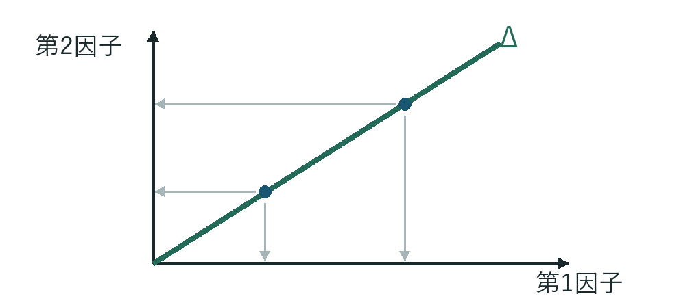

::: {.ku-chapter}
**章の導入**　直線を一本切り出す式は、射影空間のどの点を残すかを指定する。残った場所のすぐ外では、その式を掛ける写像が可逆になる。この境界付きの記録をK類にすれば、切り出す条件を重ねたり、指数で測ったりできる。
:::

## 方程式が切り出す部分をK群に戻す

**導入。** 横断的な切断が零になる場所と、法方向に退化するKoszul作用素を比べる。

局所座標で $f(z)=z$ を考える。零点は $z=0$。各位置 $z$ で、入力の複素数 $v$ を出力の複素数 $zv$ へ送る。$z$ を固定するたびに一つの線形写像が決まる。この写像だけを調べれば、零点以外の全域で逆 $v\mapsto v/z$ がある。高次元の場合も、部分多様体に沿った座標と、零点から離れる法方向の座標を分け、後者で同じ可逆性が成り立つ模型を置く。

::: {.ku-definition}
**定義｜この章で使う押し出し**

埋め込み $i:Y\hookrightarrow X$ の法束に複素向きを与える。$Y$ のK類を管状近傍へ引き戻し、法方向のThom類を掛けてから、近傍の外で零として $X$ に延ばす。この写像を $i_!$ と書く。制限 $i^*$ とは逆向きで、法方向に押し広げる工程を含む。
:::

第11章では、超曲面を一つの正則方程式で切り出し、そのコホモロジーの交代和を求めた。ここでは方程式が与える情報を、指数を取る前のK群の元として記録する。こうすれば、異なる方程式で切った部分同士の交差や、対角線の働きを積として追える。

$X$ をコンパクトな滑らかな多様体、$V\to X$ を複素束とする。滑らかな切断 $s$ が零切断と横断的に交わり、その零点集合が $Y$ とする。横断性は、各零点 $y$ で $s$ の法方向の微分が $V_y$ を埋めることを意味する。従って $Y$ は部分多様体であり、その法束 $N$ は $i^*V$ と同型である。ここで $i:Y\hookrightarrow X$ は包含。

束 $V$ の外積代数に第5章と同じKoszul作用を入れる。ただしファイバーの座標 $v$ の代わりに切断 $s(x)$ を挿入する。すなわち、

$$
D_s=\iota_{s(x)}+\iota_{s(x)}^*,
\qquad D_s^2=|s(x)|^2 I.
$$ {#eq-18-koszul-section}

従って $X\setminus Y$ で可逆。絶対K群に移すと、奇偶の束の差になるので

$$
[\Lambda^{\mathrm{ev}}V^*]-[\Lambda^{\mathrm{odd}}V^*]
        =\lambda_{-1}(V^*)
$$ {#eq-18-k-theory-euler}

が残る。零点集合 $Y$ が非空かどうかだけでなく、法方向にどのように可逆性が失われたかを記録している。

### 切断の一次近似をThom類に移す

$Y$ の管状近傍を $N$ の円板近傍と同一視する。この近傍では零点を通る法方向の微分から $N\cong i^*V$ が得られる。計量と接続を選んで近傍の $V$ を $i^*V$ の引き戻しと同一視すれば、

$$
s(y,v)=ds_y(v)+O(|v|^2)
$$

と書ける。$Y$ がコンパクトなら、十分小さい全ての法円板の境界で $ds_y(v)$ のノルムに対して二次の誤差を一様に小さくできる。ゆえに $s(y,v)$ を $ds_y(v)$ へ線形に変形しても、境界に零点は生じない。この変形で @eq-18-koszul-section は、第5章のThom類へ移る。

この相対類を管状近傍から $X$ に延長する操作を、包含 $i$ のK理論の押し出し $i_!$ と呼ぶ。任意の $a\in KU^0(Y)$ に対しては、同じThom類に法束の射影で引き戻した $a$ を掛けて延長する。特に前段落から、

$$
i_!(1)=\lambda_{-1}(V^*)\quad\text{in } KU^0(X)
$$ {#eq-18-zero-locus}

となる。$V$ の線形方程式を解いて $Y$ を描く代わりに、方程式の値を受け取る束 $V$ のEuler因子を計算できる。

::: {.ku-summary}
**まとめ**　零点集合の押し出しが、外積べきの交代和で書ける。
:::

## 押し出しに関する三つの恒等式

**導入。** 部分多様体を連続して入れる場合と、交差させる場合を整理する。

### 射影公式　係数はどちらで掛けてもよい

$a\in KU^0(Y)$、$b\in KU^0(X)$ とする。管状近傍で $b$ を制限すると、円板束を零切断へ縮める変形によって $\pi^*i^*b$ と同じ類になる。従ってThom類の積に $b$ を掛けるのは、法束上で $i^*b$ を掛けるのと同じである。外への延長と両立するので、

$$
i_!(a\,i^*b)=i_!(a)\,b.
$$ {#eq-18-projection-formula}

この式で、もとから $X$ 上で定義されている係数の束を、押し出しの前にわざわざ $Y$ 上で計算し直す必要がなくなる。

### 自己交差　零切断へ戻す

押し出した直後に $Y$ へ制限すると、法束のThom類を零切断へ引き戻すことになる。第5章の計算によって

$$
i^*i_!(a)=a\,\lambda_{-1}(N^*).
$$ {#eq-18-self-intersection}

ここで重要なのは、右に法束のEuler因子が残ること。$i^*i_!$ が恒等に見えるかもしれないが、押し出しに使った法方向の情報は、零切断に戻っても束の交代和として残る。

### 横断交差　二つの因子を掛ける

$Y$ と $Z$ がそれぞれ $V$ と $W$ の横断的な切断の零点集合で、互いにも横断的に交わるとする。すると $Y\cap Z$ は $V\oplus W$ の直接和切断の零点集合である。第5章の外積代数の直和規則を @eq-18-zero-locus に適用すれば、

$$
[Y]_K[Z]_K=[Y\cap Z]_K,\qquad
[Y]_K:=i_!(1).
$$ {#eq-18-intersection}

交差が横断的でない場合は、単に集合の交わりを代入するだけではこの式を使えない。$V$ と $W$ の全体のEuler因子の積は定義できるが、それを幾何学的な零点部分多様体で表すには正則性が必要である。

### 何がどの操作に対応するか

| 幾何学的な操作 | K群の構成 | 使った仮定 |
|---|---|---|
| 正則な方程式の零点 | $\lambda_{-1}(V^*)$ | 零点で横断的 |
| 外からの係数を掛ける | $i_!(a\,i^*b)=i_!(a)b$ | 法円板の収縮 |
| 同じ場所へ制限 | $\lambda_{-1}(N^*)$ | 法束の複素向き |
| 二つの部分の交差 | 二つのEuler因子の積 | 互いに横断的 |

: 法方向のThom類と幾何学の操作の対応。 {#tbl-18-zero-operations}

::: {.ku-summary}
**まとめ**　押し出しの合成、射影公式、横断的な引き戻しが別々の式になる。
:::

## 射影空間で一点を作る

**導入。** 座標の一次方程式を順に加えて、超平面から一点へ進む。

$X=\mathbb CP^n$、$L=\mathcal O(-1)$、$u=1-[L]$ とする。超平面は $\mathcal O(1)$ の横断的な切断の零点集合だから、そのK類は

$$
[\mathbb CP^{n-1}]_K=1-[L]=u .
$$ {#eq-18-hyperplane}

相異なる $j$ 個の独立な線形方程式を取れば、超平面の横断共通部分は $\mathbb CP^{n-j}$。 @eq-18-intersection から

$$
[\mathbb CP^{n-j}]_K=u^j.
$$ {#eq-18-linear-subspace}

特に $u^n$ は一点を押し出した類である。第4章では胞体の順に $u^n$ が最上次の生成元となることを確認した。 @eq-18-linear-subspace は、その生成元を具体的な交差として作った結果である。

$n+1$ 個の独立な線形方程式の共通部分は空である。空集合への押し出しはゼロなので $u^{n+1}=0$。これは第4章の環の関係を、次元を打ち切るだけでなく、共通零点の不存在から説明している。

### 次数 $d$ の超曲面で高い項を見る

次数 $d$ の超曲面 $Y$ では、 @eq-18-zero-locus は $1-[L]^d$ を与える。従って

$$
[Y]_K=1-(1-u)^d
 = d u-\binom d2 u^2+\binom d3 u^3-\cdots .
$$ {#eq-18-hypersurface-class}

最低次の項は $d u$ であり、通常の一次Chern類から来る次数 $d$ と一致する。一方、K群には高いべきも残る。$\mathbb CP^2$ 上の二次曲線なら $[Y]_K=2u-u^2$。互いに横断する二本の直線の個々のK類を加えただけなら $2u$ であり、その差は交点の $u^2$。

交差する二本の直線の和集合を考えると、高い項の符号を別に検算できる。二つの部分に対する制限の差が交点の層を与えるため、和集合の構造層の交代和は二直線の和から交点を引いたもの。滑らかな二次曲線と特異な二直線の和は同じ次数2の方程式で切られるので、絶対K群での分解はこの場合同じ式になる。ただし後者では滑らかな法束を使った @eq-18-zero-locus の証明ではなく、方程式の完全列を使う。

### 押し出してから指数を取る

$i:Y\hookrightarrow X$ が複素向きの埋め込みなら、押し出しの合成の規則により、$Y$ の上での指数は $X$ 上の $i_!$ の指数と一致する。ここでは複素向きのK理論の押し出しの合成則を用いる。複素束のThom類が直和で積になることと、二段階の管状近傍への写像が合成できることがその基礎である。

超曲面で $i_!(1)=1-[L]^d$ を用い、 @eq-18-projection-formula で $\mathcal O(k)$ を外から掛ければ、

$$
\chi(Y;i^*\mathcal O(k))
=\chi(X;\mathcal O(k))-\chi(X;\mathcal O(k-d)).
$$ {#eq-18-hyper-index}

これは第11章で層の短完全列から得た差と同じである。ここでは指数を取る前に、押し出した元のK群の等式があるため、その元にはさらに他の係数を掛けたり、Chern類を取ったりできる。

::: {.ku-summary}
**まとめ**　各方程式のK類を掛ければ、一点の押し出しが得られる。
:::

## 指数を使う対の取り方

**導入。** K類を一つずつ掛けて指数を取り、どの基底が双対になるか調べる。

射影空間 $X=\mathbb CP^n$ 上の二つの元に

$$
P(a,b)=\chi(X;a b)
$$ {#eq-18-pairing}

を対応させる。仮想束への $\chi$ は加法で延長する。$u=1-[L]$、基底 $1,u,\ldots,u^n$ を使い、$P(u^i,u^j)$ を求めよう。

$0\le k\le n$ なら $\chi(u^k)=1$ である。一つの方法は、 @eq-18-linear-subspace から $u^k$ を $\mathbb CP^{n-k}$ の押し出しと見て、そこでの定数係数指数を読むこと。もう一つは $u^k=(1-[L])^k$ を展開し、$\chi(L^r)=0$ が $1\le r\le n$ で成立することを使う方法である。$k>n$ では $u^k=0$。

従って基底での行列は

$$
P_{ij}=
\begin{cases}
1&i+j\le n,\\
0&i+j>n .
\end{cases}
$$ {#eq-18-pairing-matrix}

列の順序を逆にすれば対角1の三角行列なので、行列式は $\pm1$。従ってこの対は整数格子上で完全である。有理化してから逆行列があるだけでなく、整数の双対基底を選べる。

### 逆行列を支える二つの対角

@eq-18-pairing-matrix の逆は

$$
Q_{ij}=
\begin{cases}
1&i+j=n,\\
-1&i+j=n+1,\\
0&\text{その他}.
\end{cases}
$$ {#eq-18-inverse-pairing}

実際、$(PQ)_{i\ell}$ には $j\le n-i$ の項しか入らない。$Q_{j\ell}=1$ となる $j=n-\ell$ は $\ell\ge i$ で含まれ、$Q_{j\ell}=-1$ となる $j=n+1-\ell$ は $\ell>i$ で含まれる。従って差は $\ell=i$ のときだけ1で、他はゼロになる。

$n=2$ では具体的に、

$$
P=\begin{pmatrix}1&1&1\\1&1&0\\1&0&0\end{pmatrix},
\qquad
Q=\begin{pmatrix}0&0&1\\0&1&-1\\1&-1&0\end{pmatrix}.
$$

対角の余計な $-1$ は、$u^k$ の指数が最上次だけでなく $0\le k\le n$ で1であったことを補正している。

::: {.ku-summary}
**まとめ**　指数対合を行列にすると逆が整数で求まり、座標を復元できる。
:::

## 対角線が恒等写像を表す

**導入。** 積空間の対角線へ絞ってから片方へ戻る操作を考える。

積空間の点 $(x,y)$ は、二つの射影直線を独立に選んだ組である。対角線の条件 $x=y$ はその選択を一つに戻す。例えば右側を $y$ に固定して左側を走査すると、対角線と出会う場所は左側の $x=y$ の一点だけである。左側から運んだ係数 $a$ は、そこでは $y$ に属するファイバーを使う。押し出しの恒等式では、この対応を束の差について行う。

$X\times X$ の対角線 $\Delta$ は、二点の射影直線が同じという条件で決まる。第一因子のトートロジー線束を $L_1$、第二因子の商束 $\mathbf1^{n+1}/L_2$ を $Q_2$ とする。$L_1$ から固定空間へ入れ、そのまま $Q_2$ へ射影する写像は $\operatorname{Hom}(L_1,Q_2)$ の切断である。

これがゼロである条件は、第一の直線が第二の直線に含まれること。両方とも一次元なので一致する。対角線上での法方向の微分は二つの接方向の差であり、$\operatorname{Hom}(L_1,Q_2)$ を満たす。従ってこの切断は横断的である。 @eq-18-zero-locus により、

$$
[\Delta]_K=\lambda_{-1}(L_1\otimes Q_2^*).
$$ {#eq-18-diagonal-koszul}

一方、第二射影 $\pi_2:X\times X\to X$ でファイバー指数を取り、第一因子の $a$ と対角線を掛けると

$$
(\pi_2)_!\bigl(\pi_1^*a\,[\Delta]_K\bigr)=a .
$$ {#eq-18-diagonal-identity}

::: {.ku-worked}
**計算を追う｜第二射影が対角線上で恒等になる**

対角線包含を $\delta$ とする。まず $\pi_1^*a$ を掛ける操作を射影公式で $\delta_!$ の中に移す。その後、第二射影と合成する。

$$
\begin{aligned}
(\pi_2)_!\bigl(\pi_1^*a\,\delta_!1\bigr)
  &=(\pi_2)_!\delta_!\bigl(\delta^*\pi_1^*a\bigr)\\
  &=(\pi_2\circ\delta)_!\bigl((\pi_1\circ\delta)^*a\bigr)\\
  &=a .
\end{aligned}
$$

両方の射影は対角線の点 $(x,x)$ を同じ $x$ に戻す。したがって対角線へ制限する積は、指数対合から元を戻すとき、行列の恒等作用に相当する。
:::

理由は射影公式で $\pi_1^*a$ を対角線へ制限すると $a$ になり、第二射影と対角線包含の合成が恒等だからである。この式を満たす展開係数は、 @eq-18-pairing-matrix の逆行列そのものである。

@fig-18-diagonal を参照。

{#fig-18-diagonal width="76%"}

外積が $KU^0(X\times X)$ の基底を与えることは、第17章の自由群の場合のKünneth計算から従う。従って $u_1,u_2$ を両因子から引き戻した $u$ として、

$$
[\Delta]_K
  =\sum_{i+j=n}u_1^i u_2^j
    -\sum_{i+j=n+1}u_1^i u_2^j .
$$ {#eq-18-diagonal-expansion}

和には $0\le i,j\le n$ の組だけを含める。通常のコホモロジーでの対角類の最初の項に相当するのは第一和である。第二和は、指数の対で恒等になるためにK理論ではさらに必要になる。

### 球面の対角線で直接照合する

$n=1$ なら $Q_2^*=L_2$。 @eq-18-diagonal-koszul は $1-[L_1][L_2]$ になり、

$$
[\Delta]_K=1-(1-u_1)(1-u_2)
 =u_1+u_2-u_1u_2.
$$

@eq-18-diagonal-expansion に一致する。ここで第一因子の $1$ と $u_1$ を掛けて第二因子へ押し出す。$\chi(1)=\chi(u)=1$、$u^2=0$ から、

$$
(\pi_2)_!([\Delta]_K)=1,\qquad
(\pi_2)_!(u_1[\Delta]_K)=u_2.
$$

もし $-u_1u_2$ を落とすと、第一式の右辺が $1+u_2$ になってしまう。二次の補正があるかどうかは、実際に作用させる計算によって区別できる。

### 射影平面の対角線で係数を展開する

$n=2$ のとき @eq-18-diagonal-expansion は

$$
[\Delta]_K=u_1^2+u_1u_2+u_2^2-u_1^2u_2-u_1u_2^2.
$$

例えば第一因子の $u_1$ を掛けると、$u_1^3=0$ なので $u_1^2u_2+u_1u_2^2-u_1^2u_2^2$ が残る。第一因子での指数は各 $u^1,u^2$ に対し1だから、第二因子では $u_2+u_2^2-u_2^2=u_2$。同じ計算を $u_1^2$ に対して行うと、$u_1^2u_2^2$ だけが残り $u_2^2$ となる。 @eq-18-diagonal-identity を整数基底の上で直接検証できた。

::: {.ku-summary}
**まとめ**　対角線は恒等写像を表し、そのK類の展開係数が双対基底を与える。
:::

## 指数を何回測れば、整数K類を復元できるか

**導入。** 有理なChern指標の候補を、整数の指数が取れるかで試す。

未知の束の差の指標を $\gamma$ とする。測定ごとに違うのは同じ $\gamma$ に掛ける線束のべき $k$ である。測定結果 $F_\gamma(k)$ は一つの整数候補になる。異なる $k$ の値を順に並べると、同じ未知係数について別々の方程式を得る。以下は、その方程式を整数だけで逆に解ける理由である。

第4章ではChern指標の像が、整係数コホモロジーの格子と一致しないことを見た。例えば $\mathbb CP^2$ では $h$ の一次成分を持つ元に、分数の四次成分が付くことがある。ここでは逆に、有理コホモロジー類が与えられたとき、どの積分を検査すれば整数K群から来るかを判定する。

$X=\mathbb CP^n$ とし、$\gamma\in\mathbb Q[h]/(h^{n+1})$ を任意に取る。整数 $k$ に対し、

$$
F_\gamma(k)=\int_X\gamma\,e^{kh}\operatorname{Td}(TX)
$$ {#eq-18-integer-evaluations}

と置く。$e^{kh}$ の級数は次数 $n$ までで足りるので、$F_\gamma$ は有理係数で次数が $n$ 以下の多項式である。$\gamma=\operatorname{ch}(a)$ が整数K類 $a$ から来るなら、 @eq-18-integer-evaluations は仮想束 $a\otimes\mathcal O(k)$ の指数であり全て整数。逆向きに、$k=0,1,\ldots,n$ で整数と知るだけで十分であることを示す。

### 基底を線束でひねり、有限差分を取る

$u=1-[L]$ を展開すると、$\chi(u\otimes\mathcal O(k))$ は $\chi(\mathcal O(k))-\chi(\mathcal O(k-1))$。従って指数を $k$ の多項式で見ると、$u$ 倍する操作は後退差分 $\nabla f(k)=f(k)-f(k-1)$ に当たる。

二項係数のPascal関係を使うと、 @eq-18-integer-evaluations の $u^j$ に対する値は

$$
F_{\operatorname{ch}(u^j)}(k)
 =\nabla^j\binom{k+n}{n}
 =\binom{k+n-j}{n-j}.
$$ {#eq-18-difference-basis}

たとえば $u^n$ の多項式は1に一定である。これは一点を押し出したクラスに、どの線束を引き戻しても同じ階数1となることの別の表現である。

一方、標準のNewton基底を $B_d(k)=\binom{k}{d}$、$0\le d\le n$ とする。$B_d(k)$ は $k=0,1,\ldots,d-1$ でゼロ、$k=d$ で1。従って評価行列は整数の下三角で対角成分1である。この基底の係数は $F_\gamma(0),\ldots,F_\gamma(n)$ から整数操作だけで求まり、逆に係数が全て整数なら全ての整数 $k$ で値も整数となる。

さらにVandermondeの恒等式から、

$$
\binom{k+d}{d}
 =\sum_{j=0}^d \binom{d}{d-j}\binom{k}{j}.
$$ {#eq-18-vandermonde}

この式は $(1+t)^{k+d}=(1+t)^k(1+t)^d$ の $t^d$ の係数を比較したもの。係数体 $\mathbb Q$ 上の多項式の恒等式なので、非負整数 $k$ で示せば全ての $k$ で成り立つ。 @eq-18-vandermonde によれば、 @eq-18-difference-basis の基底とNewton基底の変換も整数の三角行列で、対角成分は1である。

したがって $F_\gamma(0),\ldots,F_\gamma(n)$ が整数なら、$F_\gamma$ は $\operatorname{ch}(1),\ldots,\operatorname{ch}(u^n)$ に対応する多項式の整数係数結合になる。$F$ の写像自身は単射である。実際、$F_\gamma$ がゼロなら $k^d$ の全ての係数、すなわち $\int_X \gamma\,h^d\operatorname{Td}(TX)$ がゼロ。$h^n$ の係数を取る対は非退化で、Todd類の定数項は1なので可逆である。よって $\gamma=0$。

このため、有限回の指数の整数性が、$\gamma$ が整数K類から来るための必要十分条件になる。単に次数ごとの係数が整数かを調べる方法とは異なり、Todd類と全ての $h$ のべきを組み合わせて有理格子を識別した。

### 射影平面で復元を手で行う

$n=2$ で基底を $(1,u,u^2)$、未知の係数を $(a,b,c)$ とすると、

$$
F_\gamma(k)=a\binom{k+2}{2}+b(k+1)+c .
$$

値を $F_j=F_\gamma(j)$ と書く。$k=0,1,2$ を代入すれば

$$
\begin{aligned}
a&=F_2-2F_1+F_0,\\
b&=F_1-F_0-2a,\\
c&=F_0-a-b .
\end{aligned}
$$ {#eq-18-cp2-reconstruct}

::: {.ku-worked}
**計算を追う｜差分で二次係数から読む**

$F_k=a\binom{k+2}{2}+b(k+1)+c$ に $k=0,1,2$ を代入し、隣り合う値を引く。

$$
\begin{aligned}
F_0 &=a+b+c, & F_1&=3a+2b+c, & F_2&=6a+3b+c,\\
F_1-F_0&=2a+b, & F_2-F_1&=3a+b .
\end{aligned}
$$

二つの増分の差は $a$ であり、一次項と定数項の影響が消える。これで $a$ を決め、最初の増分に戻って $b$、最後に $F_0$ に戻って $c$ の順で決める。割り算なしで逆を作れるため、三つの指数が整数なら三つのK係数も整数になる。
:::

例えば $\gamma=3+2h$ とする。Todd類 $1+\frac32 h+h^2$ と $e^{kh}$ を掛けると、最上次の係数は $3(k+1)(k+2)/2+2k+3$。値は $F_0=6,F_1=14,F_2=25$。 @eq-18-cp2-reconstruct から $a=3,b=2,c=1$。実際、$\operatorname{ch}(u)=h-\frac12h^2$、$\operatorname{ch}(u^2)=h^2$ なので $3+2u+u^2$ を指標へ送ると $3+2h$ になる。

一方 $\gamma=h$ なら $F_h(k)=k+\frac32$ となる。有理係数のコホモロジー類としては成分の係数が1であっても、$k=0$ で指数が半整数になるため整数K類からは来ない。第4章の格子の違いを、今度は指数から検出した。

### 射影三空間で御釣りの次数を決める

$n=3$、$\gamma=h^2$ とする。 @eq-18-integer-evaluations で必要なのはTodd類の一次成分 $2h$ と $e^{kh}$ の一次成分だけ。従って $F_{h^2}(k)=k+2$。これは $u^2$ の多項式 $k+1$ と、$u^3$ の多項式1の和である。よって $h^2=\operatorname{ch}(u^2+u^3)$。

四次の係数をそのまま $u^2$ に当ててしまうと、六次の成分が $-h^3$ 残る。指数の多項式の定数の違いが、この残りを $u^3$ で補うことを指示している。セル濾過では一番高い層にあった整数が、ここでは線束でひねった指数の一番低い次数の係数として見えている。

::: {.ku-summary}
**まとめ**　指数対合が完全なら、得られた整数から元のK類が決まる。
:::

## 演習と解答

**導入。** 零点と対角線の模型を、少数の低次元の式で再計算する。

### 1　自己交差を実際に計算する

$i:\mathbb CP^1\hookrightarrow\mathbb CP^2$ を超平面の包含とする。$i^*i_!(1)$ を求めよ。

**解答。** 法束は $\mathcal O(1)|_{\mathbb CP^1}$。 @eq-18-self-intersection によれば $1-[L|_{\mathbb CP^1}]$。また @eq-18-hyperplane の $u$ を曲線へ制限しても同じ。超平面内のこの元は一点の押し出しに相当し、一次のChern指標の積分は1である。

### 2　二次と三次の曲線を交差させる

$\mathbb CP^2$ の二次曲線と三次曲線が横断的に交わるとする。交差のK類と点の個数を求めよ。

**解答。** $u^3=0$ だから二次曲線の類は $2u-u^2$、三次曲線の類は $3u-3u^2$。積は $6u^2$。$u^2$ が一点の類なので、複素向きで6点。横断的な複素交差では局所符号は正である。

### 3　双対基底を列として書く

$\mathbb CP^2$ の基底 $(1,u,u^2)$ の指数対に関する双対基底を求めよ。

**解答。** @eq-18-inverse-pairing の列を順に読む。$u^2,\ u-u^2,\ 1-u$ が双対になる。例えば $\chi(u(u-u^2))=\chi(u^2)=1$、$\chi(u-u^2)=0$、$\chi(u^2(u-u^2))=0$。対角線の展開では、第一因子のこの双対基底と第二因子の元の基底の外積を足している。

::: {.ku-summary}
**まとめ**　幾何が与えるクラスと整数線形代数が返す係数を照合できる。
:::

## 参考

**導入。** 横断性、複素法束、指数対合の典拠を確認する。

複素向きのK押し出しに関する一般論は Atiyah–Singer の位相的指数の構成、および Melrose のTopological indexの節を参照。本章では零点の法方向を一次近似してThom類に移す手順を示し、射影空間の対角線では指数対の整数行列まで計算した。 [Atiyah–Singer III](https://annals.math.princeton.edu/1968/87-3/p07) [Melrose 講義](https://math.mit.edu/~rbm/Bkly08/Bkly08.html)

::: {.ku-summary}
**まとめ**　各公式に必要な仮定を、使った押し出しごとに確認できる。
:::

::: {.ku-chapter}
**章のまとめ**　対角線の係数が指数の双対基底を与え、有限回の指数測定で整数K類を復元できる。次章は射影空間を二平面の空間へ置き換える。
:::
