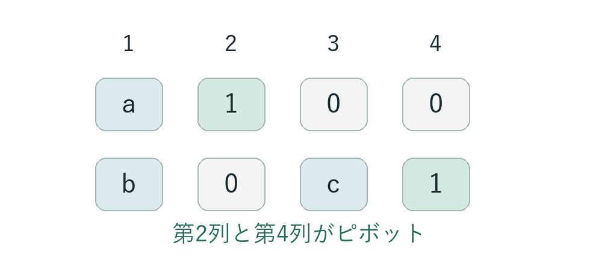

## 直線を選ぶことから二平面を選ぶことへ

複素射影空間では、固定空間 $\mathbb C^{n+1}$ の中から直線を選んだ。そして選んだ直線を束にするだけでK環を生成できた。ここでは $\mathbb C^4$ の中から二平面を選ぶ。空間を $G=\operatorname{Gr}_2(\mathbb C^4)$ と書き、選んだ二平面そのものを載せる束を $S$ とする。商束 $Q=\mathbf1^4/S$ も階数2である。

$$
0\longrightarrow S
 \longrightarrow\mathbf1^4
 \longrightarrow Q
 \longrightarrow0 .
$$ {#eq-19-tautological}

@eq-19-tautological は、束の差の一つの関係を与える。しかし $\operatorname{rank}S=2$ なので、行列式線 $\det S$ だけで $S$ の全ての情報が決まるわけではない。この章では、行列式から来る二次の生成元と、階数2の束そのものから来る四次の生成元を分け、両方が必要なことを計算する。

## 行簡約でセルを数える

二平面を、独立な二つの行を持つ $2\times4$ 行列の行空間で表す。行ごとに右端の非零位置をピボットとし、ピボットを1、別の行のその位置を0にする。二つのピボットを $i<j$ とする。この形の行列は、$i$ の左側に $i-1$ 個、$j$ の左側で別のピボットを除いて $j-2$ 個の自由な複素数を持つ。

たとえば $i=2,j=4$ では

$$
\begin{pmatrix}
a&1&0&0\\
b&0&c&1
\end{pmatrix}
$$

となる。このピボットの組の全体は $\mathbb C^3$。一方 $i=1,j=4$ なら自由度は0と2で、全体は $\mathbb C^2$。境界でどのセルが現れるかは、標準の旗との交わりの次元が増える条件で決まる。ここでは、このSchubert分解が偶数実次元のCW分解を与えることを用いる。

@fig-19-pivots を参照。

{#fig-19-pivots}

| ピボット $(i,j)$ | 複素次元 $i+j-3$ | 実セル次元 |
|---|---:|---:|
| $(1,2)$ | 0 | 0 |
| $(1,3)$ | 1 | 2 |
| $(1,4)$ | 2 | 4 |
| $(2,3)$ | 2 | 4 |
| $(2,4)$ | 3 | 6 |
| $(3,4)$ | 4 | 8 |

: 二平面の行簡約で得るSchubertセル。中間の4次元に二枚ある。 {#tbl-19-cells}

@tbl-19-cells と第8章から、$H^{2j}(G;\mathbb Z)$ の階数は下から $1,1,2,1,1$、奇数群はゼロ。同じ理由で $KU^0(G)$ は自由アーベル群で階数6、$KU^1(G)=0$。しかし加法の階数からは、どの束を掛ければ二つある四次成分を区別できるかは分からない。

## 二つのChern類を別々に作る

$h=c_1(S^*)$、$e=c_2(S^*)$ と置く。 @eq-19-tautological の双対から $c(S^*)c(Q^*)=1$。$Q^*$ のChern類を $h',e'$ とすれば、

$$
(1+h+e)(1+h'+e')=1.
$$ {#eq-19-total-chern}

ここで $h,h'$ は二次、$e,e'$ は四次の類である。次数ごとに比べると $h'=-h$、$e'=h^2-e$。残りの二つの条件を代入して整理すれば、

$$
h^3=2he,\qquad h^2 e=e^2.
$$ {#eq-19-chern-relations}

これらが十分な関係かどうかを見るには、$h^2,e$ が四次の整数基底になることを確かめなければならない。そのために、幾何学的な切断で $e$ を表して積分を出す。

### 線形汎関数を二平面へ制限する

非零の線形汎関数 $\varphi:\mathbb C^4\to\mathbb C$ がある。各二平面 $P$ へ制限すると $S^*$ の切断になる。この切断がゼロであることは $P\subset\ker\varphi$ と同値。従って零点は

$$
Z_\varphi=\operatorname{Gr}_2(\ker\varphi)
          \cong\operatorname{Gr}_2(\mathbb C^3)
          \cong\mathbb CP^2 .
$$ {#eq-19-section-zero}

最後の同型では、二平面の消去空間である双対の直線を選ぶ。零点上で微分を取ると、$\operatorname{Hom}(P,\mathbb C^4/P)$ のうち $\ker\varphi$ の外へ向かう方向が $P^*$ へ全射に写る。従って切断は横断的であり、零点の基本類が $e$ に双対である。

互いに独立な $\varphi,\psi$ を取れば、二つの零点の共通部分は $\operatorname{Gr}_2(\ker\varphi\cap\ker\psi)$。核の共通部分は二次元なので、二平面はそのもの一つだけである。二つの法方向は独立で横断的であり、複素向きで局所符号は正。ゆえに、

$$
\int_G e^2=1.
$$ {#eq-19-e-square}

次に $Z_\varphi$ の上で $h$ を読む。$P\subset\ker\varphi$ の商は一次元で、$\det P^*$ は固定の行列式線を除いてその商線に同型である。消去空間として定めた双対射影空間で、商線は $\mathcal O(1)$ に当たる。従って制限した $h$ の二乗の積分は1であり、

$$
\int_G h^2e=1.
$$ {#eq-19-h-square-e}

@eq-19-chern-relations を $h$ 倍すれば $\int_G h^4=2$ も分かる。従って $h$ による超平面で四回切ると、一般位置で二点が現れる。これは後でPlücker座標の二次方程式からも確かめる。

### 整数基底を対で確認する

四次の類 $h^2,e$ の交差行列は、 @eq-19-e-square と @eq-19-h-square-e から

$$
\begin{pmatrix}
2&1\\
1&1
\end{pmatrix}.
$$ {#eq-19-middle-pairing}

行列式は1。$G$ は閉じた複素四次元多様体なので、Poincaré双対によりねじれの無い中間コホモロジーの交差対は整数上で完全である。$h^2,e$ の張る格子の指数の二乗が、制限した交差行列の行列式の絶対値になる。従って指数は1であり、この二元は整数基底である。

二次の $h$ は $Z_\varphi\cong\mathbb CP^2$ の中の直線で積分すれば1になるため、原始的である。六次の $he$ は $h$ と対にすると1、八次の $e^2$ は基本類で評価すると1。従って全体の加法基底は

$$
1,\ h,\ h^2,\ e,\ he,\ e^2.
$$

これで、 @eq-19-chern-relations が定める環が他の隠れた整数関係を持たないことを確かめられる。単に有理化した次元を合わせただけでは、 @eq-19-middle-pairing の格子の指数を取り逃す。

## 外積べきからK環の生成元を作る

K群で線束の第一Chern類に対応する差は $[L]-1$ だった。階数2の束では、分裂原理により $S^*=L_1\oplus L_2$ と見たときの二つの差

$$
a=[L_1]-1,\qquad b=[L_2]-1
$$

を使う。元の $G$ で定義される対称な元は

$$
x=[S^*]-2,\qquad
y=[\det S^*]-[S^*]+1 .
$$ {#eq-19-k-generators}

引き戻して線束に分ければ $x=a+b$、$y=ab$。従って $y$ は二つの階数ゼロの差を両方含んでおり、Chern指標の最初の項は四次である。

$$
\operatorname{ch}(x)=h+\text{高次項},\qquad
\operatorname{ch}(y)=e+\text{高次項}.
$$ {#eq-19-leading-classes}

第二の式は $\operatorname{ch}(ab)=(e^{c_1(L_1)}-1)(e^{c_1(L_2)}-1)$ の最低次から分かる。従って $x^2$ と $y$ を比較したとき、どちらも最初は四次だが、その値は $h^2$ と $e$ で別方向である。

### 直和に対応する生成関数

階数 $r$ の束 $E$ に対し、次の多項式を使う。

$$
\Gamma_s(E)=\bigl((1-s)^r\bigr)\,
             \lambda_{s/(1-s)}(E).
$$ {#eq-19-gamma}

第9章の外積生成関数を代入したもの。分裂後に一本の線束 $L$ で計算すれば $(1-s)(1+[L]s/(1-s))=1+([L]-1)s$。従って $\Gamma_s(E)$ は、線束との差を根に持つ基本対称式を並べている。直和に関して積になり、自明束なら1になる。

$Q^*$ の対応する元を $x',y'$ と書くと、 @eq-19-tautological から

$$
(1+xs+ys^2)(1+x's+y's^2)=1 .
$$ {#eq-19-gamma-relation}

係数を比較すれば $x'=-x$、$y'=x^2-y$ であり、さらに

$$
x^3=2xy,\qquad x^2y=y^2 .
$$ {#eq-19-k-relations}

形式の見た目は Chern 類の関係 @eq-19-chern-relations と同じだが、こちらは位相的K群にある整数の束の差の式である。偶然ではなく、直和を積へ送る生成関数を二通りに使った結果である。

### 整数K群で十分な生成元だと確認する

$KU^0(G)$ は自由群で、偶数セルのスペクトル系列は崩壊した。各濾過でChern指標の最初の次数を取ると、対応する球面のBott元の指標の値は1。従って @eq-19-leading-classes の係数は、有理化しただけでなく各層の整数生成元を指定する。

具体的に $x$ は階数0なので $F^2$ に属する。一方、$y$ は階数0であり、二次のChern指標がゼロなので2骨格でゼロ。2骨格の縮約K群は自由で、二次の指標で単射に測れるからである。従って $y\in F^4$。積の濾過により $xy\in F^6$、$y^2\in F^8$。最初の層を順に取れば、

$$
1,\ x,\ x^2,\ y,\ xy,\ y^2
$$ {#eq-19-k-basis}

は先ほどのコホモロジーの整数基底にちょうど対応する。各層で係数を引き、残りを次の層へ進めれば、 @eq-19-k-basis は絶対K群の整数基底になる。

さらに @eq-19-k-relations だけで全ての多項式をこの基底で書ける。例えば $x^3y=2xy^2$ である一方、$x^3y=x(x^2y)=xy^2$。従って $xy^2=0$、また $y^3=x^2y^2=0$。高いべきはこれらで消える。基底の独立性から新たな関係が無いと分かり、

$$
KU^0(G)\cong
\mathbb Z[x,y]/(x^3-2xy,\ x^2y-y^2)
$$ {#eq-19-grassmann-ring}

を得る。射影空間の一変数環から一段進むだけで、四次の二方向を持つ環が現れた。

## Plücker座標で幾何を照合する

二平面の基底を $u,v$ とすれば、二重外積 $u\wedge v$ は $\Lambda^2\mathbb C^4$ のベクトルである。基底を変えるとその行列式が掛かるため、得られる射影点は一定。従って $G$ は $\mathbb P(\Lambda^2\mathbb C^4)\cong\mathbb CP^5$ に写る。

外積の成分を $p_{ij}$ とする。分解可能な二重ベクトル $\omega=u\wedge v$ では $\omega\wedge\omega=0$。成分を展開すると、

$$
p_{12}p_{34}-p_{13}p_{24}+p_{14}p_{23}=0 .
$$ {#eq-19-plucker}

逆に $p_{12}\ne0$ として $p_{12}=1$ に規格化すれば、二つのベクトルの最初の二成分を $(1,0),(0,1)$ に固定できる。$p_{13},p_{14},p_{23},p_{24}$ で残りの四成分を決めると、最後の $p_{34}$ は @eq-19-plucker が要求する通りになる。任意の非零成分を最初の組へ移せるため、この一つの二次式が全体の像を記述する。

従って $G$ は $\mathbb CP^5$ の滑らかな二次超曲面である。射影超平面の線束の引き戻しは $\det S^*$ であり、第一Chern類は $h$。次数2の超曲面なので $\int_G h^4=2$。 @eq-19-chern-relations と @eq-19-h-square-e の計算と合う。

### 接束の二通りの表示

平面を局所的にグラフで動かせば、接束は $\operatorname{Hom}(S,Q)$。従って第一Chern類は $2c_1(S^*)+2c_1(Q)=4h$。一方、滑らかな二次超曲面の法束は $\mathcal O(2)|_G$ だから、第11章のEuler完全列を使うと

$$
[TG]=6[\mathcal O_G(1)]-1-[\mathcal O_G(2)] .
$$ {#eq-19-tangent-quadric}

Chern指標の次数二は $6h-2h=4h$、次数四は $(6/2-4/2)h^2=h^2$。従って $c_2(TG)=7h^2$。二通りの接束表示は、少なくとも第一Chern類を直接同じ値にする。このように一つの空間を二通りの幾何で見ると、向きや次数を独立に検算できる。

また $\mathcal O_G(k)$ の指数は、二次方程式の層の完全列と第11章の代数側の式により

$$
\chi(G;\mathcal O_G(k))
=\binom{k+5}{5}-\binom{k+3}{5}.
$$ {#eq-19-quadric-index}

$k=0$ では1、$k=1$ では6。$k=2$ では20であり、$\mathbb CP^5$ の二次多項式21個から、関係 @eq-19-plucker 一個を引いた値である。

## 演習と解答

### 1　二つの四次類を同じものと仮定すると何が壊れるか

$e=h^2$ と仮定して、 @eq-19-middle-pairing を使って矛盾を出せ。

**解答。** 仮定すれば $\int e^2=\int h^4$ だが、前者は1、後者は2。これを避けるには四次で独立な生成元を残す必要がある。実際、行列式線から作った $x^2$ に加え、階数2の $S^*$ の外積べきから作った $y$ がその方向を表す。

### 2　方程式から二次の切断数を求める

$\mathcal O_G(2)$ の正則切断の次元を求め、高次群が消える理由を説明せよ。

**解答。** $0\to\mathcal O_{\mathbb CP^5}(0)\to\mathcal O_{\mathbb CP^5}(2)\to\mathcal O_G(2)\to0$。第11章の単項式計算では左二項に高次コホモロジーが無い。従って長完全列から右も高次でゼロ、$H^0$ の次元は $21-1=20$。交代和を出しただけではこの個別次数は分からず、ここでは消滅を別に用いた。

### 3　K群で最高次の係数だけを出す

@eq-19-k-relations で $x^4$ を基底表示せよ。また四次のChern指標を最初に持つ元 $y$ と比べよ。

**解答。** $x^4=2x^2y=2y^2$。Chern指標の最上次で積分すると2。$y^2$ の最上次は $e^2$ で積分1である。K群の実際の整数関係が、幾何で数えた $\int h^4=2$ を再現している。

## 参考

Grassmann多様体のSchubert分解とトートロジー束の特性類については Hatcher の第1章 §2 と第3章を参照。本章の小さい例では、中間格子の基底を交差行列の行列式1で点検し、そのうえでK環を整数係数で決定した。 [Vector Bundles and K-Theory](https://pi.math.cornell.edu/~hatcher/VBKT/VB.pdf)
