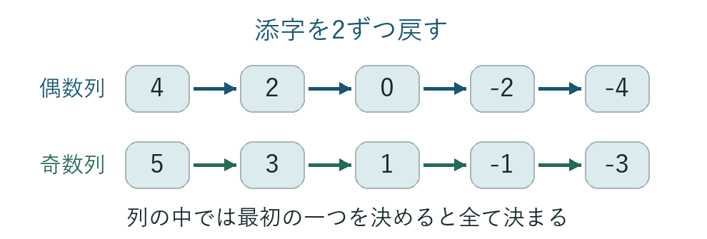
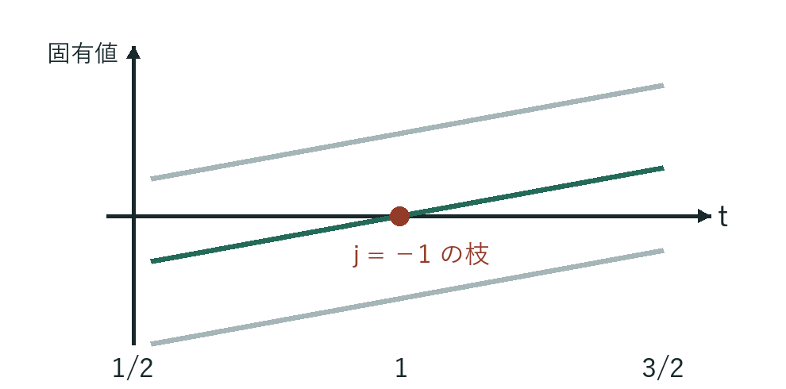

::: {.ku-chapter}
**章の導入**　正方形を貼ってできるトーラス上で、線束に値を持つ方程式を解く。境界での貼り方がFourier係数の添字をずらし、解が何組に分かれるかを決める。
:::

## トーラスでも二つの計算法を突き合わせる

**導入。** 一つの整数を解析と位相から独立に出すため、線束と方程式を固定する。

球面では、正則座標の重なりで Laurent 係数を比較し、指数を求めた。トーラスでは曲面を正方形に切り開けるため、周期的な方向のFourier係数を先に取り出せる。もう一方の方向を一周したときに、係数の添字がずれる。これが第1章のトーラスの貼り合わせの解析的な姿である。

$T^2=\mathbb R^2/\mathbb Z^2$ に複素座標 $z=x+iy$ を入れる。係数の線束を、正方形で

$$
s(x,y+1)=s(x,y),\qquad
s(x+1,y)=e^{-2\pi i m y}s(x,y)
$$ {#eq-20-torus-boundary}

を満たすものとする。境界の向きは[第1章のトーラスの規約](01-clutching.qmd#eq-01-torus-gluing)と同じであり、右の値は左の値に $e^{-2\pi i m y}$ を掛けたもの。$m$ は整数だから、二つの周期を交換しても因子は一致する。

係数に入れるユニタリ接続は $d+2\pi i m x\,dy$。この接続の $(0,1)$ 成分を取ると、$d\bar z/2$ の係数として現れる作用素は

$$
D_m=\partial_x+i\partial_y-2\pi m x .
$$ {#eq-20-torus-operator}

@eq-20-torus-operator の最後の項は周期的な実数関数ではない。しかし @eq-20-torus-boundary の右側の位相を $y$ で微分すると $+2\pi m$ の項が出るので、$x$ を1動かしたことによる $-2\pi m$ と相殺する。そのため $D_m$ は大域的な作用素になる。

具体的には $h(y)=e^{-2\pi i m y}$ として再計算すると、

$$
\begin{aligned}
(\partial_x+i\partial_y-2\pi m(x+1))(h s)
  &=h(\partial_x+i\partial_y-2\pi m x)s .
\end{aligned}
$$ {#eq-20-compatibility}

この式が無ければ、正方形上では微分を書けても、同一視された点で作用素の値が合わない。主シンボルは $\xi$ による複素数の掛け算で、非零の余接ベクトルでは可逆。したがって第6章のFredholm性と正則性を使える。

::: {.ku-summary}
**まとめ**　貼り合わせの次数が両方の計算の共通入力になる。
:::

## Fourier係数は境界で添字を変える

**導入。** 縦方向だけをFourier展開し、横の端で係数がどう移るかを見る。

$y$ はそのまま周期1なので、滑らかな切断の係数を

$$
s(x,y)=\sum_{j\in\mathbb Z} a_j(x)e^{2\pi i j y}
$$ {#eq-20-fourier}

と展開できる。 @eq-20-torus-boundary を代入して指数を一つずつ比べれば、

$$
a_j(1)=a_{j+m}(0).
$$ {#eq-20-shift}

これが境界の接続条件である。$m=0$ なら各Fourierモードが自分自身に戻る。一方 $m\ne0$ なら、添字 $j$ は $j+m$ へ移る。したがって独立な列は個々の $j$ ではなく、整数を $|m|$ で割った剰余類ごとにある。

@fig-20-fourier-tracks を参照。例えば $m=-2$ では、赤道の回転に相当する境界の位相が、偶数列と奇数列を独立にずらす。

{#fig-20-fourier-tracks width="82%"}

::: {.ku-summary}
**まとめ**　端の位相を掛けると係数の添字が次数だけずれる。
:::

## 核を常微分方程式で求める

**導入。** 各係数の微分方程式を解き、端の条件を係数の漸化式へ入れる。

@eq-20-fourier を $D_m s=0$ へ代入する。$i\partial_y$ は $j$ モードで $-2\pi j$ だから

$$
a_j'(x)=2\pi(j+mx)a_j(x).
$$ {#eq-20-kernel-ode}

よって

$$
a_j(x)=C_j\exp(2\pi j x+\pi m x^2).
$$ {#eq-20-ode-solution}

境界条件 @eq-20-shift と組み合わせると、初期値 $C_j$ は

$$
C_{j+m}=C_j\exp(2\pi j+\pi m)
$$ {#eq-20-coefficient-recurrence}

を満たす。剰余類の代表 $r$ を一つ選び、この式を正負の両方向に繰り返す。整数 $\ell$ に対し、

$$
C_{r+\ell m}
=C_r\exp(2\pi r\ell+\pi m\ell^2).
$$ {#eq-20-gaussian-chain}

::: {.ku-worked}
**計算を追う｜漸化式の指数を足す**

$\ell\ge1$ として、$C_{r+tm}$ から $C_{r+(t+1)m}$ に移るたびに現れる指数を、$t=0$ から足す。

$$
\begin{aligned}
\sum_{t=0}^{\ell-1}\bigl(2\pi(r+tm)+\pi m\bigr)
 &=2\pi r\ell+2\pi m\,\frac{\ell(\ell-1)}2+\pi m\ell\\
 &=2\pi r\ell+\pi m\ell^2 .
\end{aligned}
$$

$m=-2$ なら偶数の添字と奇数の添字が別の列を作り、どちらにも負の二次項 $-2\pi\ell^2$ がある。$m=2$ に替えると二次項が正になり、非零の初期値から始める限り両端で成長する。解の個数を決めるのは、列が何本あるかと、各列の係数が減衰するかの二つである。
:::

正の方向に $\ell$ を一つ増やすと、指数の差は $2\pi r+\pi m(2\ell+1)$ であり、 @eq-20-coefficient-recurrence の $j=r+\ell m$ を再現する。負の方向にも同じ差を逆に使えるため、 @eq-20-gaussian-chain は全ての整数 $\ell$ について成立する。

### 成長か減衰かで自由度が分かれる

$m>0$ とする。 @eq-20-gaussian-chain の指数の二次係数は正なので、$C_r\ne0$ なら $x=0$ でのFourier係数は無限の両端で発散する。滑らかな周期関数の係数は少なくとも二乗可算でなければならない。従って全ての $C_r$ はゼロであり、核はゼロである。

反対に $m<0$ なら、二次の負項が両方向の線形項を支配する。 @eq-20-ode-solution に $j=r+\ell m$ を代入すれば、$0\le x\le1$ に一様なGaussian減衰を得る。$x,y$ の任意の微分を施しても増えるのは $\ell$ の多項式程度なので、全階数で級数が一様収束する。境界で係数は @eq-20-shift により一致し、 @eq-20-kernel-ode を繰り返し微分すると、対応する微分も一致する。従って滑らかな大域切断を得る。

各剰余類の $C_r$ を自由に選べて、異なる剰余類は互いに異なるFourier成分に載る。ゆえに $m<0$ の場合、核の次元は $|m|$ である。$m$ の符号だけでなく、$|m|$ が剰余類の本数として現れた。

### 具体的な解を一つ書き下ろす

$m=-1$ なら剰余類は一つ。$r=0$、$C_0=1$ と選ぶと、$j=-\ell$ で $C_j=e^{-\pi\ell^2}$。 @eq-20-ode-solution に代入して、

$$
s(x,y)=
 \sum_{\ell\in\mathbb Z}
     e^{-\pi(\ell+x)^2}e^{-2\pi i\ell y}.
$$ {#eq-20-theta}

この式を $x+1$ で評価し、添字 $\ell+1$ を新しい整数として置き換えると、全体に $e^{2\pi i y}$ が掛かる。これは $m=-1$ の @eq-20-torus-boundary である。さらに $x$ 微分は $-2\pi(\ell+x)$、$i\partial_y$ は $+2\pi\ell$、$-2\pi m x$ は $+2\pi x$ を掛けるため、各項が $D_{-1}$ でゼロになる。指数の数を算出するだけでなく、具体的な非零の解を作れた。

::: {.ku-summary}
**まとめ**　減衰する場合に剰余類ごとに一つの解が残る。
:::

## 余核は随伴を同じ方法で解く

**導入。** 随伴にも同じ展開を行い、減衰の符号を確かめる。

$L^2$ の内積で形式的随伴を求める。$y$ 方向は周期だから $\partial_y^*=-\partial_y$。複素共役で $i$ も負号になるため、$i\partial_y$ は自己共役。$x$ 方向では境界の二辺の内積が同じになる。 @eq-20-torus-boundary の位相がユニタリであり、被積分関数の二つの係数に反対の位相が掛かるからである。従って

$$
D_m^*=-\partial_x+i\partial_y-2\pi m x .
$$ {#eq-20-adjoint}

余核はこの随伴の核に同一視できる。第6章の閉像と楕円正則性により、滑らかな解だけを調べればよい。 @eq-20-adjoint で $j$ モードを取ると、

$$
a_j'(x)=-2\pi(j+mx)a_j(x).
$$ {#eq-20-adjoint-ode}

従って @eq-20-gaussian-chain の指数の符号が反転する。$m>0$ なら減衰するので次元 $m$、$m<0$ なら成長するのでゼロ。普通の核と逆になっている。$m=0$ の場合は、境界条件が $a_j(1)=a_j(0)$ であり、$j=0$ の定数しか許さない。よって両方とも1次元である。

| $m$ | 核の次元 | 余核の次元 | 指数 |
|---:|---:|---:|---:|
| $m>0$ | $0$ | $m$ | $-m$ |
| $m=0$ | $1$ | $1$ | $0$ |
| $m<0$ | $-m$ | $0$ | $-m$ |

: Fourier係数におけるGaussianの符号で、核と余核の側が入れ替わる。 {#tbl-20-index}

@eq-20-shift は、核にも随伴核にも全く同じである。従ってそれぞれで許される剰余類の本数は同じ候補 $|m|$。実際の次元に寄与するのは、二乗可算性を満たす方だけである。

::: {.ku-summary}
**まとめ**　核と余核で減衰する次数の符号が入れ替わり、その差が指数になる。
:::

## 位相の計算はどの情報を使ったか

**導入。** 接続の曲率を計算し、トーラスの特性類で積分を簡約する。

トーラスの複素接線束は $x,y$ の一定のフレームで自明になる。従ってTodd類は1である。一方、係数線束の接続の曲率は

$$
F=2\pi i m\,dx\wedge dy.
$$

規格化 $i/(2\pi)$ を掛けると $c_1=-m[dx\wedge dy]$。第11章のDolbeault指数の式をこの曲面に適用すると

$$
\operatorname{ind}D_m
 =\int_{T^2}\bigl(1+c_1\bigr)\cdot1
 =-m .
$$ {#eq-20-topological-index}

ここでは面積を正方形の面積1に規格化した。 @eq-20-topological-index は境界の貼り合わせの巻き数だけを使い、Gaussianの係数を解いていない。一方 @tbl-20-index では、Fourier係数の成長から核と余核を別々に求めた。二つを比較すると、どの情報が指数で消え、どの情報が残ったかが明確になる。

例えば $m=0$ とし、接続に平坦な項 $2\pi i a\,dx$ を足す。曲率は同じで指数は0のまま。しかし $a\notin\mathbb Z$ なら、$x$ を一周したときに定数モードの位相が合わなくなり、核と余核はともに消える。従って同じ曲率と同じ指数を持っても、実際の解の自由度は変化し得る。

### 球面とトーラスで定数項を比較する

球面の係数が $\mathcal O(k)$ では、指数は $k+1$ であった。$k$ が係数線束のChern数、$1$ が接束のTodd項。今回のトーラスで係数線束のChern数は $-m$ であり、接束は自明なので定数項はゼロになる。この違いは座標の選び方ではなく、曲面自身の接束がどれだけねじれているかにある。

解析側でも対応がある。球面では二枚のチャートと重なりがあり、二つの指数範囲の穴と重複を数えた。トーラスでは一方向のFourier展開と、もう一方向での添字の移動を比べた。異なる方法で核と余核を得ても、接束と係数束の位相から得る差と一致する。

::: {.ku-summary}
**まとめ**　貼り目の整数が第一Chern数となり、解析側の指数を再現する。
:::

## 一周するスペクトルを数える別の模型

**導入。** 一つの周波数の固有値が零を通る向きを見る。

最後に、同じ「指数の整数」を一つの実パラメータに沿って見る。円周上の複素関数に対し、

$$
A_t=-i\,\frac{d}{d\theta}+t,
\qquad \tfrac12\le t\le\tfrac32
$$ {#eq-20-spectral-family}

を考える。正規直交基底 $e^{ij\theta}$ での固有値は $j+t$。各 $t$ で自己共役な作用素だが、$t$ が動く間に一つの固有値がゼロを横切る。

端点では $t$ が1だけ違う。$U$ を $z$ の掛け算とすれば $U^* A_t U=A_{t+1}$。従って端点の作用素はユニタリ同値であり、添字の付け替えを含めれば一周の族になっている。横切るのは $j=-1$ の枝で、$t=1$ において負から正へ移る。負から正を正に数える**スペクトル流**は $+1$ である。

@fig-20-flow を参照。

{#fig-20-flow width="76%"}

### 無限に多い固有値で、実際には何を数えるか

一般の離散スペクトルを持つ場合、ゼロの小さい近傍に入る固有値だけを選ぶ。パラメータ区間を小区間へ分け、各小区間である $\varepsilon>0$ が選べて $\pm\varepsilon$ に固有値が来ないなら、その区間では $[-\varepsilon,\varepsilon]$ のスペクトル空間の次元が一定になる。その中で非負の側の次元の終点と始点の差を取る。端点にゼロを含める規約を揃えると、切り分けを細かくしたときの中間の次元は相殺する。

$\varepsilon$ を変えても、その差に追加されるのはゼロから離れた固定の帯域の次元だけである。その帯域の両端に固有値が来ないよう同じ小区間で選べば、追加した次元は始点と終点で等しく、差には影響しない。これで一周での通過数が、無限個全ての固有値の個数を引く操作ではなく、有限な帯域の差として定義される。

@eq-20-spectral-family の族では、$t=1$ の周りで $j=-1$ の一成分だけを取ればよい。右シフトToeplitzの指数は第10章で $-1$ だった。その符号との差は、ここでは負から正への通過を正に数え、右シフトでは欠けた右辺の成分を負に数えたためである。一般のスペクトル流と作用素の指数の関係については、同一視の向きと作用素の符号を指定する必要がある。

::: {.ku-summary}
**まとめ**　固有値を一周後に並べ直すと、添字のずれを通過数として数えられる。
:::

## 演習と解答

**導入。** 次数の符号を替え、漸化式と解の次元を確かめる。

### 1　添字のずれを二回起こす

$m=-2$ では核の基底をどのように選べるか。係数の式を用いて答えよ。

**解答。** 剰余類の代表を $r=0,1$ とする。各代表で $C_r=1$、他方の代表を0にし、 @eq-20-gaussian-chain で全ての係数を決める。二つの級数は偶数と奇数の異なるFourierモードに載るため独立。どちらも $m=-2$ の負の二次項によって収束し、境界条件を満たす。従って核の次元は2。

### 2　非零の右辺の障害を具体的に書く

$m=1$ とする。ある右辺 $f$ に対する方程式 $D_1 s=f$ の可解条件は何か。

**解答。** @tbl-20-index から核は0、余核は1次元。 @eq-20-adjoint-ode を用いると随伴の核は

$$
u(x,y)=\sum_{\ell\in\mathbb Z}
          e^{-\pi(\ell+x)^2}e^{2\pi i\ell y}
$$

で張られる。これは @eq-20-theta の複素共役で、境界条件が $m=1$ のものへ変わる。従って可解条件は $\int_{[0,1]^2}\overline u\, f\,dx\,dy=0$。満たせば解は存在し、核がゼロなので一意である。

### 3　指数と解の空間を区別する

$m=0$ に対し $D_0+2\pi i a$ を考える。$a\in\mathbb R$ のとき、どの $a$ で核が非零か。

**解答。** 二変数のFourier基底 $e^{2\pi i(px+qy)}$ 上で、固有値は $2\pi i(p+a)-2\pi q$。これがゼロであるためには $q=0$、$p=-a$ が必要。従って $a$ が整数の場合に限り核は1次元。随伴も同じ次元を持つため、指数はすべての $a$ で0である。平坦な接続を変える操作では、貼り合わせのChern数は変わらない。

::: {.ku-summary}
**まとめ**　核、余核、指数がそれぞれどこで決まるかを分けて検算できる。
:::

## 三つの計算を持ち帰る

**導入。** 係数列、曲率、固有値を一つの貼り方へ戻して照合する。

正方形の左右で位相を貼ると、境界積分では巻き数が残った。Fourier係数では同じ回転が添字の移動として残り、Gaussianの減衰で解の側を選んだ。最後に、曲面のTodd類と係数線束の第一Chern類を掛けた積分が、その解の差を一つの整数へ圧縮した。局所の座標、絶対のK類、解析的な可解条件の役割の違いを、一つの @eq-20-torus-boundary から順に追える。

::: {.ku-summary}
**まとめ**　同じ整数が、周期境界のずれと幾何的な曲率で別々に読める。
:::

::: {.ku-chapter}
**章のまとめ**　境界の回転が係数列の剰余類、曲率の積分、固有値の通過数の三つに現れた。次章はどの作用素を選ぶと何を数えるかを比べる。
:::
